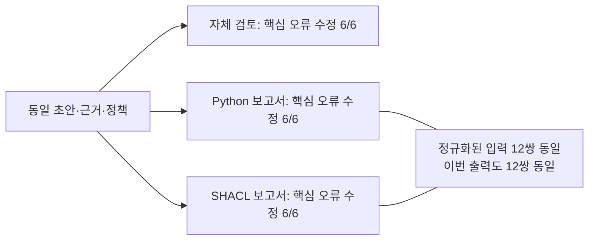

# 동일 초안 검토 36건의 첫 실행 결과

2026년 11월 10일, 가상 공장 6개 사례에 작성한 정상·오류 초안 12개를 자체 검토, Python 보고서, SHACL 보고서 조건으로 나눠 최종 답변을 생성했다. 총 36회 호출이 모두 완료됐다. 이번 작은 사례 집합에서는 검사 보고서가 핵심 판단을 추가로 개선한 결과를 확인하지 못했다.

## 실행 범위와 비용

모델은 `google/gemini-3.8-flash`, 제공업체는 `google-ai-studio`로 고정했다. temperature 0, seed 42, 최대 출력 2048토큰, 낮은 reasoning effort를 사용했다. 추가 조회나 자동 재시도는 없었다. 모델 별칭 고정이 가중치의 불변성이나 완전한 재현성을 보장하지는 않는다.

| 항목 | 관측 결과 |
|---|---:|
| 계획한 최종 답변 | 36건 |
| 완료 / 실패 / 미실행 | 36 / 0 / 0 |
| 이번 실행 보고 비용 | USD 0.06954000 |
| 이번 실행 비환급 비용 예약 | USD 1.01463150 |
| 기존 사용분을 포함한 누적 보고 비용 | USD 0.19274850 |
| 누적 비환급 예약 / 승인 상한 | USD 2.31670200 / 5.00 |
| 미확정 비용 | 0건 |

보고 비용과 보수적 예약액은 다르다. 실패가 발생해도 예약액을 되돌리지 않는 원장을 사용했다. 이번 단일 사이클 종료 후 새 호출을 차단했다. 준비된 입력과 원래 초안은 수정하지 않았다.

## 핵심 판단의 수동 검토

아래 집계는 조정자가 조건을 알고 답변 전체를 읽은 결과다. 독립적인 블라인드 평가나 문장별 사실 정확도 점수가 아니다.

| 검토 조건 | 오류 초안의 핵심 오류 수정 | 정상 초안의 핵심 판단 유지 |
|---|---:|---:|
| 자체 검토 | 6/6 | 6/6 |
| Python 보고서 | 6/6 | 6/6 |
| SHACL 보고서 | 6/6 | 6/6 |

단순 배정 오류, 자격 만료, 서로 다른 자격 기록의 조건 혼합, 조회 누락을 원천 부재로 단정한 오류, 자격 통과를 납기·안전 보장으로 확대하는 오류가 모두 수정됐다. 정상 초안도 핵심 판단을 유지했다. 답변 길이와 표현은 달라졌다. 필요한 불확실성 표시는 불필요한 보류로 세지 않았다.

인용 ID는 36개 답변 모두 제공된 근거 ID 안에 있었다. 이는 인용 식별자 검사이며 각 문장이 근거로 완전히 뒷받침되는지 평가한 점수는 아니다. 검토 메모의 실행 가능성도 이번에 수치화하지 않았다. 일부 답변은 구체적인 후속 확인 지시보다 오류 설명과 정책 한계를 반복한다.

## 대표 사례의 실제 답변

서로 다른 자격 기록을 합치는 사례의 오류 초안은 다음과 같다.

> Q03으로 P-A 자격이 확인되고 Q03B로 유효한 CAP-CUT 자격이 확인되므로 M03은 조건을 충족합니다. [E2]

자체 검토는 다음과 같이 설명했다.

> 초안에서는 Q03과 Q03B의 속성을 분리하여 각각 자격이 충족되는 것처럼 서술하였으나, 정책 규정상 단일 자격 기록 내에서 제품(`product`), 역량(`capability`), 유효 기간(`validity dates`)을 모두 동시에 충족해야 합니다.

SHACL 보고서 조건도 같은 핵심 오류를 수정했다.

> 초안은 Q03과 Q03B를 조합하여 조건을 충족한다고 결론지었으나, 단일 자격 기록 내에서 제품(P-A)과 역량(CAP-CUT) 및 기준일(2026-11-09) 유효기간이 모두 충족되어야 합니다.

따라서 이 사례는 조건 혼합 오류를 설명하는 데는 유용하지만 이번 실행에서 SHACL 보고서만의 추가 효과를 보여주지는 못했다.

## 동일한 Python·SHACL 입력

두 검사기의 정규화된 보고서가 같고 엔진 이름을 가렸으므로 Python·SHACL의 최종 입력은 12쌍 모두 같았다. 이번 실행에서는 출력 문자열도 12쌍 모두 같았다. 이를 서로 다른 엔진이 독립적으로 성능을 입증한 결과나 일반적인 완전 재현성으로 해석하지 않는다.

## 해석과 다음 단계

이번에는 짧은 근거와 명시적인 정책을 제공했다. 자체 검토만으로도 작성된 오류를 발견할 수 있었으므로 검사 보고서가 추가로 바꿀 핵심 판단이 없었다. 이 결과는 SHACL이 일반적으로 불필요하다는 뜻이 아니다. 반대로 보고서가 붙었다는 이유만으로 신뢰성이 높아졌다고 주장할 수도 없다.

다음 비교에서는 LLM이 실제 조회를 거쳐 만든 초안을 먼저 확보하고 맞은 답과 틀린 답을 모두 보존한 뒤 동일 초안으로 분기해야 한다. 여러 후보·연결 깊이·적용 조건이 늘어나는 경우를 사전에 정하고 자체 검토도 충분한 경우를 대조군으로 유지해야 한다. SHACL이 이기는 사례가 나올 때까지 조건을 바꾸고 성공한 사례만 제시하는 방식은 피한다.

현재 채팅 화면의 독립 실행과 이번 고정 입력 배치 실험은 별개다. 이번 결과는 신규 데이터베이스 조회나 전체 GraphRAG 파이프라인의 성능 측정이 아니라 작성된 초안의 최종 검토 단계 진단이다. 원문 답변과 조정자 판정은 `research/virtual-factory-llm-1/diagnostic/answers-001/`에 보존했다. [사례 정의와 입력 구성](../experiments/virtual-factory-diagnostic.md)은 별도 문서에 남아 있다.
