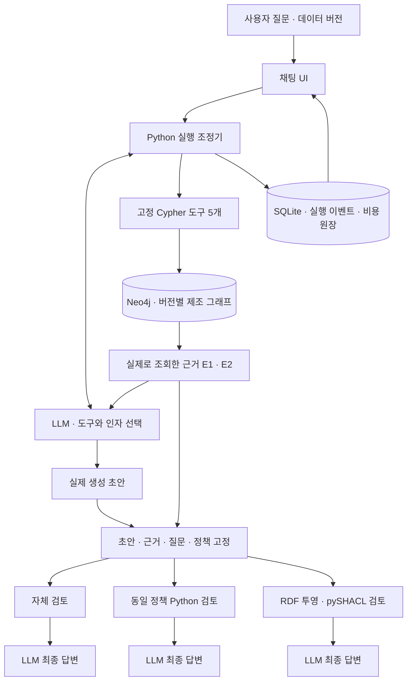
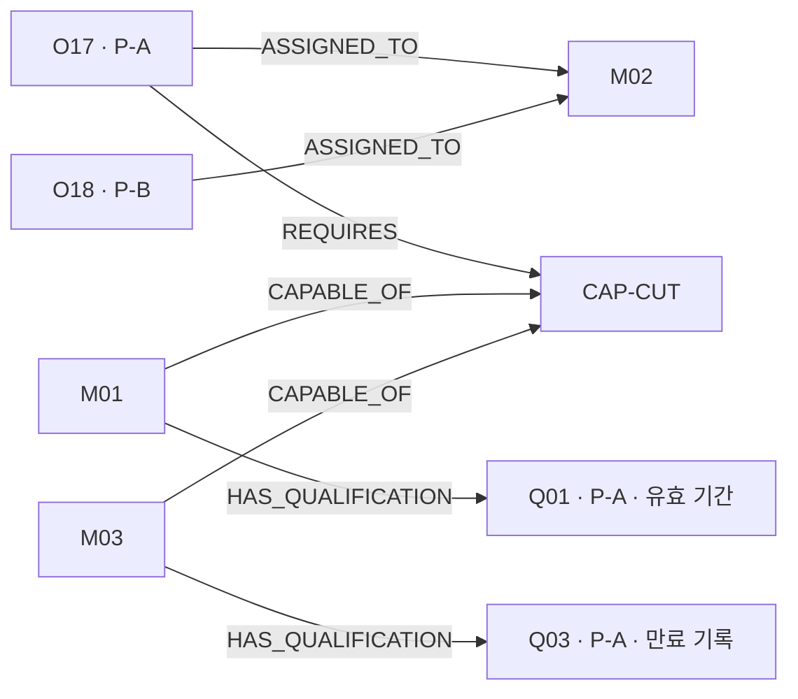
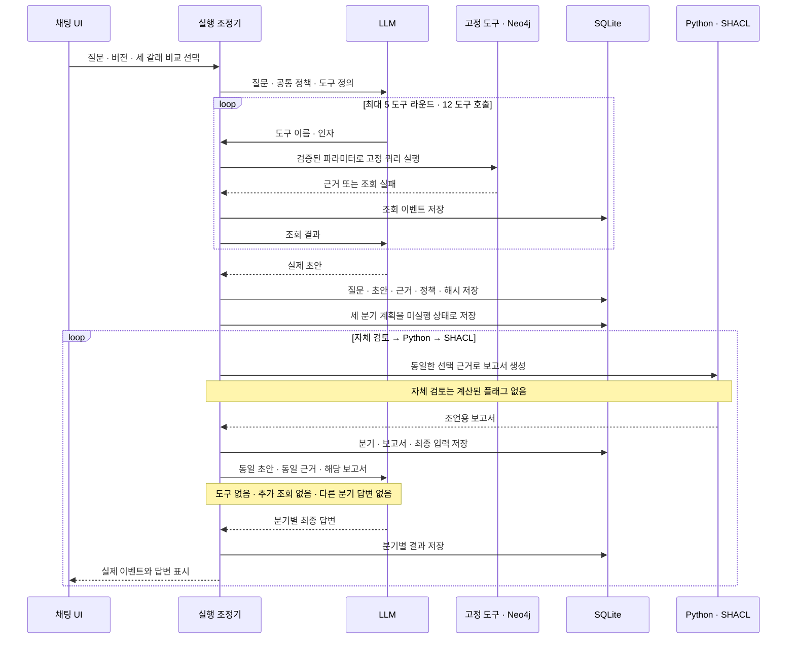

# 조회 템플릿과 실제 초안의 세 갈래 검토

## 연구 방향

이번 논의에서는 자유로운 Text2Cypher·Text2SPARQL 생성보다, 검수한 쿼리 템플릿을 찾고 인자를 채우는 경로를 우선하기로 했다. LLM이 쿼리와 가상 시나리오의 초안을 만들고 사람이 검수하는 방식도 후보에 포함한다. 이는 실무 위험과 운영 부담을 줄이려는 설계 판단이며 자유 쿼리 생성보다 우수하다고 측정한 결과는 아니다.

템플릿을 미리 작성해도 잘못된 선택·인자·조합은 남는다. 주문의 영향 범위를 찾는 질문에 대체 설비 조회만 실행할 수 있고 서로 다른 제품이나 시점의 결과를 연결할 수도 있다. 후속 연구는 검색 적중률뿐 아니라 질문의 범위, 조합의 입출력 타입, 버전·시점·완전성 조건을 함께 확인해야 한다. 지원하지 않는 질문을 명시하는 경로도 필요하다.

현재 앱에는 다섯 개의 도구가 있다. LLM에 모든 도구 정의를 전달하므로 쿼리 카탈로그 검색 인덱스는 아직 없다. 벡터 검색이나 자동 쿼리 조합기도 구현하지 않았다. 템플릿 검색과 조합은 이번 세 갈래 검토 구현과 분리한 후속 과제다.

## 현재 아키텍처

조회 단계에서 LLM은 `find_entities`, `inspect_entity`, `impacted_orders`, `replacement_candidates`, `qualification_records` 중 도구와 인자를 선택한다. Cypher 본문은 `apps/factory_lab/graph.py`에 미리 작성되어 있다. 사용자 문자열이 쿼리 본문이 되지 않도록 인자를 검증하고 파라미터로 전달한다. `find_entities`는 부분 문자열 조회다.

그래프 자체도 LLM이 매번 생성하지 않는다. `factory-v1.json`과 `factory-v2.json`의 작성된 가상 제조 데이터를 Neo4j에 적재한다. 원본 버전과 해시를 검증하며 O17·O18의 M02 배정, 설비 역량, 자격 기록을 조회한다. 그래프 데이터·쿼리·검토 규칙은 사람이 정의했고 LLM은 조회 경로와 답변을 결정한다. 이 경로에는 Neptune·n10s·OWL 추론이 연결되어 있지 않다.

역량이 맞는 후보를 찾았다는 사실만으로 자격이 충족되지는 않는다. 현재 검토기는 선택된 후보와 조회된 자격 기록에서 상태, 역량, 제품, 기간의 조건을 확인한다. SHACL 입력은 그 근거를 변환한 임시 RDF이며 데이터베이스 전체나 자연어 답변을 직접 검증하지 않는다. 미조회 기록을 원본에 없는 기록으로 단정하지 않는다.

## 실제 실행 순서

세 갈래 비교는 `agent.py`의 실제 초안 생성 직후에 연결했다. `branching.py`는 질문, 초안, 근거, 공통 시스템 지시, 데이터 버전·해시·기준일, 이전 질문 문맥을 JSON으로 복제하고 SHA-256을 계산한다. 이 묶음을 SQLite `evidence_frozen` 이벤트에 저장한다. 각 분기는 복제본을 받아 원래 묶음의 해시를 다시 확인한다.

자체 검토·Python·SHACL의 최종 호출은 서로 독립된 메시지를 사용한다. 앞 분기의 수정 답변을 다음 분기에 넣지 않는다. Python과 SHACL의 엔진 이름은 모델 입력에서 제외하고 실행 기록에만 남긴다. 정규화된 보고서가 같으면 두 분기의 입력도 같다. 이때 답변 차이를 RDF 표현 자체의 효과로 해석할 수 없다.

최종 검토 선택에서 `동일 초안 · 세 갈래 비교`를 고르면 조회·초안 생성은 한 번, 최종 생성은 세 번 수행하는 코드 경로를 사용한다. 각 최종 호출은 기존 게이트, 호출 수, 비용 예약, 종료 시각을 그대로 검사한다. 첫 실패 때 나머지 분기는 실행하지 않으며 자동 재시도하지 않는다. 계획은 `not_attempted`, 시작은 `branch_started`, 완료·실패는 각각 별도 이벤트로 남긴다. 중단·재시작 시에도 기존 계획과 완료 답변을 보존한다. 세 답변 중 하나를 임의로 후속 대화의 정답으로 선택하지 않으므로 비교 실행을 부모로 한 이어서 질문은 거절한다.

## 비교 범위와 평가 계획

[앞선 36회 진단](2026-11-10-factory-final-answer-cycle.md)은 작성한 초안과 고정 근거의 오류 수정 능력을 봤다. 새 경로에서는 실제 도구 선택과 조회를 거쳐 생긴 초안을 비교 대상으로 남긴다. 다만 제조 데이터는 여전히 가상 데이터이며 실제 사용자·공장의 오류 분포를 대표하지 않는다.

평가할 때는 초안이 맞았던 사례와 틀렸던 사례를 함께 보존한다. 핵심 판단의 수정 여부, 인용 근거의 뒷받침, 근거 없는 확신, 불필요한 보류, 구체적 검토 지점을 따로 평가한다. 조회가 빠져 생긴 문제와 근거를 읽고도 잘못 판단한 문제도 구분한다. 세 분기 모두 추가 조회가 없으므로 누락된 사실을 복구하는 실험은 아니다.

고정 순서는 자체 검토·Python·SHACL이다. 반복·순서 균형화·독립 채점은 아직 추가하지 않았다. 따라서 이후 실제 호출 결과가 생겨도 순서·서빙 변동을 포함한 작은 개발 사례로 해석해야 한다. 최종 호출마다 같은 모델 설정과 출력 한도를 쓰지만 보고서 길이와 전체 입력 토큰 수가 동일하지는 않다.

이번 변경의 검증 대상은 분기 격리, 저장, 실패 보존과 화면 표시다. 유료 실행 게이트는 닫힌 상태를 유지한다. 새 경로의 실제 LLM 답변과 검토 효과는 아직 측정하지 않았다.
