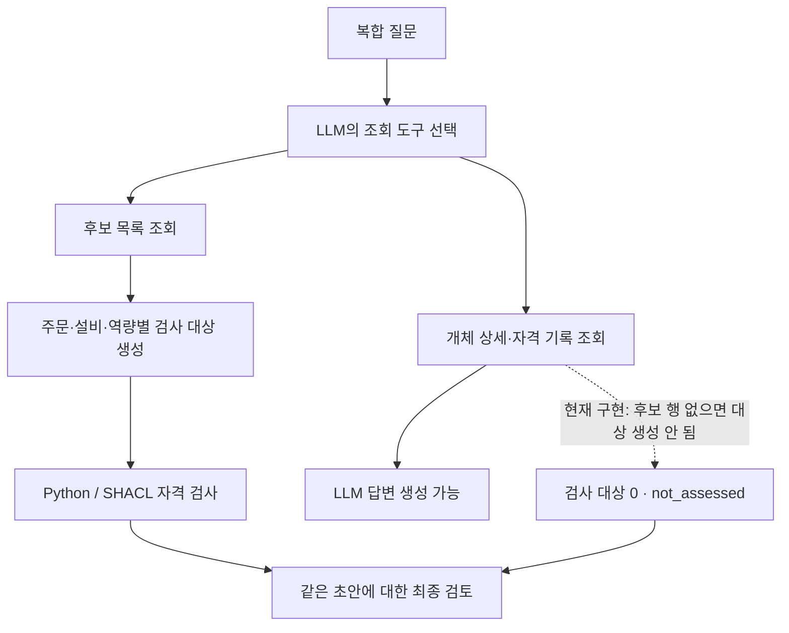

# 복합 질문의 실제 답변에서 드러난 검토 보고서의 효과와 빈틈

Factory Lab의 복합 질문 12건을 실제 LLM으로 실행했다. 초안 12개를 저장하고 각 초안과 조회 근거를 그대로 사용해 자체 검토·Python 보고서·SHACL 보고서의 최종 답변 36개를 생성했다. 실제 호출은 75회, API 보고 비용은 $0.390222075였다. 실패와 미실행은 없었고 유료 실행은 종료했다.

이번 자료는 네 질문 유형에 세 가지 근거 상태를 조합한 가상 제조 개발 사례다. 한 모델의 한 번 실행이며 새로운 제조 현장이나 대표적인 사용자 질문을 평가한 벤치마크가 아니다. 모델은 `google/gemini-3.8-flash`, 제공자는 Google AI Studio로 고정했다. temperature 0과 seed 42를 사용했지만 완전한 재현성을 가정하지 않았다.

## 개선된 자격 설명과 더 강해진 단정

여러 자격 기록을 합치면 제품 B 주문도 맡길 수 있느냐는 질문에서, M03의 제품 A 자격은 이미 조회되어 있었다. 제품 B에는 적용할 수 없는 기록이었다. 초안과 자체 검토는 이를 `qualification-not-retrieved`로 설명했다. Python·SHACL 보고서를 받은 답변은 `qualification-not-applicable`로 바꿨다.

| 비교 지점 | 실제 관찰 |
| --- | --- |
| 사례 `case-10`의 초안·자체 검토 | M03의 제품 B 자격을 `qualification-not-retrieved`로 설명 |
| 같은 사례의 Python·SHACL 검토 | `qualification-not-applicable`로 수정 |
| 후보 선택의 핵심 결론 | 그대로 유지. 보고서는 부적격 사유의 구분을 개선 |

반대 방향의 변화도 있었다. 새 주문 O20이 추가된 `case-07`에서 초안은 가용 용량 배분 우선순위가 “바뀔 수 있습니다”라고 썼다. 자체 검토도 가능성 표현을 유지했다. 그런데 Python·SHACL 최종 답변은 자원 경합이 “발생합니다”라고 단정했다. 조회 근거에는 주문과 후보 관계가 있지만 실제 일정·부하 정보는 없다. 검토 보고서를 추가했다고 답변의 모든 주장이 더 정확해지는 것은 아니었다.

이 두 사례를 함께 봐야 한다. 선언된 자격 조건의 설명은 바로잡을 수 있었지만 그 검사 범위 밖의 운영상 추론이 더 강한 단정으로 바뀌기도 했다. 저장된 초안과 최종 답변은 사후에 수정하지 않았다.

## 조회 경로에 따라 비어 버린 검사 대상

이번 실행에는 또 다른 설계 문제가 드러났다. 12건 중 4건(`case-04`, `case-05`, `case-11`, `case-12`)에서 보고서의 검사 대상 수가 0이었다. 상태는 `not_assessed`로 남겼다. 이는 조건을 모두 만족했다는 뜻이 아니다.

LLM은 개체 상세와 자격 기록을 조회해 답할 수 있었다. 하지만 현재 검사 입력을 만드는 코드는 `replacement_candidates` 도구가 반환한 후보 행을 기준으로 검사 대상을 만든다. LLM이 다른 조회 경로로 답을 구성하면 관련 자격 근거가 있어도 검사할 후보가 만들어지지 않을 수 있다.

따라서 검사기를 마지막에 붙이는 것만으로 충분하지 않다. 사용자가 요청한 판단 중 무엇이 검사 대상이 되었는지, 무엇은 아직 검사하지 않았는지를 함께 보여줘야 한다. 규칙의 개수와 검사 대상의 누락은 서로 다른 문제다.

## Python과 SHACL의 비교가 말해 주는 범위

12건 모두 Python·SHACL 최종 요청의 메시지가 동일했다. 두 구현은 같은 정책과 선택 근거를 사용했고 보고서에서 검사 엔진 이름을 제거했다. 실제 최종 답변 문자열은 12쌍 중 5쌍이 같았다. 나머지 표현 차이를 SHACL 문법 자체의 효과로 해석할 수는 없다.

현재 관찰된 자격 사유 수정은 명시적인 검사 결과를 LLM에 전달한 효과의 사례다. Python으로도 같은 결과를 얻었다. RDF·SHACL의 공유·재사용·유지보수 이점이나 사람의 검토 시간 절감은 이번 실행으로 측정하지 않았다.

## 다음 구현의 초점

다음 개선안에서는 검사 규칙을 무조건 늘리는 대신 질문의 판단 항목과 검사 대상을 연결한다. 주문·설비·역량·기준일을 명시한 검토 대상을 만들고 실제 조회된 근거만 연결해야 한다. 필요한 근거가 없거나 질문 해석이 불확실하면 그 항목을 미검토로 남겨야 한다. 평가 정답이나 숨겨진 원천 기록으로 검사 입력을 채우면 안 된다.

Factory Lab 화면에는 최종 답변과 함께 **검사한 항목 / 미검토 항목 / 근거 밖의 주장**을 구분해 보여주는 방향이 적절하다. 이는 다음 구현 제안이며 아직 적용한 기능은 아니다. 이번 실험에서는 실제 RDFLib 고정 SPARQL 도구 조회 76회를 수행했고 Neptune·Neo4j 서버를 새로 실행하지 않았다.

실행 자료는 저장소의 `research/factory-complexity-1/llm-001/`, 사전 평가 기준은 `research/factory-complexity-1/evaluation-plan-001/`에 보존했다. [규모와 조회 한도 실험](2026-11-11-factory-complexity.md)은 별도의 축으로 다룬다.
