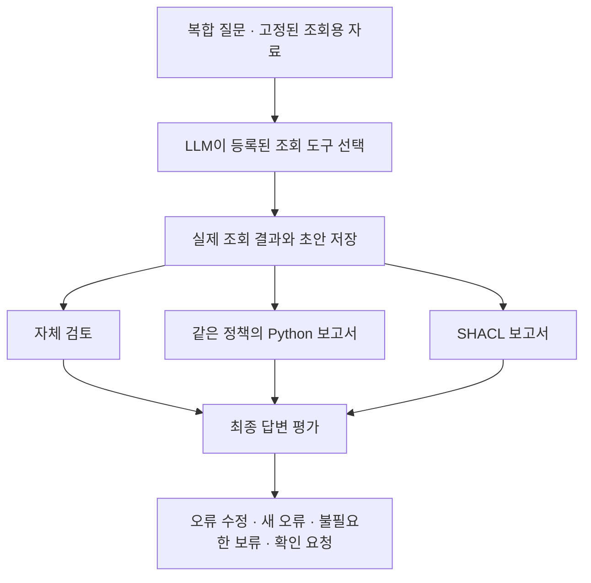

# 트리플 수와 답변에 필요한 근거 수를 나눠 보는 실험

Factory Lab의 다음 실험은 데이터 크기와 질문의 복잡성을 따로 늘린다. 전체 트리플이 많아져도 질문에 필요한 근거가 같으면 답변의 어려움은 그대로일 수 있다. 반대로 작은 그래프에서도 후보가 많거나 제품·기간 조건이 엇갈리면 조회 결과를 빠뜨릴 수 있다.

## 먼저 확인한 규모와 조회 한도

로컬 SQLite와 RDFLib에 같은 정보를 넣고 고정 조회를 실행했다. 질문과 무관한 설비·주문·자격 묶음을 추가한 세 조건, 질문에 관련된 대체 후보를 늘린 세 조건을 구분했다. 여섯 조건 모두 실행을 마쳤다. 이는 Neptune·Neo4j 서버 성능 비교가 아니다.

| 변경한 조건 | 실제 규모 또는 후보 수 | 확인한 결과 |
| --- | --- | --- |
| 무관한 자료 추가 | 1,014 / 10,012 / 100,014 트리플 | 세 규모에서 질문 관련 반환 내용 유지 |
| 관련 후보 추가 | 29개 | 29개 반환, 한도 플래그 꺼짐 |
| 관련 후보 추가 | 30개 | 30개 반환, 한도 플래그 켜짐 |
| 관련 후보 추가 | 31개 | 30개 반환, 한도 플래그 켜짐 |

각 조건에서 두 구현의 조회 결과가 일치했고 선택된 근거에 대한 Python·SHACL 플래그도 일치했다. 준비 조회를 포함해 288회, 그중 시간을 측정한 조회는 216회다. 독립적인 질문 288개나 LLM 답변 288개를 평가했다는 뜻은 아니다.

31개 후보 조건에서는 실제로 한 후보가 반환되지 않았다. 하지만 30개 조건도 같은 한도 플래그를 반환했다. 따라서 플래그는 추가 확인이 필요하다는 신호이지, 누락이 발생했다는 증명은 아니다. 이번 검사는 후보별 자격 조회도 별도로 수행한다. 후보 목록만 늘려도 모든 후보의 자격 근거가 자동으로 확보되지는 않는다.

## 복합 질문 네 가지와 근거 상태 세 가지

다음 LLM 비교에는 작성된 가상 제조 질문 네 가지를 사용한다. 각 질문은 단일 사실 조회가 아니라 여러 요구를 함께 담는다.

| 질문 | 함께 확인할 내용 |
| --- | --- |
| M02 중단 후 O17 대체 | M01·M03의 제품·역량·기간 조건, 일정 미확인, 사람의 추가 검토, 변경 실행 금지 |
| M03 자격 갱신 | O17과 O18의 적용 차이, 이전·갱신 기록, 납기와 승인 여부의 미확인 |
| 이전·현재 영향 주문 비교 | M02 영향 목록의 변화, 새 주문 O20에 관한 제보, 기존 관계가 같아도 목록이 달라지는 경우 |
| 여러 자격 기록의 적용 | 서로 다른 기록의 조건을 임의로 합치지 않기, O17·O18 후보 비교, 부족한 근거와 후속 확인 |

각 질문에 필요한 기록이 있는 상태, 원천에서 빠진 상태, 원천에는 있지만 조회용 자료에서 빠진 상태를 만든다. 총 12개 개발 사례다. 같은 질문의 문구는 세 상태에서 유지하고 상태 이름이나 평가 정답은 실행기에 제공하지 않는다. 출처 해시는 남으므로 입력을 완전히 익명화한 실험이라고 하지는 않는다.

이 사례는 연구자가 설계한 진단용 자료다. 실제 공장의 오류 발생률이나 새로운 제조 도메인의 일반화 성능을 대표하지 않는다.

## 실제 초안을 기준으로 한 세 갈래 검토

세 분기는 같은 초안과 같은 선택 근거를 받는다. 보고서를 만든 뒤 원천을 추가 조회하거나 평가 정답으로 답을 고치지 않는다. 앞 분기의 최종 답변도 다음 분기에 전달하지 않는다. 조회는 미리 구현한 도구로 수행하며 LLM이 임의의 SQL·SPARQL을 작성하는 조건은 아니다.

자격 검사는 제품·역량·기간 등 선언된 조건을 다룬다. 영향 주문 목록의 완전성, 실제 납기, 일정이나 승인 여부까지 검사하는 것은 아니다. 이 경계를 답변이 지키는지도 평가한다. SHACL이 초안의 잘못을 수정했는지만 세면 이미 맞았던 답을 불필요하게 보류하거나 새 오류를 넣은 경우를 놓친다.

## 현재 결과와 남은 검증

규모·조회 한도 실험은 실행했고 12개 사례와 세 갈래 답변 실행기는 구현했다. 독립 검토 후 실행기와 기존 앱에 대한 여섯 소프트웨어 검사도 통과했다. 이 글을 작성한 시점에는 새 유료 실행 승인을 기다리고 있으며 이번 12개 사례의 실제 LLM 답변과 SHACL의 답변 개선 효과는 아직 측정하지 않았다.

현재 근거로는 제한적으로만 말할 수 있다. 이 고정 조회에서는 무관한 자료를 약 10만 트리플까지 늘려도 반환 내용이 바뀌지 않았다. 반면 관련 후보가 조회 한도를 넘으면 누락이 발생했다. 다음에는 더 큰 그래프 자체의 효과보다 LLM이 조회 범위를 이해하고 필요한 근거를 모으며 검토 보고서의 적용 범위를 지키는가를 확인한다.

측정은 메모리 내 SQLite·RDFLib의 고정 조회를 대상으로 한다. 적재·해시 검증 시간과 조회 시간을 분리했고 네트워크·동시 접속·운영 DB의 비용은 측정하지 않았다. 실행 자료는 저장소의 `research/factory-complexity-1/scale-001/`, 사례는 `research/factory-complexity-1/development-001/`에 보존했다. 기존 [Factory Neptune 비교 기록](../experiments/records/2026-11-11-factory-neptune-parity.json)과는 별도 실험이다.
