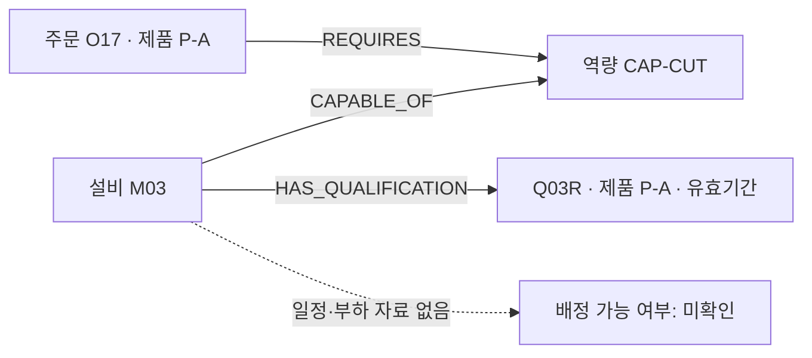

# 그래프 근거와 규칙을 함께 관리해야 하는 이유

Factory Lab에서 제품 A에 한정된 자격 기록 Q03R을 추가하자, LLM은 변경된 관계를 조회해 O17의 후보로 M03을 포함했다. 제품 B 주문 O18에는 그 자격을 적용하지 않았다. 초안의 핵심 판단은 맞았다. 하지만 세 최종 검토 답변에는 “조회한 자격이 적용되지 않음”과 “자격을 조회하지 못함”이 섞여 남았다. [실제 답변 기록](../experiments/records/2026-11-10-factory-renewal-live.json)은 이 차이를 보여준다.

## 의미 모델의 역할

`CAP-CUT` 역량, 제품별 자격, 설비의 `available` 상태, 일정상 투입 가능 여부는 서로 다른 조건이다. 지금 데이터에는 앞의 세 정보만 있고, 부하·일정 서비스는 없다. 이 차이를 기록하지 않으면 “기능적 후보”를 곧바로 “배정 가능한 설비”로 읽기 쉽다.

온톨로지는 이런 개념과 관계의 뜻을 여러 조회·검사 도구가 공유하도록 표현하는 방법이다. 이번 연구에서 사용한 RDF 스키마는 작고 작성된 모델이다. 도메인 전문가가 검증한 완성형 공장 온톨로지나 자연어에서 자동 생성된 스키마는 아니다.

## SHACL 보고서의 자리

SHACL은 선택된 근거가 선언된 조건을 만족하는지 확인하고, 무엇을 다시 봐야 하는지 기록한다. 제품, 역량, 기간이 어긋난 자격을 구분하는 데 쓸 수 있다. 검사를 통과한 기록이 실제로 참인지, 조회되지 않은 기록이 원천에도 없는지는 SHACL 보고서만으로 알 수 없다.

| 작업 지점 | 명시할 내용 | 이번 연구에서 확인한 범위 |
| --- | --- | --- |
| 적재와 변경 | 식별자·관계·자격 적용 범위·버전 | 작성된 데이터의 P-A 자격 추가와 기존 Q03 보존 |
| 조회 도구 | 반환 근거의 범위와 조회하지 못한 정보 | 고정 조회 도구 5개의 결과와 출처 해시 |
| 사후 검토 | 후보별 적용 조건과 확인 요청 | 같은 초안에서 자체·Python·SHACL 답변 비교 |
| 사람의 재검토 | 어느 기록과 규칙을 다시 봐야 하는가 | 검토 기록은 남겼지만 사람의 처리 시간은 측정하지 않음 |

Python도 같은 정책을 검사할 수 있다. [48쌍 조회 비교](../experiments/records/2026-11-10-factory-rdf-parity.json)에서는 Neo4j와 로컬 RDFLib가 같은 근거를 돌려주었고, Python과 SHACL의 자격 플래그도 일치했다. 그러므로 이번 결과는 SHACL만이 답을 맞혔다는 증거가 아니다. 선언형 규칙의 가치는 여러 서비스가 뜻과 버전을 공유하고, 변경 뒤 영향을 추적하는 설계에서 따로 검토해야 한다.

## 다음 비교에서 측정할 것

온톨로지의 운영상 효용을 보려면 규칙을 한 번 작성하는 비용만으로 비교할 수 없다. 같은 제품 범위 변경을 Python 공유 라이브러리와 RDF·SHACL 설정에 반영해야 한다. 수정해야 할 위치, 누락된 소비자, 이전 판단의 재검토 범위, 담당자가 오류를 설명하는 데 필요한 자료도 함께 기록해야 한다. 실제 유지보수 시간과 팀 간 재사용 성과는 아직 측정하지 않았다.

LLM 경로에서는 검사기가 구분한 사유가 최종 문장에 그대로 남는지를 먼저 확인할 필요가 있다. 구조화된 판단·근거·사유를 최종 답변에 연결하는 방식은 다음 실험 후보이며, 이번 실행으로 효과가 확인된 구현은 아니다.
