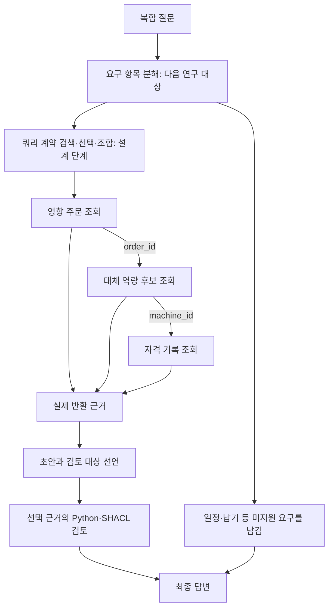

# 실제 LLM 검토 경로와 쿼리 계약 연구의 시작

새 검사 대상 선언 경로를 실제 LLM으로 실행했다. 이전에 검사 대상이 없었던 네 사례에서 초안 4개와 최종 답변 12개를 생성했다. 호출은 22회, API 보고 비용은 0.127838175달러였으며 실패·미실행·미확정 청구는 없었다. 비용 상한을 관리하는 비환급 예약액은 1.01105850달러으로, 실제 보고 비용과 구분한다. 실행 게이트는 종료 후 닫았다.

## 실제 선언에서 검사까지

이번에는 사람이 검사 대상을 넣지 않았다. LLM이 사용자 질문에서 주문–설비 쌍을 선언하고 고정 조회 도구로 근거를 가져왔다. 같은 초안과 근거에서 자체 검토, Python 보고서, SHACL 보고서의 세 답변을 생성했다. 모델은 기존 `google/gemini-3.8-flash`, 제공자는 Google AI Studio, temperature는 0, seed는 42를 유지했다. 이 설정이 완전한 재현성을 보장하지는 않는다.

| 사례 | 실제 선언한 주문–설비 쌍 | 검사 단위 | 최종 답변 |
|---|---:|---:|---:|
| case-04 | 2 | 2 | 3 |
| case-05 | 2 | 2 | 3 |
| case-11 | 4 | 4 | 3 |
| case-12 | 4 | 4 | 3 |

질문을 읽고 사후 점검 목록을 별도로 작성해 비교했다. 필요한 12개 쌍의 선언 누락이나 추가 선언은 없었다. 이 점검 목록은 실행기에 전달하지 않았다. 일정·납기 등 다른 요구 사항까지 모두 검사했다는 뜻은 아니다.

Python과 SHACL의 지적 사항 및 최종 LLM에 전달한 메시지는 네 사례 모두 같았다. 검사기가 사용하는 언어의 효과를 분리해 주장할 수 있는 결과가 아니다. 이전 실행과는 도구 안내와 실제 조회 과정이 달라졌으므로, 이전·이후 차이를 대상 선언 기능 하나의 인과 효과로 해석해서도 안 된다.

## 판단보다 설명에서 드러난 차이

case-11과 case-12의 초안 및 자체 검토 답변은 M03의 제품 P-B 자격을 `qualification-not-retrieved`로 표현했다. 그러나 M03의 제품 P-A 자격 기록은 이미 조회돼 있었다. 현재 정책에서는 조회된 기록이 해당 주문에 맞지 않는 경우이므로 `qualification-not-applicable`로 구분해야 한다. 두 사례의 Python·SHACL 답변은 이 코드로 바뀌었다.

대체 후보의 핵심 판정은 그대로였고 판정 사유의 분류가 정리됐다. 또한 일부 보고서 조건의 답변에는 초안이 “완벽히 부합”한다는 표현이 나타났다. 선택 근거와 제한된 정책 검사만으로 답변 전체의 정확성을 인증할 수는 없다. 보고서를 제공했다고 해서 표현의 확신이 항상 적절해지는 것도 아니다.

네 사례는 과거 결과를 보고 고른 개발 사례다. 대상 선언이 작동했다는 확인을 넘어 보편적인 정확도 개선이나 SHACL의 우위를 주장하지 않는다. 원본 답변과 실패 분모는 `research/factory-complexity-1/coverage-live-001/`에 보존했다.

## 쿼리 계약으로 옮기는 연구 범위

현재의 실제 원사이클은 확인했다. 다음 연구는 복합 질문의 요구를 조회와 근거에 연결하는 방법에 초점을 맞춘다. 검사 규칙을 더 늘리는 일보다 이 연결을 우선한다.

> 재사용 가능한 쿼리의 명시적 계약을 이용해 복합 질문의 조회를 구성하고, 답변과 검토가 실제로 다룬 범위를 추적하는 GraphRAG 구조.

첫 산출물은 기존 고정 조회 도구 여섯 개의 계약 초안이다. `research/query-contracts-1/catalog-proposal.json`에 입력의 의미적 유형, 결과에서 다음 조회로 전달할 값, 확보할 수 있는 근거, 판단할 수 없는 항목, 조회 한도와 버전 범위를 기록했다. 현재 실행기는 문자열 인자를 검사하며 이 의미적 유형을 강제하는 새 선택기나 인덱스는 아직 구현하지 않았다.

예를 들어 `replacement_candidates`는 역량 후보를 반환하지만, 유효한 자격이나 일정 여유까지 보장하지 않는다. `qualification_records`도 주문의 제품·필요 역량 정보 없이 자격 적용성을 확정하지 못한다. 계약은 이런 연결 조건과 한계를 선택 과정에서 사용할 수 있게 명시하는 수단이다.

비교 조건은 전체 카탈로그를 제공하는 방식, 카탈로그를 검색하는 방식, 검색에 입력·출력·적용 범위 조건을 더하는 방식으로 나눈다. 같은 정보를 각 조건에 제공하고 총 도구 호출·토큰 예산을 맞춘다. 질문 분해의 차이와 선택기의 차이를 섞지 않도록, 선택기 비교에서는 같은 분해 결과를 고정한다. 어휘 검색과 밀집 벡터 검색도 구분해 측정한다.

먼저 측정할 것은 필요한 조회의 누락, 의미가 맞지 않는 조회 선택, 연결할 수 없는 출력과 입력, 근거 없는 확정, 불필요한 보류다. 그다음 최종 답변 품질과 비용을 함께 본다. 새로운 질문 조합과 유사하지만 의미가 다른 쿼리가 필요하다. 현재 여섯 도구만으로 대규모 도구 선택의 보편성을 입증했다고 주장하지 않는다.

<!-- HUMANIZE-SUMMARY
경로: light / 장르: report. A-18 관형구, C-8 대구, C-11 연결어미 뒤 쉼표, J-1 강조를 최소 수정했다. 수치·식별자·코드·Mermaid 및 측정 결과와 제안 범위의 구분을 보존했다. 자체검증에서 확인한 미통과 항목 없음. 변경률 확정은 별도 검증 대상이다.
-->
