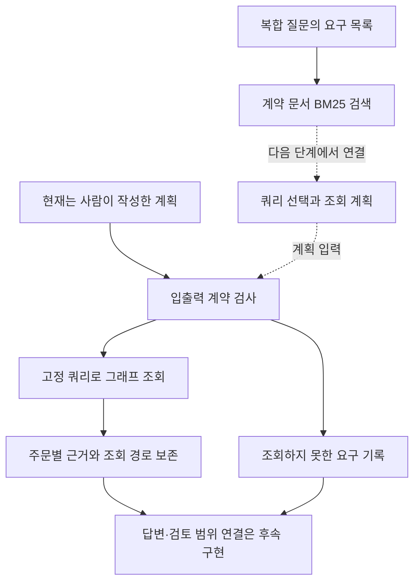

# 답변 검토 비교를 닫고 복합 질문의 조회 구성으로

## 기존 실험의 결론

Factory Lab의 답변 후 검토 비교는 여기서 한 차례 마무리한다. 복합 질문 12건의 초안과 최종 답변을 비교했고 검토 대상이 빠졌던 4건에서는 LLM 실행을 다시 진행해 대상 선언과 검토 연결을 확인했다. 같은 질문을 재사용했으므로 두 실험을 독립 표본으로 합산하지 않는다.

선택한 근거를 기준으로 검토자들이 뚜렷한 핵심 판단 오류를 찾지는 못했다. 일부 잘못된 판단 이유는 Python과 SHACL 보고서를 받은 답변에서 수정됐지만 핵심 결정의 개선이나 SHACL만의 우위는 확인하지 못했다. 보고서를 받은 뒤에도 근거보다 강하게 단정하는 표현은 남았다. 비슷한 질문을 계속 늘려 긍정적인 결과를 찾는 방식은 중단한다.

## 다음 연구의 대상

다음 연구는 복합 질문에 필요한 조회를 구성하는 과정이다. 예를 들어 설비 중단의 영향 주문을 찾은 뒤, 주문별 대체 설비와 자격을 조회하고 납기 가능성까지 묻는 요청을 다룬다. 각 쿼리가 정상 실행됐더라도 다른 주문의 제품 조건을 섞거나 일정 자료 없이 납기를 판단하면 요구를 제대로 처리했다고 할 수 없다.

첫 구현은 쿼리 계약 검색과 조회 연결 실행기를 분리한다. BM25는 기존 여섯 쿼리의 계약 문서에서 후보를 찾는다. 별도의 실행기는 영향 주문, 대체 후보, 자격 기록이라는 세 조회를 연결하며 주문·제품·요구 역량과 데이터 버전을 유지한다. 현재 조회 계획은 사람이 작성한다. 검색 결과를 보고 LLM이 선택하는 단계는 아직 연결하지 않았다.

조회가 반환한 행은 질문에 답했다는 증거와 구분한다. 일정·부하 서비스가 없는 납기 요구는 미계획 상태로 남기고 빈 조회 결과도 원천에 기록이 없다는 뜻으로 바꾸지 않는다. 결과 수 제한, 호출 예산 소진, 데이터 버전 불일치도 기록한다.

## 다음 비교의 판단 기준

전체 계약 목록을 보여주는 방식, 관련 계약을 검색하는 방식, 같은 검색에 연결 검사를 추가하는 방식을 비교할 계획이다. 계약 정보와 질문 분해, 원천 접근 범위, 전체 호출·토큰 예산은 맞춘다. 현재 실행기의 객체 종류 확인은 선택된 데이터 뷰 전체를 읽으므로 이 접근도 비교군에 똑같이 제공하고 비용에 포함해야 한다.

지금의 여섯 쿼리와 개발 사례만으로 일반화나 알고리즘 우위를 주장하지 않는다. 의미가 다른 경쟁 쿼리와 새 질문 조합을 준비한 뒤, 필요한 조회 누락과 잘못된 연결, 근거 없는 단정, 불필요한 보류를 함께 측정한다. 차이가 없다면 인덱싱을 더 복잡하게 만드는 대신 그 결과를 정리한다.

기존 결과와 종료 기준은 [답변 검토 실험 정리](../experiments/answer-review-closeout.md)에, 다음 비교의 조건은 [쿼리 계약 실험 설계](../experiments/query-contracts.md)에 기록했다.

<!-- HUMANIZE-SUMMARY
경로: light / 강도: 보수 / 장르: report
탐지·수정: C-11 연결어미 뒤 쉼표 5곳 삭제. 사실·수치·제목·기술 용어·Mermaid·링크 보존.
핵심 변경: “비교했고, 검토” → “비교했고 검토”; “읽으므로, 이” → “읽으므로 이”.
자체검증: 6/6 통과. 변경률 확정은 공통 게이트에서 확인.
등급: B. 그 밖의 수정이 거의 필요 없는 글.
-->
