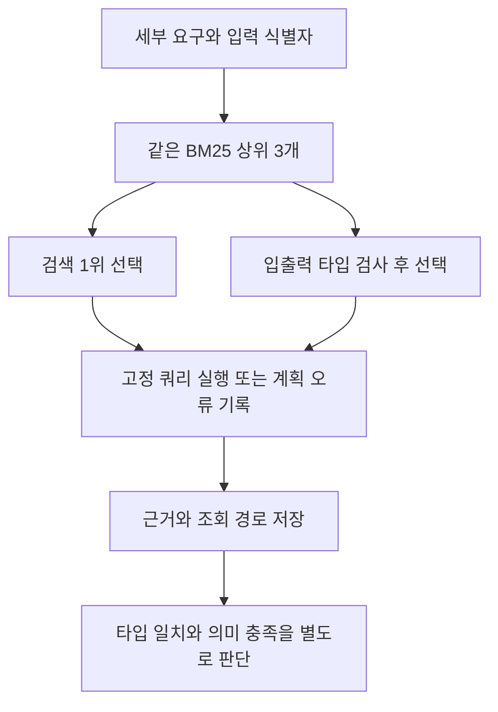

# 쿼리 선택에서 타입 검사로 해결한 오류와 남은 의미 차이

## 비교 범위

쿼리 계약 검색을 실제 선택과 조회 실행에 연결했다. 비교 대상은 영향 주문, 대체 역량 후보, 현재 배정 설비, 전체 자격, 현재 유효한 자격, 만료된 자격이라는 여섯 쿼리다. 각 쿼리는 고정 SQL과 SPARQL로 실행한다. 이름만 바꾼 쿼리를 늘린 것은 아니다.

복합 요청 6건을 사람이 세부 요구 15개로 나눴고 두 방식에 같은 문장과 입력 식별자·연결 경로를 제공했다. 한 방식은 BM25 검색 1위를 선택하고 다른 방식은 같은 상위 3개에서 입력·출력 타입이 맞는 쿼리를 선택한다. LLM의 질문 분해나 쿼리 선택을 평가한 실험은 아니다. 이전 개발 사례의 합성 그래프를 재사용했으며 새 질문도 개발 자료로 남긴다.

## 선택 결과

| 항목 | 검색 1위 선택 | 상위 3개와 타입 검사 |
| --- | ---: | ---: |
| 작성자가 의도한 쿼리와 일치 | 11/15 | 12/15 |
| 의도한 쿼리와 불일치 | 4/15 | 3/15 |
| 선택하지 않아야 할 요구를 올바르게 남김 | 0 | 0 |
| 조회 계획의 타입·연결 오류 | 1/6 | 0/6 |

대체 설비 후보를 찾는 요구에서 검색 1위는 설비 자격 조회였다. 입력은 주문 식별자인데 이 쿼리는 설비 식별자를 요구한다. 타입 검사를 적용한 방식은 상위 후보에서 주문을 입력받는 대체 설비 조회를 골라 연결했다.

다만 상위 후보를 더 살피는 효과와 타입 검사 효과가 함께 바뀌었다. 이번 차이를 타입 검사만의 인과 효과로 해석하지 않는다. 일치 수는 사람이 정한 조회 의도와의 일치이며 최종 답변 정답률도 아니다.

## 남은 세 가지 불일치

납기와 일정·부하 확인 요구에는 자격 조회가 선택됐다. 갱신 문서의 진위와 승인자 확인 요구에도 같은 조회가 선택됐다. 두 경우 모두 입력 타입은 맞지만 필요한 서비스는 없다. 타입 검사만으로 이런 대체 조회를 막지는 못했다.

현재 제품별 자격 요구에는 현재 유효한 자격 조회 대신 전체 자격 조회가 선택됐다. 전체 기록도 후속 날짜 필터링에 쓸 수 있으므로 이 선택이 최종 오답을 뜻하지는 않는다. 다만 이번 계획에는 그 필터링이 없으며 작성자가 의도한 날짜 범위와 선택한 조회의 범위는 달랐다.

## 실행 기록과 다음 비교

비교 기록 24칸을 모두 보존했다. 조회 계획 오류 1건은 두 백엔드에서 실행하지 않았다. 실행된 11개 백엔드 쌍에서는 결과와 조회 경로가 일치했다. 실제 조회는 총 84회이며 실패한 조회는 없었다. 두 백엔드의 반복을 독립적인 질문 표본으로 세지 않았다. 관련 테스트 29개가 통과했다.

다음 비교에서는 쿼리 계약의 입력 타입뿐 아니라 제공하는 근거, 날짜 범위, 판단할 수 없는 사항을 LLM이 선택에 반영하는지 확인한다. 전체 계약 목록을 보는 조건도 유지해 검색 단계가 오히려 필요한 쿼리를 놓치는지 함께 봐야 한다. 지원하지 않는 요구를 남기는 능력과 지원 가능한 요구를 불필요하게 보류하는 경우를 같이 측정할 계획이다.

이번 결과를 보고 설명문을 고쳐 같은 질문의 점수를 올리지는 않았다. 원래 순위와 오선택을 그대로 보존했다. 추가 유료 LLM 호출, AWS 시작, Factory Lab 서버 재시작은 하지 않았다.

[실험 설계와 구현 범위](../experiments/query-contracts.md) · [실행 기록](../experiments/records/2026-11-12-query-selection-development.json)
