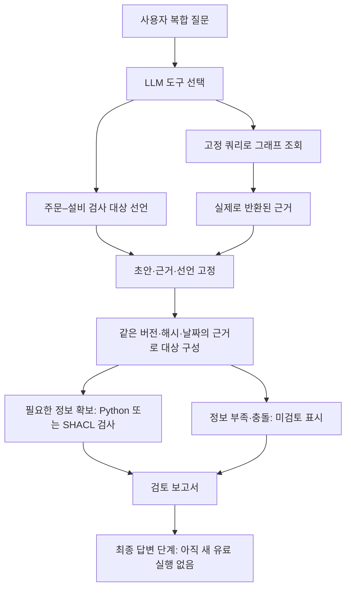

# 검사 대상 누락과 근거 기반 검토 범위

앞선 복합 질문 실험에서 발견한 문제는 검사 규칙 이전에 있었다. LLM이 주문과 설비를 조회해 답했어도 검사기가 그 대상을 전달받지 못하는 경우가 있었다. 기존 구현은 `replacement_candidates` 결과에서만 검사 대상을 만들었다. `inspect_entity`로 같은 관계를 조회한 경로는 자격 기록 수집에는 쓰였지만 검사 대상을 만드는 데는 쓰이지 않았다.

## 대상 선언과 선택 근거

새 경로에서는 LLM이 `declare_review_targets` 도구로 주문–설비 쌍과 사용자 질문의 인용 구절을 선언할 수 있다. 이 도구는 그래프를 조회하지 않는다. 대상 선언은 근거가 아니며 인용이 원문에 있다는 검사도 질문을 올바르게 해석했다는 뜻은 아니다. 선언 호출은 기존 도구 호출 한도 안에서 집계한다.

검사 대상은 명시된 쌍과 기존 후보 조회 결과로 한정한다. 조회한 모든 주문과 설비를 임의로 조합하지 않는다. 필요한 주문 제품, 설비 상태, 역량 관계가 없거나 조회 결과끼리 충돌하면 미검토로 남긴다. 없는 관계를 다른 소스에서 보충하지 않는다. Python과 SHACL에는 동일하게 구성한 입력을 전달한다.

화면에는 검사한 대상과 미검토 대상을 따로 보여준다. 일정·부하, 납기 약속, 영향 목록의 완전성, 외부 사실, 실제 운전 승인은 이 검사기의 범위 밖이다. 지적 사항이 없다고 이 항목까지 확인한 것으로 표시하지 않는다.

## 저장된 12건의 재검사

이번에는 새 LLM 답변을 생성하지 않았다. 기존 12건의 선택 근거를 그대로 사용하고 사람이 공개 질문 유형을 보고 대상 쌍을 지정한 진단이다. 평가 정답이나 원본 그래프를 추가로 읽어 검사 입력을 보충하지 않았다.

| 기존 검사 대상이 없던 실행 | 기존 검사 단위 | 새로 구성한 검사 단위 |
|---|---:|---:|
| case-04 | 0 | 2 |
| case-05 | 0 | 2 |
| case-11 | 0 | 4 |
| case-12 | 0 | 4 |

검사 단위는 주문–설비–필요 역량 조합이다. 12건 모두 Python과 SHACL의 지적 사항이 일치했다. 새 유료 호출, 추가 소스 조회, 새 최종 답변은 각각 0건이다. 결과는 `research/factory-complexity-1/coverage-001/replay.json`에 보존했다. 입력 파일 해시와 사람이 지정한 대상도 함께 남겼다.

이는 대상을 전달하면 기존 조회 근거를 검사에 사용할 수 있다는 구현 확인이다. 실제 LLM이 대상을 빠짐없이 선언한다거나, 답변 정확도가 개선됐다거나, SHACL이 Python보다 낫다는 결과는 아니다. 기존 12건은 이미 검토한 개발 자료이며 새로운 평가 집합이 아니다.

## 호환성과 다음 비교

새로 고정한 실행에는 `factory-review-coverage-v1`을 기록한다. 이 표시가 없는 과거 실행은 기존 검사 경로와 직렬화를 유지한다. 과거 답변과 보고서를 새 결과로 덮어쓰지 않는다. 웹 서버의 다음 시작부터 새 경로가 적용되도록 연결했으며 기존 연구 실행기는 명시적으로 선택해야 새 경로를 사용한다.

다음 실제 LLM 비교에서는 대상 선언의 누락·오지정을 먼저 기록해야 한다. 이후 같은 초안과 근거에서 자체 검토, Python 보고서, SHACL 보고서가 답변에 주는 차이를 비교한다. 대상 선언에 쓰는 도구 호출도 예산에 포함하고 답변 개선과 불필요한 보류를 함께 집계해야 한다. 이번 구현만으로 그 효과를 주장하지 않는다.
