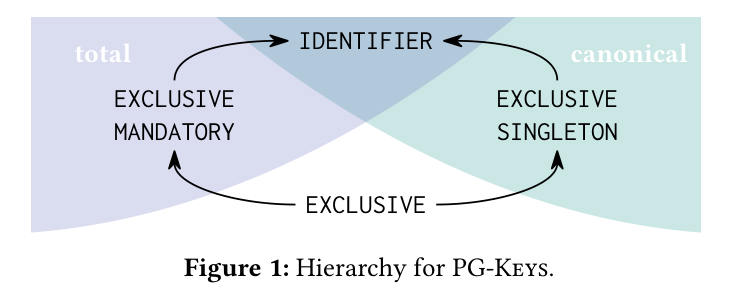
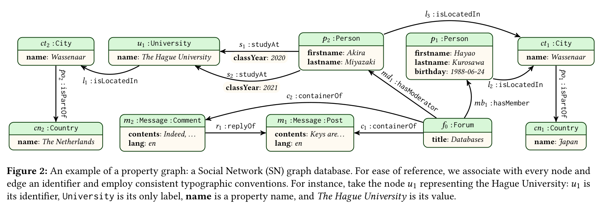
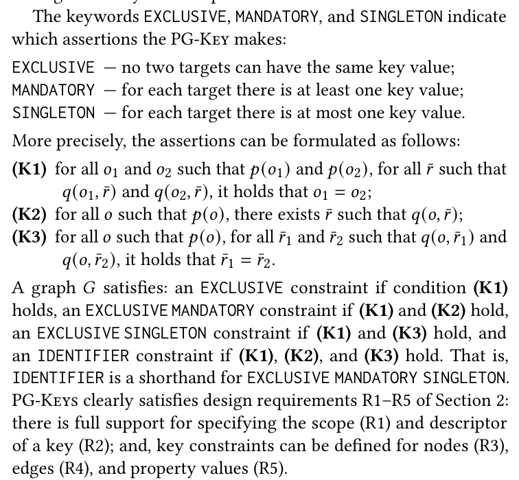
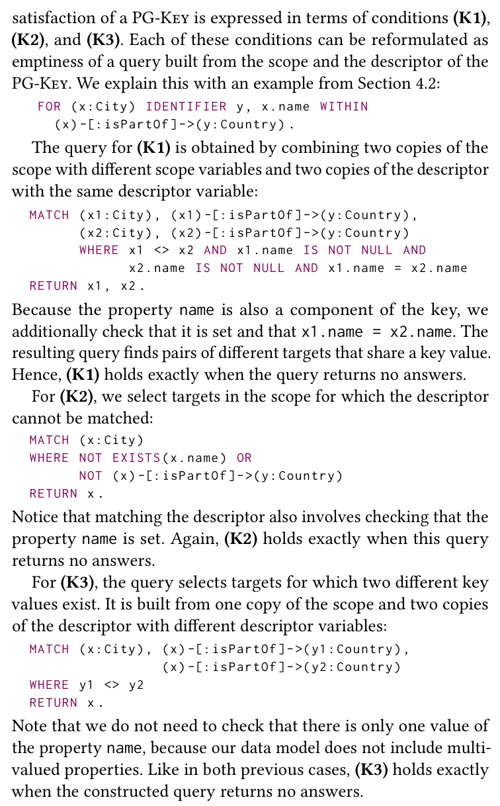
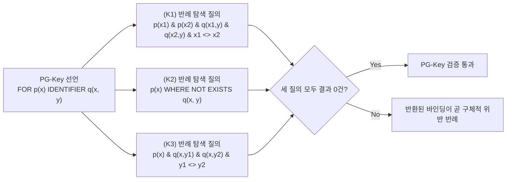

# PG-Keys 리뷰: 속성 그래프의 노드·간선·속성에 일관되게 적용하는 키와 무결성 제약

관계형 데이터베이스의 기본 키(Primary Key)는 한 테이블의 튜플만 식별한다. 그러나 속성 그래프(Property Graph)에서는 노드뿐 아니라 간선과 속성도 식별·참조해야 하고, "같은 국가에 속한 도시들의 이름은 유일하다"처럼 이웃 위상 경로를 포함한 키도 자주 등장한다. 이 논문은 LDBC(Linked Data Benchmark Council) 산하 속성 그래프 스키마 워킹그룹(PGSWG)의 학계·산업계 연구자 17명이 합의해 발표한 **PG-Keys**의 설계 요구사항, 형식 의미론, 검증 질의 변환, 그리고 RDF/OWL·SHACL·관계형 키와의 비교를 다룬다.

이 글은 2026년 11월 19일에 작성한 장별 심층 리뷰다. 논문의 1장부터 7장까지를 따라가며 속성 그래프에서 키가 필요한 세 가지 목적(무결성 제약·객체 참조·현실 개체 식별), 8가지 설계 요구사항(R0–R7), `EXCLUSIVE`·`MANDATORY`·`SINGLETON` 조합으로 정의되는 4대 키 계층, 질의 기반 범위(Scope)와 서술자(Descriptor) 문법, 조건 (K1)·(K2)·(K3)의 Cypher 검증 질의 변환, 그리고 SHACL·OWL(`owl:hasKey`)·XML 키와의 패러다임 비교를 차례로 읽는다. 원문의 도면 2점과 형식 정의·검증 질의 발췌 2점은 저자 공개 PDF에서 216 DPI로 가져왔고 설명을 위해 새로 그린 도식은 Mermaid로 구분했다.

## 논문 정보와 검토 범위

| 항목 | 내용 |
|---|---|
| 제목 | PG-Keys: Keys for Property Graphs |
| 저자 | Renzo Angles, Angela Bonifati, Stefania Dumbrava, George Fletcher, Keith W. Hare, Jan Hidders, Victor E. Lee, Bei Li, Leonid Libkin, Wim Martens, Filip Murlak, Josh Perryman, Ognjen Savković, Michael Schmidt, Juan Sequeda, Sławek Staworko, Dominik Tomaszuk |
| 소속 | LDBC Property Graph Schema Working Group (Neo4j, TigerGraph, Google, AWS, RelationalAI, Univ. of Edinburgh, TU Eindhoven, Birkbeck, Inria 등 학계·산업계 17인 공동 저술) |
| 발표 | *Proceedings of the 2021 International Conference on Management of Data (ACM SIGMOD '21)*, pp. 2423–2436 |
| 읽은 판본 | 저자 오픈 액세스 최종 원문 PDF, 14쪽 |
| 원문 | [ACM DOI](https://doi.org/10.1145/3448016.3457561) · [HAL 오픈 액세스](https://hal.science/hal-03189192) · [Birkbeck ePrints PDF](https://eprints.bbk.ac.uk/id/eprint/53503/1/staworko-sigmod21.pdf) |

이 논문은 ISO GQL(Graph Query Language) 표준의 키·무결성 제약 설계를 위해 LDBC 워킹그룹이 도출한 언어 명세 및 형식 의미론 논문이다. 특정 그래프 DB 엔진의 벤치마크 실행 시간을 측정한 실험 논문이 아니며, 이후 2023년 발표된 **PG-Schema**(SIGMOD 2023)의 제약 계층으로 그대로 통합되었다. 원문 수록 도면과 수식 영역의 원본 페이지·좌표·SHA256 해시는 [그림 출처 기록](../assets/images/pg-keys/provenance.json)에 남겼다.

## 원문 구성과 읽기 지도

| 원문 | PDF 쪽 | 핵심 내용 |
|---|---|---|
| 1 Introduction | 1–4 | 고객 360 통합(예제 1.1)과 주문 무결성(예제 1.2)에서 드러나는 기존 그래프 DB 키 제약의 한계 |
| 2 Design Requirements for Keys | 4–5 | 키의 3대 목적, 4가지 키 유형 계층(그림 1), 범위(Scope)와 서술자(Descriptor) 등 8대 요구사항(R0–R7) |
| 3 Querying Property Graphs | 5–6 | 속성 그래프 형식 정의 $G = (N, E, \rho, \lambda, \pi)$, 소셜 네트워크 예제 그래프(그림 2), 결합 질의 표기 |
| 4 A Guided Tour of PG-Keys | 6–9 | `FOR p(x) <qualifier> q(x, y)` 형식 의미론(K1–K3), 노드·간선·속성 키 예제, Cypher 검증 질의 재작성 및 증분 검증 |
| 5 Relationship to Other Paradigms | 9–11 | ER/UML/ORM, 관계형 키/FD, XML 키, 시맨틱 웹(OWL `owl:hasKey`, SHACL, ShEx)과의 표현력 비교 |
| 6 Extensions of PG-Keys | 11–12 | NULL 값 처리, 정규 경로 질의(RPQ, `isPartOf*`), 복합 속성값(배열·맵) 확장 |
| 7 Looking Ahead | 12 | ISO GQL 및 SQL/PGQ 표준화 연계 방향 |

## 1장: 왜 속성 그래프에는 관계형 기본 키 이상의 키가 필요한가

### 1.1 초기 그래프 DB 제약의 파편화

관계형 데이터베이스에서는 `PRIMARY KEY`와 ` UNIQUE`, `NOT NULL`, `FOREIGN KEY`가 모든 SQL 엔진에 표준으로 자리 잡고 있다. 반면 Neo4j, TigerGraph, JanusGraph, Amazon Neptune 등 상용 그래프 데이터베이스들은 오랫동안 스키마가 선택적이거나(schema-optional), 각 벤더가 독자적인 방식으로 단순한 '노드 레이블 + 단일 속성 유일성' 정도만 지원해 왔다.

저자들은 1장에서 두 가지 실무 시나리오(예제 1.1, 예제 1.2)를 통해 단순 속성 유일성만으로는 그래프 무결성과 엔티티 통합을 처리할 수 없음을 보여 준다.

- **예제 1.1 (고객 360 식별 그래프와 부분적/다중 키)**:
  - 기업의 내부 고객 노드(`:Customer {customerid, name}`)와 외부 소셜 미디어 데이터(`:TwitterUser {username, email}`)를 병합해 하나의 고객 노드로 합친다고 하자.
  - 내부 `customerid`는 모든 고객에게 정확히 하나씩 있어야 하는 정식 식별자(**EXCLUSIVE MANDATORY SINGLETON**)다.
  - 반면 트위터 계정(`twitter`)은 모든 고객이 갖고 있지는 않지만(선택적), 일단 존재하면 서로 다른 두 고객이 같은 트위터 계정을 공유할 수는 없다(**EXCLUSIVE**).また 한 고객이 여러 이메일 주소를 가질 수도 있는데, 이때에도 각 이메일 주소는 특정 고객 한 명만을 가리켜야 한다.
- **예제 1.2 (위상 구조를 포함한 주문 무결성)**:
  - `(:Order)-[:placedBy]->(:Customer)` 패턴에서, 주문(`Order`)의 식별자는 주문 자체의 속성(`orderid`)뿐 아니라 **"반드시 정확히 한 명의 고객(`:Customer`)과 `:placedBy` 간선으로 연결되어야 한다"**는 그래프 위상(topology) 조건까지 포함한다.

이처럼 속성 그래프의 키는 **노드 내부 속성값**만 보는 것이 아니라 **이웃 노드·간선으로 이어지는 그래프 패턴 전체**를 키의 구성 요소(descriptor)로 삼을 수 있어야 한다.

## 2장: 키의 세 가지 목적, 4대 키 계층, 8대 설계 요구사항

### 2.1 키의 세 가지 목적과 세 가지 직교 성질

2.1절과 2.2절은 데이터베이스에서 키가 수행하는 역할을 세 가지로 구분한다.

1. **데이터 무결성 제약(Constraining data)**: 중복되거나 누락된 비정상적인 데이터 패턴이 그래프에 들어오는 것을 막는다.
2. **객체 참조(Referencing objects)**: 외부나 다른 객체에서 키 값을 통해 특정 그래프 요소(노드·간선·속성)를 모호함 없이 가리킨다.
3. **실세계 개체 식별(Identifying real-life objects)**: 두 노드가 같은 실세계 대상을 나타내는지 판별하고, 키 값을 정준 식별자(canonical identifier)로 사용한다.

이 세 목적을 지원하기 위해 PG-Keys는 키의 성질을 세 가지 원자적 키워드로 분해한다.

- **`EXCLUSIVE` (배타성)**: 키 적용 범위(scope) 안의 서로 다른 두 대상 $o_1 \neq o_2$가 동일한 키 값을 공유할 수 없다(참조의 비모호성 보장).
- **`MANDATORY` (필수성)**: 범위 안의 모든 대상 $o$는 **최소 하나 이상($\ge 1$)**의 키 값을 가져야 한다(전체 참조 가능성, total reference 보장).
- **`SINGLETON` (단일성)**: 범위 안의 각 대상 $o$는 **최대 하나 이하($\le 1$)**의 키 값만 가질 수 있다(정준성, canonical reference 보장).

이 세 키워드를 조합하면 원문 그림 1과 같은 4가지 핵심 키 유형 계층이 만들어진다.



그림 1. `EXCLUSIVE`를 기반으로 `MANDATORY`(total)와 `SINGLETON`(canonical)이 결합되어 `IDENTIFIER`를 이루는 PG-Keys 계층 구조. Angles et al., PDF 4쪽. [원문](https://eprints.bbk.ac.uk/id/eprint/53503/1/staworko-sigmod21.pdf#page=4) · [크게 보기](../assets/images/pg-keys/figure-01-hierarchy.png).

| PG-Keys 유형 | 포함 조건 | 개수 범위 | 대표 실무 예시 |
|---|---|---|---|
| **`EXCLUSIVE`** | 배타성만 요구 | $0, 1, 2, \dots$ (다중값·누락 허용, 단 타인과 공유 금지) | 직원의 휴대폰 번호: 휴대폰이 없거나 2대일 수 있지만, 같은 번호를 두 직원이 공유할 수는 없음 |
| **`EXCLUSIVE MANDATORY`** | 배타성 + 필수성 (Total) | $\ge 1$ (누락 불가, 다중값 허용) | 대학원생의 공식 이메일 주소: 최소 1개 이상의 이메일이 필수이며 타인과 중복 불가(여러 별칭 이메일 보유 가능) |
| **`EXCLUSIVE SINGLETON`** | 배타성 + 단일성 (Canonical) | $0$ 또는 $1$ (누락 허용, 다중값 불가) | 고객의 트위터 핸들 또는 운전면허 번호: 없을 수는 있지만, 있다면 1개뿐이며 유일함 (SQL의 Nullable `UNIQUE`와 유사) |
| **`IDENTIFIER`** (`EXCLUSIVE MANDATORY SINGLETON`) | 배타성 + 필수성 + 단일성 | 정확히 $1$ (`= 1`) | 사용자 로그인 ID, 국가의 ISO 코드: 모든 대상이 정확히 하나의 유일한 키 값을 가짐 (관계형 `PRIMARY KEY`에 대응) |

### 2.2 여덟 가지 설계 요구사항(R0–R7)

워킹그룹이 합의한 8가지 설계 요구사항은 다음과 같다.

- **R0 (Coverage)**: 무결성 제약, 객체 참조, 개체 식별 세 가지 목적을 모두 포괄할 것.
- **R1 (Flexible Scope)**: 단순 레이블 하나가 아니라 임의의 질의 조건(예: 1970년 이후 입학한 간선, 포럼에 속한 회원 노드 등)으로 키 적용 대상(Scope)을 유연하게 지정할 것.
- **R2 (Neighborhood Keys)**: 대상 자체의 속성뿐 아니라 인접 간선·이웃 노드를 포함한 부분 그래프 위상(Descriptor)으로 키 값을 정의할 수 있을 것.
- **R3 (Node Keys)**, **R4 (Edge Keys)**, **R5 (Property Keys)**: 노드뿐 아니라 간선과 속성값 자체도 키의 적용 대상이 될 수 있을 것.
- **R6 (Readability)**, **R7 (Tractability)**: 현업 개발자가 읽기 쉽고(Cypher/GQL 패턴 문법 호환), 다항 시간 안에 검증 및 증분 유지보수가 가능할 것.

## 3장: 속성 그래프 데이터 모델과 소셜 네트워크 예제 그래프

3장은 속성 그래프를 5-튜플 $G = (N, E, \rho, \lambda, \pi)$로 형식화한다(정의 3.1).

- $N$: 유한한 노드 식별자 집합, $E$: 유한한 간선 식별자 집합 ($N \cap E = \emptyset$).
- $\rho : E \to (N \times N)$: 각 간선에 시작 노드와 끝 노드 쌍을 대응시키는 끝점 함수.
- $\lambda : (N \cup E) \to 2^{\mathcal{L}}$: 각 노드와 간선에 유한 개의 레이블 집합을 부여하는 함수.
- $\pi : (N \cup E) \times \mathcal{K} \rightharpoonup \mathcal{V}$: 노드·간선과 속성 이름($\mathcal{K}$)에 속성값($\mathcal{V}$)을 대응시키는 부분 함수.

논문 전체의 키 예제를 설명하기 위해 사용되는 소셜 네트워크(SN) 속성 그래프가 원문 그림 2다.



그림 2. 소셜 네트워크(SN) 속성 그래프 예시. 네덜란드의 `Wassenaar`(`ct2`)와 일본의 `Wassenaar`(`ct1`)처럼 이름은 같지만 소속 국가(`cn2`, `cn1`)가 다른 두 도시 노드, 동일 인물(`p2`)과 동일 대학(`u1`) 사이의 복수 `:studyAt` 간선(`s1`, `s2`) 등이 포함되어 있다. Angles et al., PDF 6쪽. [원문](https://eprints.bbk.ac.uk/id/eprint/53503/1/staworko-sigmod21.pdf#page=6) · [크게 보기](../assets/images/pg-keys/figure-02-social-network-graph.png).

그림 2를 자세히 보면 왜 단순 속성 키가 실패하는지 바로 드러난다.

1. 왼쪽의 도시 노드 $ct_2$와 오른쪽의 도시 노드 $ct_1$은 둘 다 `name: "Wassenaar"`를 갖는다. 따라서 `City.name`만으로는 도시를 유일하게 식별할 수 없고, 반드시 `[:isPartOf]->(z:Country)`로 연결된 소속 국가 노드 $z$와 묶어야만 유일해진다.
2. 인물 노드 $p_2$(`Akira Miyazaki`)와 대학 노드 $u_1$(`The Hague University`) 사이에는 `:studyAt` 간선이 $s_1$(`classYear: 2020`)과 $s_2$(`classYear: 2021`) **두 개**가 존재한다(멀티그래프). 따라서 간선 키는 양 끝점 $(x, z)$와 간선 속성 `y.classYear`를 함께 묶어야 개별 간선을 구별할 수 있다.

## 4장: PG-Keys의 형식 문법, 의미론(K1–K3), 그리고 Cypher 검증 질의

### 4.1 일반 문법과 세 가지 형식 조건 (K1), (K2), (K3)

4.1절에서 정의하는 PG-Key의 일반 문법은 두 개의 결합 질의(conjunctive query) $p(x)$와 $q(x, \bar{y})$로 이루어진다.

$$\text{FOR } p(x) \;\; \text{EXCLUSIVE } [\,\text{MANDATORY} \mid \text{SINGLETON}\,] \mid \text{IDENTIFIER} \;\; q(x, \bar{y})$$

- **범위 질의(Scope query) $p(x)$**: 키 제약이 적용될 대상 객체(노드, 간선, 또는 속성값) $x$의 집합을 선택한다.
- **서술자 질의(Descriptor query) $q(x, \bar{y})$**: 각 대상 $x$에 대해 키 값을 구성하는 튜플 $\bar{y} = (y_1, \dots, y_n)$을 추출한다.

이 문법 위에서 `EXCLUSIVE`, `MANDATORY`, `SINGLETON`이 뜻하는 일차 논리 조건 **(K1), (K2), (K3)**는 원문 7쪽(아래 캡처)과 같이 정의된다.



원문 4.1절 발췌. `EXCLUSIVE`(K1), `MANDATORY`(K2), `SINGLETON`(K3)의 형식 조건 정의. Angles et al., PDF 7쪽. [원문](https://eprints.bbk.ac.uk/id/eprint/53503/1/staworko-sigmod21.pdf#page=7) · [크게 보기](../assets/images/pg-keys/conditions-k1-k2-k3-semantics.png).

수식으로 정리하면 다음과 같다.

- **(K1) `EXCLUSIVE`**:
  $$\forall o_1, o_2, \bar{r} : \quad \big(p(o_1) \land p(o_2) \land q(o_1, \bar{r}) \land q(o_2, \bar{r})\big) \implies o_1 = o_2$$
- **(K2) `MANDATORY`**:
  $$\forall o : \quad p(o) \implies \exists \bar{r}\; q(o, \bar{r})$$
- **(K3) `SINGLETON`**:
  $$\forall o, \bar{r}_1, \bar{r}_2 : \quad \big(p(o) \land q(o, \bar{r}_1) \land q(o, \bar{r}_2)\big) \implies \bar{r}_1 = \bar{r}_2$$

### 4.2 노드 키, 간선 키, 속성 키의 구체적 작성 예시

4.2절–4.4절은 그림 2의 소셜 네트워크 그래프 위에서 노드·간선·속성에 걸리는 키를 차례로 보여 준다.

1. **위상과 속성을 결합한 노드 키 (City 식별자)**:
   ```text
   FOR (x:City)
   IDENTIFIER x.name, z WITHIN (x)-[:isPartOf]->(z:Country)
   ```
   모든 `:City` 노드 $x$는 반드시 하나의 `name` 속성과 정확히 하나의 소속 `:Country` 노드 $z$를 가져야 하며(K2, K3), 같은 국가 $z$ 안에서 같은 `name`을 가진 두 도시는 존재할 수 없다(K1).
2. **순수 위상만으로 정의된 노드 키 (Forum과 Post)**:
   ```text
   FOR (x:Forum)
   EXCLUSIVE z WITHIN (x)-[:containerOf]->(z:Post)
   ```
   두 포럼이 동일한 게시글(`Post`) $z$를 동시에 담을 수 없다는 제약을 속성 하나 없이 순수 그래프 연결 위상만으로 표현한다.
3. **멀티그래프 간선을 식별하는 간선 키 (`:studyAt` 간선)**:
   ```text
   FOR y WITHIN ()-[y:studyAt]->() WHERE y.classYear > 1970
   IDENTIFIER x, y.classYear, z WITHIN (x:Person)-[y]->(z:University)
   ```
   1970년 이후의 모든 `:studyAt` 간선 $y$는 반드시 시작점이 `:Person`이고 끝점이 `:University`여야 하며(도메인·레인지 제약까지 자연스럽게 포함!), 동일 인물이 같은 대학에 같은 `classYear`로 중복 간선을 가질 수 없다.
4. **속성값에 대한 키 (4.4절)**:
   ```text
   FOR y.classYear WITHIN ()-[y:studyAt]->()
   EXCLUSIVE y.semester
   ```
   특정 학기(`semester`) 값이 오직 하나의 학년도(`classYear`)에만 대응되어야 한다는 속성 간 함수 종속성(Functional Dependency)까지 동일한 문법으로 기술한다.

### 4.3 Cypher 질의 재작성을 통한 검증(Validation)과 증분 유지보수

4.5절의 핵심 통찰은 **(K1), (K2), (K3) 각각의 위반 여부를 표준 그래프 질의(Cypher 등)의 '결과 공집합 검사(emptiness check)'로 즉시 자동 변환할 수 있다**는 점이다(원문 8쪽 캡처).



원문 4.5절 발췌. 도시 식별자 키(`FOR (x:City) IDENTIFIER y, x.name WITHIN (x)-[:isPartOf]->(y:Country)`)를 위반하는 반례를 찾는 세 개의 Cypher 질의 (K1, K2, K3). Angles et al., PDF 8쪽. [원문](https://eprints.bbk.ac.uk/id/eprint/53503/1/staworko-sigmod21.pdf#page=8) · [크게 보기](../assets/images/pg-keys/validation-cypher-queries.png).



이 구조 덕분에 범위 질의 $p$와 서술자 질의 $q$가 유한 변수의 결합 질의(CQ)로 주어지면 데이터 크기에 대해 **다항 시간(Polynomial Time, 사실상 $\text{AC}^0$ 데이터 복잡도)** 안에 검증이 끝난다. 또한 그래프에 작은 삽입·삭제($\Delta G$)가 일어났을 때에도 변경된 노드·간선 주변만 위 Cypher 질의로 국소 검사하는 **증분 검증(Incremental Validation)**을 기존 관계형 뷰 유지보수 기법 그대로 적용할 수 있다.

## 5장–7장: SHACL·OWL·관계형 키와의 비교 및 확장

### 5.1 시맨틱 웹(OWL `owl:hasKey`, SHACL)과의 결정적 차이

5.4절에서 저자들은 시맨틱 웹 스택의 키·제약 언어와 PG-Keys를 직접 비교한다. 우리 연구(`shacl-graphrag`)의 관점에서 가장 눈여겨볼 대목이다.

| 비교 항목 | OWL 2 (`owl:hasKey`) | W3C SHACL / ShEx | PG-Keys (SIGMOD 2021) |
|---|---|---|---|
| **기본 세계 가정** | 열린 세계 가정 (OWA) + 고유 이름 가정 없음 (No UNA) | 닫힌 세계 가정 (CWA) + 그래프 내 노드 검증 | 닫힌 세계 가정 (CWA) + 객체 식별자($N, E$) 구분 |
| **키 위반 시 동작** | 두 개체가 같은 키 값을 가지면 오류를 내는 대신 **두 개체가 동일 개체(`owl:sameAs`)라고 추론**함 (단, 서로 다른 리터럴로 인해 공리 충돌 시 불일치 발생) | 선언된 모양 제약 위반(`sh:ValidationResult`) 보고 | 조건 (K1)–(K3)에 따라 명시적인 무결성 위반으로 검출하거나 엔티티 병합 규칙의 기준으로 활용 |
| **`EXCLUSIVE` (집합 간 역방향 유일성)** | `owl:hasKey`로 클래스 내 역함수적 유일성 추론 가능하나 필수성(`MANDATORY`)을 강제하지 못함 | 단일 포커스 노드에서 나가는 경로의 카디널리티(`sh:minCount 1`, `sh:maxCount 1`)는 쉽게 검사하지만, **서로 다른 두 타깃 노드가 복합 이웃 경로+속성 튜플 $\bar{y}$를 공유하지 않는다는 일반 복합 키(K1)는 코어 제약만으로 표현 불가(SPARQL 제약 필요)** | `FOR p(x) EXCLUSIVE q(x, \bar{y})`로 복합 속성+위상 튜플의 전역 유일성(K1)을 1급 문법으로 직접 표현 |
| **간선(Edge) 자체에 대한 키** | RDF 트리플에는 간선 식별자가 없어 RDF-star나 재정의(Reification) 없이는 간선 속성 키 표현이 번거로움 | 대상이 RDF 노드 중심이므로 멀티그래프 간선 인스턴스별 키 정의가 직접적이지 않음 | 간선 변수 $y \in E$를 `FOR y WITHIN ...`의 타깃으로 직접 지정 가능 (R4 충족) |

> [!IMPORTANT]
> **SHACL Core와 PG-Keys의 상호보완성**:
> 표에서 보듯 SHACL Core는 한 포커스 노드 $x$를 기준으로 필수성(**K2 `MANDATORY`** $\leftrightarrow$ `sh:minCount 1`)과 단일성(**K3 `SINGLETON`** $\leftrightarrow$ `sh:maxCount 1`)을 검사하는 데 매우 뛰어나다. 반면 **"같은 국가에 속한 서로 다른 두 도시 노드는 같은 이름을 가질 수 없다"**처럼 여러 속성·이웃 변수의 튜플 $\bar{y} = (\text{name}, \text{country})$에 걸친 복합 배타성(**K1 `EXCLUSIVE`**)은 SHACL Core에 기본 연산자가 없어 `sh:SPARQLConstraint`를 따로 짜야 한다. PG-Keys는 바로 이 (K1)+(K2)+(K3)를 하나의 일관된 패턴 문법으로 통합했다는 데 의의가 있다.

### 5.2 6장의 세 가지 확장: NULL, 정규 경로 질의(RPQ), 복합 속성값

6장에서는 실무 그래프 DB에 맞춘 세 가지 확장을 논의한다.

1. **NULL 값 처리(6.1절)**: SQL의 `UNIQUE` 제약에서 `NULL = NULL`을 참으로 볼지 거짓으로 볼지 벤더마다 다른 혼란을 피하기 위해, PG-Keys에서는 "속성이 존재하지 않음(missing property)"을 서술자 질의 $q(x, \bar{y})$의 매칭 실패로 깔끔하게 통일한다. 즉 `x.twitter`가 없는 노드는 $q(x, \bar{y})$의 바인딩 자체가 생성되지 않으므로, `EXCLUSIVE SINGLETON`에서는 여러 노드가 트위터 속성이 없더라도(바인딩 0개) 서로 충돌하지 않고 통과하며, `MANDATORY`가 붙을 때에만 위반으로 걸러진다.
2. **정규 경로 질의(Regular Path Queries, 6.2절)**: 행정 구역처럼 도시가 주(State)·도(Province)를 거쳐 국가로 연결될 때 `[:isPartOf*]` 같은 추이적 경로를 범위나 서술자에 쓸 수 있다. 다만 임의 길이 경로 자체가 키 값(`p = (x)-[:isPartOf*]->(:Country)`)으로 쓰일 때에는 그래프에 순환(cycle)이 있으면 경로가 무한해질 수 있어 최단 경로(shortest path)나 단순 경로(simple path)로 제한하는 의미론적 선택이 필요하다고 짚는다.
3. **복합 값(Complex Values, 6.3절)**: JSON처럼 속성값 안에 배열이나 중첩 객체가 들어 있을 때 `x.email[@.category='official']` 같은 경로 추출을 서술자에 결합할 수 있다.

## 종합 판단과 우리 연구(`shacl-graphrag`)에의 시사점

PG-Keys는 그래프 데이터베이스에서 흔히 뒤섞여 쓰이던 **유일성(`EXCLUSIVE`), 필수성(`MANDATORY`), 함수성(`SINGLETON`)**을 3개의 직교하는 논리 조건 (K1, K2, K3)으로 분해하고, 이를 표준 패턴 매칭 질의로 곧바로 검증할 수 있게 만든 명쾌한 논문이다.

1. **식별자·참조 무결성 검사의 표준화**:
   - 우리 연구의 `domain-characteristics-1` 및 `workbench` 연결성 검증에서 다룬 식별자 네임스페이스·복합 참조 키 문제는 사실상 PG-Keys의 `EXCLUSIVE MANDATORY SINGLETON` (K1+K2+K3) 구조와 정확히 일치한다.
2. **검증기의 Cypher/SPARQL 반례 질의 컴파일 패턴**:
   - 4.5절이 제시한 "(K1) 두 복사본 조인 후 $x_1 \neq x_2$ 검사, (K2) `NOT EXISTS` 검사, (K3) 서술자 두 복사본 조인 후 $\bar{y}_1 \neq \bar{y}_2$ 검사"는 Neo4j나 RDF/SPARQL 양쪽 백엔드에서 동등한 키 무결성 감사(audit) 쿼리를 자동 생성할 때 그대로 쓸 수 있는 표준 템플릿이다. 이어지는 2023년 논문인 [PG-Schema 리뷰](2026-11-19-review-pg-schema.md)에서는 이 PG-Keys가 어떻게 다중 상속 타입 시스템(**PG-Types**)과 결합해 완전한 그래프 스키마 언어가 되는지 살펴본다.
