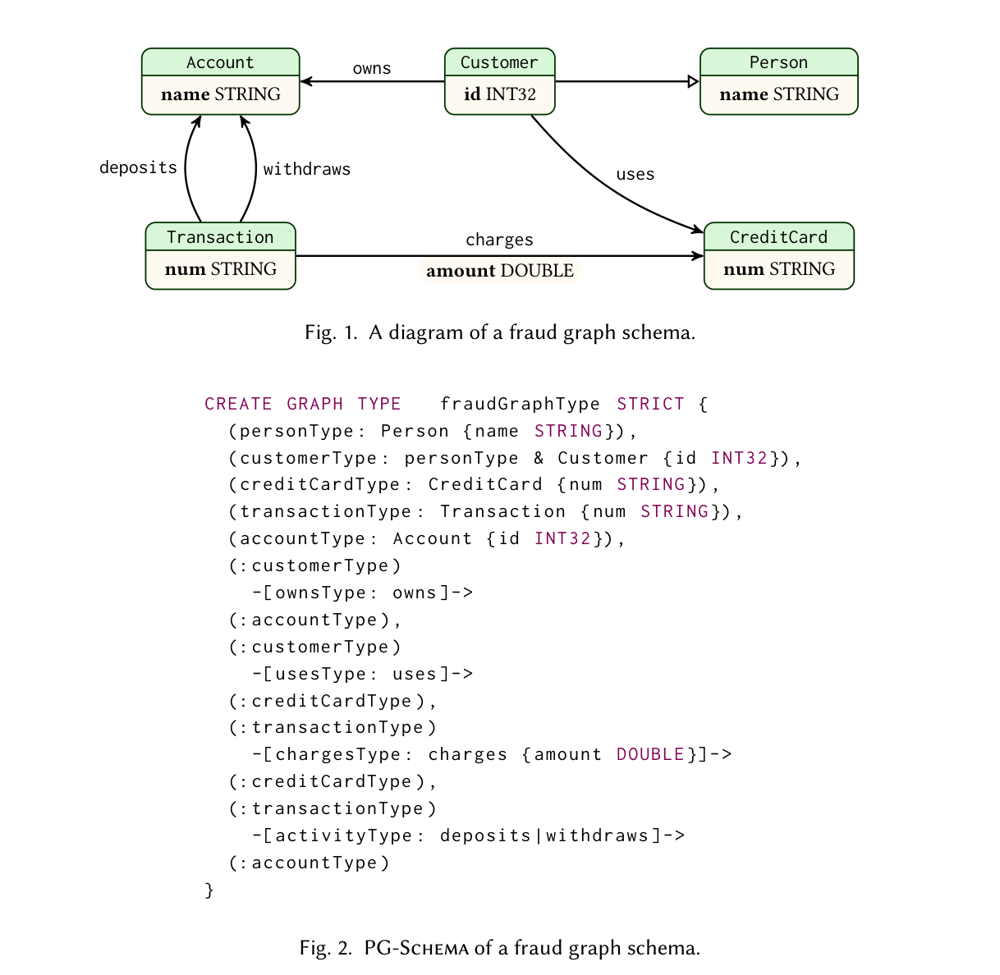
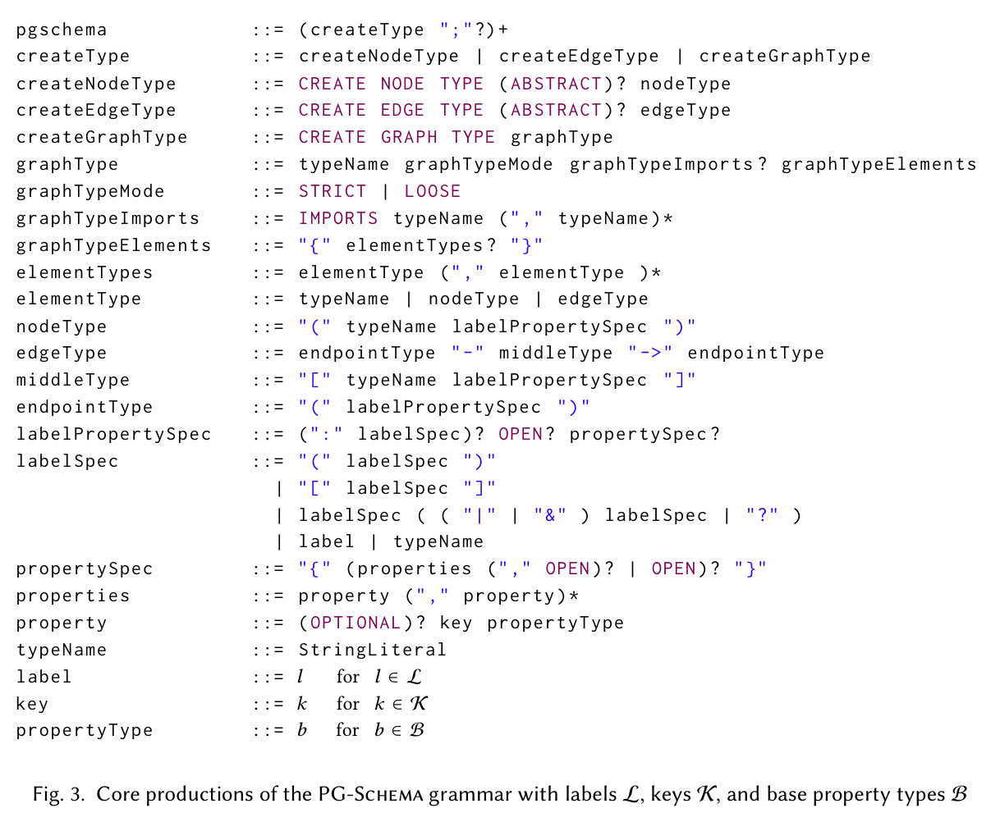
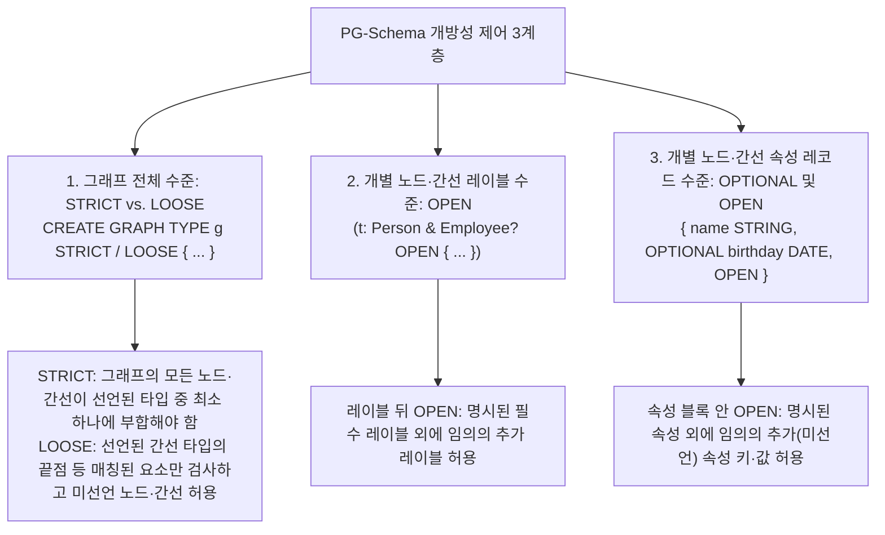
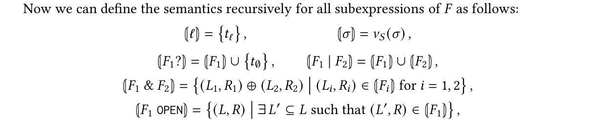
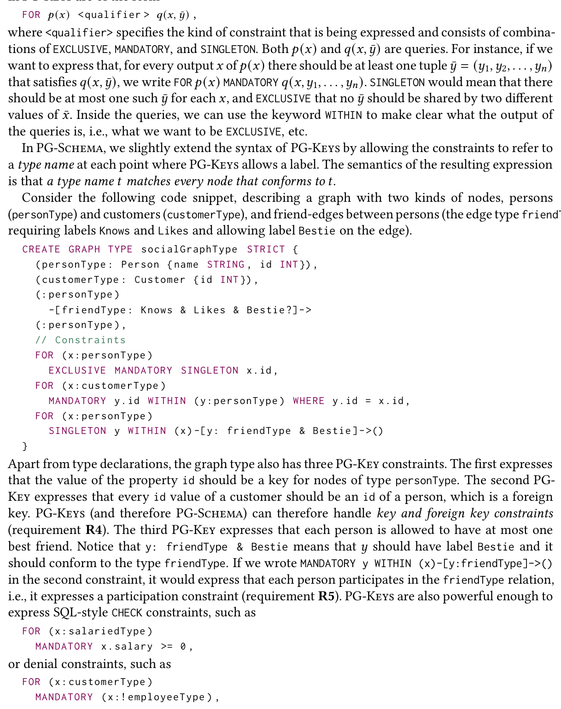
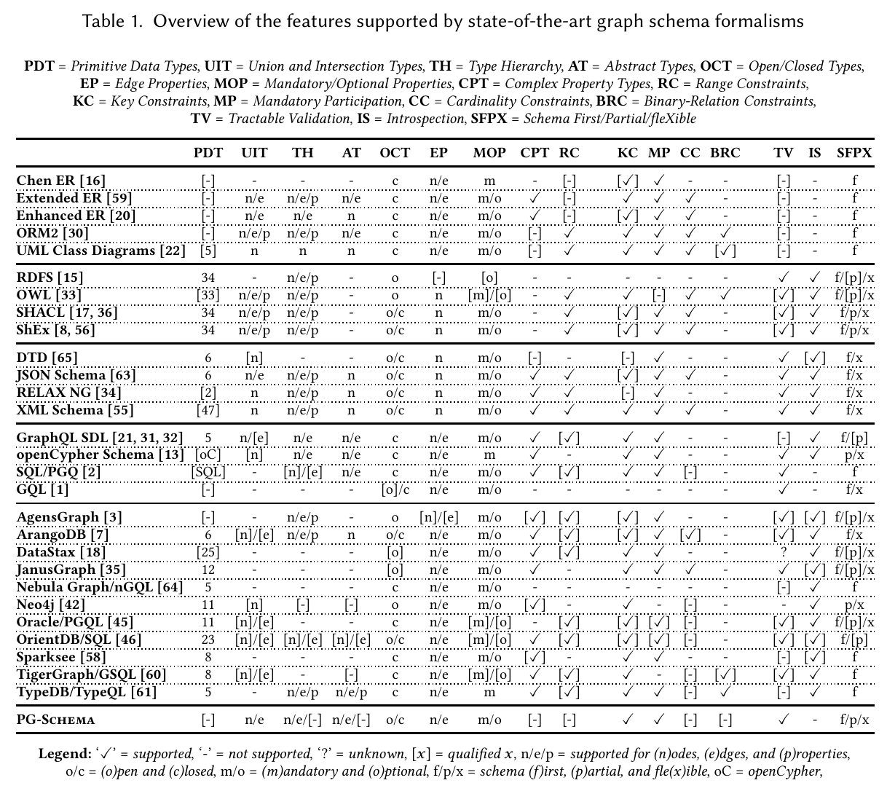

# PG-Schema 리뷰: 다중 상속 타입(PG-Types)과 PG-Keys를 결합한 속성 그래프 스키마 표준 청사진

속성 그래프(Property Graph) 데이터베이스는 스키마를 미리 고정하지 않고도 데이터를 적재할 수 있다는 유연성 덕분에 빠르게 보급되었다. 그러나 금융 사기 탐지, 제조 추적성, 고객 통합처럼 데이터 규모와 파이프라인 복잡도가 커지면 어떤 노드·간선 타입이 허용되고 어느 부분만 유연하게 열어 둘지 명시적인 스키마로 통제해야 한다. SIGMOD 2023에 발표된 **PG-Schema**는 LDBC 속성 그래프 스키마 워킹그룹의 학계·산업계 연구자 21명이 2년여의 논의를 거쳐 완성한 속성 그래프 스키마 정의 언어(DDL)다.

이 글은 2026년 11월 19일에 작성한 장별 심층 리뷰다. 논문의 1장부터 6장까지를 따라가며 금융 사기 그래프 스키마 예제(그림 1, 그림 2), 스키마리스에서 엄격한 스키마까지 아우르는 10대 설계 요구사항(R1–R10), 다중 상속·추상 타입·열린(`OPEN`)/닫힌(`STRICT`/`LOOSE`) 조합을 지원하는 **PG-Types**의 핵심 문법(그림 3)과 대수적 컴파일 의미론($\oplus$ 연산자), [PG-Keys](2026-11-19-review-pg-keys.md)를 타입 기반으로 확장한 일반 제약 계층, 그리고 ER·RDFS·OWL·SHACL·ShEx·JSON Schema·상용 그래프 DB 21종을 16개 기능 축으로 전수 비교한 표 1을 차례로 읽는다. 원문의 도면 3점, 수식·코드 1점, 비교표 1점은 저자 공개 arXiv v4 최종 PDF에서 216 DPI로 가져왔고 설명을 위해 새로 그린 도식은 Mermaid로 구분했다.

## 논문 정보와 검토 범위

| 항목 | 내용 |
|---|---|
| 제목 | PG-Schema: Schemas for Property Graphs |
| 저자 | Renzo Angles, Angela Bonifati, Stefania Dumbrava, George Fletcher, Alastair Green, Jan Hidders, Bei Li, Leonid Libkin, Victor Marsault, Wim Martens, Filip Murlak, Stefan Plantikow, Ognjen Savković, Michael Schmidt, Juan Sequeda, Sławek Staworko, Dominik Tomaszuk, Hannes Voigt, Domagoj Vrgoč, Mingxi Wu, Dušan Živković |
| 소속 | LDBC Property Graph Schema Working Group (Neo4j, TigerGraph, AWS, Google, Oracle, RelationalAI, LDBC, Univ. of Edinburgh, TU Eindhoven, Inria 등 학계·산업계 21인 공동 저술; 저자 중 7인은 ISO/IEC JTC1 SC32 WG3 GQL 표준 위원) |
| 발표 | *Proceedings of the ACM on Management of Data (PACMMOD / SIGMOD '23)*, Vol. 1, No. 2, Article 198 (2023년 6월) |
| 읽은 판본 | arXiv v4 (2023년 7월 8일 개정, SIGMOD 2023 출판본과 동일한 26쪽 최종본) |
| 원문 | [ACM DOI](https://doi.org/10.1145/3589778) · [arXiv 페이지](https://arxiv.org/abs/2211.10962) · [원문 PDF](https://arxiv.org/pdf/2211.10962) |

이 논문은 ISO GQL 및 SQL/PGQ 표준에 속성 그래프 스키마(DDL)를 도입하기 위한 언어 설계, 형식 의미론, 계산 가능성(Tractability), 그리고 21개 기존 스키마 체계와의 비교를 다룬 연구다. 원문과 원문 수록 도면·표는 [CC BY 4.0](https://creativecommons.org/licenses/by/4.0/) 라이선스로 배포되며 이미지별 원본 페이지·좌표·SHA256 해시는 [그림 출처 기록](../assets/images/pg-schema/provenance.json)에 남겼다.

## 원문 구성과 읽기 지도

| 원문 | PDF 쪽 | 핵심 내용 |
|---|---|---|
| 1 Introduction | 2–5 | 속성 그래프 스키마의 필요성과 금융 사기 탐지 그래프 스키마 예제(그림 1, 그림 2) |
| 2 Design Requirements | 5–7 | 타입(Types)과 제약(Constraints)의 역할 분담, 유연한 스키마 진화를 위한 10대 요구사항(R1–R10) |
| 3 Data Model | 8 | 속성 그래프 $G = (N_G, E_G, \text{src}_G, \text{tgt}_G, \lambda_G, \pi_G)$ 및 기본 데이터 타입($\mathcal{B}$), 레코드 타입 형식화 |
| 4 PG-Schema (4.1–4.4) | 8–17 | PG-Types 핵심 문법(그림 3), 다중 상속과 `OPEN`/`STRICT`/`LOOSE`, 형식 컴파일 의미론($\oplus$), 그래프 검증과 스키마 자동 추출(4.3), PG-Keys 기반 제약 결합(4.4) |
| 5 Relationship to Other Paradigms | 17–22 | ER/UML, RDFS/OWL/SHACL/ShEx, XML/JSON Schema, GraphQL/SQL/PGQ, 상용 그래프 DB 등 21개 체계의 16개 기능 비교(표 1) 및 확장 방향(5.3) |
| 6 Summary and Looking Ahead | 22–23 | ISO GQL 표준 반영 현황 및 요약 |

## 1장–2장: 왜 속성 그래프 스키마는 '엄격함'과 '부분적 유연성'을 동시에 갖춰야 하는가

### 1.1 금융 사기 탐지 그래프 스키마로 보는 핵심 아이디어

관계형 DB는 스키마를 먼저 정의해야만 데이터를 넣을 수 있는 **Schema-First(닫힌 스키마)** 방식이고, 초기 그래프 DB나 문서형 DB는 아무 스키마 없이 데이터를 넣는 **Schemaless(열린 스키마)** 방식이었다. 그러나 현업 그래프 애플리케이션은 두 극단 사이의 **부분적·점진적 스키마(Partial / Flexible Schema)**를 요구한다. 예를 들어 핵심 결제 트랜잭션과 계좌 노드는 엄격한 타입과 필수 속성으로 통제하되, 사기 탐지 분석가가 새로 붙이는 실험적 위험 점수나 추가 레이블은 스키마 변경 승인 없이도 허용하고 싶을 때가 많다.

저자들은 1장에서 금융 사기(Fraud) 그래프 스키마 다이어그램(원문 그림 1)과 이에 대응하는 **PG-Schema 선언 코드(원문 그림 2)**를 나란히 제시하며 논의를 시작한다.



그림 1·그림 2. 금융 사기 탐지 그래프 스키마의 시각적 다이어그램(그림 1)과 이를 선언한 `CREATE GRAPH TYPE fraudGraphType STRICT { ... }` 코드(그림 2). Angles et al., PDF 3쪽. [원문](https://arxiv.org/pdf/2211.10962#page=3) · [크게 보기](../assets/images/pg-schema/figure-01-02-fraud-schema.png) · [CC BY 4.0](https://creativecommons.org/licenses/by/4.0/).

그림 2의 짧은 코드 안에 이미 PG-Schema의 주요 특징이 녹아 있다.

- `(personType: Person {name STRING})`: 레이블이 `Person`이고 문자열 속성 `name`을 갖는 노드 타입 `personType`을 정의한다.
- `(customerType: personType & Customer {id INT32})`: **타입 교집합(`&`)을 통한 상속**이다. `customerType`은 기존 `personType`의 모든 요구사항(레이블 `Person`과 속성 `name STRING`)을 물려받으면서 동시에 추가 레이블 `Customer`와 추가 속성 `id INT32`를 갖는다.
- `(:transactionType)-[activityType: deposits | withdraws]->(:accountType)`: **레이블 합집합(`|`)을 통한 간선 타입 정의**다. 거래 노드에서 계좌 노드로 향하는 `activityType` 간선은 레이블이 `deposits`이거나 `withdraws` 중 하나면 된다.

### 1.2 타입(PG-Types)과 제약(PG-Keys)의 역할 분담 및 10대 요구사항

2.2절과 2.3절에서 저자들은 스키마 언어를 **타입(PG-Types)**과 **제약(Constraints)** 두 부분으로 나눈 이유를 설명한다.

- **PG-Types (구조와 로컬 형태 기술)**: 그래프 안에 어떤 종류의 노드와 간선이 존재할 수 있는지, 각 노드·간선이 어떤 레이블과 속성 타입을 가지며 어떤 타입의 끝점(source/target)끼리 연결될 수 있는지를 **선언적·합성적(compositional)**으로 정의한다.
- **Constraints (전역 무결성 및 키·참조·카디널리티 제약)**: 앞서 발표된 [PG-Keys](2026-11-19-review-pg-keys.md) 문법을 확장해 기본 키, 외래 키, 의무 참여(mandatory participation), SQL 스타일 `CHECK` 제약, 배타적 부정(denial) 제약을 표현한다.

이를 바탕으로 도출한 10대 설계 요구사항(R1–R10)은 다음과 같다: **R1**(노드·간선·속성 타이핑), **R2**(레이블과 타입 이름의 분리), **R3**(다중 상속과 타입 계층), **R4**(키 및 외래 키), **R5**(참여 및 카디널리티 제약), **R6**(속성값 제약), **R7**(완전 닫힌 스키마부터 완전 열린 스키마까지의 세밀한 개방성 조절), **R8**(타입 조합·재사용·임포트), **R9**(기존 그래프에서 스키마 자동 추출/Introspection), **R10**(낮은 검증 복잡도 / Tractable Validation).

## 3장–4장: PG-Types의 문법, 다중 상속, 개방성 제어와 형식 의미론

### 3.1 PG-Schema의 핵심 문법(원문 그림 3)과 세 층위의 개방성(`STRICT`, `LOOSE`, `OPEN`)

4.1절의 원문 그림 3은 PG-Schema의 핵심 문법 생성 규칙(BNF)을 보여 준다.



그림 3. 레이블 집합 $\mathcal{L}$, 속성 키 집합 $\mathcal{K}$, 기본 데이터 타입 $\mathcal{B}$ 위에서 정의된 PG-Schema의 BNF 문법. Angles et al., PDF 9쪽. [원문](https://arxiv.org/pdf/2211.10962#page=9) · [크게 보기](../assets/images/pg-schema/figure-03-core-grammar.png) · [CC BY 4.0](https://creativecommons.org/licenses/by/4.0/).

그림 3에서 실무적으로 가장 정교하게 설계된 부분은 **열린 스키마와 닫힌 스키마를 세 가지 서로 다른 입도(granularity)에서 조합할 수 있는 메커니즘**이다.



1. **속성 수준(`OPTIONAL`과 `{ ... OPEN }`)**:
   - `{name STRING, OPTIONAL birthday DATE}`는 닫힌 레코드 타입으로, `name`은 필수, `birthday`는 선택이며 그 외의 속성은 허용하지 않는다.
   - 반면 `{name STRING, OPEN}`처럼 중괄호 안에 `OPEN`을 적으면 `name`은 반드시 `STRING`이어야 하지만 그 외에 어떤 미선언 속성이 추가로 붙어도 통과한다.
2. **레이블 수준(`?`, `|`, `&`, 그리고 `OPEN`)**:
   - `(personType: Person &Taxpayer? OPEN {name STRING})`처럼 레이블 식 뒤에 `OPEN`을 적으면 `Person` 레이블은 필수이고 그 외에 어떤 추가 레이블이 붙어도 허용된다.
3. **그래프 전체 수준(`STRICT` vs. `LOOSE`)**:
   - `CREATE GRAPH TYPE ... STRICT`는 그래프 안의 **모든 노드와 모든 간선**이 그래프 타입 안에 선언된 노드 타입·간선 타입 중 적어도 하나에 부합(conform)할 것을 요구한다.
   - `CREATE GRAPH TYPE ... LOOSE`는 부분 스키마(Partial Schema) 모드로, 선언된 타입과 매칭되는 요소들의 구조·제약만 검사하고 아직 스키마에 정의되지 않은 새로운 종류의 노드나 간선이 공존하는 것을 허용한다.

### 3.2 다중 상속(Multi-inheritance)과 추상 타입(`ABSTRACT`)

객체지향이나 현실 도메인에서는 한 개체가 여러 상위 개념을 동시에 상속받는 다중 상속이 흔하다. PG-Schema는 타입 이름들을 `&`(교집합) 연산자로 묶어 이를 자연스럽게 해결한다.

```text
CREATE NODE TYPE ABSTRACT (employedType {manager STRING, salary INT});
CREATE NODE TYPE (personType : Person {name STRING, OPTIONAL birthday DATE});
CREATE NODE TYPE (employeeType : personType & employedType & Employee {
    birthday DATE, OPEN
});
```

- `employedType`은 자체 레이블이 없는 **추상 타입(`ABSTRACT`)**이다. 단독으로는 노드에 매칭되지 않고 다른 타입에 상속될 공통 속성 묶음(`manager`, `salary`)을 정의할 때 쓰인다.
- `employeeType`은 `personType`과 `employedType`을 다중 상속(`&`)받으면서 자신의 레이블 `Employee`를 추가하고, 상위 타입(`personType`)에서 `OPTIONAL`이었던 `birthday DATE`를 필수로 재정의(override/refinement)하며, 추가 속성까지 열었다(`OPEN`).

### 3.3 형식 의미론과 스키마 컴파일(4.2절–4.3절)

4.2절은 문법적으로 선언된 타입 식 $F$를 형식 기본 타입(formal base type, 레이블 집합 $L$과 허용 레코드 타입 집합 $R$의 쌍 $(L, R)$)들의 집합 $\llbracket F \rrbracket$로 풀어내는 재귀적 컴파일 의미론을 정의한다(원문 14쪽 캡처).



원문 4.2절 발췌. 노드 타입 식 $F$의 재귀적 평가 의미론 $\llbracket F \rrbracket$. 합집합(`|`)은 집합 합집합($\cup$)으로, 교집합/다중 상속(`&`)은 레이블 합집합과 레코드 타입 교집합을 결합하는 $\oplus$ 연산자로 정의된다. Angles et al., PDF 14쪽. [원문](https://arxiv.org/pdf/2211.10962#page=14) · [크게 보기](../assets/images/pg-schema/semantics-node-edge-types.png) · [CC BY 4.0](https://creativecommons.org/licenses/by/4.0/).

여기서 두 형식 기본 타입 $(L_1, R_1)$과 $(L_2, R_2)$를 결합하는 연산자 $\oplus$는 다음과 같이 정의된다.

$$(L_1, R_1) \oplus (L_2, R_2) \;=\; (L_1 \cup L_2,\; R_1 \cap R_2)$$

즉 두 타입을 `&`로 다중 상속받으면 **요구되는 레이블 집합은 합쳐지고($L_1 \cup L_2$), 허용되는 속성 레코드의 집합은 두 조건을 모두 만족하는 교집합($R_1 \cap R_2$)으로 좁혀진다.** 만약 한 상위 타입에서는 `{age INT}`를 요구하고 다른 상위 타입에서는 `{age STRING}`을 요구해 $R_1 \cap R_2 = \emptyset$이 되면 모순된 상속이 되어 어떤 노드도 그 타입에 부합할 수 없게 된다.

이어지는 4.3절에서는 두 가지 실용적 정리를 제시한다.

1. **다항 시간 검증(Validation)**: 주어진 속성 그래프 $G$의 각 노드 $u \in N_G$와 간선 $e \in E_G$에 대해 부합하는 타입 집합 $\text{Types}(u)$, $\text{Types}(e)$를 계산해 $G$가 그래프 타입 $S$를 만족하는지 판정하는 작업은 매우 효율적으로(데이터 크기에 대해 선형/다항 시간 안에) 수행된다.
2. **기존 그래프에서 그래프 타입 자동 생성(Graph Type Generation)**: 스키마 없이 운영하던 기존 속성 그래프 $G$가 주어졌을 때, 각 노드와 간선이 가진 `(레이블 집합, 속성 키:타입 매핑)` 시그니처를 모아 $G$가 완벽히 부합하는 가장 구체적인 `STRICT` 그래프 타입을 자동으로 역추출(introspection)할 수 있다.

### 3.4 4.4절: PG-Types 위에 올라탄 PG-Keys와 일반 제약

4.4절(원문 16쪽 캡처)은 앞서 정의한 **타입 이름(`personType`, `customerType`, `friendType` 등)을 [PG-Keys](2026-11-19-review-pg-keys.md)의 질의 패턴 안에서 레이블 대신 직접 참조**할 수 있게 확장한다.



원문 4.4절 발췌. `CREATE GRAPH TYPE socialGraphType STRICT` 내부에서 노드·간선 타입 이름을 참조해 기본 키, 외래 키, 단일 단짝 친구 제약, 급여 범위(`CHECK`), 고객-직원 배타성(Denial constraint)을 선언한 코드. Angles et al., PDF 16쪽. [원문](https://arxiv.org/pdf/2211.10962#page=16) · [크게 보기](../assets/images/pg-schema/constraints-within-graph-type.png) · [CC BY 4.0](https://creativecommons.org/licenses/by/4.0/).

원문 16쪽 코드가 보여 주듯 `FOR p(x) <qualifier> q(x, \bar{y})` 문법 하나로 다음 다섯 가지 제약이 모두 표현된다.

1. **기본 키(Primary Key)**:
   ```text
   FOR (x:personType) EXCLUSIVE MANDATORY SINGLETON x.id
   ```
2. **외래 키(Foreign Key)**:
   ```text
   FOR (x:customerType) MANDATORY y.id WITHIN (y:personType) WHERE y.id = x.id
   ```
3. **간선 카디널리티 제약 (최대 1명의 단짝 친구)**:
   ```text
   FOR (x:personType) SINGLETON y WITHIN (x)-[y: friendType & Bestie]->()
   ```
4. **의무 참여 제약 (Mandatory Participation)**:
   ```text
   FOR (x:personType) MANDATORY y WITHIN (x)-[y: friendType]->()
   ```
5. **속성값 범위(`CHECK`) 및 클래스 서로소(Denial / Disjointness) 제약**:
   ```text
   FOR (x:salariedType) MANDATORY x.salary >= 0
   FOR (x:customerType) MANDATORY (x: !employeeType)
   ```

## 5장–6장: 21개 스키마 체계 전수 비교(원문 표 1)와 시사점

### 5.1 SHACL·OWL·JSON Schema·상용 그래프 DB와의 16개 기능 축 비교

5장의 백미는 개념적 모델(ER, ORM2, UML), RDF/시맨틱 웹(RDFS, OWL, SHACL, ShEx), 트리/문서 스키마(DTD, JSON Schema, XML Schema), 질의/API 스키마(GraphQL, openCypher, SQL/PGQ, 초기 GQL), 그리고 상용 그래프 DB 10종(Neo4j, TigerGraph, JanusGraph, Oracle PGQL, TypeDB 등)까지 **총 21개 스키마 체계와 PG-Schema를 16개 기능 축으로 대조한 원문 표 1**이다.



표 1. 21개 데이터/그래프 스키마 형식 체계와 PG-Schema의 16개 기능 지원 비교표. Angles et al., PDF 18쪽. [원문](https://arxiv.org/pdf/2211.10962#page=18) · [크게 보기](../assets/images/pg-schema/table-01-feature-comparison.png) · [CC BY 4.0](https://creativecommons.org/licenses/by/4.0/).

표 1에서 약어로 표시된 주요 기능 축과 SHACL vs. PG-Schema의 차이를 짚어 보면 다음과 같다.

| 기능 축 (약어) | 기능 설명 | W3C SHACL | PG-Schema (SIGMOD 2023) |
|---|---|---|---|
| **UIT** (Union & Intersection Types) | 타입의 합집합(`\|`)과 교집합(`&`) | 노드(`sh:or`, `sh:and`) 및 경로 지원 (`n/e/p`) | 노드 타입과 간선 타입 모두 1급 문법으로 지원 (`n/e`) |
| **TH** (Type Hierarchy) | 서브타이핑 및 다중 상속 계층 | RDFS 서브클래스 및 모양 참조 지원 (`n/e/p`) | 노드·간선 타입의 명시적 다중 상속 지원 (`n/e/[-]`) |
| **AT** (Abstract Types) | 직접 인스턴스화되지 않는 추상 타입 | 코어 표준에 별도 `ABSTRACT` 키워드 없음 (`-`) | `CREATE NODE/EDGE TYPE ABSTRACT` 직접 지원 (`n/e/[-]`) |
| **OCT** (Open/Closed Types) | 열린 타입과 닫힌 타입의 선택·조합 | 기본은 Open, `sh:closed true`로 노드 닫기 가능 (`o/c`) | 그래프(`STRICT`/`LOOSE`)·레이블(`OPEN`)·속성(`OPEN`) 3단계 세밀 제어 (`o/c`) |
| **EP** (Edge Properties) | 간선(Edge) 자체에 대한 속성 타입 선언 | 표준 RDF 트리플에는 간선 속성이 없음 (`n`, RDF-star 별도) | 멀티그래프 간선 레코드 타입 직접 지원 (`n/e`) |
| **KC** (Key Constraints) | 복합 속성+위상 키 제약 | 부분 지원 (`[✓]`, 복합 전역 배타성은 SPARQL 제약 필요) | PG-Keys 통합으로 노드·간선·속성 복합 키 완전 지원 (`✓`) |
| **TV** (Tractable Validation) | 다항 시간 내 검증 보장 | 재귀·부정·카디널리티 결합 시 NP-hard 가능 (`[✓]`) | 비재귀 계층화 구조와 CQ 제약으로 다항 시간 검증 보장 (`✓`) |
| **SFPX** (Schema First/Partial/fleXible) | 엄격한 선스키마, 부분 스키마, 사후 유연 스키마 | 모양 타깃에 따라 모두 가능 (`f/p/x`) | `STRICT` / `LOOSE` / `OPEN` 조합으로 모두 가능 (`f/p/x`) |

### 5.2 우리 연구(`shacl-graphrag` 및 RDF↔LPG 브리지)에의 시사점

이 논문은 앞서 리뷰한 [rdf2pg 리뷰](2026-11-05-review-rdf2pg.md), [OWL과 SHACL 의미론 리뷰](2026-11-05-review-owl-shacl-semantics.md), 그리고 [PG-Keys 리뷰](2026-11-19-review-pg-keys.md)를 하나로 이어 주는 핵심 고리다.

1. **SHACL의 `sh:closed`와 PG-Schema의 `STRICT` / `LOOSE` / `OPEN` 대응**:
   - RDF/SHACL에서 엔터프라이즈 스키마를 작성할 때 가장 번거로운 점 중 하나가 "기본적으로는 열린 그래프이지만 핵심 엔티티는 닫고(`sh:closed true`), 그 안에서도 일부 확장 메타데이터만 열어 두는" 세밀한 개방성 조절이다.
   - PG-Schema가 제시한 **그래프 수준(`STRICT`/`LOOSE`) · 레이블 수준(`OPEN`) · 속성 수준(`OPTIONAL`/`OPEN`)의 3단 분리**는 JSON/LPG 기반 워크스페이스(`apps/factory_lab/workspace_*`)나 RDF-LPG 양방향 변환 스키마를 설계할 때 그대로 차용할 수 있는 가장 깔끔한 추상화다.
2. **타입 추론($\text{Types}(u)$)과 제약 검증($\text{FOR } p(x) \dots$)의 2단계 파이프라인**:
   - PG-Schema는 먼저 각 노드와 간선이 어떤 구조적 타입(`personType`, `customerType`)에 부합하는지 로컬 매칭($\text{Types}: N_G \cup E_G \to 2^{N_S} \cup 2^{E_S}$)으로 결정한 뒤, 그 타입 이름을 범위·서술자 질의에서 참조해 PG-Keys 제약을 검사한다.
   - 이는 SHACL에서 타깃 선택(`sh:targetClass` 또는 암묵적 모양 타입)과 제약 컴포넌트 검사를 나누거나, OWL-RL/RDFS 타입 폐포를 먼저 계산한 뒤 SHACL을 적용하는 2단계 검증 아키텍처와 구조적으로 일맥상통한다. ISO GQL 표준이 이 PG-Schema를 기반으로 확정되어 가고 있는 만큼, 향후 속성 그래프와 RDF/SHACL 하이브리드 시스템을 설계할 때 필수 기준점이 되는 논문이다.
