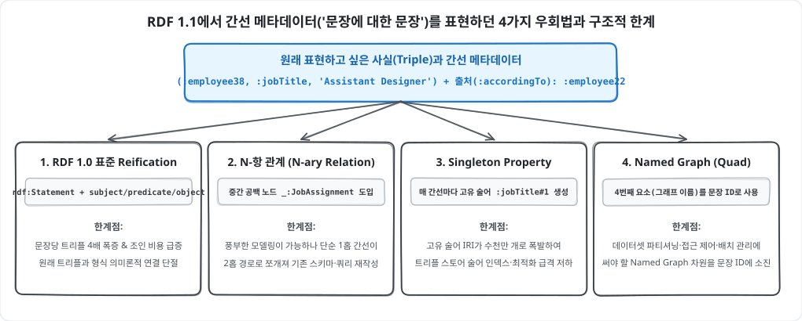
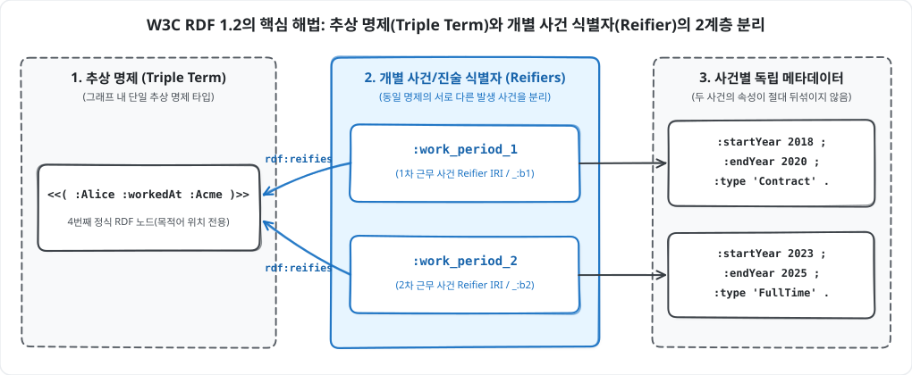

# W3C RDF 1.2 및 RDF-star 리뷰: 1999년 Reification과 RDF 1.1에서 Triple Term·Reifier 표준화까지의 진화

지식 그래프에서 `(앨리스, 직급, 수석 엔지니어)`라는 사실 하나를 기록하는 일은 간단하다. 하지만 실무에서는 곧바로 다음 질문이 따라붙는다. **"누가 그 사실을 주장했는가? 언제부터 언제까지 유효한가? 추출 신뢰도는 0.95인가, 아니면 아직 확인되지 않은 소문인가?"** 속성 그래프(Property Graph, LPG)에서는 간선(Edge) 자체에 키-값 속성을 바로 달 수 있지만, 표준 RDF에서는 오랫동안 이 '문장에 대한 문장(Statement about statements)' 문제가 가장 큰 아킬레스건이었다.

이 문제를 해결하기 위해 학계와 산업계가 제안한 **RDF\*(RDF-star)**는 2021년 W3C 커뮤니티 그룹 최종 보고서(CG Report)를 거쳐, 현재 W3C RDF & SPARQL 워킹그룹에 의해 **RDF 1.2** 및 **SPARQL 1.2**라는 정식 W3C 차세대 표준군으로 완성되고 있다. 특히 **2021년 RDF-star 초안과 2026년 최종 RDF 1.2 표준 사이에는 매우 중요한 아키텍처적 변화(Quoted Triple 직결 방식에서 `Triple Term` + `Reifier`(`rdf:reifies`) 2계층 분리로의 전환, 그리고 기본 투명 의미론 채택)**가 일어났다.

이 글은 W3C 공식 명세인 **[What's New in RDF 1.2](https://www.w3.org/TR/rdf12-new/)**, **[RDF 1.2 Concepts and Abstract Data Model](https://www.w3.org/TR/rdf12-concepts/)** (Candidate Recommendation Draft), **[RDF 1.2 Turtle](https://www.w3.org/TR/rdf12-turtle/)**, **[RDF 1.2 Semantics](https://www.w3.org/TR/rdf12-semantics/)** 네 문서를 바탕으로 작성한 심층 리뷰다. 먼저 서두에서 기존 기준이던 **RDF 1.0(1999/2004) 및 RDF 1.1(2014)**의 구조와 고전적 메타데이터 표현 방식 4가지의 한계를 짚어 본다. 이어서 **2021년 RDF-star CG 보고서가 왜 RDF 1.2에서 `Triple Term`과 `Reifier` 구조로 진화했는지**, Turtle 1.2의 세 가지 핵심 구문(`<<( ... )>>`, `<< ... ~ :id >>`, `{| ... |}`), 양방향 텍스트 방향(`rdf:dirLangString`), `rdf:JSON`, `VERSION "1.2"` 협상 메커니즘을 원문 예제·도면과 함께 분석하고, 마지막에 **RDF 1.1 vs. RDF-star(2021) vs. RDF 1.2(2026) 전수 비교표**로 정리한다.

## 문서 정보와 검토 범위

| 항목 | 내용 |
|---|---|
| 검토 대상 명세 | 1. **RDF 1.2 Concepts and Abstract Data Model** (W3C Candidate Recommendation Draft, 2026년 11월 16일 판) <br> 2. **What's New in RDF 1.2** (W3C Group Note Draft, 2026년 7월 14일 판) <br> 3. **RDF 1.2 Turtle** (W3C Working Draft, 2026년 6월 12일 판) <br> 4. **RDF 1.2 Semantics** (W3C Candidate Recommendation, 2026년 4월 7일 판) |
| 발행 그룹 | W3C RDF & SPARQL Working Group |
| 주요 편집자 | Gregg Kellogg, Olaf Hartig, Pierre-Antoine Champin, Andy Seaborne, Peter Patel-Schneider, Enrico Franconi, Dörthe Arndt, Ora Lassila, Dominik Tomaszuk |
| 원문 링크 | [RDF 1.2 Concepts](https://www.w3.org/TR/rdf12-concepts/) · [What's New in RDF 1.2](https://www.w3.org/TR/rdf12-new/) · [RDF 1.2 Turtle](https://www.w3.org/TR/rdf12-turtle/) · [RDF 1.2 Semantics](https://www.w3.org/TR/rdf12-semantics/) · [RDF 1.1 Concepts (2014)](https://www.w3.org/TR/rdf11-concepts/) |

본문에 수록한 원문 그림 2점(Figure 3, Figure 4)은 W3C `RDF 1.2 Concepts` 명세에서 제공하는 공식 SVG 도면이며, 출처·라이선스·SHA256 해시는 [그림 출처 기록](../assets/images/rdf-12/provenance.json)에 남겼다.

---

## 1장: 이전 기준이던 RDF 1.0(1999/2004)과 RDF 1.1(2014)의 구조 및 한계

### 1.1 RDF 1.0에서 RDF 1.1까지의 핵심 데이터 모델

1999년 최초 제정되고 2004년 개정된 **RDF 1.0**, 그리고 2014년 발표된 **RDF 1.1**은 웹상의 지식을 방향성 그래프(Directed Graph)로 표현하는 추상 데이터 모델을 확립했다.

- **RDF 1.1의 3대 기본 항(Basic RDF Terms)**:
  1. **IRI (Internationalized Resource Identifier)**: 전역 식별자 (RDF 1.0의 URI Reference를 국제화한 것).
  2. **Literal (리터럴)**: 문자열, 숫자, 날짜 등의 값. RDF 1.1에서는 모든 리터럴이 데이터타입을 갖도록 통일되어 단순 문자열은 `xsd:string`이 되고, 언어 태그가 붙은 문자열(`"안녕"@ko`)은 `rdf:langString` 타입을 갖는다.
  3. **Blank Node (공백 노드)**: 전역 IRI를 부여하지 않고 그래프 내부에서만 국소적으로 쓰이는 익명 존재 노드(`_:b0`).
- **RDF 1.1 트리플(Triple)의 엄격한 제약**:
  하나의 RDF 트리플 $(s, p, o)$에서 주어 $s \in \mathcal{I} \cup \mathcal{B}$, 술어 $p \in \mathcal{I}$, 목적어 $o \in \mathcal{I} \cup \mathcal{B} \cup \mathcal{L}$이어야 한다. 즉 **트리플 자체가 또 다른 트리플의 주어나 목적어 자리에 직접 들어갈 수 없었다.**
- **RDF 1.1의 주요 추가 사항(2014년)**:
  RDF/XML 일변도에서 벗어나 **Turtle, TriG, N-Triples, N-Quads, JSON-LD**를 정식 직렬화 표준으로 채택했고, 기본 그래프 하나와 여러 개의 명명된 그래프(Named Graphs, `(s, p, o, g)`)를 묶어 다루는 **RDF Dataset** 개념을 공식화했다.

### 1.2 RDF 1.1에서 '간선 메타데이터(문장에 대한 문장)'를 표현하던 4가지 우회법과 한계

RDF 1.1에서 `:employee38 :jobTitle "Assistant Designer"`라는 문장에 대해 *"이 사실은 `:employee22`가 주장했다(`:accordingTo`)"*라는 메타데이터를 붙이려면 네 가지 우회법 중 하나를 택해야 했다.



그림: RDF 1.1에서 개별 트리플(간선)에 출처·시간 등 메타데이터를 부여할 때 사용하던 4가지 우회법과 각각의 구조적 한계 ([SVG 크게 보기](../assets/images/rdf-12/excalidraw-rdf11-workarounds.svg) · [Excalidraw 원본](../assets/images/rdf-12/excalidraw-rdf11-workarounds.excalidraw)).

1. **고전적 RDF 1.0 Reification (`rdf:Statement`)**:
   ```turtle
   :employee38 :jobTitle "Assistant Designer" .
   _:stmt a rdf:Statement ;
          rdf:subject   :employee38 ;
          rdf:predicate :jobTitle ;
          rdf:object    "Assistant Designer" ;
          :accordingTo  :employee22 .
   ```
   문장 하나에 메타데이터를 달 때마다 `rdf:type`, `rdf:subject`, `rdf:predicate`, `rdf:object` **4개의 보일러플레이트 트리플이 폭발**하며, SPARQL 조인 횟수가 급증한다. 게다가 형식 의미론이 매우 약해 `RDF 1.2 Semantics`(부록 G.2)에서는 아예 고전적 Reification 부록을 "의미론적 내용이 없다(no semantic content)"는 이유로 제거하고 레거시 어휘로 분류했다.
2. **N-항 관계(N-ary Relation / 중간 이벤트 노드 도입)**:
   `:employee38 :hasJobAssignment [ :role "Assistant Designer" ; :accordingTo :employee22 ]`처럼 중간 노드를 끼워 넣는 방식이다. 모델링 자체는 풍부하지만 단순했던 1홉 간선(`:jobTitle`)이 2홉 경로로 쪼개져 기존 온톨로지와 SPARQL 쿼리를 전부 뜯어고쳐야 한다.
3. **Singleton Property**:
   `:jobTitle_1 rdf:singletonPropertyOf :jobTitle`처럼 간선 인스턴스마다 새로운 술어 IRI를 만드는 방식인데, 고유 술어 수가 수천만 개로 늘어나면서 술어 수가 적다고 가정하는 일반 트리플 스토어의 인덱스가 급격히 느려진다.
4. **Named Graphs (Quads)**:
   각 트리플마다 고유 그래프 이름을 부여하는 방식은 원래 데이터셋 파티셔닝·접근 제어·배치 관리에 써야 할 Named Graph 차원을 개별 트리플 식별에 소진해 버린다는 한계가 있었다.

---

## 2장: 2021년 RDF-star에서 2026년 W3C RDF 1.2로의 결정적 진화

### 2.1 RDF-star(2021 CG Report)가 처음 제안했던 것과 현업에서 부딪힌 두 가지 난제

Olaf Hartig 등이 제안하고 2021년 12월 W3C 커뮤니티 그룹 보고서로 정리된 초기 **RDF-star**는 매우 직관적인 해법을 내놓았다. 트리플을 `<< :s :p :o >>`라는 **인용된 트리플(Quoted Triple)**로 감싸서 다른 트리플의 주어나 목적어 자리에 직접 넣는 것이었다.

```turtle
# 2021년 초기 RDF-star CG 구문: Quoted Triple이 직접 주어가 됨
<< :employee38 :jobTitle "Assistant Designer" >> :accordingTo :employee22 .
```

하지만 이 2021년 RDF-star를 실제 상용 그래프 DB(GraphDB, Stardog, Neptune, Jena, Oxigraph 등)와 LPG(Neo4j) 브리지에 적용해 보자 두 가지 심각한 문제가 드러났다.

1. **난제 1: '추상 명제(Proposition Type)'와 '개별 발생 사건/주장(Statement Occurrence/Token)'의 혼동**:
   - 예를 들어 `:Alice :workedAt :Acme`라는 동일한 추상 명제(트리플)가 있다고 하자.
   - 앨리스는 2018년–2020년에도 Acme에서 일했고(기간 1, 계약직), 퇴사 후 2023년–2025년에도 다시 Acme에서 일했다(기간 2, 정규직).
   - 만약 2021년 RDF-star처럼 `<< :Alice :workedAt :Acme >>` 자체를 직접 주어로 써서 `:startYear`와 `:contractType`을 달아 버리면 어떻게 될까?
   ```turtle
   # [문제 발생!] 동일한 Quoted Triple에 두 사건의 속성이 한데 뒤섞여 버림
   << :Alice :workedAt :Acme >> :startYear 2018 ; :endYear 2020 ; :type "Contract" .
   << :Alice :workedAt :Acme >> :startYear 2023 ; :endYear 2025 ; :type "FullTime" .
   ```
   - `<< :Alice :workedAt :Acme >>`는 그래프 안에서 단 하나의 고유한 항(term)이기 때문에, 위와 같이 적으면 **2018년에 정규직이었는지 2023년에 계약직이었는지 두 사건의 속성 묶음이 서로 뒤섞여 구별할 수 없게 된다!** (마치 속성 그래프에서 같은 두 노드 사이에 병렬 간선을 여러 개 그을 수 없는 것과 같은 현상).
2. **난제 2: 불투명 의미론(Opacity) vs. 투명 의미론(Transparency)**:
   - 2021년 RDF-star CG 보고서는 `<< :s :p :o >>` 안의 용어들이 표면 문자열까지 똑같아야만 같은 것으로 취급하는 **참조적 불투명성(referential opacity)**을 기본 의미론에 넣었다. 예를 들어 `"04"^^xsd:integer`와 `"4"^^xsd:integer`는 같은 값(4)을 나타내는데도 인용 트리플 안에서는 서로 다른 것으로 취급되어, RDFS/OWL 추론기나 데이터타입 정규화와 충돌을 일으켰다.

### 2.2 W3C RDF 1.2의 해법: `Triple Term`(명제)과 `Reifier`(실체화 식별자)의 2계층 분리

W3C RDF & SPARQL 워킹그룹은 이 문제를 근본적으로 해결하기 위해 **RDF 1.2에서 '추상 명제 자체'와 '그 명제에 대한 개별 진술/상황/사건'을 두 개의 개념으로 명확히 분리**했다(`RDF 1.2 Concepts` §1.5 및 §3.6).

1. **Triple Term (트리플 항, `<<( s p o )>>`)**:
   - RDF 1.2의 4번째 정식 노드 종류다(기존 IRI, Literal, Blank Node + **Triple Term**).
   - 트리플 항은 그 자체로 추상적인 **명제(Proposition)** 하나를 나타낸다.
   - 추상 구문에서 트리플 항은 **오직 다른 트리플의 목적어(Object) 자리에만** 올 수 있으며(주어 자리에는 오지 않음), 표준적으로는 **`rdf:reifies`** 술어의 목적어로 쓰인다.
2. **Reifier (재정의자/실체화 노드) & Reifying Triple (`r rdf:reifies <<( s p o )>>`)**:
   - 트리플 항(명제)을 목적어로 삼고 술어가 **`rdf:reifies`**인 트리플을 **Reifying Triple**이라 부르고, 그 주어(IRI 또는 Blank Node) $r$을 **Reifier**라고 부른다.
   - 이 **Reifier($r$)**가 바로 그 명제에 대한 특정 주장(claim), 특정 시점의 근무 사건(event), 특정 추출 결과(provenance instance)를 가리키는 핸들(식별자)이 되며, 모든 메타데이터 속성은 트리플 항이 아니라 이 **Reifier($r$)**에 달린다!



그림: 추상 명제(`Triple Term`)와 개별 사건·진술 식별자(`Reifier`)를 2계층으로 분리해 동일 명제의 다중 발생 사건 메타데이터가 서로 섞이지 않게 하는 RDF 1.2 아키텍처 ([SVG 크게 보기](../assets/images/rdf-12/excalidraw-reifier-architecture.svg) · [Excalidraw 원본](../assets/images/rdf-12/excalidraw-reifier-architecture.excalidraw)).

이 2계층 분리 덕분에 동일한 추상 명제 `<<( :Alice :workedAt :Acme )>>`에 대해 `:work_period_1`과 `:work_period_2`라는 **서로 다른 Reifier를 몇 개든 만들 수 있고**, 반대로 하나의 Reifier가 여러 개의 트리플 항을 동시에 묶어(`:situation_1 rdf:reifies <<( ... )>>, <<( ... )>>`) 하나의 복합 상황에 대한 출처를 한꺼번에 기록하는 **다대다(M:N) 매핑**까지 가능해졌다.

---

## 3장: W3C 공식 도면으로 보는 미주장(Unasserted) vs. 주장(Asserted) 트리플과 Turtle 1.2 구문

### 3.1 `RDF 1.2 Concepts` 공식 도면: Figure 3 vs. Figure 4

RDF 1.2에서 가장 중요한 의미론적 구분은 **어떤 트리플이 '트리플 항(Triple Term)'으로 언급되었다고 해서 그 트리플이 그래프 안에서 참(Asserted Triple)으로 주장된 것은 아니다**라는 점이다. `RDF 1.2 Concepts` §1.5의 공식 그림 3과 그림 4가 이 차이를 정확히 보여 준다.


그림 3. 미주장(unasserted, 회색 점선 화살표) 트리플 항 `<<( :Alice :familyName "Liddell" )>>`을 Reifier `:rei-1`이 `rdf:reifies`로 가리키고, `:rei-1 :accordingTo :Bob`이 붙어 있는 RDF 그래프. Kellogg et al., W3C RDF 1.2 Concepts §1.5. [원문](https://www.w3.org/TR/rdf12-concepts/#fig-triple-term) · [크게 보기](../assets/images/rdf-12/figure-03-triple-term.svg).

- **그림 3 (미주장 명제에 대한 진술: `<< ... >>` 구문)**:
  - 그래프에는 `:rei-1 rdf:reifies <<( :Alice :familyName "Liddell" )>>`와 `:rei-1 :accordingTo :Bob` 두 개의 트리플만 들어 있고, 정작 `:Alice :familyName "Liddell"` 자체는 그래프의 최상위 트리플로 들어 있지 않다(회색 점선).
  - 즉 **"밥(`:Bob`)은 앨리스의 성이 Liddell이라고 주장하지만, 우리 데이터베이스가 그 사실을 참으로 인정(assert)한 것은 아니다"**라는 보류·주장·가설 상태를 완벽히 표현한다.


그림 4. 실제 그래프에 주장된(asserted, 검은 실선 화살표) 트리플 `:Alice :familyName "Liddell"`과 이를 가리키는 Reifying Triple이 함께 존재하는 Triple Annotation 그래프. Kellogg et al., W3C RDF 1.2 Concepts §1.5. [원문](https://www.w3.org/TR/rdf12-concepts/#fig-asserted-triple-term) · [크게 보기](../assets/images/rdf-12/figure-04-asserted-triple-term.svg).

- **그림 4 (주장된 사실 + 메타데이터 주석: `{| ... |}` 구문)**:
  - 여기서는 `:Alice :familyName "Liddell"`이 실제 그래프의 주장된 트리플(검은 실선)로도 존재하면서, 동시에 Reifier `:rei-1`을 통해 `:accordingTo :Bob`이라는 출처 주석(Triple Annotation)이 붙어 있다.
  - 즉 **"앨리스의 성은 실제로 Liddell이며, 이 사실의 출처는 밥이다"**라는 뜻이 된다.

### 3.2 `RDF 1.2 Turtle`의 세 가지 구문과 완벽한 역전개(Desugaring) 규칙

`RDF 1.2 Turtle` 명세(§2.10–2.11, Examples 23–29)는 작성의 편리함을 위해 세 가지 구문을 제공하며, 이들이 모두 단 하나의 표준 추상 모델(`rdf:reifies` + `<<( s p o )>>`)로 어떻게 풀리는지 명확히 정의한다.

#### (1) 기본 추상 구문에 1:1 대응하는 Triple Term 구문: `<<( s p o )>>`
가장 밑바탕이 되는 원시 구문으로, 겹화살괄호 안에 소괄호를 넣은 **`<<( :s :p :o )>>`** 형태다(N-Triples 1.2와 N-Quads 1.2에서도 이 구문을 사용한다).

```turtle
VERSION "1.2"
PREFIX : <http://example.com/>
PREFIX rdf: <http://www.w3.org/1999/02/22-rdf-syntax-ns#>

:rei-1 rdf:reifies <<( :Alice :familyName "Liddell" )>> .
:rei-1 :accordingTo :Bob .
```

#### (2) 미주장 트리플을 재정의하는 Reified Triple 축약 구문: `<< s p o [~ id] >>`
원문 트리플을 참으로 주장하지 않은 채(그림 3) Reifier만 만들고 그 Reifier에 속성을 달 때에는 소괄호 없는 **`<< :s :p :o >>`** 또는 명시적 Reifier ID를 지정한 **`<< :s :p :o ~ :rei-1 >>`**을 쓴다(Turtle §2.11, Examples 23–25). `~ id`를 생략하면 파서가 자동으로 새로운 Blank Node(`_:id`)를 Reifier로 할당한다.

```turtle
# [축약 구문 1] Reifier ID 생략 (자동으로 익명 Blank Node _:id 할당)
<< :employee38 :jobTitle "Assistant Designer" >> :accordingTo :employee22 .

# [축약 구문 2] 물결표(~)로 명시적 Reifier ID(:claim1 또는 _:id) 지정
<< :employee38 :jobTitle "Assistant Designer" ~ :claim1 >> :accordingTo :employee22 .

# [위 구문이 풀어진 실제 RDF 1.2 추상 트리플 (총 2개, 원문은 주장되지 않음!)]
:claim1 rdf:reifies <<( :employee38 :jobTitle "Assistant Designer" )>> .
:claim1 :accordingTo :employee22 .
```

> [!WARNING]
> **2021년 RDF-star 구문과의 결정적 차이 주의**:
> 겉보기에는 2021년 RDF-star와 똑같이 `<< :s :p :o >> :accordingTo :employee22`라고 적지만, RDF 1.2에서 이 구문은 트리플 항에 직접 `:accordingTo`가 붙는 것이 아니라 **새로운 익명 Reifier `_:b`가 생성되어 `_:b rdf:reifies <<( :s :p :o )>>`와 `_:b :accordingTo :employee22` 두 개의 트리플로 풀리는 문법적 설탕(syntactic sugar)**이다! 따라서 같은 문장을 두 줄에 나누어 적으면 각각 별개의 익명 Reifier(`_:b1`, `_:b2`)가 만들어져 두 사건의 메타데이터가 섞이지 않는다. 같은 Reifier를 공유하고 싶을 때에는 `~ :claim1`처럼 이름을 명시하면 된다.

#### (3) 트리플 주장과 재정의를 한 번에 수행하는 Annotation 구문: `{| ... |}`
원문 트리플을 참으로 주장하면서(그림 4) 동시에 메타데이터를 달 때에는 트리플 끝에 **`{| ... |}`** 블록을 붙인다(Turtle §2.11.1, Examples 26–29). 여기에도 `~ :t`로 명시적 Reifier IRI를 붙이거나 생략(Blank Node 자동 할당)할 수 있다.

```turtle
# [축약 구문] 원문 주장 + 명시적 Reifier(:t) + 메타데이터 주석 블록
VERSION "1.2"
PREFIX : <http://example.com/>
PREFIX xsd: <http://www.w3.org/2001/XMLSchema#>

:alice :name "Alice" ~ :t {| :statedBy :bob ; :recorded "2021-07-07"^^xsd:date |} .

# [위 한 줄이 풀어진 실제 RDF 1.2 추상 트리플 (총 4개)]
:alice :name "Alice" .                                      # 1. 실제 주장된(Asserted) 트리플
:t rdf:reifies <<( :alice :name "Alice" )>> .               # 2. Reifying 트리플
:t :statedBy :bob .                                         # 3. Reifier에 붙은 주석 1
:t :recorded "2021-07-07"^^xsd:date .                       # 4. Reifier에 붙은 주석 2
```

이 `{| ... |}` 구문이 바로 직전 리뷰인 [W3C SHACL 1.2 리뷰](2026-11-19-review-shacl-12.md)에서 `sh:minCount 1 {| sh:severity sh:Info |}`처럼 개별 제약 트리플에 심각도를 달거나 `ex:age 23 {| ex:date ... |}`를 `sh:reifierShape`로 검증할 때 쓰인 바로 그 표준 구문이다.

---

## 4장: RDF 1.2의 또 다른 핵심 변화들: 투명 의미론, 텍스트 방향(`rdf:dirLangString`), `rdf:JSON`, 버전 협상

RDF 1.2는 Reification 외에도 국제화(i18n), 데이터타입, 형식 의미론, 하위 호환성에서 중요한 개정을 포함하고 있다(`RDF 1.2 Concepts` §1.10, §2.1, §3.4.3, Appendix A, I 및 `RDF 1.2 Semantics` Appendix G.2).

### 4.1 `RDF 1.2 Semantics`: 투명성(Transparency)을 기본으로 채택한 단순화

2021년 RDF-star CG 시절 가장 큰 논쟁이었던 불투명성(Opacity) 문제를 `RDF 1.2 Semantics`는 **완전한 참조적 투명성(Referential Transparency)**으로 정리했다.

- 트리플 항 `<<( :s :p :o )>>` 안에 등장하는 IRI와 리터럴은 일반 주장 트리플에 등장할 때와 **정확히 동일한 자원(denotation)을 가리킨다**.
- 따라서 데이터타입 인식(D-entailment) 아래에서 `"04"^^xsd:integer`와 `"4"^^xsd:integer`가 같은 값(4)을 나타내면, 이를 포함한 트리플 항 `<<( :x :age "04"^^xsd:integer )>>`와 `<<( :x :age "4"^^xsd:integer )>>`도 의미론적으로 동일한 명제를 나타낸다.
- 이 결정 덕분에 기존의 Simple Entailment, RDF/RDFS Entailment, OWL 추론기가 별도의 복잡한 인용 문맥 예외 규칙 없이 자연스럽게 트리플 항 위로 확장될 수 있게 되었다. (만약 누군가 특정 표면 철자 그대로의 발화 문장을 기록하고 싶다면, Reifier 노드에 별도의 문자열 속성으로 원문 표기를 남기면 된다.)

### 4.2 양방향 텍스트를 위한 기본 방향(Base Direction)과 `rdf:dirLangString` (§3.4.3)

아랍어, 히브리어처럼 오른쪽에서 왼쪽(RTL)으로 쓰는 언어와 영어 약어(LTR, 예: `"HTML"`, `"CSS"`)가 한 문자열 안에 섞여 있을 때, 기존의 언어 태그(`@ar`)만으로는 유니코드 양방향 알고리즘(BiDi)이 문장 전체의 기본 방향(Base Direction)을 알 수 없어 화면 표시 순서가 깨지는 문제가 있었다(원문 §3.4.3의 `"HTML و CSS: تصميم مواقع الويب"` 예시).

RDF 1.2는 리터럴의 구성 요소에 기존의 `(어휘 형태, 데이터타입 IRI, [언어 태그])`에 더해 4번째 선택 요소인 **기본 텍스트 방향(initial text direction: `ltr` 또는 `rtl`)**을 추가했다.

- **Turtle 1.2 표기법**: 언어 태그 뒤에 이중 하이픈(`--`)으로 방향을 붙여 **`"HTML و CSS: تصميم مواقع الويب"@ar--rtl`** 또는 **`"..."@en--ltr`**처럼 적는다.
- **새로운 내장 데이터타입**: 방향이 지정된 언어 태그 문자열은 기존 `rdf:langString`이 아니라 새로운 내장 데이터타입인 **`rdf:dirLangString`**을 자동으로 부여받는다.
- 또한 언어 태그의 대소문자 정규화 모호성을 없애기 위해, `"hello"@en-GB`와 `"hello"@en-gb`처럼 **대소문자만 다른 언어 태그를 가진 두 리터럴은 추상 구문에서 완전히 동일한(equal) 리터럴**로 정의되었다(Appendix I).

### 4.3 `rdf:JSON` 정식 편입, `rdf:HTML`·`rdf:XMLLiteral` 규범화, `rdf:PlainLiteral` 퇴출

- **`rdf:JSON` 데이터타입 추가 (Appendix A.3)**: JSON-LD 1.1에 정의되어 있던 `rdf:JSON` 데이터타입이 RDF 1.2 Concepts의 정식 추가 데이터타입으로 편입되어, 속성값 안에 구조화된 JSON 문서를 표준 리터럴(`"{\"a\": 1}"^^rdf:JSON`)로 담을 수 있다.
- **`rdf:HTML` 및 `rdf:XMLLiteral`의 규범화(Normative)**: RDF 1.1 당시에는 참조하던 DOM4가 아직 W3C 권고안이 아니어서 비규범(non-normative) 상태로 남아 있던 두 데이터타입이 WHATWG/W3C DOM 표준 참조를 통해 정식 규범 정의로 격상되었다.
- **`rdf:PlainLiteral` 사용 중단 권고 (`RDF 1.2 Semantics` G.2)**: 과거 OWL 2와 RIF에서 내부용으로 쓰던 `rdf:PlainLiteral`의 필수 의미론 요구사항을 제거하고 더 이상 사용하지 않도록 공식 권고했다.

### 4.4 하위 호환성을 위한 2단계 적합성(`1.2` vs. `1.2-basic`)과 버전 선언(`VERSION "1.2"`)

기존의 수많은 RDF 1.1 파서와 트리플 스토어가 안전하게 마이그레이션할 수 있도록, RDF 1.2는 두 가지 적합성 수준(Conformance Levels, §2)과 버전 라벨(§1.10, §2.1)을 도입했다.

| 버전 라벨 (Version Label) | 문법 범위 | 의미론 | 설명 및 하위 호환성 |
|---|---|---|---|
| **`"1.2"` (Full Conformance)** | Triple Term을 포함한 전체 RDF 1.2 문법 | RDF 1.2 Semantics | `<<( s p o )>>`, `rdf:reifies`, `rdf:dirLangString` 등 모든 기능 지원 |
| **`"1.2-basic"` (Basic Conformance)** | Triple Term을 제외한 RDF 1.2 문법 | RDF 1.2 Semantics | 트리플 항(재정의)은 쓰지 않지만 `rdf:dirLangString`, `VERSION` 지시어 등 나머지 RDF 1.2 개선 사항을 지원하는 경량 엔진용 등급 |
| **`"1.1"`** | RDF 1.1 문법 | RDF 1.1 / 1.2 동일 | 모든 유효한 `"1.1"` 데이터는 `"1.2-basic"` 및 `"1.2"`에서도 완벽히 유효하며 동일한 의미를 가짐 |

또한 문서가 RDF 1.2 전용 문법을 사용할 때 구버전 파서가 조기에 명확한 버전 오류를 낼 수 있도록 두 가지 버전 선언 경로를 표준화했다.

1. **인라인 구문 선언 (Turtle/TriG 등)**: 문서 상단에 **`VERSION "1.2"`**(또는 `@version "1.2" .`)를 선언한다.
2. **HTTP 미디어 타입 파라미터**: `Content-Type: text/turtle; version=1.2` 헤더로 버전을 알린다. (단, RDF 1.1과 호환되는 일반 문서에서는 구버전 파서와의 호환성을 위해 버전 선언을 생략하는 것을 권장한다.)

---

## 5장: RDF 1.1 (2014) vs. RDF-star (2021 CG) vs. W3C RDF 1.2 (2026) 전수 비교

마지막으로 2014년 RDF 1.1 권고안, 2021년 RDF-star 커뮤니티 그룹 보고서, 그리고 현재의 W3C RDF 1.2 표준이 어떻게 다른지 핵심 항목별로 대조한다.

| 비교 항목 | RDF 1.1 (2014 W3C Rec) | RDF-star (2021 W3C CG Report) | W3C RDF 1.2 (2026 CR / WD) |
|---|---|---|---|
| **그래프 노드(RDF Term)의 종류** | 3종: IRI, Literal, Blank Node | 4종: IRI, Literal, Blank Node, **Quoted Triple** | 4종: IRI, Literal, Blank Node, **Triple Term** |
| **중첩 트리플의 위치 제약** | 중첩 불가 (주어·목적어에 트리플 직접 사용 불가) | Quoted Triple(`<< s p o >>`)이 **주어와 목적어 양쪽**에 모두 직접 등장 가능 | 추상 구문에서 **Triple Term(`<<( s p o )>>`)은 목적어(Object) 자리에만** 등장 가능 (주어 자리는 Reifier가 담당) |
| **문장 메타데이터 연결 방식** | `rdf:Statement` + `subject/predicate/object` 4개 트리플 분해 (고전적 Reification) | Quoted Triple에 직접 속성을 부착 (`<< :s :p :o >> :source :doc1`) | **Reifier 노드($r$)가 `r rdf:reifies <<( :s :p :o )>>`로 명제를 가리키고, 모든 메타데이터는 Reifier $r$에 부착** |
| **동일 명제의 다중 발생 사건(Multiple Occurrences) 구분** | 매번 별도의 `rdf:Statement` 노드를 만들어 구분 가능하나 트리플 4배 폭증 | **직접 구분 불가** (동일한 `<< :s :p :o >>`에 여러 사건의 속성이 한데 섞여 버리는 치명적 한계) | **자연스럽게 구분 가능** (하나의 `<<( :s :p :o )>>`에 대해 서로 다른 Reifier `:r1`, `:r2`를 생성해 각 사건의 메타데이터를 독립 보존) |
| **다수 트리플의 단일 상황 묶기 (Many-to-Many)** | 별도 컨테이너나 Named Graph 필요 | 불가능 (1개의 Quoted Triple은 1개의 트리플만 가리킴) | **하나의 Reifier $r$이 여러 개의 Triple Term을 동시에 `rdf:reifies`로 묶어** 복합 사실의 공통 출처·상황 기술 가능 |
| **Turtle 표면 구문 세분화** | 미지원 | `<< :s :p :o >>` (미주장) 및 `:s :p :o {| ... |}` (주장+주석) | 1. **`<<( :s :p :o )>>`**: 원시 Triple Term <br> 2. **`<< :s :p :o [~ :r] >>`**: 미주장 Reified Triple 설탕 구문 <br> 3. **`:s :p :o [~ :r] {\| ... \|}`**: 주장+주석 Annotation 설탕 구문 |
| **중첩 트리플의 형식 의미론** | 해당 없음 | **참조적 불투명성(Referential Opacity)** 기본 채택 (표면 어휘가 다르면 다른 것으로 취급해 추론과 마찰) | **참조적 투명성(Referential Transparency)** 기본 채택 (일반 트리플과 동일한 denotation 및 데이터타입 추론 유지) |
| **양방향 텍스트 방향 (BiDi)** | 미지원 (`@ar` 언어 태그만 존재, `rdf:langString`) | RDF 1.1과 동일 | 기본 방향(`ltr` / `rtl`) 추가: **`"..."@ar--rtl`** 구문 및 **`rdf:dirLangString`** 내장 데이터타입 신설 |
| **언어 태그 대소문자 동치성** | 구현체마다 소문자 정규화 여부가 선택적이어서 모호함 | RDF 1.1과 동일 | 언어 태그가 대소문자만 다른 두 리터럴(`@en-GB` vs `@en-gb`)은 **추상 구문에서 완전히 동일한 리터럴**로 규정 |
| **내장/추가 데이터타입 변화** | `rdf:HTML`, `rdf:XMLLiteral`(비규범), `rdf:PlainLiteral`(선택적 인식) | RDF 1.1과 동일 | **`rdf:JSON` 정식 편입**, `rdf:HTML`·`rdf:XMLLiteral` 규범화, **`rdf:PlainLiteral` 사용 중단 권고** |
| **버전 선언 및 적합성 등급** | 단일 적합성, 인라인 버전 선언 없음 | 별도 버전 지시어 없음 | **`"1.2"`(Full)와 `"1.2-basic"`(Triple Term 제외)** 2단계 적합성, **`VERSION "1.2"`** 지시어 및 HTTP `version=1.2` 파라미터 도입 |

## 종합 판단: 속성 그래프(LPG)와의 간극 해소와 SHACL 1.2와의 시너지

RDF 1.2는 지난 25년간 시맨틱 웹 커뮤니티를 괴롭혀 온 **"간선에 속성을 달기가 너무 어렵고 무겁다"**는 문제를 가장 우아한 방식으로 매듭지었다.

1. **초기 RDF-star의 맹점을 극복한 `Reifier` + `Triple Term` 아키텍처**:
   - 만약 2021년 RDF-star의 Quoted Triple 직결 방식이 그대로 W3C 표준이 되었다면, 동일한 두 노드 사이의 관계가 시간이나 출처에 따라 여러 번 반복되는 멀티그래프(multi-edge) 데이터를 표현할 때 또다시 중간 노드를 도입해야 하는 모순에 빠졌을 것이다.
   - RDF 1.2가 **추상 명제(`<<( s p o )>>`)**와 **실체화 식별자(`Reifier`, `~ :id`)**를 분리하고 Turtle의 `<< ... >>` 및 `{| ... |}` 구문이 자동으로 Reifier를 생성하도록 설계한 덕분에, 사용자는 LPG처럼 한 줄(`:alice :workedAt :acme ~ :job1 {| :since 2020 |}`)로 간결하게 적으면서도 그래프 이론적으로는 다중 간선과 복합 사건 프로비넌스를 100% 무손실로 표현할 수 있게 되었다.
2. **[SHACL 1.2](2026-11-19-review-shacl-12.md)와의 완벽한 맞물림**:
   - RDF 1.2가 `rdf:reifies`로 간선 메타데이터의 표준 구조를 확립하자마자, [SHACL 1.2 Core](2026-11-19-review-shacl-12.md)는 `sh:reifierShape`와 `sh:reificationRequired`를 통해 **"간선에 출처·시점 메타데이터가 빠졌거나 형식이 틀린 데이터"**를 즉시 검증할 수 있게 맞물렸다.
   - 지식 그래프를 구축하거나 LLM 기반 GraphRAG의 근거 추적(provenance & temporal validity) 계층을 설계할 때, RDF 1.2의 `{| ... |}` 주석 구문과 `rdf:reifies` 모델은 이제 가장 표준적이고 표현력 높은 기반이 된다.
