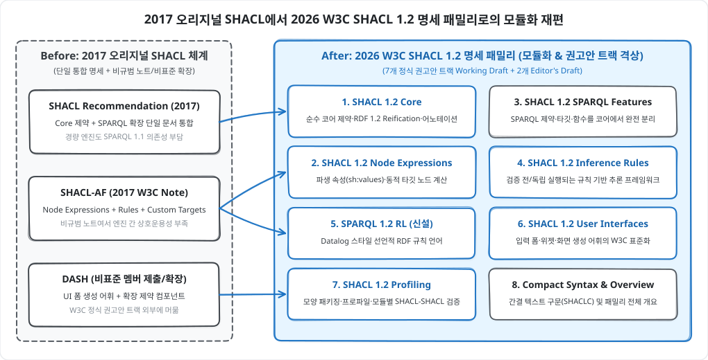

# W3C SHACL 1.2 리뷰: 2017년 SHACL 1.0에서 RDF 1.2·규칙 추론·에이전트 메타데이터까지의 진화

2017년 7월 W3C 권고안(Recommendation)으로 발표된 초기 **SHACL(Shapes Constraint Language, 흔히 SHACL 1.0)**은 오랫동안 RDF 지식 그래프 검증의 단일 표준 역할을 해 왔다. 흥미로운 점은 **SHACL에는 '1.1' 버전이 따로 존재하지 않고 2017년 오리지널 버전에서 곧바로 `SHACL 1.2`로 버전 번호를 맞췄다**는 사실이다. 이는 W3C가 RDF-star(문장에 대한 문장, Triple Term과 Reification)를 표준화하면서 기반 표준의 이름을 **RDF 1.2** 및 **SPARQL 1.2**로 통일했고, 새로운 W3C Data Shapes 워킹그룹이 이에 발맞춰 차세대 SHACL 표준군의 번호를 **1.2**로 정렬했기 때문이다.

이 글은 W3C Data Shapes 워킹그룹이 공개한 **[SHACL 1.2 Overview](https://w3c.github.io/data-shapes/shacl12-overview/)**와 **[SHACL 1.2 Core](https://www.w3.org/TR/shacl12-core/)**(2026년 11월 16일 Working Draft 기준) 두 원문을 바탕으로 작성한 심층 리뷰다. 먼저 서두에서 2017년 오리지널 SHACL이 어떤 구조와 한계를 갖고 있었는지 정리한 뒤, SHACL 1.2가 1개의 단일 권고안에서 **9개의 모듈형 명세 패밀리**로 확장된 구조, 그리고 **SHACL 1.2 Core**에 새로 들어온 핵심 기능들(RDF 1.2 Reification 검증, `sh:ShapeClass`, `sh:targetWhere`, 노드 표현식, 리스트·유일성·부분집합 제약, `sh:closed sh:ByTypes`, 불완전 데이터 표시, LLM 에이전트·코드 생성용 어노테이션)을 원문 Turtle 예제와 함께 살펴보고, 마지막에 **2017 오리지널 SHACL vs. SHACL 1.2 전수 비교표**로 마무리한다.

## 문서 정보와 검토 범위

| 항목 | 내용 |
|---|---|
| 검토 대상 명세 | 1. **SHACL 1.2 Core** (W3C Working Draft, 2026년 11월 16일 판) <br> 2. **SHACL 1.2 Overview** (W3C Editor's Draft) |
| 발행 그룹 | W3C Data Shapes Working Group |
| SHACL 1.2 Core 편집자 | Holger Knublauch (TopQuadrant), Thomas Bergwinkl (TopQuadrant), Yousouf Taghzouti (Inria), Jesse Wright (Univ. of Oxford) / 전임: Dimitris Kontokostas |
| 원문 링크 | [SHACL 1.2 Core (W3C TR)](https://www.w3.org/TR/shacl12-core/) · [SHACL 1.2 Overview](https://w3c.github.io/data-shapes/shacl12-overview/) · [2017 오리지널 SHACL 권고안](https://www.w3.org/TR/2017/REC-shacl-20170720/) · [SHACL 1.2 테스트 스위트](https://github.com/w3c/data-shapes/tree/gh-pages/shacl12-test-suite) |

`SHACL 1.2 Core`는 현재 W3C Recommendation 트랙의 Working Draft 단계이며, 일부 편의 기능(예: `sh:singleLine`)에는 워킹그룹 결의를 기다리는 "at risk" 표기가 붙어 있다. 따라서 본문에서는 현재 명세에 정의된 규범적(normative) 텍스트 정의와 향후 변동 가능한 초안 요소를 구분하여 설명한다.

---

## 1장: 이전 기준이던 2017년 오리지널 SHACL(1.0)의 구조와 한계

### 1.1 2017년 오리지널 SHACL은 무엇을 표준화했는가

2017년 이전까지 시맨틱 웹 생태계에는 RDFS와 OWL(Web Ontology Language)이 있었다. 그러나 OWL은 **열린 세계 가정(Open World Assumption, OWA)**과 **고유 이름 가정 부재(No Unique Name Assumption)** 위에서 동작하는 **추론(Inference) 언어**다. 예를 들어 "모든 직원은 사번이 1개 있어야 한다"는 OWL 공리가 있을 때 어떤 직원 노드에 사번이 빠져 있으면, OWL 추론기는 이를 데이터 오류로 거부하는 대신 "우리가 아직 모르는 어떤 익명의 사번이 어딘가에 존재한다"고 추론해 버린다.

데이터베이스 무결성 검사나 API 입력 검증처럼 **현재 주어진 그래프(Closed World)에 필수 값이 실제로 들어 있는지 검사**하려는 실무 요구를 해결하기 위해 2017년 등장한 것이 **SHACL**이다. 당시 발표된 문서는 크게 네 가지였다.

1. **SHACL (2017-07-20 W3C Recommendation)**: 유일한 정식 권고안으로, 한 문서 안에 **SHACL Core**(자주 쓰이는 내장 제약 컴포넌트)와 **SHACL-SPARQL**(SPARQL 질의로 임의 제약을 정의하는 확장)이 함께 묶여 있었다.
2. **SHACL Advanced Features (SHACL-AF, 2017-06-08 W3C Note)**: 정식 권고안이 아닌 워킹그룹 노트(Note)로, 노드 표현식(Node Expressions), 파생 속성(`sh:values`), 규칙 기반 추론(SHACL Rules: TripleRule, SPARQLRule)을 담았다.
3. **SHACL-JS (2017-06-08 W3C Note)**: JavaScript로 제약을 작성하는 노트였다.
4. **DASH (Data Shapes)**: W3C 표준 바깥에서 TopQuadrant 등 멤버들이 운영하던 사실상의 확장 어휘로, UI 폼 생성이나 확장 검증 결과 표현에 널리 쓰였다.

### 1.2 9년의 실무 운영 동안 드러난 오리지널 SHACL의 7가지 갈증

2017년 권고안은 크게 성공했지만, 현업에서 대규모 지식 그래프와 엔터프라이즈 온톨로지를 구축하면서 다음과 같은 한계가 꾸준히 제기되었다(원문 Overview 및 Core §6.18의 Issue 번호들).

1. **Core와 SPARQL의 강결합**: 2017년 권고안은 한 문서 안에 Core와 SPARQL을 함께 정의하고 Core 컴포넌트의 설명에도 SPARQL 쿼리를 섞어 써서, SPARQL 엔진 없이 순수 그래프 탐색만으로 가벼운 SHACL Core 검증기를 구현하려는 개발자들에게 혼선을 주었다(Issue 271).
2. **추론·파생 속성의 '비정식 노트(SHACL-AF)' 머무름**: 기존 데이터에서 값을 계산해 파생 속성(`sh:values`)을 만들거나 Datalog/규칙 추론을 돌리는 기능은 실무에서 필수적인데도 W3C Note(SHACL-AF)에 머물러 엔진 간 지원 여부가 제각각이었다.
3. **RDF-star / RDF 1.2(간선 메타데이터와 Reification) 미지원**: RDF 1.2의 핵심인 '트리플에 대한 메타데이터(Reification, 예: 특정 사실의 출처·유효기간·신뢰도)'를 검증할 표준 제약 컴포넌트가 없었다(Issue 300). 또한 개별 제약 조건 하나하나에 서로 다른 심각도(`sh:severity`)나 메시지를 달려면 불필요한 중간 모양(intermediate shape)을 여러 개 쪼개 만들어야 했다.
4. **장황한 타깃 선언과 합집합 문법**:
   - 클래스이자 동시에 모양인 개체를 정의할 때 매번 `a rdfs:Class, sh:NodeShape`를 중복 선언해야 했다(Issue 212).
   - 특정 조건(예: 18세 이상인 사람)을 만족하는 노드만 타깃으로 삼으려면 SPARQL 타깃을 써야 했고, 순수 SHACL 모양으로 타깃을 필터링하는 표준 방법이 없었다(Issue 517).
   - 문자열 속성에 `xsd:string` 또는 `rdf:langString` 둘 다 허용하려면 `sh:or ( [ sh:datatype xsd:string ] [ sh:datatype rdf:langString ] )`처럼 장황하게 중첩해야 했다(Issue 160, 407).
5. **복합 키 유일성·리스트 검증·상속형 닫힌 모양(`sh:closed`)의 부재**:
   - 특정 클래스 내에서 속성(또는 복합 속성) 값의 유일성(Primary Key)을 Core만으로 선언할 수 없었다(Issue 661).
   - `rdf:List`의 길이와 원소 모양을 직접 검증하는 Core 컴포넌트가 없었다(Issue 391, 414).
   - `sh:closed true`는 해당 모양에 직접 나열된 속성만 허용하기 때문에, 상위 클래스 모양(`rdfs:subClassOf`)이나 `sh:node`로 연결된 모양에 선언된 속성을 모두 위반으로 잡아내는 치명적인 불편함이 있었다(Issue 172).
6. **외부 참조나 입력 중인 '불완전 데이터(Incomplete Data)' 구분 불가**: 외부 위키데이터/법령 URI를 참조만 하고 전체 트리플을 임포트하지 않았을 때, 혹은 사용자가 아직 폼 입력 중인 노드에 대해 `sh:minCount`나 `sh:class` 위반을 어떻게 다룰지 표준 메타데이터가 없었다(Issue 1299).
7. **LLM 에이전트·코드 생성기(GraphQL/API)·단위(Unit) 연동 어휘 부재**: 스키마를 LLM 에이전트에게 읽혀 질의를 생성하게 하거나 GraphQL/Python/Java 타입 코드를 자동 생성할 때 필요한 의도(`sh:intent`), 에이전트 지시문(`sh:agentInstruction`), 코드 식별자(`sh:codeIdentifier`), 측정 단위/통화(`sh:unit`) 표준 속성이 없었다(Issue 559, 709, 725, 1295).

---

## 2장: SHACL 1.2의 전체 아키텍처와 9개 명세 패밀리 재편

`SHACL 1.2 Overview`가 밝히는 첫 번째 구조적 변화는 과거의 단일 권고안 + 비규범 노트(SHACL-AF) 체계를 **역할별로 깔끔하게 분리된 7개의 Working Draft(권고안 트랙)와 2개의 Editor's Draft**로 모듈화한 것이다.



그림: 2017년 오리지널 SHACL 체계(Before)에서 2026년 W3C SHACL 1.2 명세 패밀리(After)로의 모듈화 및 권고안 트랙 격상 구조 ([SVG 크게 보기](../assets/images/shacl-12/excalidraw-shacl12-family.svg) · [Excalidraw 원본](../assets/images/shacl-12/excalidraw-shacl12-family.excalidraw)).

| SHACL 1.2 명세 문서 | 트랙 상태 | 핵심 역할과 2017년 대비 위치 |
|---|---|---|
| **[SHACL 1.2 Core](https://www.w3.org/TR/shacl12-core/)** | Working Draft (Rec 트랙) | SPARQL 의존성을 완전히 걷어낸 순수 코어 검증 언어. RDF 1.2 Reification, 새 제약 컴포넌트, 에이전트·코드·단위 어노테이션 포함 |
| **SHACL 1.2 Node Expressions** | Working Draft (Rec 트랙) | 과거 SHACL-AF에 있던 노드 표현식을 정식 분리. 포커스 노드와 값 노드를 동적으로 계산해 파생 속성(`sh:values`)과 유연한 타깃을 제공 |
| **SHACL 1.2 SPARQL-Related Features** | Working Draft (Rec 트랙) | 과거 본문에 섞여 있던 `sh:SPARQLConstraint`, `sh:SPARQLTarget` 등을 별도 명세로 분리 |
| **SHACL 1.2 Inference Rules** | Working Draft (Rec 트랙) | 과거 SHACL-AF의 규칙 추론을 정식 명세로 격상. 검증 전이나 독립 추론 단계에서 새로운 트리플을 도출 |
| **SPARQL 1.2 RL** | Working Draft (Rec 트랙) | SHACL 1.2 추론 규칙 엔벨로프 안팎에서 사용할 수 있는 **Datalog 스타일의 선언적 RDF 규칙 언어** 신설 |
| **SHACL 1.2 User Interfaces** | Working Draft (Rec 트랙) | 과거 DASH 등 비표준 확장에 의존하던 SHACL 기반 입력 폼·UI 자동 생성을 W3C 표준으로 흡수 |
| **SHACL 1.2 Profiling** | Working Draft (Rec 트랙) | W3C PROF(`dx-prof-1.0`) 모델과 연계해 SHACL 모양 그래프를 패키징·프로파일링하는 방법과 명세별 `SHACL-SHACL` 메타 검증 그래프 정의 |
| **SHACL 1.2 Compact Syntax / Overview** | Editor's Draft | Turtle보다 간결하게 모양을 작성하는 텍스트 구문(Compact Syntax) 및 전체 아키텍처 안내서 |

---

## 3장: SHACL 1.2 Core의 7대 핵심 기술 변화와 원문 예제 분석

이제 [SHACL 1.2 Core](https://www.w3.org/TR/shacl12-core/) 본문(1장–6장 및 §6.18 변경 내역)에 새로 도입된 구체적인 기술 요소들을 일곱 가지 영역으로 나누어 살펴본다.

### 3.1 RDF 1.2(RDF-star)의 전면 수용: `sh:reifierShape`와 제약 단위 심각도 선언

RDF 1.2에서 가장 큰 변화는 **트리플 항(`sh:TripleTerm`, `<<( s p o )>>`)**과 이를 재정의(reify)하여 메타데이터를 붙이는 **Reifier(`rdf:reifies`, Turtle 약어 `{| ... |}`)**다. SHACL 1.2 Core는 이를 **데이터 검증 대상**으로도 쓰고 **SHACL 문법 자체를 간결하게 만드는 수단**으로도 활용한다.

#### (1) 데이터 그래프의 Reification 검증 (`sh:reifierShape`, `sh:reificationRequired`, §6.10.8.5)
"모든 사람의 나이(`ex:age`) 트리플에는 반드시 그 나이를 기록한 날짜(`ex:date`)와 작성자(`ex:author`)가 메타데이터(reifier)로 붙어 있어야 한다"는 프로비넌스(provenance) 제약을 이제 표준 Core 컴포넌트인 **`sh:reifierShape`**와 **`sh:reificationRequired`**로 검사할 수 있다(원문 Example 67).

```turtle
# [Shapes Graph] 나이 트리플의 출처(Reifier) 검증 모양
ex:PersonShape
    a sh:NodeShape ;
    sh:targetClass ex:Person ;
    sh:property ex:PersonShape-age .

ex:PersonShape-age
    a sh:PropertyShape ;
    sh:path ex:age ;
    sh:datatype xsd:integer ;
    sh:minCount 1 ; sh:maxCount 1 ;
    sh:reifierShape ex:ProvenanceShape ;
    sh:reificationRequired true .

ex:ProvenanceShape
    a sh:NodeShape ;
    sh:property [ sh:path ex:date ;   sh:datatype xsd:date ; sh:minCount 1 ; sh:maxCount 1 ] ;
    sh:property [ sh:path ex:author ; sh:nodeKind sh:IRI ;   sh:minCount 1 ; sh:maxCount 1 ] .

# [Data Graph] 적법한 RDF 1.2 데이터 예시
ex:Bob
    a ex:Person ;
    ex:age 23 {|
        ex:date "2019-12-05"^^xsd:date ;
        ex:author ex:Claire
    |} .
```

또한 `sh:nodeKind`의 허용 값에도 기존의 `sh:IRI`, `sh:BlankNode`, `sh:Literal` 외에 **`sh:TripleTerm`**이 정식으로 추가되었다.

#### (2) 개별 제약 트리플에 직접 붙이는 `sh:severity`, `sh:message`, `sh:deactivated` (§3.1.4–3.1.6)
2017년 SHACL에서는 `sh:severity`나 `sh:message`를 **모양(Shape) 단위**로만 선언할 수 있었다. 그래서 같은 속성(`ex:myProperty`)에 대해 `sh:minCount 1` 위반은 `sh:Info`로, `sh:datatype xsd:string` 위반은 `sh:Warning`으로, `sh:maxLength 10` 위반은 `sh:Violation`으로 다르게 내보내려면 속성 모양을 3개로 쪼개야 했다.

SHACL 1.2 Core에서는 RDF 1.2 주석 구문(`{| ... |}`)을 써서 **한 속성 모양 안의 개별 제약 파라미터 트리플마다 서로 다른 심각도·메시지·비활성화 여부를 직접 부착**할 수 있다(원문 Example 17). 또한 심각도 등급에 위반이 아닌 추적·디버깅용 **`sh:Trace`**와 **`sh:Debug`** 두 가지가 새로 추가되었다.

```turtle
# SHACL 1.2 Core Example 17: 한 속성 모양 안에서 제약별로 다른 심각도 부여
ex:MyShape-myProperty1
    a sh:PropertyShape ;
    sh:path ex:myProperty ;
    sh:minCount 1          {| sh:severity sh:Info ;    sh:message "값이 아직 입력되지 않았습니다."@ko |} ;
    sh:datatype xsd:string {| sh:severity sh:Warning ; sh:message "문자열 타입을 권장합니다."@ko |} ;
    sh:maxLength 10 .      # 기본값인 sh:Violation 적용
```

---

### 3.2 타깃과 타입 선언의 혁신: `sh:ShapeClass`, `sh:targetWhere`, 리스트 합집합

#### (1) 온톨로지 클래스와 검증 모양의 일체화: `sh:ShapeClass` (§3.1.3.3)
2017년에도 노드에 `a rdfs:Class, sh:NodeShape`를 함께 적어 암묵적 클래스 타깃(Implicit Class Target)으로 쓰는 패턴이 있었지만 두 타입을 매번 같이 적어야 했다. SHACL 1.2는 `rdfs:Class`와 `sh:NodeShape` 둘 다의 서브클래스인 메타클래스 **`sh:ShapeClass`**를 도입했다(Issue 212). `ex:Person a sh:ShapeClass` 한 줄만 선언하면 OWL의 `owl:Class`처럼 도메인 클래스를 정의하는 동시에 그 클래스의 모든 인스턴스를 자동으로 검증 타깃으로 삼는다.

#### (2) 모양으로 타깃을 필터링하는 `sh:targetWhere` 및 명시적 `sh:shape` (§3.1.3.6–3.1.3.7)
"성인(`ex:age >= 18`인 `ex:Person`)인 노드에 대해서만 투표 여부(`ex:votedFor`)를 검사하라"는 조건부 제약을 걸 때, 이제 SPARQL 없이 **`sh:targetWhere`**에 필터 모양을 넣어 타깃을 선택할 수 있다(원문 Example 14).

```turtle
# SHACL 1.2 Core Example 14: 18세 이상인 Person만 골라 투표 제약을 검사하는 sh:targetWhere
ex:AdultPerson
    a sh:NodeShape ;
    sh:targetWhere [
        sh:class ex:Person ;
        sh:property [
            sh:path ex:age ;
            sh:minCount 1 ;
            sh:minInclusive 18 ;
        ] ;
    ] ;
    sh:property [
        sh:path ex:votedFor ;
        sh:class ex:Person ;
        sh:minCount 1 ; sh:maxCount 1 ;
    ] .
```
또한 데이터 그래프나 모양 그래프에서 특정 노드가 어떤 모양을 따라야 하는지 직접 연결하는 **`sh:shape`** 속성도 명시적 타깃(Explicit shape target)으로 추가되었다.

#### (3) `sh:datatype`, `sh:class`, `sh:nodeKind`의 리스트 합집합 축약 구문 (§6.10.1)
과거에 `sh:or`로 길게 풀어 써야 했던 다중 데이터타입·다중 클래스 허용 조건이 이제 **단일 SHACL 리스트(괄호 `(...)`)**로 간결해졌다(Issue 160, 407).

```turtle
# 2017 오리지널 SHACL: 장황한 sh:or 중첩
ex:CommentShape-old
    a sh:PropertyShape ;
    sh:path rdfs:comment ;
    sh:or (
        [ sh:datatype xsd:string ]
        [ sh:datatype rdf:langString ]
        [ sh:datatype rdf:dirLangString ]
    ) .

# 2026 SHACL 1.2 Core: 리스트 하나로 합집합(Union) 즉시 표현
ex:CommentShape-new
    a sh:PropertyShape ;
    sh:path rdfs:comment ;
    sh:datatype ( xsd:string rdf:langString rdf:dirLangString ) ;
    sh:nodeKind ( sh:IRI sh:BlankNode ) . # nodeKind와 sh:class도 동일하게 리스트 합집합 지원
```

---

### 3.3 새로 추가된 8가지 핵심 제약 컴포넌트

SHACL 1.2 Core §6.10에는 실무에서 반복적으로 요구되던 8가지 새로운 제약 개념이 Core 표준 컴포넌트로 합류했다.

| 신규 제약 파라미터 (컴포넌트) | 절 번호 | 해결하는 문제와 동작 방식 |
|---|---|---|
| **`sh:uniqueValuesFor`** (`UniqueValuesForConstraintComponent`) | §6.10.9.5 | **단일/복합 키 유일성 검사**: 모양 $S$의 모든 타깃 노드들 사이에서 지정된 속성(또는 속성 리스트 `(ex:country ex:cityName)`)의 값 조합이 중복되지 않음을 보장. 앞서 리뷰한 [PG-Keys](2026-11-19-review-pg-keys.md)의 `EXCLUSIVE` 키 요구사항을 SHACL Core 안에서 상당 부분 해결함 |
| **`sh:closed sh:ByTypes`** (`ClosedConstraintComponent` 확장) | §6.10.9.1 | **상속·조합을 인식하는 닫힌 모양**: 기존 `sh:closed true`는 현재 모양에 직접 달린 `sh:property`만 허용해 서브클래스 상속 시 깨졌음. `sh:closed sh:ByTypes`로 지정하면 포커스 노드의 `rdf:type`과 그 상위 클래스(`rdfs:subClassOf`), 연결된 `sh:targetClass` 및 `sh:node` 모양들에 선언된 모든 속성을 자동으로 재귀 수집(`collectProperties`)하여 허용 목록에 포함함 |
| **`sh:someValue`** (`SomeValueConstraintComponent`) | §6.10.8.3 | **존재 양화($\exists$) 약식 표현**: OWL의 `owl:someValuesFrom`이나 `sh:qualifiedMinCount 1`과 대응. 값 노드들 중 **최소 하나 이상**이 주어진 모양을 만족하는지 검사하며, 하나라도 만족하면 즉시 통과(short-circuit) |
| **`sh:subsetOf`** (`SubsetOfConstraintComponent`) | §6.10.6.3 | **경로 간 부분집합 비교**: 기존 `sh:equals`(동치)와 `sh:disjoint`(서로소) 사이에 빠져 있던 부분집합($\subseteq$) 제약 추가. 예: `ex:favoriteChild`의 값들은 반드시 `ex:child` 경로로 도달 가능한 자녀 집합의 부분집합이어야 함 (참고: SHACL 1.2에서는 모든 속성 쌍 제약 `sh:equals`, `sh:disjoint`, `sh:subsetOf`, `sh:lessThan`이 단일 IRI뿐 아니라 **복합 경로(Property Path)**도 인자로 받도록 일반화됨) |
| **`sh:memberShape`, `sh:minListLength`, `sh:maxListLength`, `sh:uniqueMembers`** (`ListConstraintComponents`) | §6.10.5 | **`rdf:List` 1급 검증**: 값 노드가 적법한 `SHACL list`인지 확인하고, 리스트의 최소/최대 길이, 중복 원소 금지(`sh:uniqueMembers true`), 그리고 모든 리스트 원소가 만족해야 할 모양(`sh:memberShape`)을 Core에서 직접 검사 |
| **`sh:rootClass`** (`RootClassConstraintComponent`) | §6.10.9.4 | **메타모델링 서브클래스 계층 제한**: 값 노드 자체가 클래스 IRI일 때, 그 클래스가 지정된 루트 클래스(또는 루트 클래스 리스트)와 같거나 그 하위 클래스(`rdfs:subClassOf*`)인지 검사 |
| **`sh:singleLine`** (`SingleLineConstraintComponent`, *At Risk*) | §6.10.4.4 | 문자열 리터럴에 줄바꿈 문자(`U+000A`–`U+000D`)가 포함되지 않았는지 검사하며, UI 생성기에서는 한 줄 텍스트 입력창(Input)과 여러 줄 텍스트 영역(Textarea)을 구분하는 힌트로도 활용 |
| **`rdf:dirLangString` 지원 (`sh:uniqueLang`)** | §6.10.4.6 | RDF 1.2에 도입된 텍스트 방향 포함 언어 태그 리터럴(`rdf:dirLangString`, 예: `"مرحبا"@ar--rtl`)을 `sh:uniqueLang` 및 문자열 제약에서 정식 지원 |

특히 **`sh:closed sh:ByTypes`**의 도입(§6.10.9.1)은 앞서 살펴본 [PG-Schema](2026-11-19-review-pg-schema.md)의 다중 상속 닫힌 타입(`STRICT`)과 비교할 때 매우 중요한 진전이다. 이제 SHACL에서도 상위 클래스 모양과 하위 클래스 모양을 나누어 설계한 뒤 하위 모양에 `sh:closed sh:ByTypes`를 걸면 상위 클래스의 속성들을 일일이 `sh:ignoredProperties`에 복사해 넣지 않아도 닫힌 세계 검증이 자연스럽게 작동한다.

---

### 3.4 노드 표현식(Node Expressions)과 파생 속성(`sh:values`, `sh:defaultValue`)의 Core 진입

5장(§5 Node Expressions)과 §6.9.4.2는 과거 `SHACL-AF` 노트에 있던 **노드 표현식(`evalExpr(expr, focusGraph, focusNode, scope) -> outputNodes`)**을 Core의 정식 확장점(extension point)으로 편입했다.

- 노드 표현식은 다음 네 곳에 쓰인다:
  1. **`sh:values`**: 저장된 트리플(asserted triples)을 조회하는 대신, 노드 표현식을 평가해 속성 모양의 값 노드(value nodes)를 **동적으로 파생(derived properties)**시킨다.
  2. **`sh:defaultValue`**: 그래프에 명시된 값이 없을 때 기본값을 제공한다.
  3. **`sh:targetNode`**: 고정 노드 대신 표현식으로 타깃 노드를 동적 계산한다.
  4. **`sh:deactivated`**: 특정 조건에 따라 모양이나 제약을 동적으로 켜고 끈다.
- **Core와 확장 명세의 깔끔한 역할 분담**: `SHACL 1.2 Core` 문서 안에서는 상수 IRI와 상수 리터럴만 기본 노드 표현식으로 정의하고, 경로 탐색·산술 연산·문자열 결합·조건문 같은 복합 함수들은 자매 명세인 **[SHACL 1.2 Node Expressions]**와 **[SHACL 1.2 SPARQL]**에서 정의하도록 인터페이스를 표준화했다.

---

### 3.5 불완전 데이터(`sh:incomplete`, `sh:incompleteURIStart`)와 검증 보고서 고도화

6장(§6.5–§6.9)에서는 실제 데이터 파이프라인과 감사(Audit) 환경에서 매우 유용한 그래프 수준 메타데이터와 불완전 데이터 처리 규약이 추가되었다.

#### (1) 불완전 데이터의 명시적 선언 (`sh:incomplete`, `sh:incompleteURIStart`, §6.9.3.1)
실제 지식 그래프에는 아직 입력이 끝나지 않은 임시 레코드나, 외부 네임스페이스(예: `http://www.wikidata.org/entity/Q42`)를 IRI로 참조만 하고 그 외부 개체의 세부 속성 트리플은 로컬 그래프에 담아 두지 않은 경우가 흔하다. 이때 외부 노드에 대해 `sh:class`나 `sh:minCount 1` 검사가 돌아가면 수천 건의 거짓 경보가 쏟아진다.

SHACL 1.2 Core는 이를 구분하기 위해 두 가지 표준 속성을 도입했다.

```turtle
# 1. 개별 노드가 아직 작성 중(불완전)임을 선언
ex:Bob a ex:Person ;
    sh:incomplete true .

# 2. 특정 외부 URI 프리픽스로 시작하는 모든 노드는 로컬 그래프에서 불완전함을 한 줄로 선언
<http://www.wikidata.org/entity/> sh:incompleteURIStart true .
```

> [!IMPORTANT]
> **검증 엄밀성 보존 원칙**:
> 명세 §6.9.3.1은 **`sh:incomplete` 선언이 검증 엔진의 실제 `sh:conforms` 판정이나 `sh:ValidationResult` 생성 자체를 바꾸지는 않는다**고 엄격히 못 박는다. 대신 UI 도구나 후처리 보고서 생성기가 이 플래그를 읽고 '데이터가 실제로 틀린 위반'과 '외부 참조/미입력으로 인해 아직 정보가 없는 위반(`sh:minCount`, `sh:class` 등)'을 시각적으로 분리하거나 우선순위를 낮춰 보여 줄 수 있도록 표준 신호를 제공하는 것이다.

#### (2) 검증 설정 및 합격 기준 제어 (`sh:conformanceDisallows`, `sh:usedDataGraph` 등, §6.8–6.9)
- **`sh:conformanceDisallows`**: 기존에는 `sh:Warning`이나 `sh:Info`가 발생했을 때 전체 `sh:conforms`나 중첩 모양(`sh:node`, `sh:or`)의 적합성(conformance checking)을 실패로 볼지 기준이 모호한 구석이 있었다. SHACL 1.2는 검증 보고서에 `sh:conformanceDisallows` 집합(기본값은 `sh:Violation`, `sh:Warning`, `sh:Info` 포함, 설정에 따라 `sh:Violation`만 불허하도록 변경 가능)을 명시하고, 실제 검증에 사용된 데이터 그래프(`sh:usedDataGraph`), 모양 그래프(`sh:usedShapesGraph`), 프로세서 설정(`sh:usedConfiguration`, `sh:ProcessorConfiguration`)을 보고서에 기록해 **검증 재현성과 감사 추적성(provenance)**을 대폭 강화했다.
- **`sh:DataGraph`, `sh:ShapesGraph`, `sh:dataGraph`, `sh:conformsToShapesGraph`**: 데이터 그래프와 모양 그래프의 양방향 링크와 적합성 선언 어휘가 정식 표준화되었으며, `rdfs:subClassOf` 트리플을 데이터 그래프에서만 찾을지 모양 그래프와의 합집합에서 찾을지도 명시적으로 정의되었다(§6.4).

---

### 3.6 LLM 에이전트·코드 생성·단위(Unit)를 위한 비검증 어노테이션 어휘 (§6.11)

SHACL 1.2 Core에서 가장 시대적 변화를 잘 반영한 대목이 **6.11절 Non-Validating Shape Characteristics**다. 검증 통과 여부에는 영향을 주지 않으면서, **LLM 에이전트(GraphRAG/Text2SPARQL), GraphQL/API 코드 생성기, UI 빌더**에게 스키마의 정확한 의미를 전달하는 표준 어노테이션들이 대거 추가되었다.

```turtle
# SHACL 1.2 Core §6.11의 신규 어노테이션을 결합한 종합 예시
ex:FootballPlayer
    a sh:ShapeClass ;
    sh:codeIdentifier "SoccerPlayer" ;
    sh:intent "선수의 소속 구단 계약 기간은 서로 겹치지 않아야 한다."@ko {| sh:formalized false |} ;
    sh:intent "모든 선수는 최소 1개의 포지션 코드를 가져야 한다."@ko      {| sh:formalized true |} ;
    sh:agentInstruction "미국식 미식축구(American Football)나 럭비와 혼동하지 말 것. 이 클래스는 축구(Soccer) 선수를 나타냄."@ko ;
    sh:agentInstruction "인스턴스를 보충할 때에는 Wikidata의 축구 선수 식별자와 매칭할 것."@ko ;
    sh:property [
        sh:path ex:marketValue ;
        sh:name "시장 가치"@ko ;
        sh:datatype xsd:decimal ;
        sh:unit "EUR" ;                # ISO 4217 통화 코드 (또는 UCUM 단위 "cm", QUDT IRI qudt:CentiM)
        sh:codeIdentifier "marketValueEur" ;
        sh:codeType "BigDecimal" ;
        sh:order 1 ;                   # SHACL 1.2에서는 xsd:decimal 뿐 아니라 xsd:integer도 공식 허용
    ] .
```

1. **`sh:intent` (§6.11.2)**: 일반적인 설명문(`rdfs:comment`, `sh:description`)과 달리, 해당 모양이 의도하는 **개별 비즈니스 규칙·가정·제약 문장**을 한 줄씩 구조화해 적는다. 특히 그 의도가 이미 SHACL 제약으로 형식화되었는지 여부를 RDF 1.2 Reification인 `{| sh:formalized true |}` 또는 `false`로 표시할 수 있어, **"자연어 정책 중 어디까지가 SHACL로 구현되었고 어디까지가 미구현(자연어 상태로만 존재)인가"**를 스키마 자체에 정직하게 기록할 수 있다.
2. **`sh:agentInstruction` (§6.11.3)**: 자연어를 이해하는 소프트웨어 에이전트(LLM 등)에게 모양의 의미 해석, 동음이의어 주의사항, 외부 참조 데이터 소스 등을 직접 지시하는 프롬프트 메타데이터다(원문 Example 78).
3. **`sh:codeIdentifier` 및 `sh:codeType` (§6.11.4–6.11.5)**: SHACL 모양에서 GraphQL 스키마나 Java/Python/TypeScript 클래스를 자동 생성할 때 사용할 변수/필드 식별자(`^[a-zA-Z_][a-zA-Z0-9_]*$`)와 타깃 프로그래밍 언어의 데이터 타입을 지정한다. 복합 경로(`sh:path (ex:knows ex:email)`)를 API 필드 이름으로 매핑할 때 특히 유용하다.
4. **`sh:unit` (§6.11.6)**: 수치 리터럴의 측정 단위(UCUM 코드 `"cm"`, `"kg"` 또는 QUDT IRI `qudt:CentiM`)나 통화(ISO 4217 코드 `"EUR"`, `"KRW"`, `"USD"`)를 속성 모양에 선언한다(원문 Example 79).
5. **`sh:name`과 `sh:description`의 의미 명확화**: 모양 자체의 이름이 아니라, 그 모양이 규정하는 대상(속성 경로 또는 대상 리소스 종류)의 이름과 설명을 나타낸다는 점이 명확해졌다.

---

## 4장: 2017 오리지널 SHACL(1.0) vs. 2026 SHACL 1.2 전수 비교

마지막으로 2017년 제정된 오리지널 SHACL과 새로운 SHACL 1.2의 차이를 아키텍처, 타깃·구문, 제약 컴포넌트, 추론·메타데이터 네 영역으로 나누어 한눈에 비교한다.

| 비교 영역 | 세부 항목 | 2017 오리지널 SHACL (1.0) | 2026 SHACL 1.2 (Core & Family) |
|---|---|---|---|
| **1. 표준 체계와 기반 스택** | 기반 RDF / SPARQL 버전 | RDF 1.1 / SPARQL 1.1 | **RDF 1.2 (RDF-star 포함) / SPARQL 1.2** |
| | 문서 구성 | 단일 Recommendation (Core+SPARQL 혼합) + 비규범 Note (`SHACL-AF`, `SHACL-JS`) | **Core, Node Expressions, SPARQL, Inference Rules, SPARQL 1.2 RL, UI, Profiling 등 9개 모듈형 명세군** |
| | Core의 SPARQL 독립성 | Core 설명과 검증기 정의에 SPARQL 의존성이 섞여 있음 | Core에서 SPARQL 검증기 정의를 완전히 분리해 순수 Core 구현 용이성 확보 |
| **2. RDF 1.2 & 문법 편의성** | 간선/트리플 메타데이터(Reification) 검증 | 미지원 (표준 RDF Reification을 수동 노드로 풀어야 함) | **`sh:reifierShape`, `sh:reificationRequired`, `sh:nodeKind sh:TripleTerm` 기본 지원** |
| | 제약별 개별 `sh:severity` / `sh:message` | 모양(Shape) 단위로만 선언 가능 (제약별 분리 시 모양을 여러 개로 쪼개야 함) | RDF 1.2 주석(`{\| sh:severity sh:Warning \|}`)으로 **개별 제약 트리플마다 직접 부여 가능** |
| | 심각도(Severity) 등급 | `sh:Info`, `sh:Warning`, `sh:Violation` (3단계) | **`sh:Trace`, `sh:Debug`** 추가 (비위반 추적 포함 5단계) |
| | 클래스+모양 동시 선언 | `a rdfs:Class, sh:NodeShape` 중복 작성 | **`a sh:ShapeClass`** 메타클래스로 단일 선언 |
| | 조건부 모양 타깃 | SPARQL 타깃(`sh:SPARQLTarget`)에 의존 | **`sh:targetWhere`**로 순수 SHACL 모양을 이용한 조건부 타깃 필터링 지원 |
| | 다중 `sh:datatype` / `sh:class` / `sh:nodeKind` | `sh:or ( [ sh:datatype A ] [ sh:datatype B ] )` 중첩 필수 | **`sh:datatype ( A B )`** 리스트 하나로 합집합(Union) 즉시 표현 |
| **3. 신규 Core 제약 컴포넌트** | 닫힌 모양(`sh:closed`)과 클래스 상속 | `sh:closed true`만 존재 (상위 클래스 속성까지 모두 위반 처리되는 한계) | **`sh:closed sh:ByTypes`** 추가로 `rdf:type`·`rdfs:subClassOf`·`sh:node` 계층의 속성을 자동 허용 |
| | 키 유일성 (Unique Key) | Core 미지원 (`sh:SPARQLConstraint` 필요) | **`sh:uniqueValuesFor`**로 타깃 노드 집합 내 단일/복합 속성 유일성 검사 |
| | 존재 양화 ($\exists$) | `sh:qualifiedValueShape` + `sh:qualifiedMinCount 1` 조합 필요 | **`sh:someValue`** 컴포넌트로 간결하게 최소 1개 부합 검사 |
| | 속성 쌍 비교 연산 | `sh:equals`, `sh:disjoint`, `sh:lessThan`, `sh:lessThanOrEquals` (단일 속성 IRI 위주) | **`sh:subsetOf`**($\subseteq$) 추가 및 **모든 속성 쌍 제약에서 복합 Property Path 허용** |
| | `rdf:List` 구조 검증 | Core 전용 컴포넌트 없음 | **`sh:memberShape`, `sh:minListLength`, `sh:maxListLength`, `sh:uniqueMembers`** 4종 추가 |
| | 상위 클래스 계층 제한 | 미지원 | **`sh:rootClass`**로 값 노드(클래스 IRI)의 상위 클래스 루트 제한 |
| **4. 추론·품질·AI 에이전트 연동** | 파생 속성(`sh:values`)과 규칙 추론 | 비규범 노트(`SHACL-AF`)에 머묾 | Core에 노드 표현식 확장점 정식 통합 + **SHACL 1.2 Inference Rules & SPARQL 1.2 RL(Datalog)** 권고안 트랙 격상 |
| | 미입력·외부 참조 불완전 데이터 | 구분 불가 (모두 일반 위반으로 출력) | **`sh:incomplete`, `sh:incompleteURIStart`**로 검증 엄밀성은 유지하되 UI/보고서에서 불완전 데이터 위반 분리 가능 |
| | LLM 에이전트·비즈니스 의도 기술 | `rdfs:comment`, `sh:description`만 존재 | **`sh:intent`**(`{\| sh:formalized true/false \|}` 포함) 및 **`sh:agentInstruction`** 신설 |
| | 코드 생성 및 측정 단위 | 비표준 확장 사용 | **`sh:codeIdentifier`, `sh:codeType`, `sh:unit`**(UCUM / ISO 4217 / QUDT) 표준화 |

## 종합 판단: 지식 그래프와 LLM 에이전트 아키텍처에 주는 의미

SHACL 1.2는 단순한 마이너 패치가 아니라, **SHACL을 '사후 데이터 검증기'에서 '자가 완결적인 도메인 모델링·규칙 추론·에이전트 인터페이스 언어'로 격상시키는 대규모 개편**이다.

1. **OWL과 속성 그래프(PG-Schema)의 장점을 흡수한 실용적 수렴**:
   - `sh:ShapeClass`, `sh:someValue`, `sh:targetWhere`, 그리고 `SPARQL 1.2 RL`(Datalog 규칙)의 결합은 과거 OWL 온톨로지와 SHACL 모양 그래프를 이중으로 관리해야 했던 부담을 크게 줄여 준다.
   - 동시에 `sh:uniqueValuesFor`, `sh:closed sh:ByTypes`, 그리고 RDF 1.2 Reification 검증(`sh:reifierShape`)은 앞서 리뷰한 속성 그래프 표준인 [PG-Keys](2026-11-19-review-pg-keys.md) 및 [PG-Schema](2026-11-19-review-pg-schema.md)가 내세웠던 복합 키·다중 상속 닫힌 타입·간선 속성 검증 역량을 RDF 스택 안으로 정면 수용한 결과다.
2. **LLM 에이전트 및 GraphRAG 파이프라인을 위한 1급 메타데이터**:
   - 특히 **`sh:intent`**, **`sh:agentInstruction`**, **`sh:incomplete` / `sh:incompleteURIStart`**, **`sh:unit`** 네 가지는 LLM이 지식 그래프를 조회하고 검증 결과를 해석할 때 가장 자주 겪던 실패 원인(형식화되지 않은 암묵적 비즈니스 규칙 누락, 동음이의어 오해, 외부 참조 노드의 정보 부족과 실제 위반 혼동, 단위 환산 오류)을 스키마 계층에서 직접 해결하도록 설계되었다. 향후 온톨로지 기반 에이전트 시스템을 설계할 때 SHACL 1.2의 어휘 체계를 적극 도입할 가치가 충분하다.
