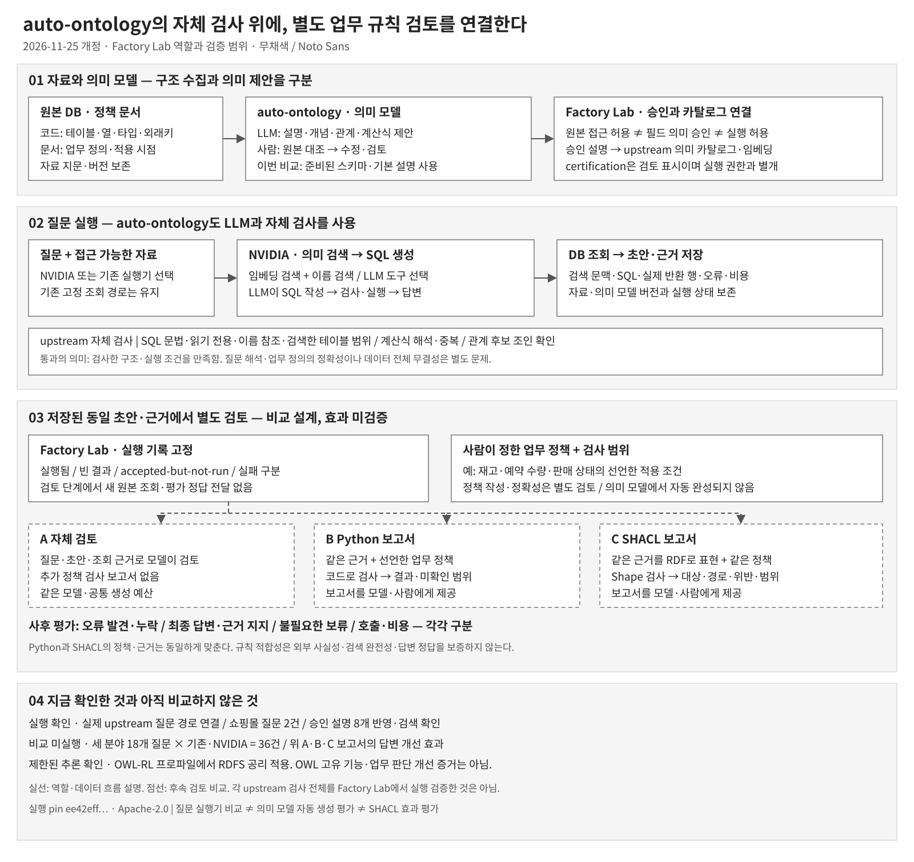

# 2026-11-25 — auto-ontology의 조회 경로와 SHACL 검토 계층

## 기본 질문에서 드러난 조회 공백

상품 필드를 승인했는데도 “주문 가능한 수량이 남은 상품을 알려주세요”라는 질문에 조회 근거가 없다는 답변이 나왔다. 필드 승인과 질의 승인이 분리돼 있었고 승인한 열을 조건에 따라 읽는 실행 경로가 부족했다. 이 문제를 고치면서 범용 DB 질문 기능을 어디까지 직접 만들지 다시 검토했다.

이번 일지는 예상 통합 구조를 기록한다. 아래 점선은 새로 연결하거나 실험해야 할 부분이며 통합이 이미 끝났다는 뜻은 아니다.

[아키텍처 SVG 원본 열기](../assets/diagrams/2026-11-25-auto-ontology-shacl.svg)

## auto-ontology에 맡길 범위

NVIDIA auto-ontology에는 DB 스키마와 표본을 이용한 의미 모델 생성뿐 아니라 의미 검색과 도구를 이용한 질의·답변 경로도 있다. 개념·필드·관계를 찾고 SQL을 생성·검사·실행하며 결과를 보고 답변하는 흐름이다. 이 기능을 다시 만드는 일을 연구의 기여로 삼기보다는 공식 연결 경로를 활용하는 방향을 검토한다.

2026-11-25에 확인한 upstream 커밋은 `a12fec75226a54ffc91752cca9538f1f01f760eb`이다. 현재 로컬 연결은 `ee42eff638ebd136c1c4fe4ab290785f912bb4bc`에 고정돼 있고 의미 생성·모델 내보내기를 호출한다. 우리 채팅은 아직 upstream의 ReAct 질의 실행기를 사용하지 않는다. 기존 고정 조회 도구와 승인한 원본 필드를 읽는 별도 경로를 사용한다.

upstream의 인증 표시는 검토 상태를 표현하는 기능이며 우리 시스템의 실행 권한과 같다고 가정하지 않는다. SQL 구문·참조 검사가 성공해도 질문 해석이나 업무 판단이 맞는지는 별도로 확인해야 한다. 특히 예산 때문에 SQL을 실행하지 않고 받아들인 결과는 실제 반환 행과 구분해 저장해야 한다.

## 우리 시스템에 남길 책임

자료실은 원본, 외부 제안, 사람의 수정과 승인, 자료 버전, 실행 근거를 연결해 보관한다. 정책 문서에서 업무 규칙을 정하고 승인하는 과정도 별도 책임으로 둔다. DB의 의미 모델을 만들었다는 사실만으로 문서 정책의 추출·적용까지 완료했다고 볼 수는 없다.

통합 시에는 실제로 생성한 초안과 조회 근거를 저장한 지점에서 검토 경로를 나눈다. 쿼리·자료·의미 모델의 버전을 함께 기록하면 나중에 답변이 어떤 자료와 해석에 의존했는지 확인할 수 있다.

## SHACL의 위치와 검사 대상

SHACL은 선택된 조회 근거를 RDF로 표현하고 선언한 Shape에 맞는지 검사하는 역할을 맡는다. 수량의 타입과 범위, 필요한 값과 연결, 명시한 적용 조건 등이 검사 대상이 될 수 있다. 보고서에는 위반 대상, 속성 경로, 제약과 검사 범위를 남긴다.

자연어 답변 전체의 진실성이나 검색의 완전성을 SHACL이 보증하지는 않는다. 규칙이 없는 문제, 가져오지 못한 근거, 외부 세계의 사실 여부는 검사 통과만으로 확인할 수 없다. 기본안은 위반을 발견하면 답변을 일괄 차단하는 대신, 최종 답변과 사람이 검토할 자료로 제공하는 것이다.

현재 제한된 경로에는 선택 근거의 SHACL 검토와 DB 타입·필수값에서 만드는 진단 기능이 있다. 업무 규칙을 자동으로 완성하거나 upstream 질의 경로와 결합한 효과까지 검증한 상태는 아니다.

## 같은 초안에서 나누는 검토 비교

| 조건 | 제공하는 검토 자료 | 확인할 차이 |
| --- | --- | --- |
| A 자체 검토 | 같은 질문·초안·조회 근거 | 모델이 스스로 수정하거나 유지하는 판단 |
| B Python 검토 | 같은 근거에 동일 업무 정책을 적용한 보고서 | 명시적 검사 결과를 제공한 효과 |
| C SHACL 검토 | 같은 근거를 RDF로 표현해 동일 정책을 검사한 보고서 | 표준 제약 표현과 검토 근거의 활용 |

A/B/C는 이 제안에서 사용하는 이름이며 이전 실험의 조건명을 바꾸지 않는다. Python과 SHACL에는 같은 정책을 제공하고 SHACL 조건에만 추가 원본 조회를 허용하지 않는다. 모델과 생성 예산도 맞춘다. 정확성, 근거 지지, 근거 없는 확신, 불필요한 보류, 검토할 항목, 비용은 사후 평가에서 나누어 본다.

이 구조만으로 SHACL의 우위를 주장할 수는 없다. 최종 답변이 같다면 규칙을 공유하고 변경 사항을 추적하는 데 어떤 도움이 있었는지를 별도로 확인해야 한다. 유지보수나 재사용의 장점도 실제로 관찰하기 전에는 설계상의 기대에 머문다.

## 다음 연결과 확인 범위

다음 작업은 upstream의 실제 질문 실행 경로를 선택적으로 붙이고 기존 고정 조회 경로와 비교하는 것이다. 실행 실패, 빈 결과, 미실행을 구분하고 저장된 초안·근거에 검토 분기를 연결한다. 이 일지를 쓰면서 새 유료 호출이나 통합 효과 실험을 수행하지는 않았다.

## 참고 구현

- [NVIDIA auto-ontology 아키텍처 — 확인한 커밋](https://github.com/NVIDIA/auto-ontology/blob/a12fec75226a54ffc91752cca9538f1f01f760eb/docs/architecture.md)
- [현재 연결한 upstream 버전](https://github.com/NVIDIA/auto-ontology/tree/ee42eff638ebd136c1c4fe4ab290785f912bb4bc)
- [필드 승인과 실제 조회 사이의 공백](../lessons-learned/2026-11-25-approved-field-query-gap.md)
