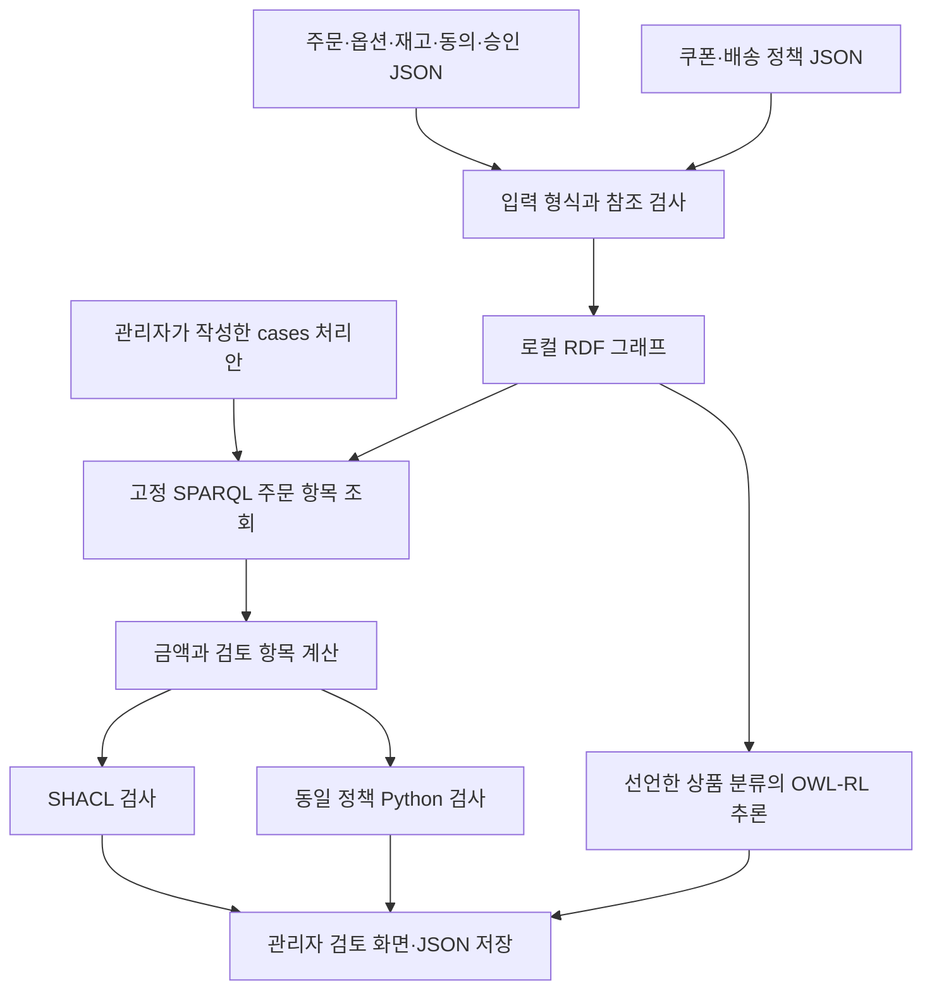

# 제조·이커머스 데모의 데이터 입력

## 두 사례의 범위

Factory Lab 화면의 **업무 사례**에서 제조와 이커머스를 선택합니다. 제조 사례는 기존 가상 설비 자료와 과거 LLM 답변을 유지합니다. 이커머스 사례는 고객 문의를 받은 관리자가 주문 변경안을 검토하는 예제입니다. 이커머스 화면의 문장은 로컬 계산 결과를 정리한 템플릿입니다. 새 LLM 답변이나 실제 주문 처리 결과가 아닙니다.

이커머스는 단일 판매자·단일 창고·원화 주문을 대상으로 합니다. 재고 예약, 주문 수정, 결제·환불, 고객 메시지 전송은 실행하지 않습니다. 제조 실험의 성능이 다른 분야에서도 재현됐다는 주장도 하지 않습니다.

## 처음 실행하기

저장소 루트에서 실행합니다. AWS와 API 키가 필요하지 않습니다.

```bash
uv sync --locked
uv run --locked python -m apps.factory_lab.public_server
```

`http://localhost:9261`에서 이커머스를 선택하면 세 처리안을 볼 수 있습니다. 예외 승인과 고객 동의가 필요한 변경안, 선언된 조건을 충족하는 변경안, 재고·도착 정보가 부족한 변경안입니다. 제조 화면으로 돌아가면 기존 사례도 볼 수 있습니다.

## 내 데이터 파일 만들기

먼저 `examples/commerce_lab/shop.json`을 복사합니다. 예제의 이름을 바꾸는 데 그치지 않고 아래 필드에 실제 시스템의 어떤 값을 연결할지 결정해야 합니다. CSV, 데이터베이스, 자연어 정책을 자동으로 해석하는 수집기는 포함하지 않습니다.

```bash
mkdir -p _workspace/my-shop
cp examples/commerce_lab/shop.json _workspace/my-shop/shop.json
uv run --locked python -m apps.factory_lab.commerce _workspace/my-shop/shop.json
uv run --locked python -m apps.factory_lab.public_server --commerce-data _workspace/my-shop/shop.json
```

첫 명령은 필수 필드·자료형·ID 참조를 검사하고 사용 가능한 사례 목록을 출력합니다. 오류가 있으면 실행을 멈춥니다. 서버 실행 명령의 `--commerce-data`로 검사한 파일을 지정합니다. 서버는 요청마다 파일을 읽고 원본 바이트의 SHA-256을 결과에 남깁니다. 실행 중 파일 교체보다는 서버를 멈춘 뒤 파일을 교체하고 재시작하는 편이 안전합니다.

이름·전화번호·주소·결제정보·비밀 키는 넣지 마세요. 주문과 상품은 비식별 ID로 연결합니다. 입력 파일은 로컬 경로만 사용하며 최대 1 MB, 각 목록은 최대 200개 기록을 허용합니다. 지원하지 않는 필드를 임의로 추가하면 거부합니다.

## 입력 필드와 관계

정확한 필수 필드와 자료형은 `apps/factory_lab/commerce.py`의 `SPECS`와 `REFERENCES`, 실행 가능한 완성 예제는 `examples/commerce_lab/shop.json`에 있습니다. 모든 목록의 기록에는 고유한 `id`가 필요합니다. ID는 영문·숫자·밑줄·하이픈을 사용합니다.

| 위치 | 필드 | 작성할 내용 |
| --- | --- | --- |
| 최상위 | `schema_version`, `snapshot_id`, `as_of`, `currency` | 버전은 1, 기준일은 ISO 날짜, 통화는 KRW |
| `products` | `id`, `name`, `category` | 상품명과 선언한 상품 분류. 현재 RunningShoe 또는 Socks |
| `skus` | `id`, `product`, `color`, `size`, `price`, `warehouse`, `available`, `arrival`, `arrival_confirmed` | 옵션별 가격·가용 재고·도착 근거. product는 상품 ID |
| `orders` | `id`, `status`, `coupon`, `shipping_policy`, `requested_arrival` | 출고 상태와 적용 정책 ID, 고객 요청 도착일 |
| `items` | `id`, `order`, `sku`, `quantity` | 주문 항목과 수량. 교체하지 않는 항목도 포함 |
| `coupons` | `id`, `minimum`, `discount` | 적용 최소 상품 금액과 정액 할인액 |
| `shipping_policies` | `id`, `minimum`, `fee`, `split_allowed` | 무료배송 기준·배송비·부분 출고 허용 여부 |
| `consents` | `id`, `order`, `sku`, `status` | 특정 주문의 특정 변경 옵션에 대한 고객 동의 |
| `approvals` | `id`, `order`, `sku`, `discount`, `status` | 해당 주문·옵션·할인액에 대한 예외 승인 |
| `cases` | `id`, `label`, `question`, `item`, `replacement`, `retain_discount`, `free_shipping`, `split`, `promise_arrival` | 관리자가 작성한 질문과 검토할 처리안. item과 replacement는 각각 주문 항목·대체 SKU ID |

금액과 재고는 음수가 아닌 정수, 수량은 양의 정수입니다. 출고 상태는 `unshipped` 또는 `shipped`, 동의·승인 상태는 `approved`, `pending`, `rejected` 중 하나입니다. `available: null`은 재고 정보 부족입니다. `arrival: null`이거나 `arrival_confirmed: false`이면 도착 확약 근거가 없는 것으로 취급합니다. 날짜는 `YYYY-MM-DD` 형식만 허용합니다. 도착 확약을 제안하지 않은 경우 확약 제약은 적용하지 않습니다. 대신 요청일 충족 여부와 도착 근거 부족을 별도로 표시합니다.

동의와 승인 목록은 이 스냅샷에 해당 기록을 빠짐없이 넣었다고 가정합니다. 기록이 없으면 처리에 필요한 증거가 없다는 뜻이며, 고객이 실제로 거절했다는 뜻은 아닙니다. 수집이 불완전한 실제 자료를 이 가정으로 가져오면 잘못 해석할 수 있습니다. 자동으로 누락을 탐지하지 않습니다.

## 원자료·정책·처리안의 구분



조회는 주문 ID를 바인딩한 고정 SPARQL을 사용합니다. 처리안이나 질문에서 쿼리를 생성하지 않습니다. 주문 항목 조회와 별도로 ID로 연결된 옵션·정책·동의·승인 기록을 읽습니다. 출처 해시, 실제 쿼리, 선택한 사실과 계산 결과를 함께 저장할 수 있습니다.

상품 합계는 교체 대상의 기존 금액을 빼고 대체 옵션 금액을 더합니다. 무료배송 기준은 할인 전 상품 합계입니다. 할인은 쿠폰 조건 또는 해당 옵션의 예외 승인을 충족할 때 적용하며 상품 합계를 넘지 않습니다. 세금·포인트·쿠폰 기간·중복 할인·부분 환불 정산은 지원하지 않습니다. 실제 업무에 맞추려면 해당 정책과 검사를 별도로 구현해야 합니다.

SHACL과 Python은 같은 계산 항목을 받습니다. 따라서 검사 결과가 일치하더라도 RDF의 우월성을 뜻하지 않습니다. OWL은 선언된 RunningShoe에서 Footwear 같은 상위 분류를 도출하며 쿠폰 적용이나 주문 변경 승인은 도출하지 않습니다. 공리는 사람이 작성했습니다.

## 결과 저장과 확장

```bash
uv run --locked python -m apps.factory_lab.commerce _workspace/my-shop/shop.json --case approval --output _workspace/my-shop/review.json
```

화면의 **이커머스 검토 JSON 저장**으로도 동일한 결과 전체를 받을 수 있습니다. 질문, 작성 처리안, 선택 근거, 계산, 원본 SHACL 보고서, Python 결과, OWL 도출 사실을 포함합니다. 원자료가 틀렸다면 모든 검사를 통과해도 잘못된 처리안일 수 있습니다. 도착일 기록도 실제 배송을 보장하지 않습니다.

새 데이터셋은 형식이 같을 때 파일 교체로 연결할 수 있습니다. 새로운 업무 정책이나 상품 분류는 어댑터·공리·테스트를 수정해야 합니다. 제조 자료는 `examples/factory_lab/snapshots/`의 별도 형식이며 이커머스 JSON을 그 경로에 넣는 방식으로 호환되지 않습니다. 이 첫 버전은 두 업무에서 사실·정책·검토 범위를 살펴보는 데 목적이 있습니다. 새 LLM 효과는 측정하지 않습니다.

<!-- HUMANIZE-SUMMARY
route: light
genre: report
적용: C-11 연결어미 뒤 쉼표 제거, C-8 반복 대구 완화, J-1 본문 강조 축소, D-8 목적 문장 정리.
보존: 사실·수치·필드명·명령·경로·Mermaid·범위·서법·register.
자가검증: 6항 점검, 미통과 항목 0건. 변경률 확정은 오케스트레이터 검증에 따름.
-->
