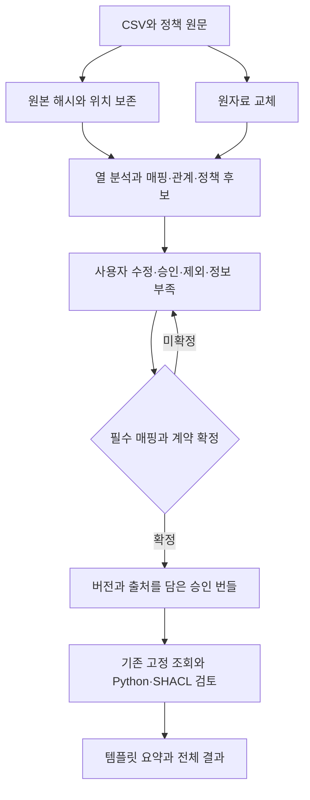

# CSV와 정책 문서로 데모 데이터 준비

공개용 Factory Lab의 **데이터 준비** 화면은 CSV와 정책 문서를 검토 초안으로 바꿉니다. 열 이름과 값에서 매핑·관계 후보를 찾고 정책 문장에서 조건·예외·날짜 표현을 표시합니다. 사용자가 내용을 확인하고 승인하면 기존 제조·이커머스 조회와 검증을 실행합니다.

현재 초안 생성기는 로컬 규칙을 사용합니다. LLM이나 외부 온톨로지 생성기를 호출하지 않습니다. 임의 정책을 실행 코드로 번역하는 기능도 없습니다. 승인할 때 선택하는 실행 계약은 아래에 설명한 기존 어댑터의 동작입니다.

## 시작과 입력 예제

```bash
uv sync --locked
uv run --locked python -m apps.factory_lab.public_server
```

`http://localhost:9261/prepare`를 엽니다. 기본 화면에서도 **CSV·정책 문서로 데이터 준비** 링크로 이동합니다. 기존 9260 서비스는 이 명령으로 바뀌지 않습니다. 원격 서버에서는 해당 포트를 SSH로 전달해야 합니다.

먼저 업무 어댑터를 선택하고 **선택한 업무 예제 열기**를 누르세요. 예제 원본은 다음 경로에 있습니다.

| 업무 | 자료 | 실행 범위 |
| --- | --- | --- |
| 이커머스 | `examples/data_preparation/commerce/` | 주문의 옵션 변경, 재고·동의·쿠폰·배송 조건 검토 |
| 제조 | `examples/data_preparation/factory/` | 주문별 대체 후보와 설비 자격 기록 조회·검토 |

두 예제 모두 작성된 가상 자료입니다. 기존 개발용 자료를 다른 입력 형식으로 옮겼으며 새로운 정확도 평가 자료가 아닙니다. `cases.csv`는 원본 업무 사실과 별도로 작성한 질문·처리안입니다.

자기 자료를 쓰려면 예제 CSV를 복사하거나 열 매핑을 직접 지정합니다. CSV·TXT·Markdown 파일을 함께 선택한 뒤 스냅숏 이름과 기준일을 입력하고 **파일 분석**을 누릅니다. 예제의 `snapshot.json`은 메타데이터 참고용이며 업로드 대상이 아닙니다.

## 입력 형식과 누락 정보

- UTF-8 CSV, TXT, Markdown만 지원합니다. 파일당 1 MB, 전체 4 MB, 최대 24개입니다.
- CSV는 헤더를 제외한 최대 200개 논리 레코드와 64개 열을 받습니다. 중복·빈 헤더, 열 수가 맞지 않는 행은 오류입니다.
- CSV의 따옴표 안 줄바꿈을 지원합니다. 논리 레코드 번호와 실제 줄 범위를 함께 기록합니다.
- 문서는 파일당 최대 256문단입니다. 관계 후보는 최대 256개·직렬화된 내용 1 MB, 전체 검토 항목은 최대 1,024개입니다. 초과하면 일부를 생략하지 않고 입력을 나누도록 오류를 표시합니다.
- 문자열은 원본 그대로 보존합니다. 원본 내용과 SHA-256은 번들에도 포함됩니다.
- 정수는 `0`, `12000`처럼 씁니다. 쉼표·통화 기호를 넣지 않습니다. 참·거짓은 `true`, `false`, 날짜는 `YYYY-MM-DD`입니다.
- 이커머스의 빈 재고·도착일은 허용된 필드에서만 `null`로 변환됩니다. 빈 값을 0이나 동의로 바꾸지 않습니다.
- 빈 동의·승인 목록도 헤더를 가진 CSV로 넣습니다. 해당 자료가 완전한지는 사람이 확인해야 합니다.

상품·주문 등의 식별자는 예제와 같은 영문·숫자·밑줄·하이픈 형식으로 최대 80자입니다. 이커머스는 단일 창고·KRW만 지원하며 세금·포인트·복합 할인·환불 정산은 지원하지 않습니다. 제조는 정해진 네 종류의 객체와 네 종류의 관계만 사용합니다. [이커머스 필드 안내](commerce-data.md)와 각 예제의 헤더를 함께 확인하세요.

## 초안 검토 순서



도식의 흐름은 자료 분석, 사람의 결정, 승인 번들 생성, 기존 검증 실행 순서입니다. OWL 분류는 별도의 작성된 공리로 수행하며 정책 원문에서 학습한 결과가 아닙니다.

1. **필드 매핑**에서 원본 열과 대상 필드를 비교합니다. 파일 이름과 열 이름이 정확히 일치할 때만 기본 매핑을 제안합니다. 이름이 다르면 `orders.id`처럼 대상 필드를 직접 지정합니다. 같은 대상에 두 열을 연결하면 실행을 중단합니다. 컬렉션 하나는 CSV 하나에서 가져오며 임의 조인을 만들지 않습니다.
2. **정책 해석**에서 원문, 추출된 단서, 실행 계약을 비교합니다. 해석에는 적용 대상·예외·시점을 기록합니다. ‘무료배송’이라는 단어를 찾았다는 사실만으로 할인 전후 기준이 정해지지는 않습니다.
3. **관계 후보**에서 식별자 형태의 열과 값 중복을 검토합니다. 값이 겹쳐도 같은 업무 식별자라는 보장은 없습니다. 후보를 승인해도 임의 조회 조인이 생성되지는 않습니다. 실제 실행은 승인된 필드와 기존 참조 관계를 사용합니다.
4. 각 항목을 **검토 대기 / 승인 / 제외 / 정보 부족** 중 하나로 저장합니다. 제외에는 이유가 필요합니다. 실행에 필요한 항목이 미확정이면 오류에서 해당 항목을 확인합니다.

‘문맥만 보존’으로 승인한 정책 문장은 실행 규칙이 아닙니다. 지원하지 않는 업무 요구를 문맥이나 제외로 처리해 지원되는 것처럼 판단하면 안 됩니다. 할인 후 기준, 명시적 예외, 기준일보다 뒤의 날짜는 일부 로컬 검사로 차단하지만 모든 언어 표현의 모순을 탐지하지는 못합니다. 사람의 승인 역시 전문 검증이나 원본의 진실성을 보장하지 않습니다.

## 실행 계약과 온톨로지의 역할

| 업무 | 현재 실행하는 검사 | 별도 OWL 분류 |
| --- | --- | --- |
| 이커머스 | 출고 상태, 같은 상품·사이즈, 재고, 동의, 할인 전 합계의 쿠폰·배송 조건, 정확히 대응하는 예외 승인, 부분 출고, 확정 도착일 | `RunningShoe → Footwear`, `Socks → Apparel` |
| 제조 | 능력 관계로 후보 조회, 조회된 자격의 제품·능력·유효 기간 검토, 기록된 가용 상태 표시 | 조회된 `CAP-CUT`에 작성된 `CuttingCapability → ManufacturingCapability` 적용 |

이커머스의 Python과 SHACL은 동일하게 계산된 특성을 받습니다. 제조도 기존 선택 근거 검증 경로를 재사용합니다. SHACL 통과는 사실의 진실성, 누락 없는 검색, 일정 여유나 배송 가능을 증명하지 않습니다. 새로운 질문에 대한 LLM 답변은 생성하지 않으며 요약은 템플릿입니다.

## 저장·재불러오기·자료 변경

**승인 번들 저장**은 원문, 매핑·정책 검토 결정, 변환된 데이터, 버전과 해시를 담은 JSON을 다운로드합니다. **승인 번들 불러오기**는 원문을 다시 분석하고 결정을 재적용해 변환 결과가 같은지 확인합니다. 해시는 변경 확인용이며 서명이나 검토자 인증은 아닙니다.

검토 세션은 서버 메모리에 최대 네 개까지 보관합니다. ‘열려 있는 초안’에서 이전 초안을 다시 열거나 닫을 수 있습니다. 브라우저를 새로고침해도 서버가 유지되는 동안 목록을 복구할 수 있습니다. 새로 열기 전 필요 없는 초안을 닫으세요. 서버를 재시작하면 미완료 세션은 사라집니다. 완료한 번들은 파일로 저장해야 합니다.

자료를 교체할 때는 새 파일 전체를 선택한 뒤 **선택한 파일 전체로 교체·재검토**를 누릅니다. 현재 구현은 변경 영향 범위를 보수적으로 잡아 모든 결정을 재검토 대상으로 돌립니다. 기존 결정과 사라진 항목은 별도로 남깁니다. 변경된 정책이 같은 열의 의미에도 영향을 줄 수 있기 때문입니다.

**이 번들로 검토 실행**은 승인한 데이터의 임시 사본으로 실제 조회·검증을 수행합니다. 기존 데모 파일이나 실제 주문·설비 상태는 수정하지 않습니다. 처리안 ID는 이커머스 `approval`, 제조 `qualification`부터 사용하세요. 전체 결과에는 승인 번들 해시와 원본 파일별 해시가 포함됩니다. 제조의 `factory-v3`는 기존 쿼리 어댑터의 내부 이름이며 새 데이터가 과거 연구 스냅숏이라는 뜻은 아닙니다.

## 외부 생성기 검토와 확장 경계

두 프로젝트는 선택한 소스와 문서를 확인했으며 현재 실행 경로에 설치하거나 연결하지 않았습니다.

| 프로젝트 | 확인한 버전과 라이선스 | 이 데모와의 경계 |
| --- | --- | --- |
| NVIDIA Auto Ontology | `a630ebd97aa4b4410b2f41f5a8af06260af2f7b9`, Apache-2.0 | DB 메타데이터·값을 바탕으로 의미 카탈로그를 구성합니다. Postgres·pgvector와 모델 엔드포인트 등이 필요합니다. 출력 의미 모델을 이 데모의 매핑·정책 계약으로 옮기는 어댑터는 미구현입니다. |
| Open Ontologies | `1ed99ac1e20450faf5ad52c824232b054778e5e0`, MIT | 구조화 파일 파싱과 RDF·온톨로지 도구를 제공합니다. Rust 의존성을 확인했지만 바이너리를 설치·실행하지 않았습니다. 정책 생성이나 추론 성능을 이 데모에서 측정하지 않았습니다. |

근거는 [NVIDIA의 고정 버전 설명](https://github.com/NVIDIA/auto-ontology/tree/a630ebd97aa4b4410b2f41f5a8af06260af2f7b9), [Open Ontologies의 고정 버전 설명](https://github.com/fabio-rovai/open-ontologies/tree/1ed99ac1e20450faf5ad52c824232b054778e5e0)과 저장소의 `research/data-preparation-1/external-inspection-001.json`에 기록했습니다. 다운로드한 소스의 해시도 기록에 포함됩니다.

직접 구현한 `DraftGenerator` 인터페이스는 생성과 승인을 분리합니다. 새 생성기는 출처가 있는 제안만 반환해야 하며 승인을 대신하거나 실행 코드를 넣으면 안 됩니다. 현재 재불러오기는 로컬 생성기 버전만 지원합니다. 외부 생성기를 추가하려면 제안 형식 검사, 복원 방식, 정책 호환성 검사를 함께 구현해야 합니다.

DB 직접 연결, PDF/OCR, 임의 도메인의 정책 자동 번역은 이번 버전의 범위 밖입니다. 소프트웨어 테스트와 작성된 예제의 동작 확인을 범용 온톨로지 추출 정확도로 해석하지 않습니다.

검토 이력은 최대 4,096건·2 MiB, 초안 전체는 16 MiB로 제한합니다. 한도에 도달하면 기록을 버리지 않고 오류를 표시합니다. 이 한도는 호스트의 최대 메모리 사용량을 측정한 결과가 아닙니다.
