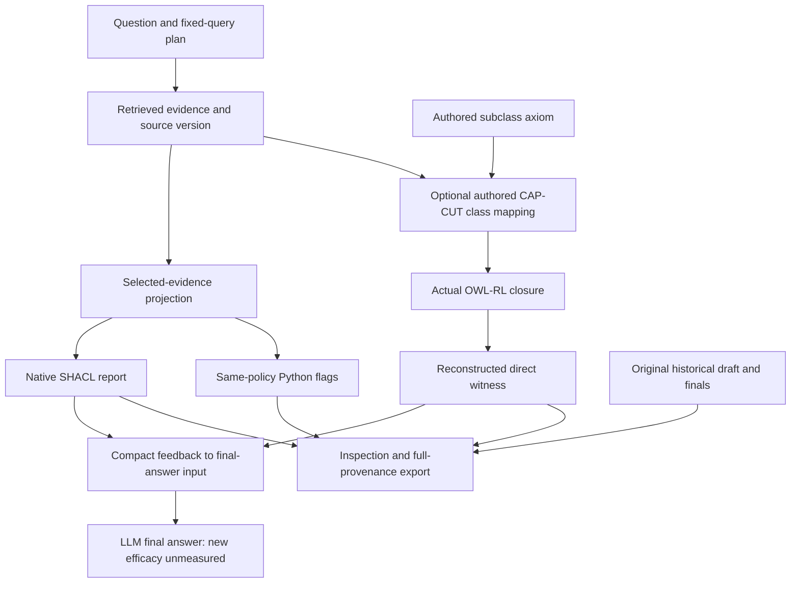

# Factory Lab constraint and inference explanations

## Implementation scope

This addition separates engine execution, historical model comparisons and prospective live use. It preserves the original research reviewer and introduces a separate explanation adapter. No new model calls, cloud resources or efficacy trials are authorized. The existing portable release is recorded in `research/factory-lab-release-1`; subsequent changes are a new demo revision.

## Four authored local diagnostics

The cases intentionally select one candidate from a real fixed-query result over the bundled fictional factory snapshot. They are diagnostics, not natural failure rates or held-out evaluation questions.

| Case | Selected scope | Intended observation |
| --- | --- | --- |
| Applicability | O18 / M03 with retrieved qualifications | Whether any single record meets product, capability and date together |
| Conforming evidence | O17 / M01 with retrieved qualifications | Conformance to the declared selected-evidence conditions, without a truth or safety claim |
| Altered evidence | O17 / M01, a retrieved qualification expiry changed to 2099 | A source-contradicting value can still conform; injection annotation is kept outside the checker |
| Omitted retrieval | O17 / M01 without a qualification query | Missing selected evidence, explicitly created by omitting retrieval; not proof of source absence |

The altered-data case intentionally contradicts the bundled source, not independently established real-world truth. Its upstream source hash identifies the original snapshot; `diagnostic_modified` and the exported intervention record identify the altered projection.

Expected behavior belongs to the test specification, not model inputs. The runtime computes reports from selected data. It does not substitute expected outputs or repair model answers.

## SHACL trace

The trace retains selected candidate values, source snapshot/hash, exact shapes and projected RDF, native report graph, focus node, source shape, constraint component, and path/value when the native report emits them. The existing SPARQL-based shapes may omit path/value; the UI preserves null rather than inventing a property violation.

No candidate targets means not assessed and no validation execution. A native report with no violations indicates conformance only to the supplied shapes and selected evidence. The capability check uses the candidate query output: the original reviewer copies the returned required capability into its candidate projection. It is not an independent reinspection of source capability edges.

The same-policy Python flags are retained for inspection; matching flags do not establish an RDF advantage.

## OWL-RL example

An explicitly authored overlay classifies the fictional CAP-CUT identifier as CuttingCapability and states that CuttingCapability is a subclass of ManufacturingCapability. The installed owlrl engine computes OWL-RL closure. Asserted facts, ontology axioms and additional triples are kept separate.

The explanation reconstructs direct asserted-type/subclass witnesses whose conclusion appears in the computed closure. This is not an internal reasoner proof trace or an explanation of every closure triple. It is not full OWL DL reasoning. No inferred class membership is treated as qualification, scheduling or physical approval, and this illustrative closure is not silently merged into SHACL qualification evidence.

## Execution and answer boundaries

```text
Authored case selection
  -> actual fixed RDF query
  -> explicit candidate projection
  -> selected evidence -> actual pySHACL -> native report + Python comparison
Authored facts + ontology
  -> actual OWL-RL closure -> inferred triples + reconstructed direct witness
Both outputs
  -> inspectable explanation panel; no model answer generated
```

The public live path can attach detailed SHACL output to its recorded result. The full trace is not added to model context: the existing compact report remains the final-answer input. This live path has no pre-review draft, so it cannot by itself measure a change from draft to final.

The optional **authored OWL classification** checkbox is off by default. If enabled, only CAP-CUT identifiers actually returned in the current query evidence receive the authored classification mapping. The full closure is saved in the run result, while the final-answer input receives only direct witnesses, evidence IDs and scope/provenance. No extra LLM call or qualification lookup is added. An execution without a retrieved target reports not assessed. Scripted gateway tests verify this connection; new real-provider behavior and answer effects remain unmeasured.

Historical model comparisons, authored diagnostics and actual new model executions must remain separate. Neither successful inference nor a conforming/violating report establishes that a model answer improved. Missing evidence, valid-but-false assertions and misinterpreted questions remain limitations.

## Historical answer comparisons

Three selected actual model runs from the consumed manufacturing development cohort are bundled under `examples/factory_lab/explanations/`. Their question, evidence, draft, self/Python/SHACL finals, original reports and source hashes are preserved. Curated observations quote exact original strings and never enter model or checker inputs.

| Saved case | What to inspect | Limit |
| --- | --- | --- |
| case-01 | Both draft and SHACL final treat M01/M03 as satisfying the bounded candidate policy | Wording changes do not establish added decision benefit |
| case-10 | The reason changes from qualification-not-retrieved to qualification-not-applicable | Core eligibility improvement and SHACL-specific advantage are not established; Python final is also available |
| case-07 | Shared candidate resources become a more definite claim of actual contention | No schedule/load evidence establishes actual contention; the problematic final is preserved |

Opening these examples executes a new local SHACL trace on their saved evidence, but **does not call a model**. The original report sent to the historical model is shown separately. Current trace flags are checked against the saved flags. The interface offers exact original answer switching, line differences and unchanged-string detection; these are not automatic semantic scores. The observation captions are posthoc illustrations, not new efficacy estimates.

## Inspect and save

Start the default public server with no API key:

```bash
uv sync --locked
uv run --locked python -m apps.factory_lab.public_server
```

Open `http://localhost:9261`. Select a constraint/inference diagnostic or a historical answer comparison. Expand **판단 근거** to inspect selected facts, individual constraints, original RDF/shapes/report, or OWL facts/axioms/derived triples. The graph remains collapsed until requested. Individual constraint details are collapsed behind a count summary.

For historical comparisons, switch among draft/self/Python/SHACL answers and inspect the quoted observation and line diff. **이 근거 설명 JSON 저장** downloads the full displayed record, including mode, source provenance and any altered-data intervention. Do not strip those fields when sharing it. Diagnostic exports and current live results are distinct from the original archived experiment artifacts.



## Verification and limitations

The repository checks use actual local RDFLib, pySHACL and owlrl execution, with scripted model messages where needed. They cover no-target handling, changed facts/shapes/axioms, native report linkage, HTTP origin/CSRF restrictions, shared execution locking/error release, historical strings/source provenance and compact final-message boundaries. Browser checks exercise four diagnostics and three historical comparisons at desktop/mobile widths, including full exported JSON equality.

Run the targeted tests:

```bash
uv run --locked python -m unittest discover -s tests -p 'test_factory_explanation.py'
uv run --locked python -m unittest discover -s tests -p 'test_factory_public.py'
```

- No new paid provider call, cloud start or deployment is part of this work. Existing closed budgets remain closed.
- Authored diagnostics do not estimate natural error rates. Historical cases are selected consumed development examples, not held-out evidence.
- OWL-RL membership follows supplied facts and axioms, not external truth. This authored ontology is neither automatically extracted nor expert-validated.
- Conforming false data, missing facts, incorrect question interpretation and model misuse of a report remain possible.
- New live OWL input behavior is software-tested with a scripted gateway; real-model response effects remain unmeasured. Do not attribute an answer improvement to the new interface.
- Local single-user execution is serialized. No throughput, peak-memory, production-hosting or platform-portability benchmark was performed.

See `research/factory-explanation-1/verification-001.json` for the final verification receipt when present. Private logs and screenshots remain under ignored `_workspace/factory-explanation-20261117/`; they are not a publication bundle.
