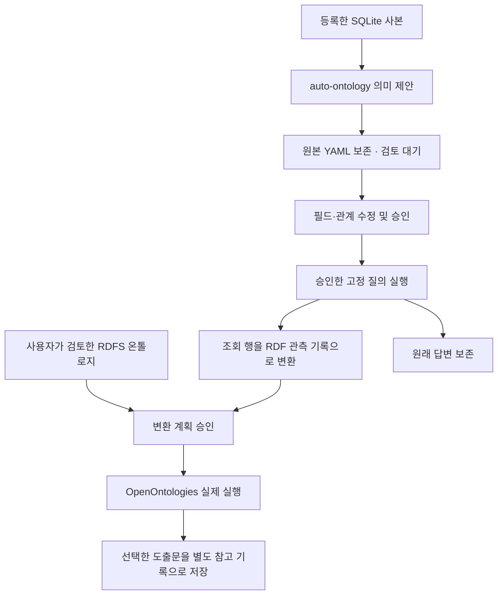

# 선택적 온톨로지 확장

운영 자료실은 외부 확장이 없어도 원본 등록, 필드 검토, 승인한 조회를 실행합니다. 확장은 의미 제안과 검토 자료를 더하는 별도 경로입니다. 외부 결과를 가져오는 것과 사람이 승인하는 것은 다른 작업입니다.

## 연결 경로



조회 결과의 RDF 주어는 저장된 출력 행을 식별합니다. 주문이나 설비 자체의 동일성을 선언하지 않습니다. 추론 결과를 참고 기록으로 저장해도 원래 답변은 바뀌지 않습니다.

## 고정한 공급자와 역할

| 공급자 | 확인한 버전·커밋 | 라이선스 | 현재 연결 |
| --- | --- | --- | --- |
| NVIDIA auto-ontology | 1.3.0 · ee42eff638ebd136c1c4fe4ab290785f912bb4bc | Apache-2.0 | 운영자 CLI에서 공식 카탈로그·의미 생성 경로 실행 후 YAML 가져오기 |
| fabio-rovai/open-ontologies | 2.1.0 · 1ed99ac1e20450faf5ad52c824232b054778e5e0 | MIT | 운영자가 지정한 로컬 바이너리로 고정 load/reason/save 명령 실행 |

upstream은 각각 별도로 설치합니다. Factory Lab 저장소에 두 구현을 복사하거나 기본 의존성으로 넣지 않았습니다. 라이브러리와 데이터의 제3자 고지는 각 프로젝트의 원문을 유지해야 합니다.

## 자신의 자료 연결

설치와 비공개 운영자 설정은 [운영자 설치·연결 안내](factory-lab-extension-operator.md)를 따릅니다. 고정 버전 설치·카탈로그 실행·서버 연결 명령이 들어 있습니다. 카탈로그 명령은 기존 설치에서 실제 실행했으며 새 환경의 설치·빌드 전체 재현은 아직 검증하지 않았습니다.

[세 분야 사용 절차](factory-lab-domain-workflows.md)와 [조회에서 추론 참고 기록까지](factory-lab-extension-walkthrough.md)는 실제 화면의 필드·관계·질의 승인 절차를 설명합니다. [다섯 자료 묶음의 실행 기록](../experiments/records/factory-lab-extensions-20261119.md)에서 질문별 실행과 미해결 범위를 확인할 수 있습니다.

[DB와 정책 문서 등록](factory-lab-registered-sources.md)의 작은 예제로 시작하세요. SQLite 등록 사본과 문서 레지스트리는 운영자가 관리하고 브라우저에는 원본 경로 대신 자료 식별자를 전달합니다. 기존 운영 DB에 직접 쓰는 경로는 제공하지 않습니다.

새 분야를 추가할 때는 테이블·열·식별자·외래키를 확인하고 자료의 날짜와 버전 의미를 설명합니다. 문서는 같은 사본에 연결해 등록합니다. 자료실에서 필드와 관계를 검토한 뒤 필요한 질문을 고정 질의로 작성하고 승인합니다. 상품·설비 같은 이름을 공통 코드에 추가할 필요는 없습니다. 현재 지원 연산으로 질문을 표현할 수 없다면 연산을 생략해 실행하지 말고 미지원으로 남겨야 합니다.

## auto-ontology 실행 경계

운영자 진입점은 다음 명령의 도움말에서 확인합니다.

```bash
uv run --locked python -m apps.factory_lab.auto_ontology_cli --help
```

필수 입력은 레지스트리, source-id, 출력 폴더, 고정 upstream 소스, 해당 설치의 Python 실행 파일, 비공개 운영자 설정입니다. Python 의존성은 uv로 관리합니다. upstream은 Python 3.12 이상 3.14 미만을 요구하며 별도 PostgreSQL 카탈로그가 필요합니다. 기존 서비스의 카탈로그를 공유하지 마세요.

catalog 모드는 스키마와 물리 관계를 가져오며 모델 의미 생성은 요청하지 않습니다. semantic 모드는 모델·임베딩을 호출합니다. localhost 비용 제한 게이트웨이와 요청·예약 식별자가 있어야 하며 API 키를 바로 넣었다고 실행이 승인되는 것은 아닙니다.

현재 연결은 최대 12개 테이블·테이블당 40열·원본 16 MiB로 제한합니다. catalog 모드는 전체 등록 사본의 스키마와 물리 관계를 수집하며 행 수 때문에 앞부분을 자르지 않습니다. semantic 모드는 테이블당 1,000행과 셀 크기 제한을 유지합니다. 중규모 DB의 카탈로그 수집과 LLM 의미 생성은 별도 기능입니다. 이 연결에는 문서 입력 경로가 없습니다.

실제 중규모 수집에서는 이커머스 15,680행의 12개 표·46개 열·12개 외래키와 조직 운영 17,250행의 12개 표·47개 열·15개 외래키가 원본 구조와 일치했습니다. 두 결과를 자료실의 승인 대기 제안으로 가져오고 운영자가 보관한 실행 기록과 연결했습니다. 모델 호출은 없었고 원본 해시는 유지됐으며 전용 카탈로그 서비스는 실행 후 중지했습니다. 이 결과는 의미 해석의 정확도나 전체 행의 LLM 분석을 입증하지 않습니다.

실행 폴더의 receipt.json과 native-export.yaml을 보존합니다. 자료실에서 YAML을 가져오면 제안으로 저장됩니다. 실제 열 연결과 관계 방향을 확인하고 수정·승인한 뒤 조회에 사용하세요. 가져온 계산식·SQL을 자동 실행하지 않습니다. Ossie 의미 모델 전체를 OWL이나 SHACL로 변환하는 기능도 제공하지 않습니다.

## OpenOntologies 실행과 근거

고정 소스에서 빌드한 바이너리를 서버의 --workspace-reasoner-binary 옵션으로 지정합니다. 이 버전의 Rust 요구사항은 1.89입니다. 실행은 로컬 프로세스이며 유료 모델을 호출하지 않습니다.

업로드한 RDF의 추론과 저장된 DB 조회에서 시작하는 추론을 구분합니다. DB 조회 경로에서는 출력 열, 문자열·정수 자료형, NULL 생략, 관측 행 클래스, RDFS 온톨로지를 먼저 검토합니다. 현재 이 경로는 일반 관계형 질의 결과와 RDFS만 지원합니다. 관계 탐색 결과나 다른 자료형을 자동 변환하지 않습니다.

계획 승인 후 별도 실행 버튼을 누릅니다. 원본 입력, 바이너리 해시, 출력, 도출 기록과 오류를 저장하며 일부 출력만 남았거나 입력 연결이 달라지면 참고 문장으로 선택할 수 없습니다. 선택 가능한 도출문은 조회 행의 분류입니다. 추론 인증서 검증은 실행하지 않았으며 논리적 도출이나 적합성이 현실의 사실을 보증하지 않습니다.

## 실행 출처 연결과 백업

실행 폴더의 receipt.json과 native-export.yaml을 보존하세요. 운영자는 workspace_extension_receipt_cli로 현재 원본·가져온 제안·실행 기록의 연결을 별도 저장할 수 있습니다. 데이터 정리 화면에서 연결 기록과 원래 제안을 확인합니다. 로컬 파일의 해시 연결이며 생산자 인증이나 사람의 의미 승인을 뜻하지 않습니다.

```bash
uv run --locked python -m apps.factory_lab.workspace_extension_receipt_cli --help
```

운영자는 workspace_backup_cli로 자료실의 승인·조회·추론 이력과 등록 사본을 백업하고 새로운 경로에 복구할 수 있습니다. 실행 중인 작업이 없어야 하며 신뢰하는 로컬 백업과 기록한 manifest 해시를 사용합니다. 기존 경로를 덮어쓰지 않습니다. 제조·조직 운영의 저장 이력을 복구해 16개 추론 관련 요청이 외부 도구를 다시 실행하지 않고 같은 결과를 반환하는지 확인했습니다. 조회 이력은 그대로 보존했으며 조회 자체를 다시 실행한 검사는 아닙니다.

```bash
uv run --locked python -m apps.factory_lab.workspace_backup_cli --help
```

## 실패·복구와 확인 범위

요청 결과를 받지 못했다면 같은 요청 기록을 먼저 확인하세요. 실패 기록을 지우거나 자동 재시도하지 않습니다. 자료·검토·규칙·바이너리 연결이 바뀌면 새 계획을 검토해야 합니다. 확장을 끈 뒤에도 저장한 기록은 읽습니다.

실제 auto-ontology 의미 결과의 수정·승인·조회 재사용과 OpenOntologies의 저장 조회 기반 추론·참고 저장을 확인했습니다. 관련 흐름은 1440 px와 375 px 브라우저에서 실행했습니다. 이는 작성한 소규모 자료의 소프트웨어 연결 확인이며 전문가 검토나 답변 정확도 개선을 입증한 결과는 아닙니다. 모바일에서 원문 진단을 모두 펼치면 화면이 길어집니다.

문서 수백 개의 자동 파싱·검색·정책 적용, 수백만 행 운영 성능, 자유 질문의 자동 의미 해석은 이번 연결로 검증하지 않았습니다. 문서 수와 DB 행 수만 늘려 이런 기능까지 지원한다고 판단하지 마세요.
