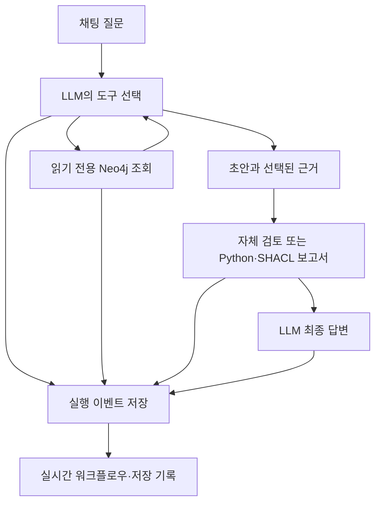

# Factory Lab 실행 안내

Factory Lab은 가상 제조 자료를 조회하는 GraphRAG 연구용 앱이다. 질문을 받으면 LLM이 Neo4j 조회 도구를 선택한다. 서버는 실제 호출과 결과를 저장하고 채팅·워크플로우 화면에 전달한다. 미리 작성한 답변이나 애니메이션으로 실행을 대신하지 않는다.

## 접속

EC2에서 앱은 `127.0.0.1:9260`으로만 열린다. Mac의 `~/.ssh/config`에 있는 `Host graph-lab` 블록에 다음 항목을 추가한다.

```text
LocalForward 9260 127.0.0.1:9260
```

기존 `ssh -N graph-lab` 터미널에서 Ctrl+C를 누른 뒤 같은 명령으로 다시 연결한다. 이미 연결된 터널을 둔 채 같은 포트를 열면 충돌할 수 있다. 브라우저에서 `http://localhost:9260/`을 연다. SSH 연결을 끊어도 서버와 데이터가 삭제되지는 않는다.

## 첫 질문

데이터 버전 `v2 · M02 사용 불가`, 검토 방식 `SHACL 보고서`를 선택하고 다음 질문을 입력한다.

> M02가 중단되면 어떤 주문이 영향을 받아? O17의 대체 설비 후보를 찾아 각 후보의 자격 기록을 현재 날짜 기준으로 확인하고, 추가 확인 사항을 근거와 함께 알려줘.

화면 오른쪽에는 실제 조회·응답·검토 이벤트가 쌓인다. 각 항목을 열면 도구 인자, Cypher, 반환 근거를 볼 수 있다. 답변의 인용 번호는 해당 조회 결과를 연다. 저장된 실행을 선택하면 원래 기록을 다시 볼 수 있으며 새 유료 호출은 발생하지 않는다.

`현재 답변 이어서 질문`을 선택하면 직전 실행의 질문과 답변을 문맥으로 전달한다. 이전 답변은 근거로 취급하지 않으며 현재 스냅샷을 다시 조회하도록 지시한다. 전체 대화 이력을 누적하는 장기 기억 기능은 아니다.

## 데이터와 검토 범위

가상 데이터는 버전마다 노드 11개와 관계 12개다. 주문 O17·O18은 M02에 연결되어 있다. v1은 M02가 사용 가능한 상태이고 v2는 사용 불가 상태다. M01의 제품 A 자격은 기준일에 유효하며 M03의 자격은 만료되어 있다. 이 값은 데모를 위해 작성했다. 실제 공장의 측정값이나 전문가가 검증한 작업 조건이 아니다.

LLM은 도구와 인자를 선택하지만 Cypher를 자유롭게 작성하지는 않는다. 첫 구현에는 벡터 검색, OWL 추론, Neptune 어댑터, 실제 설비 제어가 포함되지 않는다.

Python과 SHACL은 조회된 대체 후보와 자격 기록에 같은 정책을 적용한다. 추가 자료를 조회하거나 답변을 강제로 막지 않는다. 검토 대상이 조회되지 않으면 미평가로 남긴다. 경고가 없다는 결과는 사실성·완전성·물리적 적합성을 보증하지 않는다.

검토 방식을 바꿔 새 질문을 실행하면 초안도 새로 생성된다. 이 화면의 실행들을 바로 비교해 SHACL의 개선 효과라고 해석해서는 안 된다. 그런 비교에는 동일 초안과 근거를 분기하는 별도의 실험이 필요하다.

## 실행 구조



텍스트 흐름은 질문 → 도구 선택과 조회 → 초안 → 검토 → 최종 답변이다. 조회 실패·중단·출력 오류도 기록한다. 비공개 내부 사고는 워크플로우에 표시하지 않는다.

## 데이터 보존과 운영

가상 원본은 `research/virtual-factory-llm-1/`, 앱은 `apps/factory_lab/`에 있다. Neo4j는 기존 `shacl-neo4j-browser-20261106` 컨테이너의 영속 볼륨을 사용한다. 앱의 실행·비용 원장과 호출 기록은 Git에서 제외된 `_workspace/factory-lab-20261109/`에 저장한다. 서버나 컨테이너를 중지해도 이 데이터는 남지만 EC2 디스크 손실에 대비한 외부 백업을 구성한 것은 아니다.

서버 상태는 다음 명령으로 확인한다.

```bash
systemctl --user status shacl-factory-lab-20261109-uv.service
```

다시 시작하려면 다음 명령을 사용한다.

```bash
docker start shacl-neo4j-browser-20261106
systemctl --user restart shacl-factory-lab-20261109-uv.service
```

Neo4j가 준비되기 전에는 조회가 실패할 수 있다. 진행 중인 실행이 있을 때 앱을 재시작하면 해당 실행을 중단으로 보존하며 자동 재시도하지 않는다. 실행 중 GUI에서 그래프를 직접 수정하지 않는다. 조회 전 원본과 DB 내용을 대조하지만 확인과 조회가 하나의 트랜잭션으로 묶여 있지는 않다.

## 유료 호출 제한

이번 승인 범위는 2026년 11월 9일 07:14:45–15:14:45 UTC, 총 USD 5 이내이며 구현상 최대 100회 호출을 제한한다. 실패·취소된 요청도 비환급 예약에 포함한다. 중지를 누르면 이미 진행 중인 요청은 완료되어 과금될 수 있지만 이후 호출은 시작하지 않는다.

설정은 `google/gemini-3.8-flash`, 제공업체 `google-ai-studio`, temperature 0, seed 42다. 모델 별칭과 제공업체를 고정해도 응답의 완전한 동일성을 보장하지 않는다. 모델 지원 설정과 가격은 실행 전 확인했으며 요청·응답 기록을 보존한다. 종료 시각 이후에는 새 호출을 막고 저장된 기록은 계속 열람할 수 있다. 서비스 재시작은 비용 원장을 초기화하거나 승인 시간을 연장하지 않는다.
