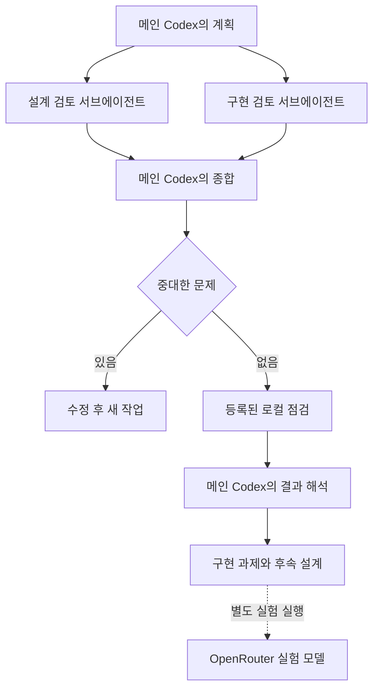

# 연구 운영 에이전트

연구 운영과 코드 작성은 현재 Codex 세션과 Codex 서브에이전트가 맡는다. OpenRouter는 기존 GLEIF·YAGO 실험에서 질문에 답하는 모델을 호출할 때 사용한다. 연구 운영의 검토 담당을 실험의 비교 조건으로 추가하지 않는다.

`scripts/research_ops.py`는 입력과 검토 결과를 기록하고 실행 조건을 검사하는 로컬 도구다. 모델 API를 호출하거나 서브에이전트를 직접 시작하지 않는다. 메인 Codex가 현재 세션의 협업 도구로 담당을 배정한다. 세션에 협업 기능이 없으면 검토를 대기 상태로 남긴다.

## 담당 역할과 실행 순서

| 담당 | 역할 | 산출물 |
| --- | --- | --- |
| 메인 Codex | 계획 작성, 검토 종합, 코드 수정, 결과 해석 | 계획·변경 파일·검증 기록 |
| 설계 검토 서브에이전트 | 정답 유출, 비교 조건, 표본 재사용, 과도한 주장 점검 | 근거와 수정안을 포함한 검토 의견 |
| 구현 검토 서브에이전트 | 입력·해시·기록·재시도·자원·구현 범위 점검 | 구현 문제와 확인 절차 |
| 구현 서브에이전트 | 메인이 지정한 파일의 구현 작업 | 코드 변경과 검사 결과 |

구현 서브에이전트는 작업 규모에 따라 배정한다. 두 검토 담당은 서로 다른 에이전트로 시작하고 같은 계획을 받되 상대의 의견은 읽지 않는다. 메인은 검토 담당에게 기존 대화 전체를 넘기지 않고 해당 단계의 요청 파일만 전달한다. 공유 파일과 도구에 접근할 수 있으므로 이 규칙이 OS 수준의 격리를 뜻하지는 않는다.



텍스트 흐름은 계획 → 두 독립 검토 → 종합 → 문제 시 수정, 통과 시 로컬 점검 → 결과 해석이다. OpenRouter 실험은 이 운영 점검에 포함되지 않는다. 코드가 바뀌면 바뀐 입력으로 새 검토와 점검 기록을 만든다. 검토 담당이 중대한 문제를 표시하면 메인의 통과 의견으로 실행할 수 없다.

## 작업 생성과 검토 배정

메인 Codex는 `research/operations/RUNBOOK.md`의 역할·입력 계약을 따른다. 다음 명령은 작업을 만들고 계획 요청 파일의 경로를 출력한다.

```bash
JOB_ID=$(uv run --locked python scripts/research_ops.py init research/operations/tasks/local-verification.json)
uv run --locked python scripts/research_ops.py request "$JOB_ID" plan
uv run --locked python scripts/research_ops.py status "$JOB_ID"
```

메인은 요청 파일을 읽고 지정한 경로에 JSON 결과를 작성한다. `submit`으로 결과와 실제 담당 ID를 기록한 뒤 다음 단계를 요청한다.

```bash
uv run --locked python scripts/research_ops.py submit "$JOB_ID" plan /absolute/path/to/result.json --agent-id /root
uv run --locked python scripts/research_ops.py request "$JOB_ID" methods
uv run --locked python scripts/research_ops.py request "$JOB_ID" implementation
```

설계·구현 검토는 Codex 협업 도구로 배정한다. 메인은 각 요청 파일과 담당별 출력 경로만 전달하고 결과를 받은 뒤 `submit`으로 저장한다. 두 담당의 ID는 서로 달라야 한다. ID는 메인이 제공하는 기록이며 인증된 신원 증명은 아니다. 실제 배정 내역은 Codex 세션의 도구 기록에서도 확인한다.

메인은 두 검토를 종합한 `synthesis` 결과를 제출한다. 승인 조건을 충족하면 `check`로 등록된 점검을 실행하고 `analysis` 요청을 만든다.

```bash
uv run --locked python scripts/research_ops.py request "$JOB_ID" synthesis
# 메인이 synthesis 결과를 작성하고 submit한 뒤 실행
uv run --locked python scripts/research_ops.py check "$JOB_ID"
uv run --locked python scripts/research_ops.py request "$JOB_ID" analysis
```

해석 결과는 `observe`로 제출하고 관측한 점검 ID와 종료 코드를 적는다. 테스트 통과를 연구 성능이나 사실 검증의 증거로 해석하지 않는다. `local-verification.json`은 운영 소프트웨어의 점검이며 새 유료 QA 실험을 실행하지 않는다.

## 호출 한도와 비용 구분

`research/operations/config.json`은 UTC 하루 최대 100회, 작업당 최대 7회의 역할 요청을 기록한다. 두 검토 담당은 최대 2명까지 함께 실행한다. 정상 작업은 계획·검토 두 건·종합·해석의 총 5개 요청이다. 요청을 배정하기 전에 횟수를 예약하고 실패하거나 중단한 요청도 기록에 남긴다.

이 횟수는 이 도구에 등록한 역할 작업 수다. Codex 내부 모델 호출·도구 호출·토큰 수나 계정 전체 사용량을 측정하지 않는다. Codex 계정의 한도와 비용은 현재 세션의 인증·요금 체계를 따른다. 로컬 실행기가 Codex의 달러 비용 상한을 강제하지 않으며 Codex 사용을 무료라고 가정하지 않는다.

| 구분 | 사용 경로 | 비용 관리 |
| --- | --- | --- |
| 연구 운영·코드 작성 | 현재 Codex와 네이티브 서브에이전트 | Codex 계정의 사용량·한도 |
| 실험 답변 생성 | OpenRouter | 기존 실험 실행기의 호출·비용 예산 |
| 서버 실행·저장 | AWS | EC2·EBS 등의 별도 청구 |

기존 OpenRouter 운영기의 작업당 $0.10, 하루 $0.50 설정은 과거 기록에 보존한다. 새 Codex 운영기의 비용 상한으로 옮기지 않는다. 실험용 OpenRouter 설정과 예산은 기존 실행기가 관리한다. 운영 도구에 모델 API 키는 필요 없다.

## 입력과 실행 범위

입력 문서는 `research/operations/brief.md`, `research/operations/briefs/`, `docs/setup/`에 명시한 Markdown 파일만 허용한다. 작업·역할·설정·검증 입력 해시를 고정하고 단계별 요청에는 필요한 근거만 넣는다. 문서에 정답이나 비밀을 복사해 넣지 않는다. 경로 제한만으로 공유 작업 공간의 접근을 차단할 수는 없다.

등록된 점검은 `unit-tests`와 `e0-local`이다. 단위 테스트와 기존 검증 실행기의 `--local-only`만 실행하며 모델이 제안한 셸 명령은 실행하지 않는다. 새 유료 QA 실험, DB 설치, Terraform, Git push는 등록된 점검에 없다. 상시 데몬이나 자동 서버 중지도 구성하지 않는다.

## 실패 기록과 작업 재개

새 기록은 Git에서 제외한 `_workspace/research-ops-codex/`에 저장한다. 고정 입력, 단계별 요청·제출 결과, 담당 ID, 로컬 점검 로그와 `handoff.md`를 보존한다. 공유 역할 요청 기록은 재개할 때 삭제하지 않는다. 이전 OpenRouter 기록과 비용 원장은 `_workspace/research-ops/`에 그대로 남긴다.

실패 원인을 확인한 뒤 `request`나 `check`에 `--retry`를 사용한다. 이전 시도를 덮어쓰지 않으며 완료된 단계는 다시 실행하지 않는다. 계획·검증 코드가 바뀌거나 검토에서 수정이 필요하면 새 작업을 만든다. 모의 검토 결과를 실제 서브에이전트 결과로 제출하지 않는다.

다음 설계 예제는 `research/operations/tasks/next-study-design.json`이다. 새 YAGO 평가 표본과 독립 출처 충돌 실험을 설계하지만 실행하지 않는다. 설계 검토에서는 의도적으로 넣은 정답 유출과 비교 조건의 결함을 발견하는지도 따로 확인한다.

구성 참고: [OpenAI 공식 Codex 서브에이전트 문서](https://learn.chatgpt.com/docs/agent-configuration/subagents). 이 저장소는 현재 세션의 협업 기능을 사용하며 OpenAI SDK나 별도 모델 API 클라이언트를 추가하지 않는다.
