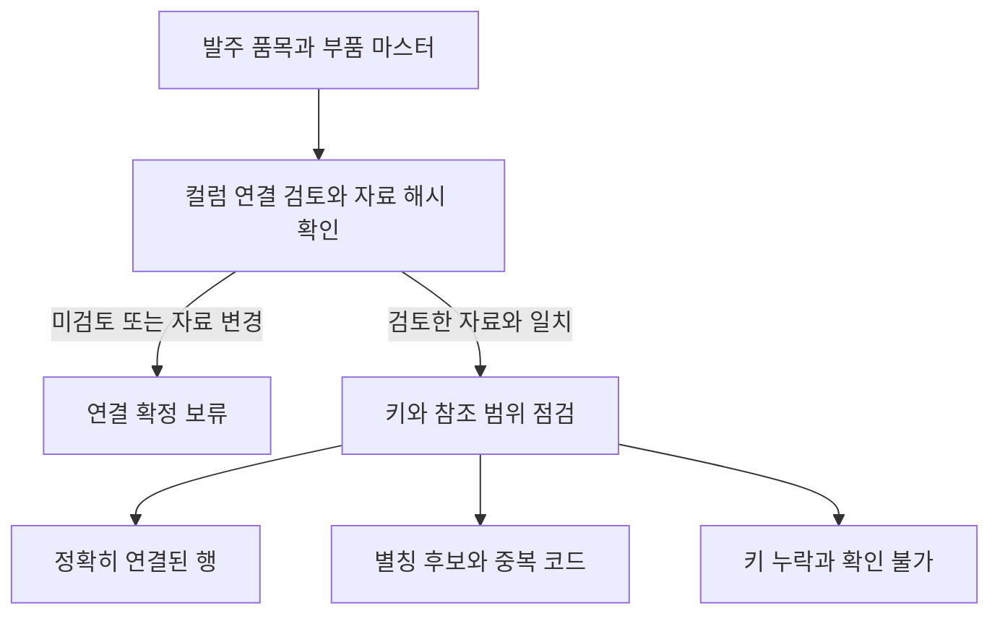

# 산업 데이터 연결과 공공 표준 후보 검토

이번 작업은 데이터 값의 규칙을 검사하기 전에, 서로 다른 자료의 행을 연결할 수 있는지 확인한다. 부품 코드가 바뀌거나 중복되면 검사가 실행되더라도 엉뚱한 부품을 검사할 수 있기 때문이다.

## 원본 스키마와 작성한 데이터

[ERPNext](https://github.com/frappe/erpnext)의 version-15 커밋 `e864addb6c367688d2b264f284c2dd9b9360a97d`에서 Item, Purchase Order Item, Purchase Receipt Item, Quality Inspection의 JSON 스키마와 라이선스를 확보했다. 원본 파일은 수정하지 않고 SHA-256 해시를 기록했다. ERPNext의 [입고 문서](https://docs.frappe.io/erpnext/purchase-receipt)도 참고 자료로 저장했다.

실제 기업의 거래 내역을 확보한 것은 아니다. 개발용 데이터는 공개 ERP 스키마에서 일부 필드를 골라 작성했다. ERPNext에 그대로 적재할 수 있는 완전한 문서 형식도 아니다.

| 자료 | 행 수 | 이번 검사 범위 |
|---|---:|---|
| 부품 마스터 | 301 | 발주 코드의 참조 대상 |
| 발주 품목 | 1,000 | 부품 마스터와 연결 검사 |
| 입고 품목 | 1,000 | 검사 번호로 입고·검사 기록을 연결하고 품목 코드 비교 |
| 품질 검사 | 900 | 검사 번호로 입고·검사 기록을 연결하고 품목 코드 비교 |
| 합계 | 3,201 | 전체 행 수와 검사 대상 행 수를 구분 |

## 연결 상태와 실제 결과

발주 1,000행에 코드 변경, 키 누락, 참조 대상 부재, 중복 코드 조건을 의도적으로 넣었다. 아래 수치는 작성한 조건에서 소프트웨어가 구분한 결과이며 실제 기업의 오류 발생률은 아니다.

| 상태 | 행 수 | 의미 |
|---|---:|---|
| 연결됨 | 600 | 제공된 컬럼 연결에서 같은 키를 가진 참조 행이 하나 있음 |
| 연결 후보 | 100 | 별칭 대응표가 후보를 제안하지만 확정하지 않음 |
| 키 누락 | 100 | 발주 행에 부품 코드가 없음 |
| 현재 자료에서 찾지 못함 | 100 | 제공된 부품 마스터에 같은 키가 없음 |
| 중복으로 모호함 | 100 | 같은 코드를 가진 부품 마스터 행이 둘 이상 있음 |

예를 들어 `LEGACY-0`에는 대응표가 가리키는 후보가 있어도 연결 완료로 처리하지 않는다. `P000`은 마스터에 두 번 등장하므로 한 행을 임의로 고르지 않는다. 일치하는 키도 같은 실물 부품이라는 사실까지 보증하지는 않는다.

텍스트 흐름: 자료를 읽고 컬럼 연결과 자료 해시를 확인한 뒤 키 일치·별칭 후보·중복·누락을 각각 기록한다. 자동으로 데이터를 고치거나 후보를 승인하지 않는다.

같은 발주 행에서 부품 마스터의 완전성 선언을 제거하자 800행은 참조 범위 확인 불가, 100행은 키 누락, 100행은 중복으로 분류됐다. 자료가 일부만 들어왔을 때 유일한 연결이나 실제 부재를 단정하지 않기 위한 처리다. 완전성은 사용자가 제공한 선언이며 시스템이 원본 전체를 조사해서 알아낸 사실은 아니다.

컬럼 연결을 미검토 상태로 두면 1,000행 모두 확정을 보류한다. 세 조건은 같은 행을 재사용했으므로 독립된 3,000건의 사례로 볼 수 없다.

## 입고와 검사 기록의 품목 비교

연결할 키와 비교할 값은 다르다. 입고의 quality_inspection과 검사의 name으로 행을 연결한 뒤 두 행의 item_code를 비교한다. 검사 번호가 같더라도 다른 품목의 검사 기록일 수 있기 때문이다.

검토한 연결과 참조 범위에서 유일하게 연결된 행만 비교한다. 두 값이 모두 있는데 다르면 선언한 일치 규칙 위반, 비교할 값이 비어 있으면 근거 부족으로 기록한다. 검사 번호 누락·참조 기록 미발견·중복은 비교 보류다. 값이 일치해도 검사 합격이나 실제 부품의 안전성을 뜻하지 않는다.

| 입력 조건 | 값 일치 | 일치 규칙 위반 | 비교할 값 누락 | 비교 보류 |
|---|---:|---:|---:|---:|
| 작성한 원본 입고·검사 자료 | 900 | 0 | 0 | 100 |
| 검사 자료에 오류를 넣은 사본 | 700 | 50 | 50 | 200 |
| 위 사본의 참조 범위가 미확인 | 0 | 0 | 0 | 1,000 |

오류 사본에는 품목 불일치, 품목값 누락, 검사 기록 삭제, 검사 기록 중복을 각각 50건씩 넣었다. 같은 입고 1,000행을 재사용했으며 독립된 3,000건이 아니다. 비교는 Python으로 실행하며 RDF·SHACL의 효과를 비교한 실험이 아니다.

## 화면 사용 순서

기존 작업을 보존하려면 ‘내보내기’에서 ‘원본 데이터 행과 문서 텍스트를 JSON·ZIP에 포함합니다’를 선택한 뒤 프로젝트 JSON을 저장한다. 기본값은 원본 행과 문서 텍스트를 제외하므로 다시 검사하려면 데이터를 연결해야 한다. 프로젝트 가져오기는 현재 작업을 교체한다.

1. ‘데이터 연결’에서 비교할 표를 추가하거나 준비한 프로젝트 JSON을 가져온다.
2. ‘표 사이 연결’에서 검사할 표·키 열과 참조할 표·키 열을 고른다.
3. 필요한 경우 별칭 후보 JSON을 입력한다. source_value, target_value, evidence를 가진 목록이며 최대 100개·50KB다. 업로드한 파일이 있으면 직접 입력보다 우선한다.
4. 품목값까지 비교하려면 ‘연결된 행의 값도 비교’를 켜고 비교할 두 열을 먼저 고른다.
5. 실제로 검토한 범위에 한해 참조 자료의 완전성과 두 열의 식별자 대응을 확인한다. 값 비교를 켰다면 두 값이 같아야 한다는 규칙도 별도로 검토한 뒤 실행한다. 이 체크는 사용자의 선언이며 시스템의 독립 검증이 아니다.

표·열·별칭 후보·값 비교 설정을 바꾸면 검토 확인이 초기화된다. 설정을 모두 고른 다음 다시 검토하고 확인해야 한다.

일부가 가려졌거나 잘린 자료, 참조 자료에서 원본 행이 제외됐다면 완전성 확인을 선택해도 미확인으로 처리한다. 별칭은 근거를 볼 수 있는 후보로 남으며 이 화면에서 승인할 수 없다. 입력이나 검토 상태가 바뀌면 이전 결과와 다운로드가 숨겨진다. 현재 화면은 한 번에 열 한 쌍을 비교한다.

## 연결 설정 저장과 복원

‘연결 설정 JSON 다운로드’는 선택한 표·키 열, 비교할 열 한 쌍, 별칭 후보와 근거를 저장한다. 원본 행과 문서, 검토 확인은 저장하지 않는다. 별칭 값과 근거 문구가 포함되므로 익명화된 파일은 아니다.

다시 사용할 때는 먼저 같은 표·열이 있는 프로젝트를 가져온다. ‘연결 설정 불러오기’에 설정 JSON을 올리고 ‘설정 불러오기’를 누른다. 설정은 최대 100KB이며 검사 결과 JSON이나 프로젝트 JSON을 대신 올릴 수 없다. 표·열이 없으면 불러오기를 거부한다.

불러올 때마다 연결 검토·값 비교 규칙 검토·참조 범위 확인과 이전 검사 결과를 초기화한다. 데이터가 같아도 확인 상태를 자동 복원하지 않으며 검사를 자동 실행하지 않는다.

저장 당시와 현재 표의 해시가 다르면 경고를 표시한다. 해시는 행 값뿐 아니라 출처 정보도 포함한다. 프로젝트를 가져오는 과정에서 출처 메타데이터가 정리돼도 달라질 수 있으므로 경고만으로 실제 값이 바뀌었다고 단정하면 안 된다. 해시가 같다는 사실도 승인이나 사실의 진실성을 보증하지 않는다.

## 자료 일부가 없을 때의 판정

`redacted`는 자료 일부가 가려졌다는 표시다. JSON·ZIP 프로젝트 백업과 다시 가져오기에서 이 표시를 보존한다. 원본 행을 제외한 백업의 `data_omitted` 표시도 유지한다. 참조 범위에 대한 `complete` 선언은 프로젝트 백업에서 복원하지 않는다.

| 검사 | 일부만 있는 참조표에서 값을 찾음 | 같은 값을 찾지 못함 |
|---|---|---|
| 일반 참조 규칙 | 현재 참조표에 값이 있으므로 통과 | `truncated`·`redacted`·`data_omitted` 표시가 있으면 확인 불가 |
| 표 사이 연결 | 전체 범위와 유일성을 확인할 수 없으므로 연결 확정 보류 | 실제 부재를 단정하지 않고 확인 불가 |

두 검사는 질문이 다르다. 일반 참조 규칙은 값이 현재 목록에 있는지 확인하고 표 연결은 같은 키의 참조 행을 하나로 정할 수 있는지 확인한다. 중복이나 키 누락은 각 상태로 따로 기록한다. 누락 표시가 없는 일반 참조 검사에서 미발견 값은 기존처럼 위반으로 분류하지만 이는 현재 자료 기준의 판정이다. 숨겨진 누락을 자동으로 찾아내거나 외부 사실의 참·거짓을 판별한 결과는 아니다.

## 공식 공통표준도메인 조회

[행정안전부 공공데이터 공통표준도메인](https://www.data.go.kr/data/15156442/fileData.do)의 2025년 11월 8차 CSV를 확보했다. 129행·15개 컬럼이며 원본 해시를 고정했다. 같은 8차 개정의 공식 표준용어 13,176행과 표준단어 3,284행도 확보하고 원본 해시를 기록했다. 회사별 컬럼 매핑 정답을 확보한 것은 아니다.

‘표준도메인’ 탭에 해당 공식 CSV 원본을 올린 뒤 현재 표·컬럼을 선택하고 조회할 도메인 이름을 직접 입력한다. 현재 컬럼의 데이터 타입은 선택 입력이다. 검증한 원본만 지원하므로 다른 버전이나 엑셀에서 다시 저장한 파일은 거부한다. 다운로드 시점에 공식 파일이 바뀌었다면 버전 지원을 먼저 추가해야 한다.

예를 들어 번호C9에는 CHAR와 VARCHAR 두 행이 있다. CHAR를 입력해도 두 후보를 모두 보여주고 타입 문자열의 일치 여부만 표시한다. 번호C13과 번호C24도 같은 상황이다. 같은 이름을 중복 제거하거나 하나를 임의로 선택하지 않는다. 후보가 하나여도 미검토 상태이며 현재 도구는 매핑을 승인하거나 검사 규칙을 생성하지 않는다.

공식 사전의 길이 설명은 바이트 기준이며 한글은 2바이트로 설명한다. 이를 일반적인 글자 수 제한으로 바로 바꾸면 안 된다. 빈 허용값·단위도 곧바로 규칙 위반이나 제한 없음으로 해석하지 않는다. 현재 조회 기능은 원문의 값을 보존해 보여준다.

## 표준용어와 연결된 도메인 조회

‘표준용어’ 탭에는 [공식 용어 CSV](https://www.data.go.kr/data/15156379/fileData.do)와 위 도메인 CSV를 모두 올린다. 검토할 표·컬럼을 선택하고 표준용어 이름을 직접 입력한 뒤 조회한다. 용어 파일은 최대 4MB, 도메인 파일은 최대 1MB이며 검증한 8차 원본만 지원한다. 공백까지 정확히 비교하므로 동의어나 약어를 입력했다고 자동으로 같은 용어를 찾지는 않는다.

용어 후보와 연결된 도메인 후보의 수를 따로 표시한다. 국제표준도서번호는 용어 후보가 하나지만 연결된 번호C13 도메인은 CHAR·VARCHAR 두 행이다. 세금계산서번호와 전자세금계산서승인번호의 번호C24, 현금영수증승인번호의 번호C9도 후보가 둘씩 남는다. 하나를 임의로 고르거나 중복 오류로 단정하지 않는다.

공식 용어 13,176행을 도메인명으로 대조한 결과 13,172행은 도메인 후보 하나, 4행은 후보 둘과 연결됐고 미발견은 없었다. 개정 이력을 포함한 원본 행을 그대로 사용한 이름 대조이며 유효한 최신 규칙의 수나 회사 컬럼 매핑 정확도를 측정한 결과는 아니다.

조회 결과에는 설명·저장 형식·동의어·개정 이력 등 원문 필드를 남긴다. 모든 후보는 미검토 상태이며 현재 화면은 승인이나 검사 규칙 생성을 제공하지 않는다. 표·컬럼·이름·자료가 바뀌면 이전 결과를 숨기고 잘못된 원본을 올리면 조회를 중단한다. 표준단어 사전은 확보했지만 용어를 단어로 분해하거나 조합해 추천하는 기능은 아직 없다.

## 저장 범위와 다음 단계

| 저장 파일 | 포함 내용 | 포함하지 않는 내용 |
|---|---|---|
| 기존 프로젝트 JSON | 표 구조·문서 정보·규칙. 원본 행·문서 텍스트는 포함 옵션 선택 시 저장 | 기본값의 원본 행·문서 텍스트, 새 연결 검사 설정과 도메인·용어 후보 조회 상태 |
| 연결 설정 JSON | 표·키 열, 비교 열, 별칭 후보·근거, 선택한 표의 해시 | 원본 행·문서, 검토 확인·참조 범위 승인, 검사 결과 |
| 연결 결과 JSON | 연결·비교 결과, 검토 계약, 자료 해시, 행 번호 | 기본 설정에서는 원본 키·비교 값·별칭 근거 문구 |
| 도메인 후보 JSON | 선택한 표·컬럼, 입력한 이름·타입, 공식 후보와 출처 | 업무 데이터 행 값 |
| 용어 후보 JSON | 선택한 표·컬럼, 조회 이름, 공식 용어와 도메인 후보, 출처 해시 | 업무 데이터 행 값, 승인된 매핑·규칙 |

연결 결과에서 원본 값을 포함하는 옵션은 사용자가 직접 선택한다. 후보·검사 결과 파일은 메타데이터를 포함하므로 익명화된 파일은 아니다. 결과 파일은 프로젝트로 다시 가져오는 설정 파일도 아니다.

연결·값 비교·표준 후보 조회는 로컬에서 실행하며 LLM을 호출하지 않는다. 기존 문서 규칙 추출과 SHACL 검사 기능은 별도 흐름이다. 이번 연결 기능만으로 자연어 컬럼 해석, 실제 기업 데이터의 정확도, 사람의 작업 시간 절감 또는 SHACL의 우월성을 입증하지 않았다.

다음 작업은 표준단어를 활용한 후보 탐색과 단위·버전·시점이 다른 자료의 비교다. 현재 실행 중인 앱이 이전 코드를 유지한다면 저장할 작업을 먼저 내보내고 앱을 재시작해야 새 탭이 표시된다.

## 검증 기록

- [용어·단어 원본 분석](../experiments/records/20261019-public-terms-profile.json): 공식 원본의 해시·행 수 확인과 용어–도메인 이름 대조.
- [용어 조회 함수](../experiments/records/20261019-term-lookup.json): 관련 테스트 24개 통과. 작성한 조회 요청 6건은 대표성 있는 정확도 평가가 아니다.
- [용어 화면](../experiments/records/20261019-term-ui.json): 관련 테스트 17개 통과. 파일 입력을 대체한 테스트의 범위는 실제 업로드와 구분했다.
- [용어 브라우저 검증](../experiments/records/20261019-term-browser.json): 공식 CSV 업로드, 복수 도메인 유지·다운로드, 입력 변경·잘못된 파일 처리 확인. 390px 화면에서 가로 넘침이 없었다. 예제 컬럼 선택은 화면 검증용이며 의미 매핑의 정답이 아니다.

- [설정 복원 화면](../experiments/records/20261019-linkage-config-ui.json): 관련 테스트 45개 통과.
- [설정 브라우저 검증](../experiments/records/20261019-linkage-config-browser.json): 다운로드·재적용, 확인 상태 초기화, 자료 변경 경고, 잘못된 설정 형식 거부 확인. 390px 화면에서 가로 넘침 없음. 출처 정리에 따른 해시 차이를 고려하지 못한 최초 실패도 보존했다.
- [누락 표시 보존](../experiments/records/20261019-linkage-provenance-roundtrip.json): 관련 테스트 57개 통과.
- [참조 규칙의 확인 불가 처리](../experiments/records/20261019-reference-redaction.json): 관련 테스트 65개 통과. 최초에는 결과 목록 순서를 가정한 새 테스트 8개가 실패했고 행 번호별 비교로 수정했다.
- [화면 안내와 입력 초기화](../experiments/records/20261019-linkage-config-notices.json): 관련 테스트 29개 통과. 이 수정 후 브라우저를 다시 검증한 기록은 아니다.

- [입고–검사 비교](../experiments/records/20261019-receipt-inspection-consistency.json): 관련 테스트 28개 통과, 원본 파일 보존 확인.
- [값 비교 화면](../experiments/records/20261019-receipt-consistency-ui.json): 자동 테스트 76개·하위 검사 60개 통과, 브라우저 실행 확인.
- [공식 도메인 원본](../experiments/records/20261019-public-domain-profile.json): 파싱·원본 검증 테스트 5개 통과.
- [도메인 후보 조회](../experiments/records/20261019-public-domain-candidates.json): 후보 조회·원본 파싱 테스트 16개 통과.
- [도메인 화면](../experiments/records/20261019-public-domain-ui.json): 최초 전체 검사에서 95개 통과·1개 실패·하위 검사 60개 통과. 테스트 경로 수정 후 해당 화면 테스트 4개 통과. 전체 검사를 다시 돌린 결과로 합산하지 않았다.

위 테스트 수는 각 시점의 소프트웨어 검증 기록이며 서로 겹치는 테스트를 포함한다. 데이터 정확도의 독립 표본 수가 아니다. 브라우저의 첫 시간 초과와 실패 기록도 보존했다.

<!-- HUMANIZE-SUMMARY -->
<!-- LIGHT · report: A-18 관형구 1곳과 C-11 연결어미 뒤 쉼표 2곳을 다듬었다. 수치·링크·코드·Mermaid·제목·한계와 주장 강도를 보존했다. 자체검증 6항 확인, 변경률은 별도 검증 대상. -->
