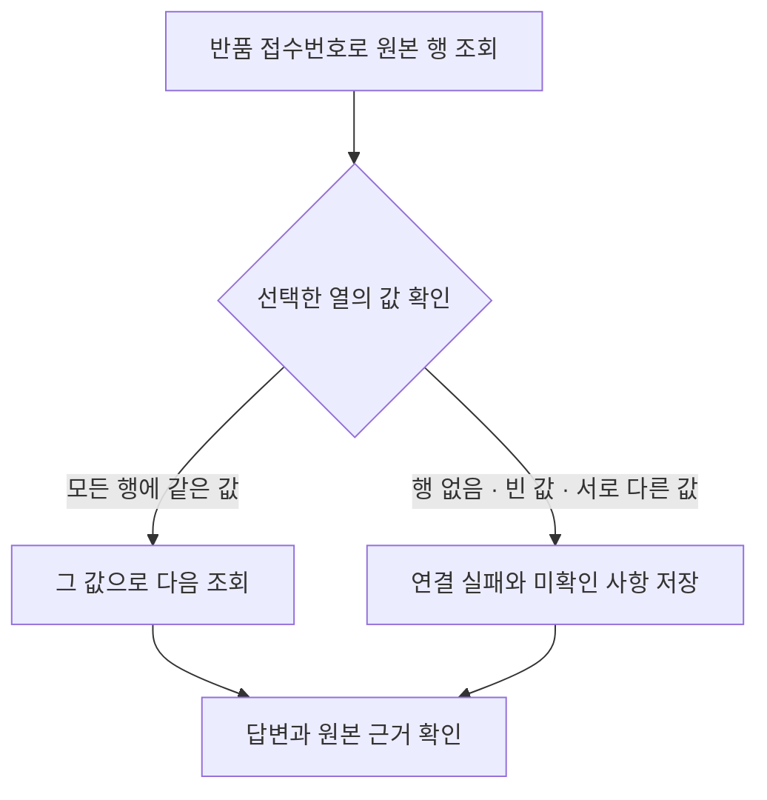
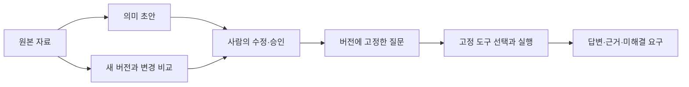

# 운영 자료실 사용 안내

운영 자료실은 CSV와 정책 문서를 보관하고 필드의 의미를 검토한 뒤 질문에 활용하는 단일 사용자용 화면입니다. 이커머스를 우선 지원하며 제조 예제와 기존 연구 화면도 유지합니다. 제품 전체의 완성이나 일반적인 답변 품질을 검증한 상태는 아닙니다.

## 용어 구분

이 안내에서 **언어모델(LLM)**은 자료 해석을 제안하거나 질문에 답하는 생성 모델을 뜻합니다. 화면의 **모델 제안**처럼 “모델”이 들어간 이름도 LLM 기능을 가리킵니다. **표준 스키마**는 `orders.id`, `skus.id`처럼 자료를 연결할 대상 필드와 구조입니다. LLM과 구분해 부릅니다.

현재 의미 매핑은 로컬 사전·규칙으로 후보를 만들고 선택적으로 LLM 제안을 받은 뒤 사람이 수정·승인하는 방식입니다. 임베딩 유사도로 자동 확정하지 않습니다. 정책 문장을 읽고 구조화된 계산 규칙을 자동으로 만드는 기능도 아닙니다. LLM의 추론 설정과 OWL 추론기의 규칙 실행은 서로 다른 기능입니다.

## 시작과 자료 입력

저장소 루트에서 실행합니다. 기존 서버가 같은 데이터 디렉터리를 사용 중이면 먼저 종료해야 합니다.

```bash
uv sync --locked
uv run --locked python -m apps.factory_lab.public_server
```

브라우저에서 `http://localhost:9261/workspace`를 여세요. 원격 EC2에서는 SSH 터널을 사용합니다. 서버는 `127.0.0.1`에만 연결하며 공개 서비스용 사용자 인증은 제공하지 않습니다. 기존 `/` 연구 화면과 `/prepare` 준비 화면은 별도 경로로 남아 있습니다.

새 자료실에서 UTF-8 CSV와 TXT/MD 문서를 선택합니다. 최대 24개, 파일당 1 MB, 전체 4 MB이며 CSV는 파일당 200행·64열까지 받습니다. 자료 기준일과 버전 이름을 기록하고 통화는 `KRW`, `GBP` 같은 코드 또는 `unknown`, `mixed`, `not_applicable`을 직접 지정하세요. 코드는 사용자 선언이며 통화를 검증하거나 환산하지 않습니다. 원본 조회는 다른 통화에서도 가능하지만 현재 주문 변경안 계산은 KRW만 지원합니다.

### 원본 파일과 과거 실행 탐색

자료실은 선택한 파일 하나의 미리보기와 원문을 보여줍니다. 데스크톱에서는 파일 목록으로, 모바일에서는 파일 선택 상자로 바꿉니다. 다른 탭을 다녀와도 같은 자료실의 선택은 유지합니다. 파일이 교체돼 더 이상 없다면 남아 있는 파일로 돌아갑니다.

질문 기록에서 과거 결과를 열거나 이전 기록을 더 불러와도 기록 목록의 펼침 상태를 유지하고 연 결과로 포커스를 옮깁니다. LLM이 만든 자료 해석 제안은 질문 답변 목록과 구분합니다. 새로고침 후에는 저장된 실행을 다시 열어야 할 수 있습니다.


### 세 파일로 시작하는 구매 항목 예제

`examples/factory_lab/workspace/commerce-lines/`의 `orders.csv`, `catalog.csv`, `policy.md`를 새 자료실에 함께 올리세요. 모두 직접 작성한 가상 자료이며 Apache-2.0으로 배포합니다. `README.md`와 `manifest.json`은 안내·해시 파일이므로 업로드 대상이 아닙니다.

이 예제는 표준 주문 계산에 맞추지 않고 원본 근거를 읽는 경로입니다. 데이터 정리에서 CSV의 여섯 열을 **원본 조회에만 사용 · 표준 연결 없음**으로 선택하고 의미를 적은 뒤 승인합니다. `purchase_ref`는 여러 상품 항목에 반복될 수 있는 구매 참조, `sku`는 상품 코드, `stage`는 기록된 배송 상태입니다. 상품 목록의 `label`은 상품명, `family`는 분류입니다. 기록된 상태가 실제 배송 완료를 입증하지는 않습니다.

정책 문서의 두 문단은 **문맥만 보존**으로 선택하고 참고할 범위를 적어 승인하세요. 문단을 승인해도 환불 규칙이 생기지는 않습니다. LLM이 표준 필드나 정책 연결을 제안했다면 원문과 목적을 대조해 수정할 수 있습니다. LLM 제안 적용 직후에는 모두 검토 대기 상태입니다.

관계 후보를 검토한다면 `orders.csv`의 `sku`와 `catalog.csv`의 `sku`를 원문 설명과 비교하세요. 값이 같은 것만으로 승인하지 않습니다. 관계 후보가 없다면 직접 추가해 검토할 수 있습니다. 이 예제에서 실제 LLM은 관계 대조 도구 대신 앞선 행 조회에서 얻은 SKU를 다음 행 조회에 전달했습니다. 승인한 관계 후보가 모든 값 전달의 업무 의미를 검사한 것은 아닙니다.

LLM 질문이 설정된 환경에서는 다음 질문을 보낼 수 있습니다.

> 구매 참조 O-211에 기록된 상품의 이름과 분류, 배송 상태를 확인하고 환불을 승인할 수 있는지도 알려줘.

새 자료실에서 실제 초안을 생성하고 사람이 검토한 뒤, 구매 참조 조회 → SKU 값 전달 → 상품 조회와 문서 원문 조회 → 답변 저장을 한 사례에서 확인했습니다. 상품 정보와 기록된 상태를 답하고 환불 승인은 미해결로 남겼습니다. 이 원본 조회 경로에서는 SHACL·OWL이나 환불 규칙을 실행하지 않았습니다. LLM을 연결하지 않았다면 **원본 열로 행 찾기**와 **승인한 문단 직접 읽기**로 같은 자료를 확인할 수 있습니다.

`O-210`에는 서로 다른 SKU의 항목이 두 개 있습니다. 이 자료가 포함됐다고 여러 값을 자동으로 나눠 조회하는 기능까지 확인한 것은 아닙니다. 현재 앞선 조회의 값 연결은 모든 반환 행에 같은 비어 있지 않은 값이 하나일 때만 실행합니다. 이 예제의 성공은 한 작성 자료의 사용 경로를 확인한 결과이며 자동 매핑 정확도나 일반적인 답변 품질 평가가 아닙니다.

## 검토와 승인

LLM 초안에는 항목별 확인 질문을 함께 저장할 수 있습니다. 예를 들어 같은 참조 번호가 주문번호인지 환불 접수 번호인지, 정책 금액이 할인 전인지 후인지 묻는 질문입니다. 질문은 데이터 정리 화면에서 원문과 함께 확인하고 판단한 내용은 업무 의미·적용 범위에 직접 기록합니다. 질문이 없다고 의미가 검증된 것은 아니며 질문을 저장해도 승인이나 규칙 실행은 일어나지 않습니다. 저장된 초안을 다시 열 때에는 LLM을 다시 호출하지 않습니다. 실제 LLM이 적절한 질문을 만드는지는 아직 측정하지 않았습니다.

자료실에서 원문·미리보기·출처 해시를 확인한 뒤 데이터 정리로 이동합니다. 로컬 사전과 규칙이 만든 제안은 아직 승인된 의미가 아닙니다. 실제 값을 보고 필드를 수정하고 선택한 필드의 승인 미리보기를 확인하세요.

**선택한 필드 승인 미리보기**에는 승인할 연결, 입력한 업무 의미와 메모, 원본의 첫 3개 값과 행 위치가 표시됩니다. 선택한 필드만 확인하고 **선택한 내용 승인**을 누르세요. 연결 대상이 없거나 원본 조회용 필드의 업무 의미가 비어 있으면 승인 버튼을 사용할 수 없습니다. **돌아가기**나 Esc로 닫으면 승인하지 않고 편집을 이어갈 수 있습니다. 선택하지 않은 필드의 편집 내용은 따로 저장해야 합니다.

정책 문단은 적용 대상·시점·예외를 검토합니다. 같은 규칙에 여러 문단이 승인돼 있으면 판단 실행을 보류합니다. 하나의 문단으로 적용 범위를 설명할 수 있을 때만 선택 이유와 다른 문단의 제외 이유를 기록하세요. 여러 문단의 조합은 아직 지원하지 않습니다. 문단의 금액과 CSV의 정책 금액이 같은지도 자동으로 확인하지 않습니다. 실제 계산에는 승인된 구조화 자료와 고정 규칙을 사용합니다.

### 승인한 문서 원문 조회

LLM을 연결하지 않았다면 **질문하기 → 직접 조회 · 변경안 검토 → 승인한 문단 직접 읽기**에서 문단을 선택하세요. **선택한 문단 조회**를 누르면 원문과 출처를 표시하고 실행 기록을 저장합니다. LLM을 호출하지 않으며 정책 적용 여부도 판단하지 않습니다. 승인을 철회하면 현재 버전의 새 조회는 사용할 수 없지만 이전 조회 기록에는 당시 원문을 보관합니다.

질문하기에서는 승인한 정책 문단도 원문 근거로 조회할 수 있습니다. LLM이 문단을 선택하면 전체 문장과 파일명·원문 행·해시를 답변 근거에 보관합니다. 승인하지 않은 문단은 이 조회 도구의 목록에 포함하지 않습니다.

이 기능은 문서에 적힌 내용을 확인하는 용도입니다. 현재 질문에 적용되는 정책인지, 다른 문단과 충돌하는지, 예외가 모두 반영됐는지는 검사하지 않습니다. 문맥 보존으로 승인한 문단도 조회할 수 있지만 계산 규칙이 되지는 않습니다. 문단 미리보기는 앞의 240자만 제공하며 선택한 문단은 전체 원문을 전달합니다. 다른 문단의 내용을 모두 검토했다는 뜻은 아닙니다.

연결 테스트에는 모의 LLM 응답을 사용했습니다. 실제 LLM의 문단 선택과 답변 정확도는 아직 측정하지 않았습니다.

### 열 이름이 등장하는 설명 문서

필드와 관계 후보에서 **열 이름이 등장하는 설명 문서**를 펼치면 같은 열 이름을 포함한 문단을 확인할 수 있습니다. 파일명, 원문 행과 해시를 함께 표시합니다. 관계 후보의 대상을 바꾸면 새 대상 열의 참고 문단도 바뀝니다.

대소문자를 구분해 정확한 열 이름을 찾으며 최대 5개 문단과 전체 일치 개수를 표시합니다. 같은 이름의 다른 열에 관한 설명이나 관계를 부정하는 문장도 포함될 수 있습니다. 조사와 붙은 열 이름은 놓칠 수 있으므로 결과가 없다고 설명이 없다는 뜻은 아닙니다. 전체 문서는 자료실에서 확인하세요. 이 연결은 의미를 확정하거나 승인을 바꾸지 않습니다.

### 기존 관계 후보의 LLM 검토

LLM 초안 생성이 설정된 환경에서는 값 겹침으로 찾은 기존 관계 후보도 LLM에 전달합니다. LLM은 원문이 관계를 뒷받침하는지, 관계와 충돌하는지, 판단할 정보가 부족한지를 제안 이유·인용 위치·확인 질문과 함께 남길 수 있습니다. 검토가 없는 후보는 아직 LLM이 평가하지 않은 후보이며, 관계를 지지한다는 뜻이 아닙니다.

**데이터 정리**의 관계 후보에서 LLM 검토 문구와 **모델이 참고한 원문 위치**를 함께 확인하세요. 지지하거나 반박하는 판단에는 출처가 필요하지만, 출처 위치가 맞는다고 그 해석까지 검증되는 것은 아닙니다. 반박된 후보도 자동으로 삭제하거나 제외하지 않습니다. 원문을 대조한 뒤 검토 상태와 해석을 직접 저장하세요.

판단과 인용은 생성 당시 관계에 대한 기록입니다. 연결할 열을 수정하면 이전 근거가 새 연결에도 맞는지 다시 검토해야 합니다. 현재 소프트웨어 검증에는 모의 응답을 사용했으며 실제 LLM의 지지·반박 판단 품질은 아직 측정하지 않았습니다.

### 필드의 업무 의미

**데이터 정리**의 필드 항목에서 **이 필드의 업무 의미 · 적용 범위**를 작성하고 **이 항목 저장**을 누르세요. 예를 들어 주문 항목마다 반복되는 주문번호라면 “주문 참조 번호이며 여러 행에 반복될 수 있음”이라고 기록할 수 있습니다. 설명을 쓰는 것만으로 승인되지는 않습니다. 연결할 필드와 검토 상태도 함께 확인하세요.

승인한 필드의 설명은 **원본 열로 행 찾기**의 조회 목록과 실행 근거에 보관합니다. 자유 질문에서는 LLM의 도구 선택과 답변 작성에 전달될 수 있습니다. 결과의 **사용자가 설명한 필드 의미**를 펼치면 원본 값과 구분해 확인할 수 있습니다. 기존 식별자 조회 경로에는 아직 이 설명을 전달하지 않습니다.

설명은 사용자의 검토 기록이며 원본에서 확인된 사실이나 실행 가능한 규칙이 아닙니다. 설명을 적어도 계산 방식이나 파일 간 연결이 자동으로 바뀌지 않습니다. 수정하면 새 자료 버전에 반영되고 과거 실행에는 당시 설명이 남습니다. 긴 설명은 LLM 입력 크기에 포함되므로 입력 한도에 걸릴 수 있습니다. 실제 LLM이 설명을 올바르게 활용하는지는 아직 검증하지 않았습니다.

표준 필드에 맞지 않는 열도 원본 조회에 사용할 수 있습니다. 데이터 정리에서 해당 열의 연결을 **원본 조회에만 사용 · 표준 연결 없음**으로 선택하고 업무 의미를 적은 뒤 승인하세요. 승인한 열은 원본 행 조회와 질문의 근거로 사용할 수 있습니다. 이 선택으로 재고 계산이나 정책 검사가 가능해지는 것은 아닙니다. 승인하지 않은 열은 조회 결과에서 제외하며 승인 변경 후에도 이전 실행에는 당시의 근거와 설명을 보관합니다.

### 정책 날짜의 역할

정책 문단에 `YYYY-MM-DD` 형식의 날짜가 있으면 각 날짜의 역할을 직접 선택합니다. 같은 날짜가 여러 번 나와도 원문 위치별로 검토하세요.

| 선택 | 자료 기준일과 비교하는 방식 |
| --- | --- |
| 적용 시작일 | 시작일 당일부터 적용할 수 있습니다. 그 전 기준일에는 승인을 막습니다. |
| 적용 종료일 | 종료일 당일까지 적용할 수 있습니다. 그 후 기준일에는 승인을 막습니다. |
| 참고 날짜 | 검토 예정일 등 적용 기간이 아닌 날짜입니다. 기간 계산에서 제외합니다. |
| 역할 확인 필요 | 의미가 정해지지 않은 상태입니다. 실행할 정책으로 승인하기 전에 확인해야 합니다. |

예를 들어 자료 기준일이 `2026-11-17`이고 정책에 “2027-01-01까지 적용”이라고 적혀 있다면 종료일로 선택합니다. “2027-01-01부터 적용”은 시작일이며 해당 기준일에는 아직 적용되지 않습니다. “다음 검토일은 2027-01-01”이라면 참고 날짜인지 원문을 확인하세요. 시스템이 이 문장들의 의미를 자동 판정하지는 않습니다.

선택한 역할과 적용 범위를 확인한 뒤 **이 항목 저장**을 누르세요. 작성 중에는 **검토 입력 임시 저장**으로 보관할 수 있습니다. 기존 승인 자료에 날짜 역할이 없으면 원본 기록 조회는 가능하지만 정책을 사용하는 판단 실행은 보류됩니다. **데이터 정리**에서 해당 문단의 날짜 역할을 선택하고 해석을 확인한 뒤 다시 저장하세요.

한 문단의 여러 적용 기간은 아직 지원하지 않습니다. 날짜를 참고 날짜로 바꾸어 실행 제한을 우회하지 말고 적용 관계가 불명확하면 미해결로 남기세요. `2026년 11월 17일`처럼 다른 형식은 현재 날짜 후보로 잡지 못하므로 원문 검토가 필요합니다. 날짜 역할은 사람의 선언이며 정책 전체의 유효성을 보증하지 않습니다.

### 정책에 연결된 CSV 값

정책 문단에서 **적용할 규칙**을 선택하면 그 규칙이 사용하는 필드가 함께 표시됩니다. 각 필드를 펼쳐 원본 값, CSV 레코드 번호, 원문 행과 파일 해시를 확인하세요. 승인한 필드 연결이 없거나 여러 개라면 값을 확정해 보여주지 않고 연결을 검토해야 한다고 표시합니다.

이 표는 연결된 필드의 전체 원본 값입니다. 특정 질문에서 사용한 행만 추린 결과나 여러 파일을 조인한 표가 아닙니다. 문서에 “7만 원 이상 무료배송”, CSV에 `50000`이 있다면 값과 적용 대상을 대조하고 차이가 해결되기 전에는 정책을 승인하지 마세요. 문서의 금액이 CSV를 덮어쓰거나 불일치를 자동으로 판정하지 않습니다. 변경이 필요하면 원본 자료를 교체하고 새 버전에서 다시 검토하세요.

### 정책 문서와 표 대조

이커머스 정책을 사용하는 계산은 개별 항목 승인에 더해 **정책 문서와 표 대조**가 필요합니다. **데이터 정리**에서 **문서와 표 비교하기**를 열고 문단, 표의 값, 적용 대상을 확인하세요. **적용 대상을 정하는 필드 연결**을 펼치면 식별자·참조를 포함한 필드 연결과 원본 값을 볼 수 있습니다. 이 목록이 표 사이의 연결을 자동으로 검증하는 것은 아닙니다.

대조 결과는 **값과 적용 범위가 일치함**, **문서와 표가 다름**, **아직 확인할 수 없음** 중에서 선택합니다. 계산 기준과 비교한 값·적용 대상·남은 차이를 적고 **대조 결과 저장**을 누르면 새 버전에 기록됩니다. 배송·쿠폰 계산은 할인 전 금액만 지원합니다. 문서가 할인 후 금액을 뜻한다면 실행을 위해 할인 전으로 선택하지 말고 미해결로 남기세요.

예를 들어 문서의 무료배송 기준이 7만 원이고 표에 `50000`이 있다면 불일치로 기록합니다. 해당 자료를 교체하거나 잘못 연결한 필드를 고친 뒤 다시 대조하세요. 시스템은 어느 쪽이 정답인지 선택하거나 값을 자동 수정하지 않습니다. 승인 기록이 없는 빈 표는 필드 연결 누락과 구분해 표시합니다. 기록이 없다는 사실의 업무상 의미도 함께 검토해야 합니다.

대조 전·불일치·미해결·재검토 상태에서는 정책 계산을 보류하지만 승인한 필드의 원본 조회는 계속 사용할 수 있습니다. 대조 결과를 저장한 뒤에도 자료, 기준 정보, 해당 정책의 해석·날짜 역할 또는 필드 연결이 바뀌면 이전 판단을 재사용하지 않습니다. 현재는 적용 대상 누락을 피하기 위해 어떤 필드 연결이 바뀌어도 다시 대조하도록 처리합니다. 관련 필드만 선별하는 방식은 아직 아닙니다.

대조 결과는 사용자의 판단이며 사실 검증이나 업무 실행 승인이 아닙니다. 저장된 결과는 재접속·내보내기·가져오기 후에도 보존하지만 가져온 기록의 작성자나 판단의 정확성을 인증하지 않습니다. 대조 창의 **대조 입력 임시 저장**으로 작성 중인 판단·계산 기준·메모를 서버에 보관할 수 있습니다. 재접속 후 **보관한 대조 입력 복원**을 눌러 이어서 작성하세요. 임시 저장은 승인이나 대조 결과 확정이 아니며 자동 저장도 아닙니다. 자료 버전이나 대조 대상이 바뀐 입력은 확인만 가능하고 복원할 수 없습니다. 대조 창에 저장하지 않은 변경이 있으면 창 닫기와 브라우저 이동 시 경고합니다. 브라우저 강제 종료나 장애까지 막는 기능은 아니므로 필요한 입력은 임시 저장하세요. 다른 항목을 편집 중이면 먼저 저장한 뒤 대조 창을 열 수 있습니다.

### 두 CSV의 같은 값 대조

관계를 승인하는 것만으로 조회가 실행되지는 않습니다. 관계 설명과 양쪽 열을 승인하면 **질문하기 → 직접 조회 도구 → 두 CSV의 같은 값 대조**에서 관계와 값을 직접 선택해 실행할 수 있습니다.

이 기능은 선택한 두 열에서 정확히 같은 문자열을 찾아 양쪽 원본 행을 보여줍니다. 중복 행도 모두 남기며 파일명과 원문 위치를 함께 표시합니다. 한쪽에서 행을 찾지 못했다면 선택한 파일과 열에서 일치하는 기록이 없다는 뜻입니다. 같은 업무 객체인지, 관계가 사실인지, 정책이 적용되는지는 판단하지 않습니다. 실행 결과는 자료 버전과 함께 저장되며 같은 요청을 다시 열면 당시 결과를 확인할 수 있습니다. 승인을 철회하면 새 조회에는 사용할 수 없습니다.

기존 업무 계산은 승인된 표준 필드와 고정 참조 규칙을 사용합니다. 자연어 문서를 임의의 실행 규칙으로 컴파일하지 않습니다.

작성 중에는 **검토 입력 임시 저장**을 누르세요. 서버에 보관하지만 승인에는 반영하지 않습니다. 재접속 후 같은 자료 버전에서 복원할 수 있습니다. 다른 버전의 입력은 확인만 가능하며 자동 적용하지 않습니다. 자동 저장은 아닙니다.

### 관계 제안의 출처와 값 대조

관계 후보에는 제안 출처가 표시됩니다. 로컬 생성기는 값이 겹치는 열을 후보로 찾습니다. 선택적으로 켠 LLM 생성기는 값이 겹치지 않는 열도 관계 후보로 제안할 수 있습니다. 기존 후보에 LLM 제안이 합쳐지면 두 기록을 함께 보관합니다.

LLM이 지정한 근거는 실제 파일의 열이나 문단에 연결해 저장합니다. 확인 질문도 초안에 함께 남깁니다. 근거 위치가 유효하다는 사실이 제안 내용의 정확성을 뜻하지는 않습니다. 모든 관계 제안은 검토 대기 상태이며 재불러올 때 LLM을 다시 호출하지 않습니다.

관계 검토 화면에서는 현재 선택한 두 열의 비어 있지 않은 고유 값이 얼마나 겹치는지 보여줍니다. 각 열의 빈 값·중복 행 수와 처음 5개 원본 기록, 위치, 파일 해시도 확인할 수 있습니다. 이 표는 조인 결과가 아니며 같은 값이 같은 업무 객체를 뜻하는지도 판단하지 않습니다.

연결할 열을 바꾸면 값 대조는 새 선택을 기준으로 갱신합니다. 제안 이유와 인용 원문은 생성 당시의 기록이므로 새 연결에도 해당하는지 다시 확인하세요. LLM 관계 제안의 저장·복원과 화면 연동은 모의 응답으로 확인했으며 실제 LLM의 관계 해석 품질은 아직 측정하지 않았습니다.

### 자동 제안에 없는 관계 추가

**데이터 정리 → 관계 직접 추가**에서 두 파일의 열을 선택하고 연결을 제안하는 이유를 적으세요. 추가한 관계는 검토 대기로 저장됩니다. 원본 값과 의미를 확인한 뒤 관계와 양쪽 열을 승인해야 조회에 사용할 수 있습니다. 추가만으로 조회가 실행되지는 않습니다.

자료를 교체해도 두 열이 남아 있으면 직접 추가한 관계를 보존하고 재검토 대상으로 돌립니다. 열이 사라지면 이전 관계는 이력에 남습니다. 새 관계를 추가할 때 같은 두 열의 중복 연결을 막지만 기존 관계의 대상을 수정해 연결이 겹친 경우에는 각 기록을 보존합니다.

### 앞선 조회 결과로 다음 조회 연결

반품 접수번호로 주문번호를 찾은 뒤 그 주문의 배송 기록을 조회하는 질문에는 두 번의 조회가 필요합니다. LLM은 앞선 원본 행 조회의 어떤 열을 다음 조회에 사용할지 선택할 수 있습니다. 실행기는 반환된 모든 행에 비어 있지 않은 동일한 문자열이 있을 때만 그 값을 전달합니다. 여러 행에서 같은 값이 나와도 하나의 업무 객체임을 확인한 것은 아닙니다.



답변의 근거를 펼치면 **앞선 조회에서 가져온 값**에서 근거 ID, 원본 열, 전달한 값과 원본 위치를 확인할 수 있습니다. 연결에 실패하면 이유도 표시됩니다. LLM이 선택한 열이 질문의 의도에 맞는지는 별도로 확인하세요. 실행기는 임의의 행을 선택하거나 여러 값으로 조회를 늘리지 않습니다.

현재 연결은 앞선 `source_rows` 결과의 승인된 열을 다음 `source_rows` 또는 `relation_rows`의 값으로 사용하는 범위입니다. 쿼리나 코드를 생성하지 않으며 질문당 최대 4개 도구 제한을 유지합니다. 원래 요청과 실제 전달한 값은 함께 저장되므로 이전 실행을 다시 열어도 LLM을 호출하지 않습니다.

이 경로의 소프트웨어 동작은 작성한 사례와 모의 LLM 응답으로 확인합니다. 실제 LLM의 질문 해석·조회 선택 품질과 일반적인 사용자 편의성을 입증한 결과는 아닙니다.

### 질문에서 승인한 관계 활용

자유 질문을 켜면 LLM은 승인된 관계와 양쪽 열을 조회 목록에서 확인하고 관계 ID와 찾을 값을 선택할 수 있습니다. 실제 조회는 고정된 `relation_rows` 도구가 수행합니다. LLM이 쿼리를 만들거나 여러 관계를 이어서 실행하지 않습니다.

예를 들어 “A 주문과 내역을 비교하고 환불 가능 여부도 확인해 줘”라는 질문에서 관계 조회는 두 열에 정확히 같은 값 A가 있는 기록을 가져옵니다. 환불 정책은 이 조회로 확인할 수 없습니다. 답변의 근거를 펼치면 양쪽 원본 행과 위치를 볼 수 있으며 조회 조건은 LLM의 해석임을 함께 표시합니다.

승인한 관계 설명은 사용자의 해석이며 실제 관계의 진실성을 보증하지 않습니다. 관계나 연결된 열의 승인을 철회하면 새 질문의 도구 목록에서 빠집니다. 이전 실행은 당시 자료 버전으로 남습니다. 저장된 실행을 다시 열어도 LLM을 호출하지 않습니다.

이 경로는 모의 LLM의 선택·답변과 실제 로컬 조회로 검증했습니다. 실제 LLM이 질문에 맞는 관계와 값을 선택하는지는 아직 측정하지 않았습니다.

## 질문과 근거

### 작업별 질문 준비

질문 입력창의 **질문 준비 안내**에서 확인하려는 작업을 직접 선택하세요. 원본 행 찾기, 문서 문단 읽기, 두 CSV의 같은 값 대조를 구분해 필요한 검토 항목과 도구를 안내합니다. 이커머스에서는 기록된 재고 수량 비교와 정해진 대체 상품 검토도 선택할 수 있습니다. 작업 선택은 질문을 자동 분류하거나 LLM에 전달하는 절차가 아니며 조회·승인·유료 호출을 실행하지 않습니다.

원본 조회에는 승인한 원본 열이, 문서 읽기에는 승인한 문단이 필요합니다. 대체 상품 검토에 필요한 전체 주문·정책 항목을 갖추지 않아도 이 조회들은 사용할 수 있습니다. 두 CSV 대조에는 관계 설명과 양쪽 열의 승인이 필요하며 같은 문자열을 찾은 결과가 같은 업무 객체임을 보증하지는 않습니다.

아직 승인하지 않은 항목은 해당 검토 화면에서 확인하세요. 표준 역할이 연결되지 않았다고 원본에 정보가 없다는 뜻은 아닙니다. 현재 원문을 확인한 뒤 필요하면 **자료 묶음 교체 안내**로 이동할 수 있습니다. 파일 교체 시에는 보존할 파일까지 포함한 전체 묶음을 선택해야 합니다. 안내를 읽거나 작업을 바꿔도 작성 중인 질문과 검토 입력은 유지합니다.

재고 비교는 같은 CSV에서 상품 코드와 가용 수량을 각각 `skus.id`, `skus.available`로 승인해야 합니다. 현재 재고 비교 도구는 LLM 질문 경로에서 사용하며 별도의 직접 재고 입력 폼은 제공하지 않습니다. LLM을 연결하지 않았다면 원본 행 조회로 기록을 확인하세요. 수량 비교는 예약·최신성·주문 승인을 확인하지 않습니다.

**아직 답하지 못한 요구**의 준비 안내는 현재 선택한 자료 버전을 기준으로 열립니다. 과거 답변과 당시의 미해결 요구는 바꾸지 않습니다. 환불 검토에 배송 완료나 반품 사유 기록이 도움이 될 수 있지만 필요한 근거는 정책에 따라 다릅니다. 이런 자료를 추가해도 환불 승인 기능이 생기지는 않습니다. 기록과 정책 문구를 읽는 기능과 실제 승인 절차를 구분해 사용하세요.


질문 화면은 질문 입력과 실행 기록을 먼저 보여줍니다. 원본 행 조회와 고정 변경안 검토는 **직접 조회 · 변경안 검토**, CSV의 예제 질문은 **저장된 예제 질문**을 펼쳐 사용하세요. LLM이 꺼져 있으면 직접 조회 패널은 처음부터 열립니다. 패널 제목에 키보드 초점을 두고 Enter로 펼칠 수도 있습니다. 응답 확인이 필요한 요청은 접힌 패널 밖에 표시하며 기록에는 당시 자료 버전과 아직 답하지 못한 요구를 남깁니다.

| 경로 | 실행 내용 | LLM 호출 |
| --- | --- | --- |
| 원본 열로 행 찾기 | 승인한 원본 열에서 값이 정확히 일치하는 모든 행 조회 | 없음 |
| 원본 기록 확인 | 승인한 필드의 정확한 식별자로 원본 문자열 조회 | 없음 |
| 주문 변경안·저장된 질문 | 고정 조회·계산, RDFLib·SHACL·동일 정책 Python·작성된 OWL 규칙 | 없음 |
| 자유 질문 | LLM의 고정 도구 선택 → 실제 조회·검토 → LLM 답변 | 최대 2회 |

**원본 열로 행 찾기**에서는 승인한 열과 찾을 값을 선택합니다. 예를 들어 `order_no`에 `A`가 여러 번 나와도 일치하는 행을 모두 표시합니다. 고유 주문 ID를 지정하거나 나머지 정책을 승인할 필요는 없습니다. 결과에는 같은 파일에서 승인한 열의 원본 값만 포함되며 CSV 레코드 번호, 원문 줄 위치와 파일 해시를 확인할 수 있습니다.

값은 대소문자와 공백을 포함해 정확히 비교합니다. 빈 값도 찾을 수 있습니다. 같은 값의 여러 행을 같은 주문으로 확정하거나 합산·중복 제거하지 않습니다. 파일 간 연결이나 정책 판단도 수행하지 않습니다. 일치하는 행이 없다는 결과는 선택한 파일에 한정됩니다. 기존 **원본 기록 확인**은 승인한 표준 ID로 조회하는 별도 경로이며 ID가 반복되면 여러 기록이 있다는 상태를 유지합니다.

자유 질문은 서버에서 별도로 활성화해야 합니다. 활성화하지 않아도 원본 조회와 고정 검토는 사용할 수 있습니다. 입력한 질문의 Enter는 전송, Shift+Enter는 줄바꿈입니다. 실제 주문 변경·환불·출고는 수행하지 않습니다.



답변에서 자료 버전과 근거 ID를 확인하세요. 원본 관측, 계산, 제약 검토, 추론은 서로 다릅니다. SHACL 통과나 인용 ID 일치는 사실의 진실성·근거의 완전성·답변의 정확성을 보장하지 않습니다. 전체 도구 결과와 답변 LLM에 전달한 입력을 따로 저장합니다. 중복 그래프 직렬화 등을 제외한 경로도 기록합니다.

근거 상세의 **사용한 조회 조건**에서 LLM이 선택한 조회 조건을 확인할 수 있습니다. 이는 LLM의 질문 해석이며 사용자가 각 값을 확인했다는 뜻은 아닙니다. 직접 입력한 변경안과 LLM이 선택한 입력의 출처를 따로 기록합니다.

### 기록된 재고 수량 비교

자유 질문에서 특정 SKU의 재고가 요청 수량 이상인지 확인할 수 있습니다. 같은 CSV의 SKU 식별자와 가용 수량을 각각 `skus.id`, `skus.available`로 승인해야 합니다. 다른 필드나 할인·배송 정책을 모두 승인할 필요는 없습니다. LLM이 SKU와 요청 수량을 선택하므로 실행 근거에서 선택한 조건을 확인하세요.

선택한 파일에서 같은 SKU가 한 행일 때 기록된 수량을 비교합니다. SKU가 없거나 여러 행에 있으면 판단을 보류하며 빈 수량이나 지원하지 않는 숫자 형식도 임의로 보정하지 않습니다. 현재는 0 이상 10억 이하의 정수 표기만 읽습니다. 여러 창고의 재고를 합산하지 않습니다.

Python 비교와 SHACL 검사는 같은 수량과 조건을 사용합니다. 두 결과가 같아도 재고의 최신성이나 예약 가능성을 보증하지 않습니다. 상품 대체 적합성·고객 동의·할인·배송·주문 변경 승인은 별도로 확인해야 합니다. 전체 주문 변경안에는 기존의 자료·정책 검토 조건이 계속 적용됩니다.

이 경로는 작성한 예제와 테스트 응답을 반환하는 LLM로 점검했습니다. 이후 실제 LLM 개발 사례에서 자료 개요와 S1의 기록 재고를 함께 물어, 기록 수량 0개와 요청 수량 2개를 비교한 답변을 확인했습니다. 한 사례의 결과이며 일반적인 도구 선택 정확도를 뜻하지 않습니다.

재고 비교의 전체 결과는 실행 기록에 보관합니다. 답변 작성 LLM에는 선택한 원본 행과 위치·해시, 필드 설명, 요청 수량, 비교·검사 결과, 미확인 사유와 검사하지 않은 범위를 전달합니다. 전체 SKU 목록과 중복 그래프 표현은 답변 입력에서 제외하며 제외한 경로는 `answer_projection`에 기록합니다. 질문의 조회 선택 단계에는 여전히 식별자 목록을 전달하므로 큰 자료는 그 단계에서 입력 한도에 걸릴 수 있습니다.

### 예시 SQLite 연결

**새 저장소 → DB 연결하기 → 예시 SQLite DB 연결**을 누르면 실제 SQLite 스냅샷을 연결합니다. 스냅샷은 상품·주문·주문항목 3개 표와 11행으로 구성됩니다. 작성한 가상 자료이며 연결 시 LLM을 호출하지 않습니다. 첫 상태의 필드 의미는 모두 검토 대기입니다. 원본 화면에서 스키마·외래키 선언과 표본을 먼저 확인하세요.

전체 항목을 승인할 필요는 없습니다. **상품 3개 열 검토하기**에서 products의 sku·name·available을 확인하고 필요한 열의 의미와 승인 상태를 저장하세요. 세 열을 승인하면 **상품 조회 정의 초안 만들기**로 정확한 상품번호 필터와 출력 열을 확인할 수 있습니다. 제공된 예제 템플릿이며 LLM이 생성한 쿼리가 아닙니다. 이 정의도 별도로 검토·승인한 뒤 채팅에서 “P-102 상품의 이름과 기록된 재고를 알려줘”라고 질문할 수 있습니다. 기록 조회가 재고 예약이나 주문 변경을 뜻하지는 않습니다.

**LLM으로 의미 초안 제안받기**는 NVIDIA auto-ontology 실행 창을 엽니다. 연결된 서버에서 스키마 수집과 유료 의미 생성을 구분해 선택하세요. LLM 제안을 받아도 자동 승인되지 않으며 원본과 대조해 사용할 항목만 수정·승인합니다. 연결하지 않은 서버에서는 직접 검토하거나 이미 생성한 제안 파일을 가져올 수 있습니다. [예시 DB 정의와 실행 안내](https://github.com/shinysong/shacl-graphrag/tree/main/examples/factory_lab/database-onboarding)를 참고하세요.

### 저장소 자료 탐색

채팅에서 답변에 사용할 저장소를 선택한 뒤 “이 데이터가 무엇인지 설명해주세요”라고 물어보세요. 자료 개요, 가능한 질문, 검토 대기 예시는 입력란만 채웁니다. 질문 보내기를 눌러야 실행됩니다.

자료 탐색은 승인 전에도 파일·테이블 이름, 원본 컬럼, 제한된 예시 값과 검토 상태를 확인합니다. 접근 권한과 모델 전송 범위는 그대로 적용합니다. 미승인 의미나 관계는 검토자의 제안으로 표시하며 업무 판단을 승인한 것으로 취급하지 않습니다. 열 승인과 실행할 DB 질의 승인은 서로 다릅니다.

CSV는 업로드한 파일을, 등록 DB는 연결 때 저장한 스키마·집계·제한된 표본을 탐색합니다. DB 전체 행 수와 저장된 표본 행 수를 구분하며 탐색만으로 현재 DB를 다시 조회하지 않습니다. 목록은 한 번에 최대 5개, 필드 예시 값은 최대 3개를 반환합니다. 표시하지 않은 항목과 다음 목록 위치도 근거에 남습니다.

LLM은 질문에 따라 목록을 확인한 뒤 필요한 자료 상세나 승인된 조회를 선택합니다. 조회 선택은 최대 3단계, 도구 실행은 전체 최대 8개이며 최종 답변을 포함해 모델 호출은 최대 4회입니다. 실패도 기록하고 자동으로 다시 호출하지 않습니다.

다음 질문으로 시작할 수 있습니다.

- 어떤 파일과 테이블이 있고 어떻게 연결되어 있어?
- 주문 관련 자료를 찾아 주요 컬럼과 예시 값을 보여줘.
- 아직 검토하지 않은 항목은 무엇이야?
- 자료 개요를 설명하고 S1의 기록 재고가 2개 이상인지 확인해줘.

마지막 질문은 예제의 재고 조회 승인이 있을 때 사용할 수 있습니다. 실제 주문이나 예약을 변경하지 않습니다. 답변의 근거에서 파일·컬럼·표본·검토 상태를 확인하세요. 지원하지 않는 업무, 승인 부족, 조회 실패는 자료 자체가 없다는 뜻과 구분해야 합니다. 모델이 이를 잘못 해석할 수 있으므로 답변과 미해결 요구를 함께 확인하세요.

### 현재 자료에서 가능한 조회

**직접 조회 · 변경안 검토**에는 승인된 조회 대상이 있는 도구만 표시합니다. 원본 열만 승인했다면 원본 행 조회를 사용하고 문단이나 관계를 승인하면 해당 조회 도구가 나타납니다. 검토 대기 항목은 **데이터 정리로 이동**에서 확인하세요. 일부 항목이 검토 대기 중이어도 이미 승인한 원본은 조회할 수 있습니다.

주문 항목 ID와 상품 옵션 ID의 연결 후보가 있으면 주문 변경안 도구가 표시됩니다. 도구가 보인다고 실행 준비가 끝난 것은 아닙니다. 식별자 승인, 필요한 자료와 정책은 실행 전에 별도로 확인합니다. 저장된 예제 질문이 없으면 예제 질문 패널은 표시하지 않습니다.

열 승인이나 식별자 연결이 없어 조회에 실패한 기록에는 검토 안내가 표시됩니다. **원래 오류 기록**을 펼치면 저장 당시 오류를 확인할 수 있습니다. 데이터 정리로 이동해 현재 자료를 검토한 뒤 새로 실행하세요. 이전 실패 기록과 당시 자료 버전은 그대로 남습니다.

### 질문 근거 연결

답변 아래의 **질문 근거 연결**은 처음에는 접혀 있습니다. 펼치면 그 실행에 저장된 조회, 파일·열과 값 전달을 볼 수 있습니다. 조회 완료와 답변에서 참조한 근거를 구분하며 간선에는 같은 문자열 대조나 원문 문단 읽기처럼 실제 수행한 작업을 표시합니다. **이 조회의 근거 상세 열기**는 해당 근거로 이동하며 LLM을 다시 호출하지 않습니다.

그래프는 현재 자료실 전체를 그리지 않고 저장된 실행만 읽습니다. 같은 문자열이나 사용자가 적은 관계 설명을 업무상 동일 객체나 검증된 사실로 취급하지 않습니다. 텍스트 연결에서도 같은 정보를 확인할 수 있으며 전체 원본 행은 근거 상세에 남습니다.

자료를 교체해도 이전 답변과 근거는 당시 버전에 남습니다. 새 자료의 승인을 다시 검토한 뒤 새 조회를 실행하세요. 작성한 상품 자료 한 사례에서 교체 전 답변의 상품명을 보존하고 재승인 후 직접 조회에 변경된 상품명을 사용하는 동선을 확인했습니다. 이는 새 자료에 대한 LLM 답변을 다시 평가한 결과는 아닙니다.

### 질문별 준비 상태

질문 화면의 **현재 자료로 할 수 있는 일**에서 원본 행 찾기, 문단 읽기, 관계 대조, 재고 비교의 준비 상태를 따로 확인할 수 있습니다. 표시된 개수는 승인한 조회 범위의 수입니다. 답할 수 있는 질문 수나 정답 수는 아닙니다. 재고 비교가 준비되어 있어도 대체 상품의 할인·배송 조건까지 검토할 수 있다는 뜻은 아닙니다.

**대체 상품 검토 · 준비 항목**을 펼치면 연결·승인이 필요한 필드, 중복 연결, 미검토 항목, 적용할 정책과 계산 기준을 확인할 수 있습니다. 현재 변경안 계산은 KRW와 정해진 자료 구조를 요구합니다. 화면의 **데이터 정리로 이동**에서 필요한 내용을 검토하세요. 직접 입력하는 변경안에는 저장된 예제 질문용 필드를 요구하지 않지만, 전체 변경안 실행에 필요한 다른 검토 조건은 그대로 적용합니다.

이 목록은 준비를 돕는 안내입니다. 정책 검사는 각 검사에서 처음 발견한 오류를 표시하므로 모든 문제를 한꺼번에 찾았다고 볼 수 없습니다. 준비 항목이 없어도 실행 시 값 형식, 식별자 중복, 자료 간 참조와 선택한 변경안을 다시 검사합니다. 안내를 보는 것만으로 승인이 바뀌거나 LLM이 호출되지는 않습니다.

### 질문·초안 생성 상태
질문을 보내면 화면에 서버가 마지막으로 저장한 단계가 표시됩니다. **질문 해석 · 조회 선택 중**, **저장소 구조·샘플·검토 상태 탐색 중**, **탐색 근거를 바탕으로 다음 조회 선택 중**, **선택한 도구로 근거 조회 중**, **조회 근거로 답변 작성 중**을 구분하고 조회 완료·실패 건수를 함께 보여줍니다. 빠른 단계는 다음 상태로 넘어가 화면에서 보지 못할 수 있습니다. 완료율이나 남은 시간을 계산한 표시는 아닙니다.

LLM 초안 생성도 처리 중·완료·실패·중단 상태를 표시합니다. 생성기의 내부 추론 단계나 진행률은 표시하지 않습니다. 생성이 끝나면 처리 중 안내를 완료 안내로 바꿉니다. 새 초안은 별도로 보관하며 적용하기 전까지 기존 검토 결과를 바꾸지 않습니다.

진행 상태 조회는 LLM을 다시 호출하거나 실행을 재개하지 않습니다. 처리 중에는 새 실행을 막습니다. 상태 조회가 실패해도 질문을 자동으로 다시 보내지 않으며 원래 실행의 결과를 기다립니다. 연결이 끊겨 결과를 받지 못했다면 저장된 요청 기록부터 확인하세요. 중단된 생성은 완료 여부를 확정할 수 없으므로 새로 생성하기 전에 외부 호출·비용 기록도 확인해야 합니다.

### 질문 입력 한도와 복구

LLM에 전달할 입력이 38,000바이트를 넘으면 해당 단계의 요청을 보내기 전에 멈춥니다. 이는 토큰 한도가 아니라 현재 실행기의 바이트 한도입니다. 근거를 임의로 잘라 답변을 만들지 않습니다.

- 조회 선택 전 한도 초과: 자료의 조회 목록 자체가 크면 질문을 짧게 바꿔도 해결되지 않습니다. LLM 조회는 시작하지 않았습니다. **원본 열로 행 찾기**로 필요한 기록을 직접 확인할 수 있습니다.
- 답변 작성 전 한도 초과: 이미 조회한 근거는 저장된 실행에서 확인하세요. 조회 대상이 줄어들도록 질문을 구체화할 수 있지만 새 실행이 한도 안에 들어온다고 보장하지는 않습니다.

**이 질문의 저장된 실행 확인**은 LLM을 다시 호출하지 않습니다. 새 질문을 실행하면 LLM을 새로 호출하고 비용이 들 수 있습니다. 저장 공간 부족까지 함께 발생했다면 마지막으로 저장된 지점만 남을 수 있으므로 오류 안내를 확인하세요.

### 저장된 실행 찾아보기

실행 기록은 최근 20건의 요약부터 보여줍니다. **결과와 근거 열기**를 누르면 당시 저장된 답변과 근거를 읽습니다. 이 버튼은 LLM을 다시 호출하지 않습니다. **이전 실행 기록 더 보기**로 오래된 기록을 이어서 찾을 수 있습니다. 데이터 정리 화면에서도 같은 방식으로 과거의 자료 해석 제안을 확인합니다.

질문을 방금 실행했거나 기존 요청을 복구한 직후에는 결과를 바로 보여줍니다. 탭을 바꾸거나 이전 기록을 더 읽어도 최근 열어본 결과 세 건은 유지됩니다. 네 번째 결과를 열면 가장 먼저 열었던 결과는 요약으로 돌아갑니다. 원본 실행 기록은 삭제되지 않습니다. 새로고침하거나 자료실을 다시 불러오면 요약부터 표시하며 근거 안의 접힌 항목은 다시 열어야 할 수 있습니다.

## 선택적 LLM 연결

[기존 실행 안내](factory-lab-public.md)의 키·가격·예산 설정을 먼저 확인하세요. 아래는 설정 예시입니다. 실제 연결 확인 범위는 이 절의 뒤에서 설명합니다.

```bash
uv run --locked --env-file .env python -m apps.factory_lab.public_server \
  --live-config _workspace/factory-lab-public/live-config.json \
  --workspace-questions
```

`--workspace-model-proposals`를 별도로 추가하면 원문 전체를 LLM에 보내 의미 초안을 제안받을 수 있습니다. 초안 생성은 최대 1회, 자료 탐색을 포함한 자유 질문은 최대 4회 호출하며 기존 공유 비용 원장과 종료 시각을 사용합니다. 실패도 시도에 포함하고 자동 재시도하지 않습니다. 기존 연구 화면의 질문은 3회 호출하는 별도 경로입니다.

LLM은 표준 필드에 맞추기 어려운 열을 **원본 조회에만 사용 · 표준 연결 없음**으로 제안할 수도 있습니다. 제안을 적용해도 검토 대기 상태이며 사용자가 필드의 업무 의미를 적고 승인해야 원본 조회에 쓸 수 있습니다. LLM의 제안 이유가 사용자 해석으로 자동 저장되지는 않습니다. 이 선택지는 문서 정책이나 새 계산 규칙을 만드는 기능이 아닙니다. 실제 LLM이 적절하게 선택하는지는 아직 측정하지 않았습니다.

LLM 제안에서 **모델이 참고한 원문 위치**를 펼치면 LLM이 선택한 문서 문단이나 CSV 열을 볼 수 있습니다. 문서는 원문과 행 위치를, CSV 열은 처음 3개 레코드의 값과 원문 행 위치를 표시합니다. 전체 원본은 자료실에서 확인할 수 있습니다.

출처는 저장된 파일 해시와 위치에 연결되며 초안을 다시 불러올 때 원본과 일치하는지 검사합니다. 존재하지 않는 출처나 잘못된 위치는 거부합니다. LLM이 출처를 선택하지 않았다면 저장된 출처가 없다고 표시합니다. 출처가 존재한다고 해서 제안한 의미가 맞거나 그 문단이 주장을 뒷받침한다는 뜻은 아닙니다. 제안을 적용하기 전과 적용한 뒤 모두 원문을 비교해 검토할 수 있습니다.

외부 생성 초안은 현재 승인 자료를 바로 덮어쓰지 않습니다. 내용을 확인하고 적용하면 새 버전이 생기며 다시 검토해야 합니다. 저장한 제안을 복원할 때 LLM을 재호출하지 않습니다. 실제 auto-ontology 의미 결과의 수정·승인·조회 재사용과 OpenOntologies의 저장 조회 기반 추론·참고 저장을 확인했습니다. [선택적 온톨로지 확장](factory-lab-upstream-extensions.md)에서 연결 조건과 한계를 확인하세요.

### LLM 응답 형식과 추론 설정

초안 생성과 자유 질문은 일반 JSON 또는 응답 전체를 감싼 하나의 JSON 코드 블록을 읽습니다. 코드 블록 밖의 설명, 여러 JSON 덩어리, 잘린 응답은 자동으로 복구하지 않습니다. 형식을 읽을 수 있어도 필드·출처·도구·인용 검사는 그대로 적용합니다. 형식 검사를 통과했다고 내용이 맞다는 뜻은 아닙니다.

선택적 설정 `reasoning_effort`에는 `low`, `medium`, `high`를 지정할 수 있습니다. 사용 중인 LLM과 공급자가 지원하는지 먼저 확인하세요. 이 설정이 없으면 기존 요청 방식을 유지합니다. 추론 토큰도 출력 예산을 사용할 수 있으므로 출력이 잘렸다면 원래 응답과 사용량을 확인해야 합니다. 설정을 낮춰도 완전한 응답이나 품질을 보장하지 않습니다.

### 실행 중 취소

질문과 초안 생성 중에는 **실행 취소**로 중단을 요청할 수 있습니다. 이미 제공자에게 보낸 호출을 강제로 취소하거나 비용을 돌려주는 기능은 아닙니다. 진행 중인 호출이 끝나면 반환된 기록을 보관하고 다음 LLM 호출 전에 중단 요청을 확인합니다. 취소 상태와 남은 근거를 확인한 뒤 필요할 때 새 요청으로 실행하세요.

### 연결이 끊긴 요청 확인

새로고침하거나 연결이 끊겨 응답을 받지 못했다면 화면 위의 **응답 확인이 필요한 요청**에서 접수 상태부터 확인하세요. 초안 생성과 질문의 요청 기록은 따로 유지합니다. 실행 중에는 자료실을 아직 불러오지 못해도 상태 확인과 취소 요청을 할 수 있습니다.

**서버 상태만 확인**은 LLM을 호출하거나 원래 요청을 전송하지 않습니다. 접수 기록이 없을 때만 **원래 요청 보내기**와 철회를 선택할 수 있습니다. 원래 요청을 보내면 처음 실행이 시작될 수 있고 LLM을 쓰는 요청은 비용이 들 수 있습니다. 자료 버전이 달라졌으면 원래 요청을 실행하지 않습니다. LLM을 쓰는 요청은 연결이 켜져 있어야 하며, 원본 직접 조회는 LLM 없이 실행할 수 있습니다.

실행 중인 요청은 상태를 다시 확인하거나 취소를 요청하세요. 취소는 이미 시작한 외부 호출을 되돌리거나 비용을 환급하지 않습니다. 종료된 요청의 **저장된 실행 열기**는 당시 결과와 오류를 읽으며 새 LLM 요청을 보내지 않습니다. 상태 조회에 실패한 경우에는 미접수로 단정하지 않고 원래 요청을 보존합니다.

### 기존 자료실 복구에서 확인한 LLM 연결

소규모 작성 자료에서 실제 LLM이 만든 관계·필드 초안을 저장하고 테스트 운영자가 검토한 자료로 복합 질문을 실행했습니다. 질문 해석과 답변 생성에 실제 LLM을 사용했고 고정 관계 조회의 결과를 근거로 저장했습니다. 상품명과 분류를 답하면서 자료에 없는 환불 조건은 미해결로 남긴 한 사례를 확인했습니다.

이 확인은 기존 자료실을 복사해 남은 검토부터 이어간 한 경로입니다. 모든 단계를 새로 시작한 독립 평가나 실제 업무 정확도 측정은 아닙니다. 원래 형식 오류와 입력 누락 실패도 보존했으며 전문가의 의미 검증을 대신하지 않습니다.

## 변경·복구·보관

상태는 기본 데이터 디렉터리의 `workspaces.sqlite`에 저장됩니다. 원본·검토 이력·실행 결과를 포함하므로 비공개로 관리하세요. SQLite 파일을 백업할 때는 서버를 정상 종료한 뒤 복사하세요. `.env`와 비용 원장은 공개하지 마세요.

같은 파일과 기준 정보를 다시 올리면 버전을 유지합니다. 파일이나 기준 정보가 바뀌면 새 버전을 만들고 승인을 다시 검토하도록 합니다. 교체 묶음에서 빠진 파일은 새 버전에서 제거되지만 과거 원본과 실행은 남습니다.

응답이 끊기면 **서버 상태만 확인**을 사용하세요. 이미 저장된 실행은 재호출하지 않습니다. 미접수 요청을 철회하면 서버가 취소 기록을 남겨 뒤늦은 동일 요청의 실행을 막습니다. 이미 실행 중인 호출의 취소 범위는 위의 **실행 중 취소**를 확인하세요.

저장 한도를 넘어 최신 실행 기록을 보관할 수 없으면 실행은 실패로 끝납니다. 마지막으로 저장된 지점은 보존하지만 그 이후의 응답이나 근거까지 저장됐다고 볼 수는 없습니다. 오류 안내를 확인하고 같은 요청의 저장 기록부터 살펴보세요.

보관하기는 되돌릴 수 있으며 삭제가 아닙니다. 초안 내려받기는 원본·제안·검토 결정을 옮기는 기능입니다. 실행 이력과 임시 저장 입력은 포함하지 않습니다. 가져오면 새 자료실을 만들며 기존 자료를 덮어쓰지 않습니다.

### 같은 자료 재업로드와 검토 보존

파일명·내용과 자료 메타데이터가 같으면 파일을 선택한 순서가 달라도 기존 초안과 검토를 유지합니다. 같은 자료를 다시 올리는 동작으로 LLM을 다시 호출하지 않습니다. 저장한 원래 제안과 사용자가 수정한 연결도 구분해 보존합니다.

파일이나 메타데이터가 바뀌면 새 자료를 기준으로 다시 검토해야 합니다. 이전 LLM 판단을 새 자료의 판단으로 자동 승계하지 않습니다. 새 초안에 포함된 검토 이력은 사람의 결정과 출처 연결을 남기지만 과거 LLM의 전체 판단·인용을 모두 담지는 않습니다. 과거 LLM 근거를 확인하려면 당시 버전이나 내보낸 초안을 보관하세요.

### 재시작 복구 확인 범위
작성한 소규모 CSV로 조회와 자료 교체를 마친 뒤 서버 프로세스를 종료하고 같은 저장 디렉터리로 다시 실행했습니다. 데스크톱·모바일 화면에서 이전 버전의 조회 결과와 실패 기록을 다시 열고 변경된 자료는 재승인 후 새로 조회하는 과정을 확인했습니다.

별도 진단에서는 테스트 생성기가 응답을 반환하기 전에 서비스 프로세스를 강제로 종료했습니다. 새 프로세스에서 같은 저장소를 열어 중단 상태를 복구한 뒤 같은 요청 키로 기록을 확인했습니다. 저장된 자료와 승인은 그대로였고 테스트 생성기에 다시 진입하지 않았습니다. 이 진단은 서비스 프로세스 수준의 한 사례입니다. 웹 서버 전체의 처리 중 재시작, 실제 제공자의 중복 과금 방지, 부분 응답 보존, 저장 중 장애나 전원 손실까지 검증한 것은 아닙니다.

## 확인 범위와 남은 제한

작성한 비표준 이커머스 CSV의 업로드·승인·질문·실제 조회·복구를 데스크톱과 모바일 브라우저에서 확인했습니다. 이때는 실제 LLM 대신 모의 응답을 사용했습니다. 실제 유료 LLM의 생성 품질이나 일반적인 정확도를 측정한 결과는 아닙니다.

실제 UCI Online Retail 일부 자료는 GBP와 원본 해시를 유지해 업로드했습니다. 원본 열 조회는 반복 값의 모든 행을 반환하지만 이를 고유한 주문이나 주문 합계로 해석하지 않습니다. 소수 금액과 Excel 날짜 일련번호를 운영 판단에 필요한 형태로 일반화한 것도 아닙니다. 현재는 임의 스키마·복합 식별자·정책 조합을 모두 처리하지 못합니다. 날짜 역할은 사람이 지정하며 다른 날짜 형식과 여러 적용 기간은 추가 지원이 필요합니다. 정책 문장과 CSV 값의 의미적 일치를 자동으로 검증하지 않습니다. 이력 조회·카드 중복·상세 유지 변경은 독립 검토와 소프트웨어 검사를 마쳤습니다. 정책 대조는 작성한 개발 예제로 화면 저장, 실제 계산, 해석 변경 후 실행 보류를 확인했습니다. 이후 독립 검토에서 식별자·참조 연결을 변경해도 이전 대조가 무효화되지 않는 문제를 발견해 수정했습니다. 이 수정본은 독립 검토와 등록된 소프트웨어 검사 122개를 통과했습니다. 대조 입력 임시 저장·복원과 입력 한도 초과 기록 보존은 이후 독립 검토와 소프트웨어 검사에서도 확인했습니다. 조회 목록 한도에 대한 호출 0회 테스트와 단계별 복구 안내는 개발 검증에 추가했으며 별도 독립 검토가 남아 있습니다. 이 검사는 실제 LLM 품질이나 제품 전체의 완료를 의미하지 않습니다.


## 대규모 자료의 확장 방향

다음은 아직 구현하거나 성능을 측정하지 않은 설계 방향입니다. 현재 CSV는 파일당 200행으로 제한하며 LLM 초안 생성은 원문 전체를 포함한 입력 메시지에 38,000바이트 한도를 적용합니다. 이 경로로 수백만 행을 처리할 수 있다고 볼 수는 없습니다.

| 대상 | 확장 방향 |
| --- | --- |
| 수백만 행의 표 | 원본은 SQL 데이터베이스나 분석 저장소에 두고 고정된 매개변수 쿼리로 필터·집계를 실행합니다. LLM에는 스키마, 통계, 제한된 표본과 조회 결과를 전달하는 구성을 검토합니다. |
| 수백 개의 정책 문서 | 문서의 버전·적용일·절·표·예외 연결을 보존해 나눕니다. 키워드·벡터 검색과 재정렬로 질문에 필요한 근거를 고르되 원문 위치와 주변 맥락을 함께 찾도록 설계합니다. |
| 의미 매핑과 그래프 | 원본 식별자, 승인한 필드 의미·관계, 정책과 출처를 관리합니다. 모든 행을 RDF로 옮길 필요가 있는지는 조회 목적에 따라 판단합니다. 매핑 제안에는 표본만 사용하더라도 키 중복·자료형·관계 누락 검사는 실제 데이터 범위를 따로 정해야 합니다. |
| 조회 구성과 검토 | 원본 검색과 재사용 쿼리 목록 검색을 분리합니다. SQL·Python의 대량 검사와 선택한 근거 또는 변경 영향 범위의 SHACL 검사를 나누고 각 검사가 다룬 범위를 기록합니다. |
| 자료 변경 | 수집·인덱싱을 대화 실행과 분리하고 버전·해시·변경 이력을 남깁니다. 변경된 필드·정책과 영향을 받는 매핑·쿼리부터 다시 검토하는 방식을 검토합니다. |

확장 여부는 행 수만 늘려 판단하지 않습니다. 1만·10만·100만 행으로 규모를 높이면서 조회 누락, 잘못된 연결, 답변의 근거 범위, 지연 시간·메모리·비용을 함께 측정하는 후속 평가가 필요합니다. 원본에 없는 사실과 검색 과정에서 놓친 근거도 계속 구분해야 합니다.


### DB 의미 제안의 저장과 승인

**LLM으로 의미 초안 제안받기**가 끝나면 실행창에 저장된 열·개념·관계 기록 수와 **원본 값과 제안 비교 표 열기** 버튼이 나옵니다. 결과는 서버에 자동 저장됩니다. 창을 닫아도 저장소의 **검토·승인**에서 다시 열 수 있습니다. 선언된 외래 키와 의미 관계 후보는 구분해서 표시합니다.

비교 표에서 원본 열과 예시 값, 제안된 설명, 수정할 의미, 승인 후 사용 범위를 확인하세요. 필요한 열을 선택하고 설명을 고친 뒤 **선택한 필드 승인 미리보기**에서 최종 확인합니다. 선택만 한 상태는 승인 준비이며 마지막 승인 버튼을 눌러야 새 버전에 반영됩니다. 제안 생성은 원본 값이나 기존 승인을 바꾸지 않습니다. 관계 후보는 별도 검토 대상이며 필드 승인만으로 자동 승인되지 않습니다.

예를 들어 `products.available`의 설명이 “현재 주문 가능한 재고”라면 원본 열이 실제 예약 가능 수량을 뜻하는지 확인해야 합니다. 확인할 수 없다면 “원본에 기록된 수량”으로 범위를 좁힐 수 있습니다. 의미 설명을 승인해도 실시간 재고나 주문 변경 가능 여부가 보장되지는 않습니다.

### DB 선언 기반 SHACL 초안

검토 화면의 **DB 선언에서 SHACL 초안 만들기**는 LLM을 호출하지 않습니다. 선언된 자료형과 `NOT NULL`로 초안을 만들며 업무 정책이나 관계의 정답을 추론하지 않습니다. 원본 근거·제약 목록·생략한 항목·Turtle을 함께 저장합니다.

초안을 수정한 뒤 **현재 SHACL로 표본 검사·결과 저장**을 누르면 저장된 표본 RDF를 실제 pySHACL로 검사합니다. 현재는 명시적 표본 대상에 대한 단순 속성의 자료형과 값 개수 제약만 지원합니다. 결과에는 검사 대상·제약·위반과 자료 버전이 남습니다. 전체 DB 검사가 아니며 답변 차단이나 운영 규칙으로 자동 적용되지 않습니다. 표본 적합성은 업무 의미나 실제 세계의 사실성을 보증하지 않습니다.


### 한국어 설명과 저장소 정리

비교 표의 **표시된 열 설명을 한국어로 번역 · 유료**는 현재 페이지의 물리 열 설명을 최대 20개까지 번역합니다. 번역은 별도 초안으로 저장하며 원본 제안이나 기존 승인을 덮어쓰지 않습니다. 수정 입력란에는 한글 번역을 채우고 기존 승인 해석의 원문도 펼쳐 볼 수 있습니다. 작성 중인 입력은 먼저 저장하거나 정리해야 합니다. 새 자료 버전에서는 이전 번역을 자동으로 사용하지 않습니다.

새 NVIDIA 의미 생성 요청에는 설명과 정의를 한글로 작성하도록 요청합니다. DB·표·열 이름과 식별자, JSON 구조, SQL은 그대로 유지하도록 합니다. 언어 지시는 의미의 정확성을 보증하지 않으며 과거 영어 결과를 새 생성 결과인 것처럼 바꾸지 않습니다. 전체 native 생성의 한국어 출력 품질은 별도 확인이 필요합니다.

왼쪽 **목록 정리 · 여러 개 선택**에서 저장소를 검색하고 여러 개를 골라 보관할 수 있습니다. 보관하면 기본 목록에서 숨기며 원본·승인·실행 기록은 남깁니다. **보관한 자료실 보기**에서 선택해 복구할 수 있습니다. **검색 결과 전체 선택**은 검색에 맞는 저장소를 선택하지만 보관 전 확인창에는 현재 선택한 전체 목록이 나옵니다. 일부 요청이 실패하면 완료 수와 실패한 목록을 표시하며 자동 재시도하지 않습니다.
