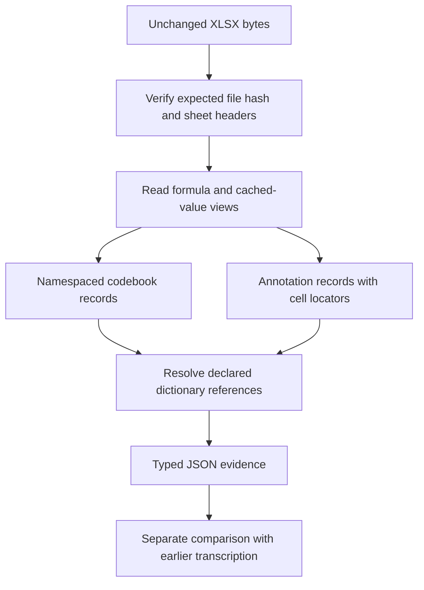

# Workbook-to-record extraction contract

## Problem and boundary

A numeric code has meaning only in its codebook. Annotation code 2 must join the
workbook's defect dictionary, not an unrelated radiography legend. A formula's
cached numeric result also loses provenance if exported without its expression.
This extraction step makes those bindings explicit before any query or validation.
It does not discover relations from natural language or decide physical weld quality.

## Input policy

Use already acquired PP3–PP7 workbooks. The manifest supplies the source inventory,
expected hashes and attribution only. It must not supply annotation values,
dictionary values, formula values or design mappings to the extractor. Workbook
paths resolve under explicit caller-provided roots. Do not download new data.
Source bytes remain unchanged; output must be a new file.

## Declared interpretation

- Annotation columns A–G map to defect code, setting code, bead number, millimetre
  interval and sample interval. Header checks bind this mapping to these workbooks.
- Dictionary identifiers include coupon and sheet namespace. Equal integers in two
  codebooks do not imply identical concepts. Cross-coupon equivalence is not inferred.
- Bead identifiers are scoped by coupon. No automatic join to measured HDF5 signals,
  radiography indications or ultrasonic indications is asserted.
- Codebook electrical values are nominal settings, not measured current or voltage.
- Empty cells stay null. Formula text and cached values remain separate; the exporter
  does not evaluate Excel formulas. A missing cache must not become zero.
- Source cell coordinates, sheet, archive member and file hash support auditability.
  Recorded hashes establish byte consistency, not independent source authenticity.

## Verification and limits

Compare extracted values, codebook joins and formula/cache pairs with the previously
published safe transcription only after extraction. Agreement means reproducible
transcription, not an independent truth assessment. Preserve the descending PP5
interval unchanged. PP7's design discrepancy remains a separate manually interpreted
source comparison; no design expectation enters the extraction algorithm. The PP4
PDF acquisition failure remains unresolved.

This artifact contains actual recorded annotation data under the source CC BY4.0
attribution. It is separate from the 32 authored actionable development fixtures and
older 144 consumed synthetic cases. It establishes neither graph superiority nor
LLM relation-extraction accuracy. No physical prescription or source repair occurs.
