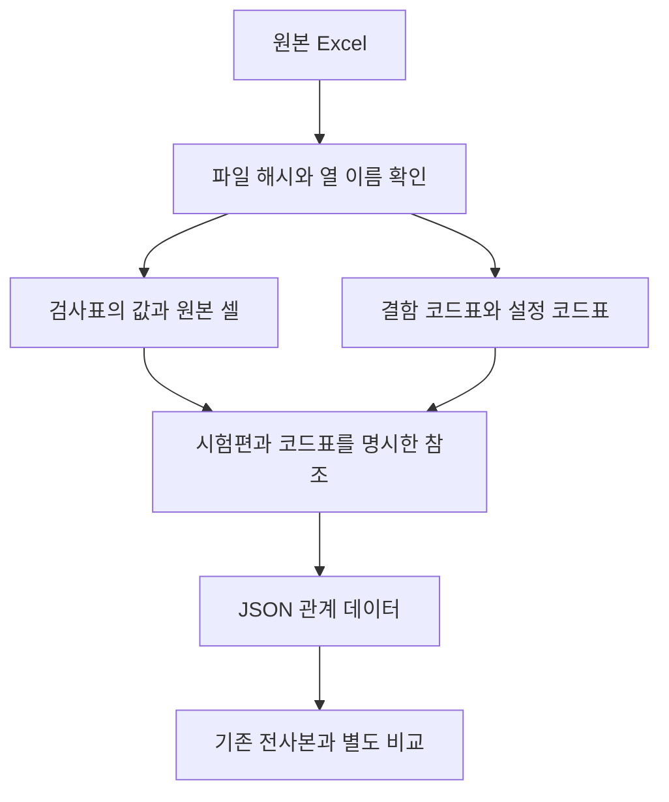

# Excel에서 관계 데이터까지

## 전처리의 역할

PENELOPE 검사표에서 `defect=2`만 읽으면 결함 종류를 알 수 없습니다. 같은 파일의 `defect_code` 시트에서 코드 2를 찾아야 `Lack of fusion`이라는 뜻이 붙습니다. 다른 검사 문서의 코드 2와 섞이지 않도록, 이번 추출기는 코드가 속한 시험편과 시트까지 식별자에 넣습니다.



## 실제 한 행의 해석

PP3 시트의 2행에는 다음 값이 기록되어 있습니다.

| 원본 셀 | 값 | 추출 후 역할 |
|---|---:|---|
| A2 | 2 | `PP3:defect_code:2` 참조 |
| B2 | 1 | `PP3:welding_settings_code:1` 참조 |
| C2 | 1 | PP3 시험편 안의 비드 번호 |
| D2 | 80 | 구간 시작 위치, mm |
| E2 | 314.41 | 구간 끝 위치, mm |

두 참조를 따라가면 결함 이름과 명목 용접 설정을 찾습니다. 설정 코드 1의 450 A는 코드표의 명목값입니다. 측정 신호를 읽어 얻은 전류값은 아닙니다. 비드 번호가 있다는 이유만으로 별도 검사 영상의 결함과 같은 대상으로 묶지도 않습니다.

## 원본 값과 수식의 보존

PP6의 D100에는 `=50+80`이라는 수식과 저장된 계산값 130이 있습니다. 추출 결과에는 둘 다 남깁니다. 수식을 다시 계산하지 않으며 저장된 계산값이 없는 경우에는 `null`을 기록합니다. 빈 AC 설정 셀도 0으로 채우지 않습니다.

PP5의 25행처럼 시작 위치 177 mm가 끝 위치 160 mm보다 큰 기록도 그대로 보존합니다. 오름차순 구간이라는 검증 조건을 적용하면 확인 대상으로 삼을 수 있지만 추출기가 두 값을 바꾸지는 않습니다.

## 관계 선언과 검증의 분리

이 단계에서 사람이 정한 것은 열의 의미, 코드표의 범위, 참조를 만드는 방법입니다. 추출기는 정해진 구조를 읽습니다. LLM이 자연어에서 관계를 발견한 결과는 아닙니다. 열 이름이나 구조가 달라지면 조용히 다른 의미로 해석하지 않고 오류를 냅니다.

JSON의 참조는 Python이나 SQL에서도 사용할 수 있습니다. RDF로 옮길 때는 이 식별자를 노드로, 코드표 참조를 간선으로 표현할 수 있습니다. 그 뒤에 필요한 값의 유무나 구간 조건을 SHACL로 검사할 수 있습니다. 이번 전처리 작업 자체가 RDF 변환이나 SHACL 실행까지 수행하는 것은 아닙니다.

## 검증 범위

새 추출 결과와 기존 전사본의 값이 일치하는지 별도로 비교합니다. 이 비교는 전처리의 재현성을 확인합니다. 원천 기록이 현실과 맞는지는 확인하지 못합니다. 설계 PDF와 검사표의 설정 불일치, 실제 측정 신호와의 위치 정렬, 수정 권한은 각각 별도 근거가 필요합니다.

원본 자료는 [PENELOPE 공개 저장소](https://zenodo.org/records/15083865)의 CC BY 4.0 자료입니다. 추출 파일에는 저자·라이선스·파일 해시를 남겼습니다. 전체 압축파일의 해시는 검증하지 않았으며 이번 작업은 이미 확보한 PP3–PP7 Excel 파일만 사용합니다.

## 실행 예시

저장소 루트에서 실행합니다. 출력 파일이 이미 있으면 덮어쓰지 않고 중단합니다.

```bash
uv run --offline --locked --group workbench python scripts/extract_penelope_workbooks.py \
  --source-root _workspace/penelope-fit/sample \
  --source-root _workspace/actionable-source-audit/source \
  --manifest research/actionable-evidence-1/source/penelope-annotations.json \
  --output _workspace/new-workbook-extraction.json
```

243행과 5개 파일의 코드표, 수식·저장값 27쌍이 기존 전사본과 일치했습니다.
비교 결과는 `workbook-extraction-comparison-v1.json`에 기록했습니다.
