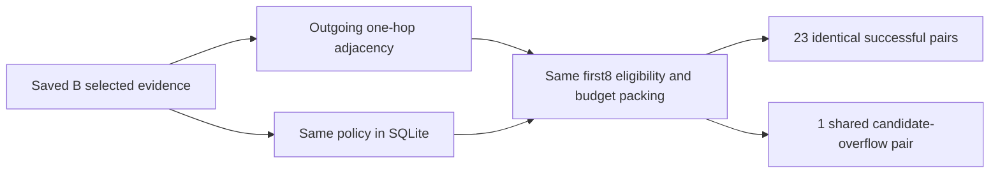

# Selected-B relation retrieval

One actual bounded execution compared adjacency traversal (C) with SQLite traversal
(E), using identical saved B selected evidence and the frozen relation-packing-v1
policy. No model, generator, reference scorer or repair ran in this stage.

| Observation | C | E |
|---|---:|---:|
| Planned and saved questions | 24 | 24 |
| Successful evidence envelopes | 23 | 23 |
| Candidate budget errors | 1 | 1 |
| Selected chunk occurrences | 104 | 104 |
| Selected edge / node occurrences | 48 / 56 | 48 / 56 |
| Exclusions after first8 eligibility, successful rows | 328 | 328 |
| Final token/byte budget skips, successful rows | 78 | 78 |
| B seed occurrences absent from final output, all rows | 105 | 105 |

All 24 paired envelopes match except arm/backend labels. This comprises **23
successful pairs and one shared failure**, not 24 successful retrieval pairs.
All 48 planned arm rows were executed and saved; no unexecuted slots were omitted.

## Preserved failure and evidence displacement

Question dev-017 produced 33 candidates, exceeding the predeclared maximum32.
Both backends returned budget_error with empty selected evidence and retained the
candidate list. No cap adjustment, retry or reference-guided recovery occurred.

For successful rows, the first8 traversal candidates were eligible for packing.
Whole chunks that exceeded the original 4096 E5-token or64000-byte final cap were
skipped without refilling from later candidates. Maximum selected payload was4021
accounting tokens and6474bytes. E5 counts are not generator token counts.

Endpoint insertion and packing displace some B seeds. The105 displaced occurrences
include the shared failed question's seeds; they are not all lost relevant facts.
The328 first8 exclusions apply only after successful expansion; the33 candidates
of the failed question are not misclassified as first8 exclusions. Node/edge
counts describe composition, not relevance or complete support.

## Verification and scope

- Software tests:15passed,16subtests, exit0. Includes no refill after a first8 skip,
  later seed displacement, and separate intermediate-failure accounting.
- Independent methods and implementation reviews ready before actual execution:
  job `20261101T101113Z-graphrag-relation-run-789954`.
- Parent exit0, runner status partial_failure; those describe different things.
  Child elapsed4.557866512914188s and maxRSS354768KiB are single-run observations,
  not engine performance measurements. Limits:4GiB address space,110s between-arm
  guard, external120s timeout with5s termination grace.
- Saved-output audit exit0:48rows,8input hashes, source-exact payloads, actual
  token counts, independently repacked saved candidates, displacement and parity.
  Additional summary/parity cross-check exit0 confirmed23successful/1failed pairs.
- The audit does not independently recompute traversal. Indexing and packing are
  shared between C/E. Registered check list was empty; checks above were manual.

The policy was chosen after observing A/B results on consumed development data.
C-B changes expansion and candidate ordering together. Agreement with matched SQL
is an implementation check, not graph superiority, source truth or answer quality.
Offline support scoring is the next separate step; D must use exact C evidence
without further source lookup. Original A/B outputs and all failed outputs remain.

Artifacts: `C.jsonl`, `E.jsonl`, `parity.json`, `summary.json`, `manifest.json`,
`frozen/`. Operator receipts: `_workspace/graphrag-cycle17/`.
