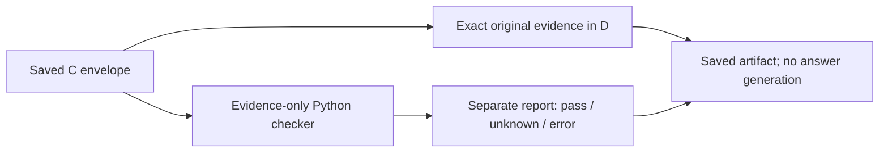

# Exact-C evidence with a separate checker report

D attached reports to all24 saved C envelopes without modifying any envelope.
The checker completed on23 inputs; dev-017 retained its original candidate-budget
failure and received a checker error receipt. Attachment success is not validation
success. There were46pass and98unknown individual checks, and zero violations in
this saved evidence. These144 checks are not144 independent questions or trials.

| Recorded outcome | Count |
|---|---:|
| Exact original C envelopes preserved | 24 |
| Attachment completed | 24 |
| Checker completed / input error | 23 / 1 |
| Individual pass / unknown / violation | 46 / 98 / 0 |
| Selected-evidence-plus-report payloads above4096 E5 tokens | 21 |

Reports inspect selected dictionary references, explicit edge bindings and
unsupported process-review-version applicability. Unknown can mean a needed target
was not selected or a check is unsupported. It does not establish global source
absence. Pass means agreement under that local check, not factual truth, complete
question evidence, approval or safe physical action. No native SHACL engine ran.

## Report overhead

Maximum report size was1748bytes and838E5 accounting tokens. Maximum combined
selected-chunks-plus-report JSON was4706tokens. Twenty-one of24 combined payloads
exceeded4096tokens; no truncation or evidence replacement was applied to hide this.
These counts exclude persisted envelope metadata and are not actual generator
prompt counts. They are not additive token estimates. No shared total generation
budget was enforced, and no model was called. A future generation comparison must
freeze a shared total allowance, including report overhead, before execution.

D contains the same source evidence as C. Its source-support status follows that
identity; this is not an independent measurement of report utility. Current
A0/B1/C7/E7 out of18 source-present support counts remain unchanged. The six
bundle-absent reference cases and the C/E failed retrieval remain preserved.

## Verification and limitations

-17software tests and9subtests passed, exit0; bounded tests deny Python file/socket
 access during pure attachment. This is not an OS sandbox.
-Two independent reviews ready before execution, job
 20261101T105111Z-graphrag-report-attachment-3809fa. Methods reviewed the packet;
 implementation performed static source/test inspection. Neither reran tests.
-Parent execution exit0, all24IDs saved, no missing slots or retry. External
 timeout120s with5s termination grace was applied.
-Manual audit exit0 checked24exact C envelopes,6input hashes, selected-only
 citations, report hashes/byte cap and actual pinned tokenizer counts; summary
 status categories matched. The audit does not independently reproduce checker
 rule judgments. Registered checks were empty.

The runner reads only saved C, pinned tokenizer and bound code/policy metadata.
The checker accepts no corpus, question contract, references or retrieval client.
Reports do not trigger lookup, repair, filtering or veto. Answer accuracy,
unnecessary withholding and whether a model uses reports correctly are unmeasured.

Artifacts: reports.jsonl,summary.json,manifest.json,frozen/.
Operator receipts: _workspace/graphrag-cycle19/.
