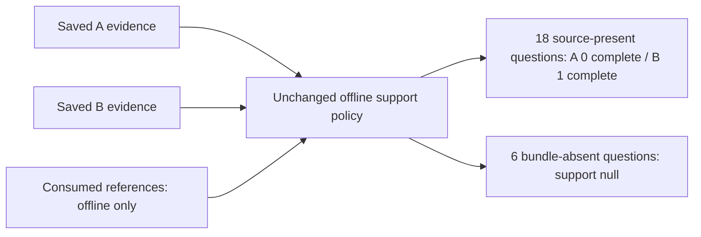

# Saved hybrid retrieval support

One unchanged offline scoring run compared saved B keyword+dense+rerank evidence
with saved A dense-only evidence. No retriever, model, repair or tuning ran here.
The same source, consumed development references and scorer policy were retained.

| Authored support task | A complete / present | B complete / present |
|---|---:|---:|
| Recorded setting | 0 / 6 | 1 / 6 |
| Nominal Idc | 0 / 6 | 0 / 6 |
| Defect label | 0 / 6 | 0 / 6 |
| Total | 0 / 18 | 1 / 18 |

All 24 B envelopes passed the scorer's source-exact payload validation. The six
review-version questions are absent from the supplied bundle according to the
frozen references; support stays null. They are not retrieval failures or measured
abstentions. No generated answers exist, so answer accuracy remains unmeasured.

## Observed evidence gaps

Only dev-021 (PP7:10 recorded setting) has complete required support. Five other
questions have their annotation node but lack the required dictionary node:
dev-006 and dev-007 (PP4), dev-014 (PP6), dev-022 and dev-023 (PP7).
Their node coverage is 0.5, not complete support. The remaining 12 source-present
questions have no required node coverage. Extra selected nodes do not count when
they belong to another source record or dictionary entry.

The five partial cases motivate testing relationship expansion from the existing
B seeds. They do not establish that expansion will recover every missing node
within the same budget. Future C/E must use identical selected B seeds, never
reference targets. B minus A changes hybrid retrieval and reranking together;
this comparison does not isolate reranker effects or demonstrate graph benefits.
The narrow, low-diversity development cohort is not a representative benchmark.

## Execution and verification

- Scorer execution: exit 0. Manifest freezes five inputs and code/policy copies.
- Manual audit: exit 0, all 24 rows, six pre-bound files and five manifest copies;
  independent support-set enumeration and selected ID/payload binding passed.
- Two independent native reviews were ready before scoring. Methods reviewed the
  packet; implementation additionally inspected actual bindings and audit code.
- Registered check list was empty. No new unit tests or model execution occurred.
- Initial ad hoc preflight exited 1 because it compared an original extraction
  hash with the derived corpus file hash. The corrected check verifies extraction
  lineage and corpus identity separately. No source or reference bytes changed.

The generic scorer does not enforce top-level source lineage or independently
prove source absence. External fixed-source lineage checks cover this run only;
absence remains an authored statement about the supplied bundle. The manual audit
relies on the scorer for canonical payload and source-exact checks, so it is not a
second full evidence validator.

Results: `scores.json`, `comparison.json`, `manifest.json`, `frozen/`.
Review job: `20261101T093324Z-graphrag-b-support-88d0e0`.
Local receipts and retained preflight failure: `_workspace/graphrag-cycle15/`.
