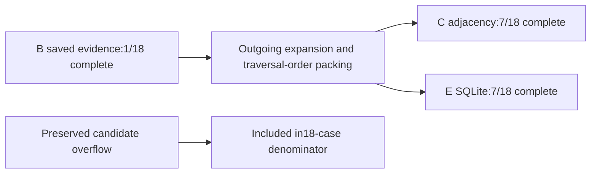

# Paired retrieval support after relation expansion

Unchanged offline scoring on saved evidence produced the following results.
These are consumed development support contracts, not generated-answer accuracy.

| Task | A dense only | B hybrid + rerank | C relations | E matched SQL/Python |
|---|---:|---:|---:|---:|
| Recorded setting | 0/6 | 1/6 | 1/6 | 1/6 |
| Nominal Idc | 0/6 | 0/6 | 2/6 | 2/6 |
| Defect label | 0/6 | 0/6 | 4/6 | 4/6 |
| Complete required support | 0/18 | 1/18 | 7/18 | 7/18 |

All24 questions remain visible per arm. Six review-version references are absent
from the supplied bundle and retain null support. The dev-017 candidate overflow
remains incomplete within the18 source-present questions: C/E each have23valid
saved envelopes and1retrieval failure. No successful-only denominator is used.

## Paired changes

C gained complete support over B on dev-006,dev-007,dev-011,dev-014,dev-019,dev-023.
No B-complete case became incomplete; dev-021 remains complete. Some other B
chunks were displaced, but those occurrence counts are distinct from losing a
question's complete support. Eleven source-present questions remain incomplete,
including the budget failure. C and E scores are identical for every question.

This supports a narrow observation: the declared expansion-and-packing policy
secured additional required source nodes on six of these development questions.
It does not isolate graph representation, reasoning or expansion from ordering.
The policy was selected after inspecting A/B development results. E reproduces
C under the same semantics, so the result does not establish a graph-specific
advantage over SQL/Python. Shared indexing and packing also limit the independence
of parity. There is no measured QA accuracy, hallucination or abstention outcome.

## Execution and verification

- C and E unchanged scorer calls each exited0, writing separate manifests/frozen
  inputs in support-score-c-001 and support-score-e-001. Original A/B unchanged.
- Manual audit exited0:48C/E rows, all24IDs, independent admissible-node-set
  enumeration, failure/null handling, manifests/copies, exactC/E score equality
  and pairedA/B comparison. No retrieval rerun, repair, cap change or model call.
- Two independent reviewers approved the supplied plan before scoring, job
  20261101T103026Z-graphrag-ce-support-ca10c8. Both reviews were request-only;
  coordinator binding and result audits establish the recorded execution checks.
- Registered checks were empty; no new software tests were needed for the
  unchanged scorer. Current extraction lineage and derived-corpus identities
  were externally checked against oldA/B bindings.

The generic scorer does not enforce top-level lineage or independently establish
source absence. The six absence states remain authored, bundle-scoped references,
not global absence claims. Support conforms to the existing authored node-set
policy, not independent factual truth. D later adds a selected-evidence checker
report to exact C evidence; it cannot fetch or repair missing records.

See scores.json, comparison.json, manifest.json and frozen/. Local receipts are
in _workspace/graphrag-cycle18/. This stage is not a published benchmark.
