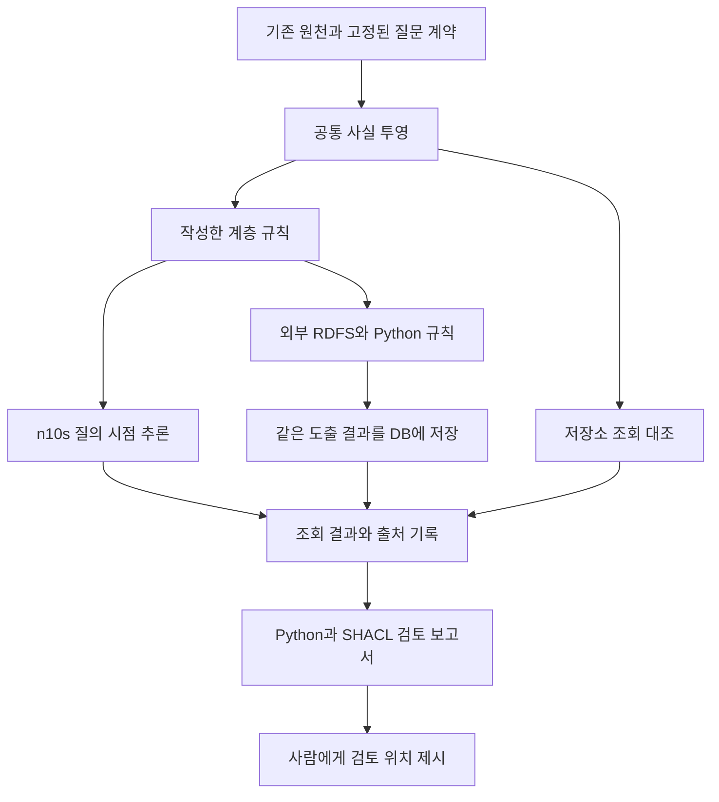
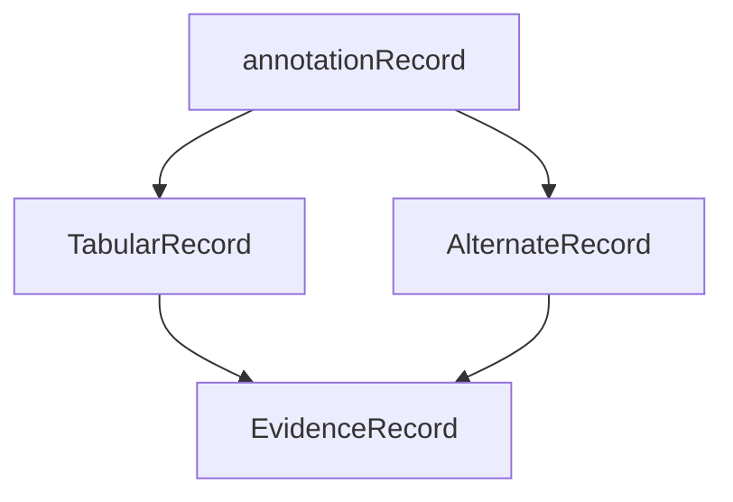

# Final evidence-bounded report review
Review Koreanreport against coordinator observedsummary below; raw artifacts andsource implementations omitted,unverified here. Allruntimes already independentlyreviewed prior execution throughresearch_ops. Currentreportislocalnotpublished. No paidLLMcalls. Same consumedsource/typedqueries/manualhierarchy; notdomainexpertvalidation. Expectedreferences evaluatoronly,notruntime. Reports same160outputs, notindependentquestions. CurrentNeptune stopconfirmed by AWS error"is in stopped state"09:25;temporaryownedn10sremoved. Billingnotmeasured. Finalhumanizegate0,27unit tests pass. Initial10evaluations reproduced with809listedhashes; same-scorer reproduction notindependentcorrectness. Network0auditfieldnottelemetry. Allpriorunexpectedoutcomes preserved. Need assess claimlimits/denominators/continuity and documenttechnicalconsistency. No source edits/noadditionalexperiments; noask to validate externaltruth. Findings concise tofitcontextcap.
Observed direct evidence: parity40planned36completed4unsupportedQ7;36completedmatch;BGP_REUSE included. Inference224completed, per32: asserted20,python32,RDFS32,sharedNeo4j32,sharedNeptune32,n10s32,stale26. Updates160completed, per32:python32,n10s32,neptune-recomputed32,staleoffline28,neptunestale28;20n10sedgemutationreceipts;8querypre/postcountsunchanged,notbyteproof. Import20completed=12roundtrips+8n10snativequeries(8match);all6Neptuneexact,0/6n10sexact underKEEPbecauseURNpredicateprefix. Source68triples61predicateschanged. Authored6defaultlike→4,preserve6→6butURNtermschanged. Followup10completed:5cases×2backends;Neptune5exact,n10s4exact;URNKEEPfails,URNSHORTEN/HTTPKEEP/HTTPSHORTEN/full3999SHORTENexact. Followuppostobservation. Advisory336completed=168pairsagree;160actualeachpolicy32flags(8mismatch24matching),8authoredcontrols6flagsand1wrongmetadatafalsepass. Family960completed=480pairsagree;each160global32flags8mismatch24matching0miss,declared20flags8mismatch12matching0miss,swapped20flags4mismatch16matching4miss. Boundary34observed30completed4PythonTypeErrors(intboollistdict),13completepairs12agree;LFsuffixSHACLpassesPythonmalformed. Strictv2:370observed362completed8sharedinputrejects0checkerfailures;181completedpairsagree4rejectedpairsnotconformance;168oldpairsunchanged. Hashmetadata notexternaltruth/freshnessproof. Datatypestring/minmaxLength64addedv2;originalv1unchanged. ExistingpriorLLMstudy162planned154calls145answers47paired46/46/47confirmedagainstcanonicalpriorreport; no reclassification.

# Report
# Neo4j와 Neptune의 추론 결과 및 최종 검토 실험

기존 RAG 연구에 실제 Neptune과 Neo4j+n10s를 연결했다. 이번 범위에서는 **같은 사실과 계층 규칙으로 조회한 결과가 일치하는지, 관계나 규칙이 바뀐 뒤 오래된 결과가 남는지, 마지막 검토 보고서가 무엇을 확인할 수 있는지**를 나눠 살폈다.

작은 공통 규칙에서는 n10s, Python 규칙, 외부 RDFS 추론이 같은 조회 결과를 냈다. 저장된 추론 결과를 갱신하지 않으면 변경 후 결과가 달라졌고 n10s의 RDF 가져오기·내보내기에서는 URI 설정에 따른 차이도 발견했다. SHACL의 버전 경고는 잘못된 결과만 골라내는 판정기가 아니었다. 질문 계약에 맞는 확인 범위를 지정했을 때 이미 일치하는 결과에 붙는 경고가 줄었다.

## 기존 연구와 이번 실행의 연결

[이전 최종 답변 비교](2026-11-04-paired-six-model-review.md)는 같은 초안에서 자체 검토와 SHACL 보고서 검토를 분기했다. 162개 계획 중 154회 호출, 145개 완료 답변을 보존했고 세 조건이 모두 완료된 47개 묶음에서 요청 항목 전체 일치는 초안 46개, 자체 검토 46개, 보고서 검토 47개였다. 이 결과는 그대로 유지한다.

이번에는 새 LLM을 호출하지 않았다. 이전 답변을 새 DB나 새 추론 조건에서 생성한 답변으로 재분류하지도 않았다. [비교 설계](../experiments/backend-reasoning-review.md)의 백엔드 조회, 공통 추론, 변경 추적을 실행하고 최종 검토의 일부를 오프라인으로 점검했다.

기존 Q1–Q9 질문 유형은 유지했다. 실제 버전 이력이 없는 Q7은 조회 비교에서 미지원으로 남겼다. 타입 계층 I1과 상위 관계 I2는 별도로 추가한 진단 질문이다. 이 두 질문에 쓰인 계층은 연구자가 작성했으며 원천 문서에서 자동 추출한 도메인 온톨로지가 아니다.

## 원천 자료와 비교 범위

기존 개발 자료 328개 노드·486개 관계에서 7개 노드와 내부 관계 4개를 선택했다. 두 검사 기록, 결함 사전 항목과 설정 사전 항목을 같은 ID로 연결했다. 첫 조회 비교는 이를 68개 트리플로 표현했다. 마지막 가져오기·내보내기 확인에서는 기존 자료 전체를 표현한 3,999개 트리플도 사용했다.

원천은 Tapia Suárez 외의 [Submerged Arc Welding Open Repository](https://doi.org/10.5281/zenodo.15083865)이며 CC BY 4.0 출처 표기를 유지한다. 이 자료는 이미 개발에 사용했으므로 새 홀드아웃 평가로 볼 수 없다. 숫자와 원래 행 정보를 담는 첫 투영의 리터럴은 JSON 문자열이다. 이것을 RDF 숫자 자료형 비교로 해석하지 않는다. 언어 태그·다중 값·사용자 정의 자료형은 별도의 6트리플 작성 자료로 확인했다.

그림의 마지막 단계는 저장된 결과의 보고서 점검이다. 보고서를 받은 LLM이 더 나은 답을 쓰는지는 이번 실행에 포함하지 않았다.

## 1단계 저장소 조회 대조

SQL/Python, RDFLib, Neo4j/Cypher, Neptune/RDF/SPARQL에 같은 기본 그래프 패턴을 적용했다. Q1–Q9의 근거 조회 계약에 Cypher 관계 재사용 회귀 사례 하나를 더해 10개 계약 × 4개 구현, 40개 슬롯을 계획했다.

36개가 실행됐고 현재 자료에 없는 Q7은 4개 구현 모두 미지원이었다. 실행된 36개 결과는 미리 고정한 값과 일치했다. 이는 값·관계 전달의 대조이며 36개의 자연어 답변 정확도를 측정한 결과가 아니다. Q3의 산술, Q4의 최종 조건 판정, Q9의 자연어 검토까지 DB가 완료했다고 세지 않았다.

이 단계의 Neo4j는 RDF 항을 노드로 표현한 공통 비교용 매핑이다. n10s의 일반적인 RDF 가져오기 경로와 구분한다. 최초 독립 검토에서는 하나의 Cypher `MATCH`에 여러 패턴을 넣을 때 같은 관계를 재사용할 수 없는 문제가 발견됐다. 패턴별 `MATCH`로 고친 뒤 회귀 사례를 포함해 실행했으며 최초 검토 기록도 보존했다.

## 2단계 공통 계층 추론

`annotationRecord → TabularRecord → EvidenceRecord`와 결함·설정 관계를 상위 `sourceReference`로 연결하는 규칙을 작성했다. 여러 근거 경로, 한 경로 삭제, 두 경로 삭제, 규칙 누락, 순환, 방향 반전, 선택 투영의 관계 삭제를 포함한 8개 조건에서 4개 조회를 실행했다.

| 조건 | 완료 조회 | 현재 작성 규칙의 참조 집합과 일치 |
|---|---:|---:|
| 도출하지 않은 사실 조회 | 32 | 20 |
| 같은 정책의 Python 규칙 | 32 | 32 |
| 외부 RDFS 추론 | 32 | 32 |
| 같은 외부 도출 결과를 저장한 Neo4j | 32 | 32 |
| 같은 외부 도출 결과를 저장한 Neptune | 32 | 32 |
| n10s 질의 시점 추론 | 32 | 32 |
| 최초 RDFS 결과를 유지한 대조 조건 | 32 | 26 |

총 224개 조회가 완료됐다. 같은 작성 규칙의 8개 조건 × 4개 조회를 반복했으므로 32개의 독립 질문을 평가한 결과로 볼 수 없다. 외부 추론은 `owlrl.RDFS_Semantics`를 사용했다. 패키지 이름과 달리 이번 실행에는 전체 OWL 2 RL이나 HermiT 비교를 포함하지 않았다. 전체 폐쇄 집합의 동등성도 주장하지 않는다.

n10s 5.26.0을 Neo4j 5.26.32에서 실행했고 `nodesInCategory`, `getRels`를 실제 호출했다. 공통 도출 결과 조건은 DB에 같은 내용을 넣어 조회 차이를 확인하며 n10s 조건은 계층 경로를 질의 시점에 따라간다. 이 구분을 유지해야 DB와 추론 알고리즘의 효과를 섞지 않을 수 있다.

## 4단계 삭제와 복원

다음 실행은 같은 DB 안에서 규칙과 관계를 순서대로 삭제·복원했다. n10s는 기존 그래프의 관계를 수정했고 Neptune의 갱신 조건은 외부 RDFS 추론을 다시 계산해 도출 결과를 교체했다. 별도 Neptune 그래프에는 최초 도출 결과를 그대로 두었다.

한 경로를 지워도 다른 경로가 남으면 상위 타입 조회 결과가 유지된다. 두 경로를 모두 지우면 선택 자료의 상위 타입 구성원은 7개에서 5개로 바뀌었다. 원래 규칙을 복원하면 다시 7개가 됐다.

8개 연속 상태 × 4개 조회 × 5개 조건, 160개 슬롯을 모두 실행했다. Python 재계산, n10s 즉시 조회, Neptune 재계산 조건은 각각 32개 조회가 현재 참조 집합과 일치했다. 갱신하지 않은 오프라인·Neptune 조건은 각각 28개가 일치했고 같은 4개 조회에서 달랐다. 이 4개는 두 경로 삭제의 타입 조회, 관계 삭제의 관계 조회, 규칙 전체 삭제의 타입·관계 조회다.

20개 n10s 관계 수정의 시도와 결과를 각각 저장했다. n10s 조회 전후에는 노드·관계 개수가 같았다. 이 확인은 개수 수준이며 저장 내용 전체의 바이트 동일성 검사가 아니다. Neptune의 재계산은 전체 도출 결과를 교체하는 방식이다. 증분 진리 유지 알고리즘이나 동시 수정의 원자성을 검증한 것으로 표현하지 않는다.

## RDF 가져오기와 URI 보존

n10s의 `rdf.import.inline`과 `rdf.export.spo`를 직접 연결했다. 첫 실행 20개 작업은 모두 완료됐지만 완료와 원래 RDF 항의 보존은 달랐다. `KEEP` 설정에서 `urn:` 형태의 일부 술어 URI 앞에 `neo4j://graph.schema#`가 붙었다. 원래 68개 트리플과 내보낸 68개 트리플의 개수는 같았지만 RDF 항 집합은 달랐다.

사용한 버전의 [내보내기 코드](https://github.com/neo4j-labs/neosemantics/blob/5.26.0/src/main/java/n10s/rdf/export/LPGRDFToRDFProcesssor.java#L128-L147)는 축약 접두사에 맞거나 `http`로 시작하는 이름을 구분하고 나머지에는 기본 스키마 주소를 덧붙인다. 이 관찰 뒤 URI 종류와 설정을 나눈 별도 진단을 실행했다. 원래 결과를 수정하거나 잘못 붙은 접두사를 평가기에서 지우지 않았다.

| 별도 진단 입력 | n10s RDF 항 보존 | Neptune RDF 항 보존 |
|---|---|---|
| 작성 자료 `urn:` + `KEEP` | 불일치 | 일치 |
| 작성 자료 `urn:` + `SHORTEN` | 일치 | 일치 |
| 작성 자료 HTTPS + `KEEP` | 일치 | 일치 |
| 작성 자료 HTTPS + `SHORTEN` | 일치 | 일치 |
| 전체 원천 투영 3,999트리플 + `SHORTEN` | 일치 | 일치 |

이 표의 보존 설정은 다중 값 `ARRAY`, 언어 태그 보존, 사용자 정의 자료형 보존을 함께 켰다. 이를 끈 별도 작성 자료에서는 6개 트리플이 4개로 줄고 태그·자료형 정보가 사라졌다. [n10s 설정 문서](https://neo4j.com/labs/neosemantics/5.14/reference/)도 각 기능을 별도 설정으로 다룬다. 문서 버전과 실제 실행 버전은 구분해 기록했다.

RDF로 가져온 계층 자료에서도 n10s의 8개 조회는 현재 참조 집합과 일치했다. 조회가 성공하는 것, 원래 식별자를 되돌리는 것, 필요한 문자·자료형 정보를 보존하는 것은 각각 확인할 항목이다. 이 결과를 임의의 RDF 그래프나 빈 노드, RDF-star의 일반적인 가역성으로 확대하지 않는다.

## 3단계 최종 검토 보고서의 확인 범위

변경 실험의 저장 결과 160개에 사용 자료의 해시와 현재 광고된 자료 해시를 붙여 Python과 실제 pySHACL로 검사했다. 현재 해시는 통제된 실행기가 제공한 메타데이터다. 검사가 외부 원천의 최신 상태를 알아낸 것은 아니다. 검사는 답 내용이나 평가 정답을 받지 않았고 답을 수정·차단하지 않았다.

전체 묶음 해시를 비교하면 32개 결과에 경고가 붙는다. 그중 8개는 현재 참조 집합과 달랐고 24개는 이미 일치했다. 같은 4개 조회의 불일치가 두 오래된 결과 조건에 반복된 것이므로 8개의 독립 오류 사례는 아니다.

후속 검사에서는 질문이 타입 계층을 묻는지 관계를 묻는지에 따라 관련 사실·규칙 묶음의 해시를 제공했다. 타입 질문에는 타입 사실과 `subClassOf`, 관계 질문에는 관계 사실과 `subPropertyOf`를 연결했다. 이 구분은 사전에 작성한 계약이며 자연어 질문을 자동 해석한 성과가 아니다.

| 확인 범위 정책 | 검토 경고 | 불일치 결과에 경고 | 일치 결과에도 경고 | 불일치인데 경고 없음 |
|---|---:|---:|---:|---:|
| 전체 묶음 | 32 | 8 | 24 | 0 |
| 선언한 질문 유형별 범위 | 20 | 8 | 12 | 0 |
| 유형과 범위를 뒤바꾼 대조 조건 | 20 | 4 | 16 | 4 |

각 행은 같은 160개 결과를 다시 검사한 것이다. Python과 SHACL의 480쌍 보고서는 모두 같았다. 960개 검사 슬롯을 독립 실험 수로 세지 않는다. 경고 감소는 검토 후보 수의 변화이며 실제 사람의 노동 시간이나 불필요한 답변 보류를 측정한 결과가 아니다.

별도 8개 메타데이터 대조 사례에서는 해시가 빠졌거나 형식이 잘못되면 경고가 났다. 그러나 오래된 결과의 사용 해시를 현재 해시와 같다고 잘못 제공한 사례 하나는 불일치 결과인데도 검사를 통과했다. 전체 묶음 검사와 이 대조 사례를 합친 Python·SHACL 보고서 168쌍도 모두 같았다. 검토 정책은 공급된 메타데이터와 질문 계약의 정확성에 의존한다.

이 범위에서는 최종 보고서를 “답이 틀렸다는 판정”보다 “어느 자료·규칙 변경을 다시 살펴볼지 알려 주는 근거”로 사용하는 편이 결과와 맞는다. 보고서를 본 LLM이나 사람이 실제로 판단을 개선하는지는 다음 평가 대상이다.

## 검사 입력의 경계와 별도 버전

정상 해시에서 일치했다고 모든 입력에서 일치하지는 않았다. 누락, 길이, 대소문자, 줄바꿈, 숫자·리스트 등을 넣은 17개 작성 사례를 추가했다. 기존 검사 34개 슬롯 중 30개가 완료됐고 Python에서 비문자열 4개가 예외로 남았다. 두 검사가 모두 완료된 13쌍 중 12쌍의 메시지가 같았다. 64자리 해시 뒤에 줄바꿈 하나가 붙은 사례는 기존 SHACL이 통과시키고 Python은 형식 오류로 판단했다.

원래 검사와 결과를 보존한 채 별도 버전을 만들었다. 공통 입력 경계에서 문자열 또는 null만 허용하고 SHACL에는 문자열 자료형과 정확히 64자인 길이 제약을 추가했다. 이전 168개 입력과 경계 사례 17개를 합친 185쌍을 다시 검사했다. 370개 슬롯 중 362개가 완료됐고 비문자열 입력 8개 슬롯은 공통 경계에서 거절됐다. 완료된 181쌍의 메시지는 같았으며 이전 168쌍의 보고서도 바뀌지 않았다. 공통 입력 거절 4쌍은 SHACL 검사 성공이나 두 검사기의 일치로 세지 않았다.

이는 반례를 본 뒤 같은 개발 입력에서 수정한 결과다. 새로운 평가 자료에서 일반적인 정책 동등성을 입증한 것은 아니다. 입력 계약을 명시하고 변환·검사 오류를 별도로 남겨야 한다는 구현상의 결과로 해석한다.

## 비교에서 도출할 수 있는 장단점

| 구성 | 이번에 확인한 점 | 별도 평가가 필요한 점 |
|---|---|---|
| Neo4j+n10s | 작성한 계층의 질의 시점 조회, 실제 RDF 가져오기, 변경 후 즉시 조회 결과 | 더 넓은 추론 범위, 대규모 비용, 가져오기 설정별 정보 보존 |
| Neptune+외부 RDFS | 같은 도출 결과의 실제 저장·SPARQL 조회, 명시적 재계산 후 결과 일치 | 갱신 전략과 실행 비용, 운영 편의, 다른 외부 추론기 |
| 같은 정책의 Python | 이 작은 규칙·보고서 범위에서 같은 결과 | 복잡한 규칙 관리와 협업 비용 |
| SHACL 검토 보고서 | 메타데이터 계약 위반과 검토 후보를 구조화 | 자연어 답변 효과, 사람의 검토 효율, 올바른 계약 작성 |

Neptune 자체에 이번 외부 추론 연산을 수행시킨 것은 아니다. n10s와 외부 RDFS의 전체 기능이 같다는 결론도 아니다. 같은 규칙으로 비교 가능한 부분과 각 도구의 별도 기능을 나눠 측정할 수 있게 됐다.

## 실행 기록과 남은 평가

실행·원천·조회·결과·정리 영수증은 `research/backend-reasoning-review-1/`에 남겼다. `live-001`, `inference-live-001`, `updates-live-001`, `rdf-import-live-001`, `import-followup-live-001`은 실제 연결 실험이고 `advisory-replay-001`, `advisory-scope-001`은 저장된 결과의 오프라인 재검사다. 같은 자료를 재사용하므로 이들의 행 수를 합쳐 독립 표본 수로 제시하지 않는다.

독립 방법론·구현 검토를 각 실행 전에 받았다. 중간에 발견한 Cypher 관계 재사용, 정리 실패 후 진행, 부분 수정 기록 누락을 수정했고 최초 검토를 보존했다. 관련 소프트웨어 단위 검사 27개가 통과했다. 이 검사 통과는 자연어 답변이나 산업적 정확도의 증거가 아니다.

10개 실행의 평가값을 오프라인에서 다시 계산했다. 원래 평가기와 저장된 입력을 사용했고 같은 결과를 얻었다. 로컬 매니페스트에 기록한 809개 파일도 일치했다. 재계산은 기존 채점의 재현성 확인이며 평가 정답의 독립적 정확성이나 원격 실행의 진위를 인증하지 않는다. 재실행 방법은 `research/backend-reasoning-review-1/evaluation/README.md`에 있다.

실험용 n10s 컨테이너와 소유 네임스페이스를 정리했다. Neptune 중지 요청은 2026-11-06 09:14:59 UTC에 수락됐고 09:25 UTC의 AWS 응답에서 `stopped` 상태를 확인했다. 새 LLM 호출, 원격 푸시, 사이트 발행은 하지 않았다.

다음 평가는 이 백엔드·추론 조건이 **동일한 질문과 생성 예산에서 최종 답변에 어떤 차이를 만드는지**다. 새 질문의 출처와 정답을 독립적으로 준비하고 자체 검토와 보고서 검토의 정확도·근거 없는 확신·불필요한 보류를 함께 측정해야 한다. 자연어에서 관계·스키마·SHACL을 만드는 과정, 도메인 전문가의 검토 시간, OWL/SWRL/SHACL Rules에 따른 조치 추천은 이번 결과에 포함하지 않았다.

