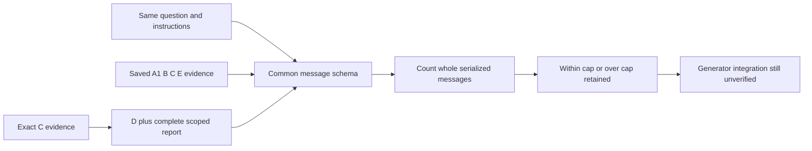

# Common serialized input accounting

Current failure: adding compact selected-binding reports to frozen C exceeds the4096 E5 accounting cap on13/24 cases. Evidence-only counts also omit question, instructions and message serialization. Current generator/model/chat framing is not fixed. This cycle prepares one shared message schema and an offline audit, not paid generation or a revised retrieval experiment.

scripts/graphrag_input_contract.py builds the same system instruction and user JSON fields question/evidence/validation for A1 improved dense, B refinedhybrid, C B+relations, D exactC+compact native SHACL report, E matchedSQLite/Python. No arm labels/scores/reference answers enter prompts. C/D/E selected chunk lists must equal; all envelopes must pass existing source-free integrity parser and match question ID. Only D has validation; others null. Report carries all operational checks, scope, rawconforms and no-bindings unknown. No source lookup or repair.

Count the entire canonical serialized message list with pinned E5 surrogate, not sum of parts. Common4096token/64000byte accounting caps; retain all24questions×5arms, overbudget and errors. No trimming, refill, best-budget selection or denominator dropping. Shared-arm readiness is only an accounting diagnostic; generator_ready alwaysfalse. Actual provider chat framing/tokenizer, output reserve and context limit remain unverified. Empty reports are not positive validation. E is a shared-semantics backend comparator, not independent engine-quality evidence.

Tests cover envelope/question/report rejection, inclusive limits, byte cap, invalid counters and no mutation. Offline audit will use consumed saved question texts, A1/B/C/E envelopes and saved compact D payloads with exactC comparison; no scorer references. Hash inputs/code/tokenizer, persist proposed messages+counts and failures. Native reviewers inspect script/test only; no registered checks. Manual checks after approval. All current retrieval/support results remain frozen.

## Future matched-budget retrieval policy

Before new answer evaluation, freeze generator+tokenizer/chat template, full prompt, output reserve, common context and cost limits. Predeclare one common evidence reserve for allarms, plus a bounded worst-case report allowance from schema maxima, not the per-question outcome. C/D share a selected bundle and report cannot influence selection or trigger D-only lookup. Verify complete actual prompts after packing; record oversize/failure in original denominators. Changes to projection/caps/ranking receive new run IDs and support rescoring, never replace existing 7/18C results. Current24 consumed cases cannot become fresh held-out data. Larger budgets are allowed only as a separately named common-budget sensitivity condition, not D-only accommodation.

