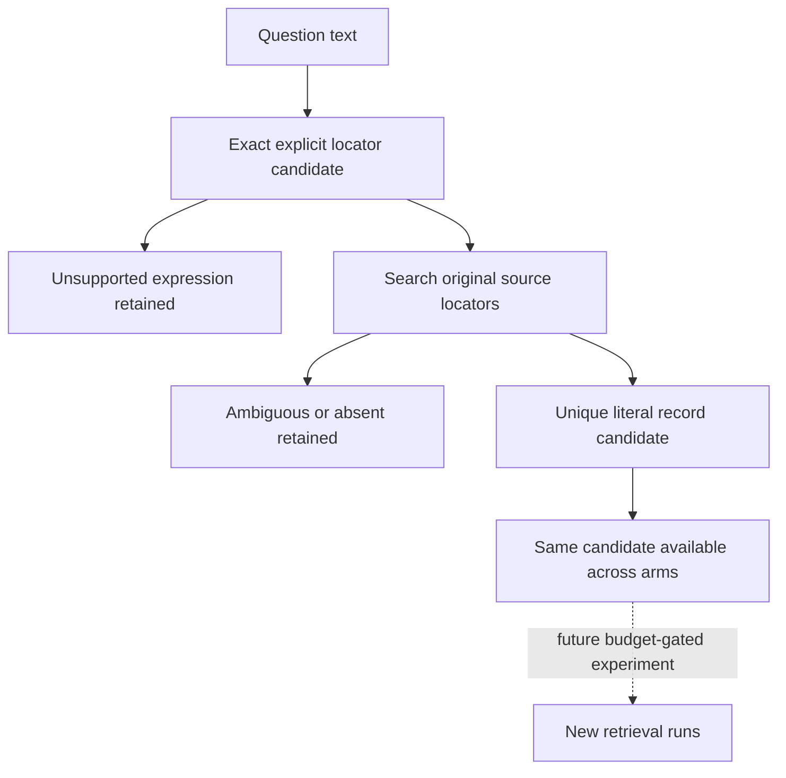

# Shared explicit locator contract

Proposed contract research/refined-hybrid-1/explicit-anchor-contract-v1.json separates literal locator extraction from question interpretation and retrieval. Current saved nominalIdc6failures start from dictionary nodes with no outgoingedges. This motivates testing a common question/source-derived anchor, but does not establish an improvement or graph advantage.

This cycle only freezes contract/reviews it. No resolver code, pilot matching or retrieval execution. Inputs only questiontext and originalsource. No scorerlabels,missingnodes,taskIDs,expectedanswers. All24consumed questions plus explicit software controls later, not only6failures. Exact source.coupon/sheet/excel_row lookup acrossbundle; no IDsuffix construction. Metadata invalid/missing records are not silently ignored. Multimatch=ambiguous,nomatch=bundle-not-found,unsupportedlocator separate. Scope is authored explicit Korean locator at fixedprefix, no generalNL claims. Tail meaning including negation/comparison NOT certified, even if literal locator resolves. This limitation is explicit in output and controls; do not treat candidate as final interpreted question.

Future intervention disabled until new common full-message budget is fixed. Samecandidateaccess A1/B/C/D/E. Anchorprepend/stablededup/top8 on bases; C/E share newlypackedB; DexactnewC andfreshreport. No Dsourcefetch/reportfeedback. Alloriginal results frozen and allfailures retained. This is query preprocessing/seed-selection treatment, notgraph-onlyadvantage. No paid/AWS/push/deploy.

Methodsreview: scope/candidate semantics, confounds and fair future comparison. Implementationreview: contract unambiguous enough for futureimplementation, invalid/ambiguous source handling, IO controls; inspect current source schema ifneeded but no new matching run. Registeredchecks empty. Afterreviews manually validate JSON schema structure and immutable snapshot digest; not experiment evidence.

Revision specifies the exact Python regex and unbounded mention detectors, strict input-byte hashes, _index whole-bundle structural validation plus annotation-only typed locator metadata, deterministic precedence and typed/null/ordered outputs. Initial implementation blockers and original contract are preserved in the previous job/snapshot; this is a new review freeze. No matching or retrieval execution is authorized this cycle.
