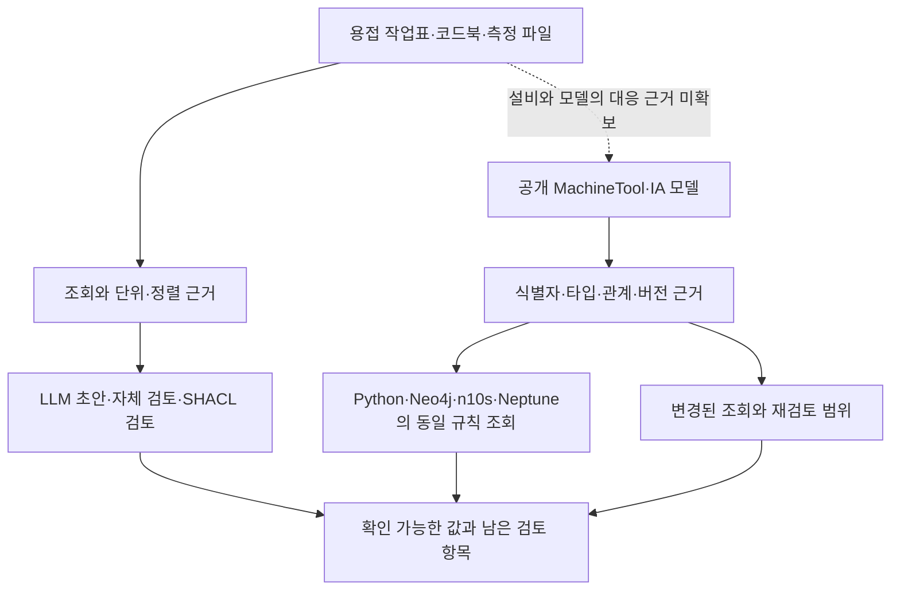

# Research evidence map and static demo scope labels
Review report claims and static presentation update. Raw XML/HDF/LLM answers are OMITTED: source facts and all underlying measurements unverified by this packet. Prior independent reviews and coordinator audits are separate. Public record catalogs25explanatory entries:19unchanged oldquestions plus6scoped followups; not25new trials. Currentpaidcap180exhausted, no new paid/DBruns. No verifiedidentityjoin between measurementfiles and referenceOPCmodel. Separateposthoc questions/sourceaccess/algorithm/backend/validation; no generalSHACLsuperiority or measuredhumanmaintenance. Code extracts exact queryfunction spans fromlive.py hashmatching prelaunch-v4; earlierfreezepriorversiondiffretained. Builder wrapsalreadyreviewed upstream, replacementexactoneoldparagraph preservesdata. Underlying builder/dependencies omitted/unverified here; coordinatorwill compareallapplication/jsonscriptpayloads and browser regression. Manual checksafterreview: catalog19questiontextpreserved25unique,sourceartifactexists,threesourceexcerptsprelaunchbound,UTF8doc/source; builder runs, compareJSONpayloads exact, oldselectors andfourcases stillwork390light1280dark, MkDocsstrict, serialChirpy, reportMermaidmobile. No registered checks.

## Report after humanize standard gate0 2.1%
# 제조 자료에서 확인한 의미 규칙의 이식성과 검토 범위

이번 연구에서는 같은 자료·같은 의미 규칙을 여러 구현에서 유지하면서 답의 근거와 변경 후 재검토 범위를 추적하는 방법을 확인했다. SHACL이 Python보다 정확하다거나, 그래프 DB를 사용하면 LLM 답변이 좋아진다는 결론은 아직 뒷받침되지 않는다. 기존 제조 질문을 중심에 두고 공개 정보모델의 실제 버전 변경을 추가했으며, SBOM은 별도의 보조 사례로 유지했다.

## 서로 다른 제조 자료의 역할

| 자료 | 이번에 사용한 내용 | 연결하지 않은 범위 |
|---|---|---|
| Penelope 용접 자료 | PP6 작업표·코드북·README·선택한 실제 HDF 측정 파일 | 측정 구간의 검증된 정렬, 적용 검토 문서 이력 |
| OPC Foundation MachineTool·IA | 공개 XML 두 버전의 식별자·관계·타입·모델링 규칙 | Penelope의 실제 설비 식별자, 운전 중인 OPC UA 서버 |
| 공개 Fujitsu 제조 기록 | 같은 설비 이름이 서로 다른 위치에 등장하는 예 | 동일한 물리 설비인지, 이동인지, 동명이물인지에 대한 정답 |
| CycloneDX SBOM | 명시적 빈 목록과 항목 부재, 실제 릴리스의 의존 관계 변경 | 제조 현장에 대한 성능 전이 |

용접 자료와 MachineTool 모델은 모두 제조 자료지만 같은 설비를 가리킨다는 검증된 연결은 없다. 두 자료를 합쳐 하나의 현장 디지털 트윈을 구축한 결과로 설명하지 않는다. 각 자료는 측정값 해석, 모델 의미의 이식, 식별 모호성이라는 서로 다른 문제를 드러낸다.

점선은 향후 필요한 자료 연결이다. 현재 코드가 실행하는 결합 경로가 아니다.

## 질문 유형과 실제 평가의 연결

기존 19개 설명용 질문을 보존하고 여섯 개 후속 질문을 더해 [25개 질문 목록](../experiments/records/20261107-manufacturing-research-map.json)을 정리했다. 이는 결과를 읽기 위한 사후 색인이다. 25개 질문으로 새로운 LLM 벤치마크를 수행하지는 않았다. 원래 실험의 질문·입력·분모는 각 기록에 그대로 남아 있다.

| 질문 묶음 | 대표 질문 | 확인한 범위 |
|---|---|---|
| W-Q1–Q4 값·관계·비교·집계 | “PP6 2행의 결함 이름과 명목 Idc는 무엇인가?” | 기존 근거 추출의 누락을 보완하고 네 구현의 반환 근거를 대조 |
| W-Q5–Q6 의미·적용성 | “명목값과 실측값은 같은가? 다른 작업표의 같은 코드를 대신 써도 되는가?” | 단위·출처·연결 정책을 구분한 입력 점검 |
| W-Q7 문서 적용 시점 | “그 날짜에 적용되는 검토 문서는 어느 버전인가?” | 실제 자료에 필요한 이력이 없어 미지원; 가상 이력 예와 구분 |
| W-Q8–Q9 부분 답변·검토 | “말할 수 있는 부분과 근거가 부족한 부분을 나눠 달라.” | 기존 근거 카드와 작성된 오류 초안의 검토 설계 |
| W-Q8a 측정 파일 후속 | “전류 채널은 있지만 이 결함 구간의 평균까지 검증됐는가?” | 실제 6개 모델의 초안·자체 검토·SHACL 검토 18개 답변 |
| V1–V6 버전·식별자·외부 정의 | “같은 식별자의 이름·부모가 바뀌었는가? ns 번호가 달라도 같은 대상인가?” | 두 실제 XML 파일에 대한 버전별 조회 |
| T1–T3 타입 추론·자료 범위 | “간접 소속은 무엇인가? IA 정의를 추가하면 어떤 타입이 더 보이는가?” | 실제 DB의 부분 상속 비교와 별도 오프라인 외부 정의 추가 실험 |
| M1–M2 변경 검토·규칙 범위 | “기존 근거가 그대로여도 새 객체 때문에 답이 달라지는가? 필수 항목 검사도 구현됐는가?” | 실제 추가 사례의 조회 의존성, 명시된 모델링 규칙 목록 |
| I1–I2 설비 식별 | “같은 이름을 하나의 물리 설비로 합쳐도 되는가?” | 이름·위치 묶음의 검토 신호; 물리적 동일성 판정은 미실행 |
| S1–S2 SBOM 보조 | “빈 목록과 누락은 같은가? 변경 후 어떤 조회를 다시 확인하는가?” | 앞선 SBOM 결과를 별도 계보로 참조 |

## 백엔드마다 구현한 부분

비교의 공통 입력은 모델 파일에서 추출한 `HasSubtype`과 `HasTypeDefinition` 관계다. 원본의 네임스페이스 URI와 숫자 식별자를 함께 보존하고 질의 대상과 반환 객체의 범위를 맞췄다. 상속 범위는 이 실험이 정의한 타입 소속으로 한정했다. OPC UA의 전체 의미론을 다루지는 않았다.

| 구현 | 실제 조회 방식 | 이번 비교에서의 한계 |
|---|---|---|
| Python | 같은 관계에서 상위 타입을 순회하고 객체의 간접 소속 계산 | 표준 규칙 전체를 구현한 범용 추론기가 아님 |
| Neo4j / Cypher | `SUBTYPE*1..` 조상 조회, `TYPEOF` 뒤 `SUBTYPE*0..` 소속 조회 | 연구용 관계 표현을 직접 적재; 전체 OPC UA 매핑이 아님 |
| Neo4j / n10s | `nodesInCategory`에 `TYPEOF`, `SUBTYPE` 관계명을 지정 | 선택한 어댑터는 객체 소속만 수행. 조상 조회 124개는 미지원으로 남김 |
| Neptune / SPARQL 경로 | 원본 부분 그래프에서 `subClassOf+`, `type/subClassOf*` 조회 | 이 실행은 RDF/SPARQL만 사용; 속성 그래프 모드는 비교하지 않음 |
| Neptune / 외부 OWL-RL | Python의 OWL-RL로 선택한 폐쇄 결과를 만든 뒤 적재·조회 | Neptune 내부 추론 결과가 아님. 외부 계산과 적재 단계를 사용 |

실제 DB 비교는 992개 예정 슬롯 중 868개 완료, 선택한 n10s 어댑터 미지원 124개다. 완료된 868개는 같은 정책의 Python 및 별도 원본 XML 대조 결과와 일치했다. 미지원은 n10s 제품 전체의 기능 한계라는 뜻이 아니다. 실행 당시의 질의 함수 발췌와 해시는 질문 목록의 코드 자료에 보관했다. 자세한 수치와 정리 과정의 실패는 [모델 버전 보고서](2026-11-07-manufacturing-model-versions.md)에 남겼다.

이후 IA 파일을 추가한 실험은 오프라인 후속이다. 기존 248개 타입 중심 질문은 답이 그대로였다. 후속에서는 기존 객체 전체의 타입을 묻도록 질문을 바꿨고 300개 질문 중 4개에서 답이 달라졌다. 두 버전에서 같은 객체 두 종류가 반복된 결과다. Python과 OWL-RL의 결과는 같았으므로 추가 자료를 읽은 효과로 해석한다. [외부 정의 보고서](2026-11-07-imported-definition-context.md)

## 상위 타입 추론과 필수 항목 검사의 차이

원본 모델에는 상속 관계 외에 `HasModellingRule`도 들어 있다. 해시를 확인한 네 파일에서 명시된 정방향 규칙 참조를 별도로 집계했다. 집계 범위는 규칙이 붙은 노드의 목록에 한정된다. 상속을 합친 전체 선언이나 현장 인스턴스의 적합성 판정은 포함하지 않는다.

| 파일 | 규칙이 명시된 노드 | Mandatory | Optional | MandatoryPlaceholder | OptionalPlaceholder |
|---|---:|---:|---:|---:|---:|
| MachineTool 1.01.1 | 371 | 280 | 79 | 7 | 5 |
| IA 1.01.0 선택 파일 | 76 | 35 | 36 | 1 | 4 |
| MachineTool 1.02.0 | 407 | 307 | 88 | 7 | 5 |
| IA 1.01.2 선택 파일 | 76 | 35 | 36 | 1 | 4 |

네 파일의 930개 노드 출현에 대해 별도 XML 열거 결과와 규칙 집합이 일치했다. 버전 간 반복 출현을 독립 사례로 세지 않는다. 잘못된 XML에서도 나머지 파일의 결과를 잃지 않도록 오류 처리를 보완했고 초기 검토에서 발견된 미처리 경로와 수정본을 각각 보존했다.

OPC UA의 상속된 선언은 하위 항목의 BrowsePath를 합치고 재정의를 적용해야 한다. 따라서 상위 타입을 모두 찾았다는 사실만으로 필수 항목 검사가 끝나지 않는다. [Part 3 §6.3.3](https://reference.opcfoundation.org/specs/OPC-10000-3/6.3.3)

`Mandatory`는 인스턴스의 기존 BrowsePath에 대응하는 노드에 관한 규칙이다. `MandatoryPlaceholder`는 정해진 이름을 그대로 요구하는 대신 타입과 참조 관계 조건을 만족하는 항목이 적어도 하나 있어야 한다. 이 차이를 무시하고 모든 선언을 단순한 필수 속성 검사로 바꾸면 다른 정책을 검사하게 된다. 현재 구현은 이 전체 인스턴스 검사를 수행하지 않는다. [Mandatory](https://reference.opcfoundation.org/specs/OPC-10000-3/6.4.4.4.1), [MandatoryPlaceholder](https://reference.opcfoundation.org/specs/OPC-10000-3/6.4.4.4.5)

## 확인한 기여와 남은 주장

백엔드 간에 같아야 할 대상을 구체화했다. 문자열 답과 함께 출처 버전, 네임스페이스, 관계 방향, 추론 범위, 반환 대상과 미지원 상태도 맞아야 한다. 이번 부분 상속 비교에서 이 조건을 구현하고 원본 XML까지 대조했다. 성능이나 운영 편의의 우열은 측정하지 않았다.

실제 모델 변경에서는 답의 기존 근거만으로 재검토 대상을 정할 때 추가를 놓칠 수 있음을 확인했다. ObligationType의 기존 정의와 반환 근거가 남아 있어도 새 소속 객체가 생기면 목록 답은 달라진다. 124개 조회 중 바뀐 한 조회를 기존 양성 경로만 추적하는 방식은 놓쳤고 조회가 읽은 관계 묶음을 기록한 방식은 표시했다. 이 개발 진단에는 완전한 두 스냅샷과 지정된 조회 정책을 제공했다. 최소 의존성이나 사람의 유지보수 시간 절감까지 증명하지는 않았다.

측정 자료에서는 답할 수 있는 값과 검토가 필요한 해석을 분리했다. 실제 전류 채널을 확보해도 작업표의 결함 구간과 검증된 정렬이 없으면 그 구간의 평균이라고 단정할 수 없다. 여섯 모델 모두 초기 네 필드 판단이 이미 맞았으므로 이번 18개 답변에서는 SHACL의 추가 개선 효과를 검증할 여지가 없었다. 검토 포인터는 생성됐지만 사람에게 도움이 됐는지 측정하지 않았다. [실제 답변과 인용 점검](2026-11-07-measurement-answer-review.md)

SHACL은 이 구조에서 최종 답변의 일부 주장과 적용 조건을 확인하고 근거 위치를 돌려주는 수단이다. 같은 정책은 Python으로도 구현할 수 있다. 공유·변경 관리의 효용을 주장하려면 정책을 바꾸는 데 든 시간, 구현 간 불일치, 검토자의 오류 발견과 불필요한 보류를 추가로 측정해야 한다. “노드 수가 얼마를 넘으면 온톨로지가 유리하다”는 임계값은 이번 결과에서 나오지 않는다.

## 다음 평가에 필요한 자료

더 많은 단순 질문보다 자료 사이의 연결을 검증할 근거가 우선 필요하다. 용접 사례에는 설비 식별자와 정보모델 버전의 대응표, 측정 채널·작업표 구간의 정렬 정의, 교정 이력, 적용 문서 이력이 필요하다. OPC UA 쪽에는 실제 또는 명시적으로 작성된 시험용 인스턴스와 그 자료의 완전성 범위를 구분해야 한다.

이 자료가 확보되면 먼저 공식 선언 중 지원할 부분을 정해 Python·SHACL 검사의 정책을 맞춘다. 이어 같은 초안에 자체 검토와 SHACL 보고서 검토를 적용하고 잘못된 주장 수정·근거 유지·불필요한 보류·사람의 검토 시간과 비용을 따로 본다. 이미 읽고 조정한 질문은 개발용으로 남기고 새 평가 자료를 사전에 분리한다. 자연어에서 규칙을 자동 생성하는 단계는 이 정책 대조 이후의 별도 진단이다.

## 데모와 실행 상태

- [제조 근거·모델·변경·외부 정의 데모](../experiments/seminar/manufacturing-trace.html)
- [여섯 모델의 실제 18개 답변](../experiments/seminar/measurement-review.html)
- [실행 기록과 질문 색인](../experiments/records/20261107-manufacturing-research-map.json)

이번 용접 답변 후속은 18회, 보고된 API 비용은 $0.646692400이다. 기존 캠페인을 포함하면 180/180회, 보고 비용 $3.368438350, 실패를 환급하지 않는 예약 원장은 $4.146031030이다. 남은 달러가 추가 호출 횟수를 승인하지는 않는다. AWS 비용과 연구 도구 사용 비용은 이 API 원장에 포함하지 않았다.

Neptune은 이번 실제 비교 후 중지 상태를 확인했고 임시 소유 컨테이너와 정리용 타이머도 종료했다. 데모는 저장된 결과를 읽는 정적 화면이다. 이 문서와 화면의 로컬 빌드·검사는 GitHub Pages 발행과 구분한다.

<!-- HUMANIZE-SUMMARY
장르: report / 경로: standard monolith
긴 수식(A-18), 분열문(D-8), 반복 대구(C-8), 연결어미 뒤 쉼표(C-11), 강조(J-1)를 국소 수정했다. 정량 앵커·기술 용어·링크·표·Mermaid와 주장 범위를 보존했다. 자체검증에서 미해결 위반은 확인하지 않았으며 변경률 확정은 오케스트레이터 검증에 맡긴다.
-->

