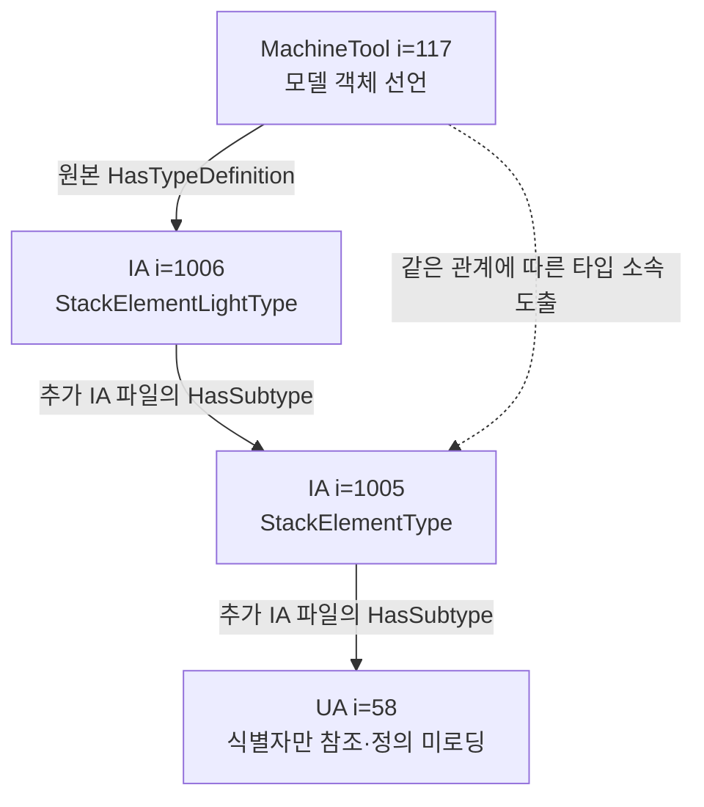

# 외부 정의를 불러왔을 때 달라지는 추론의 범위

추론기를 붙였는데 답이 그대로라면, 그 질문이 추가된 관계를 사용하는지 먼저 확인해야 한다. 공개 MachineTool 모델의 외부 IA 정의를 실제로 불러와 이 차이를 점검했다. 이번 결과는 **자료를 더 확보한 효과**이며 Python과 OWL-RL 중 어느 알고리즘이 더 우수하다는 결과가 아니다.

## 같은 질문에서의 무변화

앞선 [제조 모델 비교](2026-11-07-manufacturing-model-versions.md)는 두 MachineTool 파일 안에 정의된 타입 62개씩을 대상으로 조상 타입과 모델 객체의 소속을 물었다. IA를 참조하는 식별자는 보존했지만 IA 파일 자체의 정의는 넣지 않았다.

이번에는 각 MachineTool 파일에 기록된 IA의 버전·발행일과 같은 메타데이터를 가진 원본 XML을 추가했다. 1.01.1에는 IA 1.01.0의 2021-07-31 파일, 1.02.0에는 IA 1.01.2의 2024-02-28 파일을 사용했다. 이는 비교에 사용할 파일을 고정한 선택이며, 표준의 최소 버전 요구를 ‘반드시 그 파일이어야 한다’는 호환성 규칙으로 바꾼 것이 아니다. 원본 MIT 1.00 주석과 해시는 보존했다.

각각 분리 상태와 IA 추가 상태를 Python·OWL-RL에 같은 방식으로 제공했다. 기존 248개 질문의 네 조건, 992개 슬롯이 모두 완료됐다. 알고리즘 간 496쌍은 일치했고, IA 추가로 답이 바뀐 질문은 0개였다. 기존 MachineTool 객체 150개씩만 답의 대상에 남겨 IA 파일에 정의된 객체가 섞이지 않게 했다.

파일에 정의된 타입은 62개에서 80개로 늘었지만 질문은 여전히 기존 MachineTool 타입을 대상으로 했다. 따라서 이 무변화로 외부 정의가 불필요하다고 결론 내릴 수 없다.

## 객체의 전체 타입을 묻는 후속 질문

무변화를 확인한 뒤 질문 유형을 별도로 확장했다. “이 모델 객체는 읽어 온 관계에 따라 어떤 타입에 속하는가”를 두 버전의 기존 객체 150개씩 모두에 물었다. 결과가 달라지는 객체만 골라 실행하지 않았다. 다만 앞선 결과를 본 뒤 설계한 개발 진단이므로 새로운 평가용 표본은 아니다.

300개 질문 × 자료 범위 2개 × Python·OWL-RL의 1,200개 슬롯이 모두 완료됐다. 알고리즘 간 600쌍은 일치했다. IA 추가로 타입 집합이 달라진 질문은 **4/300**이며 타입 소속의 추가 출현은 6개, 제거는 0개였다. 동일한 객체 두 종류를 두 버전에서 조회한 결과이므로 독립적인 네 현장 사례로 세지 않는다.

| 모델 안의 선언 | IA 없이 읽힌 타입 | IA 추가로 따라갈 수 있는 상위 타입 |
|---|---|---|
| MachineTool `i=117`, `<OrderedObject>` | IA `i=1006`, StackElementLightType | IA `i=1005`, StackElementType와 UA `i=58` |
| MachineTool `i=121`, Stacklight | IA `i=1002`, BasicStacklightType | UA `i=23518` |

두 버전에서 같은 종류의 변화가 관찰됐다. 이 객체들은 정보모델의 선언이며 실제 가동 중인 설비 개체가 아니다. UA `i=58`과 `i=23518`은 참조된 식별자로 반환했으며, 이번에는 해당 UA 기본 모델의 정의까지 읽지 않았다.



IA 파일 없이 상위 타입이 나오지 않았던 것은 추론 알고리즘이 그 관계를 놓쳤다는 뜻이 아니다. 당시 입력에는 그 관계가 없었다. IA를 추가한 뒤에는 Python 전이 탐색과 OWL-RL이 같은 관계를 따라 같은 집합을 반환했다. 이번 후속 실행은 오프라인이며, 확장한 자료를 Neo4j·Neptune에 다시 적재한 실행으로 소개하지 않는다. 앞선 실제 DB 992개 슬롯과도 별도다.

## 숫자만으로 보이지 않는 미해결 경계

정의가 없는 경계 식별자의 수는 이전 버전에서 20→20, 새 버전에서 25→25로 같았다. 하지만 내용은 바뀌었다. IA `i=1002`와 `i=1006`의 정의를 읽었고, 그 결과 UA `i=17602`와 DI `i=1005`라는 다른 외부 정의의 필요가 드러났다.

따라서 ‘미정의 항목 20개’라는 숫자만으로 원래와 같은 상태라고 판정하면 안 된다. 어떤 식별자가 해소됐고 어떤 참조가 새로 드러났는지 함께 보존해야 한다. 이 목록은 선택한 부분 그래프의 경계이며 전체 OPC UA 의존성을 모두 읽었다는 증거가 아니다.

## 확인한 것과 남은 것

별도 사후 검사기는 실행기의 변환·추론 코드를 가져오지 않고 원본 XML을 다시 읽어 너비 우선 탐색으로 타입 집합을 계산했다. 1,200개 저장 결과가 일치했다. 잘못된 타입 삽입, 결과 행 누락, 원본 해시 오류 통제도 확인했다. 해시가 잘못된 소스의 600개 결과는 채점 불가로 남겼다. 검사기의 객체 목록 일치 표시는 읽기에 성공한 소스에 한정되므로, 그 표시만으로 실패한 소스까지 확인됐다고 해석하지 않는다.

IA 하나를 읽지 못하는 실행 통제에서는 계획한 1,200개 중 300개 실패와 900개 완료를 보존했다. 실패를 빈 타입 집합의 성공으로 바꾸지 않았다. 원본 XML 재검사는 선택한 타입 관계의 일치 확인이며 전체 OPC UA 의미, 설치 호환성, 물리적 사실의 판정은 아니다.

이 사례의 실질적인 구분은 세 가지다. **질문이 필요로 하는 관계, 실제로 읽어 온 정의, 그 관계를 따라 계산하는 방법**을 따로 기록해야 한다. 같은 질문·같은 자료 범위에서 알고리즘을 비교하고, 자료를 추가한 실행은 별도 조건으로 남겨야 추론기의 효과와 입력 자료의 효과가 섞이지 않는다.

저장 자료는 `research/manufacturing-model-change-1/import-boundary-001/`와 `object-type-context-001/`에 있다. LLM 호출, 현장 검토 시간, 새 DB 실행이나 성능 비교는 이 후속 진단에 포함하지 않았다.

Reviewresultsinterpretationandreadonlydemobuilder. RawXML/full1200responses omittedunverified. 1200completed600pairsallmatch,4changed6typeadditions; coordinatorrawXMLBFSauditall1200match. Baseline992done0/248changes, sequelposthocall300objects. KeepseparateactualDB992 earlier. Humanizeitmayadjustproseonly. ExistingbaseHTMLomittedunverified. NoAPI/DB. Review<=250words.

## build.py
```
import json,sys,hashlib
from pathlib import Path
from collections import defaultdict,deque
ROOT=Path('research/manufacturing-model-change-1');P=ROOT/'object-type-context-001'
sys.path.insert(0,str((P/'xml-audit').resolve()));import audit
sys.path.insert(0,str((ROOT/'projection-001').resolve()));import projection

def build(out):
 cfg=json.loads((P/'config.json').read_text());x=json.loads((P/'observed.json').read_text());d={(r['source_index'],r['object'],r['mode'],r['arm']):r for r in x['rows']}
 expected={(q['source_index'],q['object'],m,a) for q in cfg['questions'] for m in ('isolated','with_declared_ia_file') for a in ('python_transitive','owlrl_transitive')}
 if len(d)!=1200 or len(x['rows'])!=1200 or set(d)!=expected or any(r['status']!='completed' for r in d.values()):raise ValueError('observed_scope')
 cases=[];paired=0
 for i,s in enumerate(cfg['sources']):
  main=audit.read(s['main']);ia=audit.read(s['ia']);parents=defaultdict(set);direct=defaultdict(set);names={};classes=main[0]|ia[0]
  for src in (s['main'],s['ia']):names.update({k:v['browse'][1] for k,v in projection.parse(src['path'])['nodes'].items()})
  for a,b in main[2]|ia[2]:parents[a].add(b)
  for o,t in main[3]:direct[o].add(t)
  for q in [q for q in cfg['questions'] if q['source_index']==i]:
   obj=q['object'];a=d[i,obj,'isolated','python_transitive']['types'];b=d[i,obj,'with_declared_ia_file','python_transitive']['types']
   for mode in ('isolated','with_declared_ia_file'):
    if d[i,obj,mode,'python_transitive']['types']!=d[i,obj,mode,'owlrl_transitive']['types']:raise ValueError('algorithm_mismatch')
    paired+=1
   if a==b:continue
   paths=[]
   for target in sorted(set(b)-set(a)):
    queue=deque([[t] for t in sorted(direct[obj])]);seen=set();found=None
    while queue:
     path=queue.popleft();node=path[-1]
     if node==target:found=[obj]+path;break
     if node in seen:continue
     seen.add(node);queue.extend(path+[parent] for parent in sorted(parents[node]))
    if found is None:raise ValueError('no_support_path')
    paths.append({'target':target,'nodes':[{'key':k,'label':names.get(k,json.loads(k)[1]),'definition_loaded':k in classes or k in main[1]} for k in found]})
   cases.append({'source_index':i,'object':obj,'name':names[obj],'before':a,'after':b,'paths':paths,'source_hashes':{key:src['sha256'] for key,src in s.items()}})
 if len(cases)!=4 or paired!=600:raise ValueError('observed_counts')
 data={'cases':cases,'planned':1200,'objects':300,'changed':4,'paired_equal':paired,'offline_only':True,'local_class_query_predecessor':{'queries':248,'changed':0},'raw_observed_sha256':hashlib.sha256((P/'observed.json').read_bytes()).hexdigest()}
 fragment=Path(__file__).with_name('fragment.html').read_text().replace('__IMPORT_DATA__',json.dumps(data,ensure_ascii=False).replace('<','\\u003c').replace('>','\\u003e').replace('&','\\u0026'))
 source=Path(__file__).with_name('base-before-import.html').read_text()
 if source.count('</body>')!=1 or 'id="import-context-demo"' in source:raise ValueError('base')
 Path(out).write_text(source.replace('</body>',fragment+'\n</body>'));return data
if __name__=='__main__':print({'cases':len(build(sys.argv[1])['cases'])})

```

## fragment.html
```
<section id="import-context-demo" style="max-width:1200px;margin:30px auto;padding:20px;border:1px solid #8c9baa;border-radius:12px">
<h2>외부 정의를 읽었을 때 달라지는 질문</h2>
<p>이 부분은 저장된 오프라인 후속 결과다. 앞선 실제 DB 비교에 새 정의를 다시 적재한 결과가 아니다. 기존 MachineTool 타입을 묻는 248개 질문은 IA 추가 후에도 그대로였다. 기존 객체의 전체 타입을 묻는 300개 후속 질문에서는 4개가 달라졌다. 질문 유형을 바꾼 개발 진단이며 새로운 평가용 표본은 아니다.</p>
<p>1,200개 슬롯 완료 · Python/OWL-RL 600쌍 일치 · 실제 설비가 아닌 모델 객체 선언</p>
<label for="ic-case">달라진 4개 질문 </label><select id="ic-case" style="max-width:100%;font:inherit"></select>
<div style="display:grid;grid-template-columns:repeat(auto-fit,minmax(240px,1fr));gap:16px"><div><h3>MachineTool 파일만</h3><pre id="ic-before" style="white-space:pre-wrap;overflow-wrap:anywhere"></pre></div><div><h3>지정한 IA 파일 추가</h3><pre id="ic-after" style="white-space:pre-wrap;overflow-wrap:anywhere"></pre></div></div>
<h3>추가 타입의 원문 관계 경로</h3><p>각 추가 타입에 대한 경로 하나를 보여준다. 첫 연결은 HasTypeDefinition, 이후 연결은 상위 타입 방향의 HasSubtype이다. 참조된 식별자가 나와도 그 대상의 전체 정의를 읽었다는 뜻은 아니다.</p>
<div id="ic-paths"></div>
<p>각 버전에서 미정의 경계의 수는 20→20, 25→25로 같았지만 IA 정의 두 개가 해소되고 다른 외부 정의 두 개가 드러났다. 개수만으로 자료의 범위가 그대로라고 판단하지 않는다.</p>
<details><summary>원본 해시와 이 질문의 저장 결과</summary><pre id="ic-raw" style="white-space:pre-wrap;overflow-wrap:anywhere"></pre></details>
<p><a href="../../journal/2026-11-07-imported-definition-context/">자료 범위와 추론 결과 해석</a> · <a href="measurement-review.html">실제 LLM 답변 검토</a></p>
</section>
<script type="application/json" id="ic-data">__IMPORT_DATA__</script>
<script>(()=>{'use strict';const d=JSON.parse(document.getElementById('ic-data').textContent),sel=document.getElementById('ic-case');d.cases.forEach((c,i)=>{const o=document.createElement('option');o.value=i;o.textContent=(c.source_index===0?'1.01.1':'1.02.0')+' · '+c.name+' · '+JSON.parse(c.object)[1];sel.append(o)});function show(){const c=d.cases[Number(sel.value)];document.getElementById('ic-before').textContent=c.before.join('\n');document.getElementById('ic-after').textContent=c.after.join('\n');document.getElementById('ic-raw').textContent=JSON.stringify(c,null,2);const parent=document.getElementById('ic-paths');parent.replaceChildren();for(const p of c.paths){const box=document.createElement('div');box.style.cssText='border:1px solid #8c9baa;padding:12px;margin:12px 0;overflow-wrap:anywhere';for(const [i,n] of p.nodes.entries()){if(i){const arrow=document.createElement('p');arrow.textContent='↓ '+(i===1?'HasTypeDefinition':'상위 타입');box.append(arrow)}const text=document.createElement('p');text.style.fontWeight='600';text.textContent=n.label+' · '+JSON.parse(n.key).join(' ') +(n.definition_loaded?'':' · 정의 미로딩');box.append(text)}parent.append(box)}}sel.addEventListener('change',show);show()})();</script>

```
