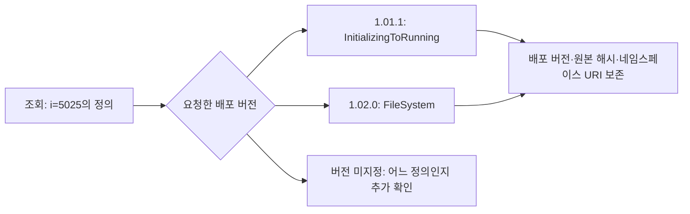

# Review manufacturing model results and stated limits
Review claims/denominators and reproducibility design from this packet only. Full XML, parser, runtime/UI omitted; mark those independently unverified. No source edits, paid calls, AWS operations or other review reading.
Observed coordinator checks: 2/2 XML parsed; five parser controls and two-source failure denominator check passed. Read-scope four controls passed. 1192 dependent posthoc queries, 166 changed results. Browser36backend/question choices,3identitycontrols,49definitions,5scopeexamples,zeroerrors and overflow390light/1280dark. These are not QA efficacy. Projection and read-scope independently reviewed in prior separate jobs. All failures retained. No new paid calls; existingDBstoppedconfirmed16:04:46UTC.
Demo source now versioned under research/manufacturing-answer-trace-1/demo-001; it reads saved artifacts only, renders textContent, no DB/API call. Current runtime data stored ignoredworkspace and generatedHTML in docs. Full template not supplied: no independent UI/security claim. Builder below included for path/runtime inspection.
Additional IA metadata followup archived separately, not included in preceding model comparison: two raw files Version1.01.2 dated2022-06-15 vs2024-02-28 have different hashes; latter ModelVersion1.1.2. Official Part6AnnexF states Version human-readable not programmaticcomparison, ModelVersion/PublicationDate used for ordering; RequiredModels minimumrequirements may permit later models. Exactfilepinning is reproducibility policy, not standards compatibility. No dependency solver implemented.

# 제조 정보모델의 버전과 식별자 해석

제조 사례의 변경 이력을 보완하기 위해 OPC Foundation이 공개한 MachineTool 정보모델 두 버전을 비교했다. 작업표나 실제 설비 이력이 아니라, 실제 배포된 스키마 파일의 변경이다. 기존 용접 자료의 값·출처 점검을 대체하지 않고 제조 분야에서 버전과 식별 범위를 다뤄야 하는 사례를 추가한다.

## 공개 스키마와 비교 범위

자료는 [OPC Foundation UA-Nodeset 저장소](https://github.com/OPCFoundation/UA-Nodeset)의 MachineTool 1.01.1과 1.02.0이다. 각각 2022-07-04와 2024-11-01 배포 태그를 고정했고 원본 XML과 MIT 1.00 라이선스 주석을 보존했다. 공식 [MachineTool 사양 안내](https://reference.opcfoundation.org/specs/OPC-40501-1)도 1.02.0의 발행일을 2024-11-01로 표시한다.

비교기는 숫자형 NodeId, 노드 종류, 네임스페이스를 포함한 BrowseName, 명시된 부모·DataType·참조만 읽는다. 값, 설명, 그 밖의 속성과 가져오지 않은 외부 모델의 정의는 비교 대상에서 제외했다. 따라서 아래 결과는 선택한 정의 필드의 차이이며 전체 의미 변경이나 장비 호환성 판정이 아니다.

| 항목 | 1.01.1 | 1.02.0 |
|---|---:|---:|
| 파일에 정의된 노드 | 552 | 589 |
| 참조의 출현 횟수 | 2,206 | 2,375 |
| 선언된 필수 외부 모델 | 4 | 6 |

네임스페이스 URI와 숫자 식별자로 구성한 조회 키 545개가 두 파일에 공통으로 있었다. 새 파일에만 있는 키는 44개, 이전 파일에만 있는 키는 7개였다. 공통 키 중 49개에서 선택한 필드가 달랐다. 이 49개 모두 참조가 달랐고 그중 BrowseName 15개·부모 14개·DataType 10개가 달랐다. 항목은 서로 겹치므로 합산하지 않는다. 원문을 살펴본 뒤 만든 탐색적 점검이며 새로운 평가용 표본이 아니다.

## 같은 식별자에 기록된 다른 정의

두 파일의 `ns=1;i=5025`는 같은 MachineTool 네임스페이스 URI를 가리킨다. 그러나 기록된 정의는 다르다.

| 항목 | 1.01.1 | 1.02.0 |
|---|---|---|
| NodeId | `ns=1;i=5025` | `ns=1;i=5025` |
| BrowseName 원문 | `1:InitializingToRunning` | `FileSystem` |
| ParentNodeId 원문 | `ns=1;i=101` | `ns=1;i=13` |

이 차이를 표준의 결함이라고 판정하지 않았다. “이 식별자가 어느 버전에서 무엇으로 기록돼 있는가”라는 조회에는 버전 문맥이 필요하다는 사례다. 동일한 조회 키가 보인다고 정의가 그대로 유지됐다고 가정할 수 없다. 반대로 이름이 바뀌었다는 관찰만으로 실제 설비가 바뀌었다고 말할 수도 없다.



## 다른 번호가 가리키는 같은 대상

반대 방향의 사례도 있다. `SignalColor`, `SignalModeLight`, `StacklightOperationMode` 별칭은 이전 파일에서 네임스페이스 번호 4를, 새 파일에서 번호 6을 사용한다. 두 번호는 각 파일에서 같은 `http://opcfoundation.org/UA/IA/` URI를 가리킨다. 숫자 식별자도 각각 3004·3005·3002로 유지된다.

따라서 원문 `ns=4;i=3004`와 `ns=6;i=3004`가 다르다는 이유만으로 대상이 달라졌다고 판단하면 안 된다. 먼저 각 파일의 NamespaceUris를 해석해야 한다. 새 파일의 번호 4는 Machinery/Jobs를 가리키므로 번호 자체를 파일 간 공통 식별자로 사용할 수도 없다.

이는 외부 IA 모델의 내용이 그대로라는 뜻은 아니다. 필수 모델의 버전도 별도로 기록돼 있으며 이번에는 그 모델 파일들을 가져오지 않았다. “참조 대상의 URI와 식별자가 같음”과 “참조 대상의 전체 정의가 같음”을 구분한다.

## 백엔드가 함께 지켜야 할 조건

이 자료에서는 최소한 다음 문맥이 조회 결과에 남아야 한다.

- 어떤 배포 버전과 원본 파일 해시에서 가져온 정의인지.
- NodeId의 네임스페이스 번호를 어떤 URI로 해석했는지.
- 참조의 종류와 정방향·역방향을 어떻게 보존했는지.
- 외부 모델을 실제로 읽었는지, 버전 요구만 기록했는지.

JSON·SQL·Neo4j·Neptune 모두 이 조건을 명시적으로 구현할 수 있다. 예를 들어 버전을 포함한 키나 조회 조건, RDF의 그래프 문맥을 사용할 수 있다. RDF를 선택했다고 배포 버전이 자동으로 구분되거나, Neo4j를 선택했다고 의미를 공유할 수 없는 것은 아니다. 이번 정보모델 비교는 오프라인 파서로 실행했으며 이 새 자료를 네 DB에서 실행한 결과로 제시하지 않는다. 실제 네 구현의 일치 확인은 앞선 용접 부분집합에 한정된다.

SHACL은 선언된 조건을 검사하는 데 사용할 수 있다. 예를 들어 전달된 레코드의 출처 버전이 요청된 버전과 맞는지 검사할 수 있다. 그러나 이번 새 자료에 대한 SHACL 검사나 LLM 답변 개선 효과는 아직 실행하지 않았다. 검사 입력에 버전과 출처를 남기는 준비 단계부터 필요하다.

## 파일·노드·개별 질문의 재검토 범위

같은 두 스냅샷으로 재검토 범위도 점검했다. 두 파일에서 확인한 조회 키의 합집합은 596개다. 각 키마다 BrowseName과 직접 참조 목록을 묻는 두 질문을 만들었다. 총 1,192개 조회는 같은 자료에서 파생된 개발 항목이며 독립적인 현장 질문 표본이 아니다. 파일을 모두 읽은 뒤 만든 질문 목록이므로 미래의 사용자 질의를 예측한 결과로도 볼 수 없다.

정책은 다음처럼 명시했다.

1. **파일 전체**: 원본 파일 해시가 바뀌면 모든 질문을 재검토한다.
2. **해당 노드**: 질문이 가리키는 키의 종류·이름·부모·DataType·참조 중 하나가 바뀌거나 키가 추가·제거되면 재검토한다.
3. **개별 질문의 필드**: BrowseName 질문은 해당 키의 BrowseName을, 참조 질문은 해당 키의 직접 참조 목록을 비교한다. 키의 추가·제거도 해당 질문의 결과 변경으로 취급한다.

예를 들어 노드의 참조만 바뀌면 2번은 그 노드의 이름 질문도 표시한다. 3번은 이름 값이 그대로인 질문은 표시하지 않고 참조 질문만 표시한다. 여기서 질문을 좁힌다는 말은 질문 문자열을 더 짧게 만든다는 뜻이 아니라 **각 질문이 읽는 키와 필드를 명시한다는 뜻**이다.

| 재검토 정책 | 전체 조회 | 결과가 바뀐 조회 | 재검토 표시 | 변경을 놓친 조회 | 결과가 그대로인데 표시된 조회 |
|---|---:|---:|---:|---:|---:|
| 파일 전체 | 1,192 | 166 | 1,192 | 0 | 1,026 |
| 해당 노드의 선택 필드 | 1,192 | 166 | 200 | 0 | 34 |
| 개별 질문의 필드 | 1,192 | 166 | 166 | 0 | 0 |

마지막 정책이 정확히 일치한 것은 이 직접 조회의 필드 의존성을 사람이 정확히 지정했고 양쪽 스냅샷을 모두 제공했기 때문이다. 자동 자연어 해석이나 일반적인 변경 탐지 능력을 입증한 것이 아니다. 숨겨진 원문 누락, 잘못 지정한 의존 필드, 외부 모델 변경에는 이 결과를 그대로 적용할 수 없다. 표시된 질문을 자동 차단하거나 답변을 수정하지도 않았다. 재검토 대상 수가 줄었다고 사람의 검토 시간이 같은 비율로 줄었다고 말할 수는 없다.

이번 계산은 모든 정책에 두 스냅샷 전체를 제공했다. 실제 DB 조회 호출 수나 네트워크 사용량의 감소는 측정하지 않았다.


## 질문과 판단 한계

| 질문 | 현재 자료로 점검할 내용 | 남는 한계 |
|---|---|---|
| 각 배포 버전에서 i=5025는 무엇으로 기록됐는가 | 해당 버전의 이름·부모·참조 | 실제 설비 정체성과 무관 |
| 같은 식별자라면 정의도 같은가 | 두 원문 정의의 차이 | 표준의 결함이나 호환성 판단은 별도 |
| ns 번호가 달라지면 참조 대상도 달라지는가 | 각 파일의 URI 매핑과 숫자 식별자 | 외부 모델의 전체 정의는 미확인 |
| 새 버전은 어떤 외부 모델을 요구하는가 | RequiredModel의 URI·버전·발행일 | 설치된 현장 시스템 상태는 없음 |
| 이 변경을 적용해도 현장 장비가 정상 동작하는가 | 이 자료만으로 판단 불가 | 장비 구성·구현·시험 결과가 필요 |

이 사례는 “노드가 몇 개 이상이면 온톨로지가 유리한가”에 수치로 답하지 않는다. 하나의 조회 키라도 서로 다른 버전의 정의를 함께 다루면 문맥 관리가 필요할 수 있음을 보여준다. 그 관리를 JSON으로 할지 공유 스키마·그래프로 할지 결정하려면 시스템 수와 변경 빈도뿐 아니라 실제 유지보수 작업과 오류 비용을 별도로 측정해야 한다.

<!-- HUMANIZE-SUMMARY -->
경로: light / 장르: report / 강도: conservative
적용: C-11 연결어미 뒤 쉼표 정리, A-18 긴 관형구 문장 분리.
보존: 제목, 사실, 수치, 날짜, 고유명사, 링크, 코드, 주장과 유보 강도.
자체검증: 6/6 잠정 통과. 변경률과 등급은 공통 게이트에서 확정.
원문이 이미 간결하여 최소한으로 수정함.

## Demo builder
```python
import json,datetime as dt,sys
from pathlib import Path
from scripts.manufacturing_evidence_cards import package
from scripts.manufacturing_obligation_coverage import coverage
root=Path('research/manufacturing-answer-trace-1')
run=Path(sys.argv[1]) if len(sys.argv)>1 else root/'projection-offline-001'
def rows(p):return [json.loads(s) for s in p.read_text().splitlines()]
old=[r for r in rows(Path('research/backend-reasoning-review-1/live-001/results.jsonl')) if r['case_id']!='BGP_REUSE']
current=rows(run/'results.jsonl');contracts=json.loads((root/'coverage-design-001/contracts.json').read_text())
assert len(old)==36 and len(current) in (18,36)
assert len({(r['backend'],r['case_id']) for r in current})==len(current)
q=json.loads(Path('research/backend-reasoning-review-1/design-001/question-map.json').read_text())['types']
cards=[package(r) for r in current];cov=[coverage(r,contracts['questions'][r['case_id']]) for r in current]
d={'questions':q,'old':old,'current':current,'cards':cards,'contracts':contracts,'oldCoverage':[coverage(r,contracts['questions'][r['case_id']]) for r in old],
'currentCoverage':cov,'adapters':rows(root/'replay-001/results.jsonl'),'queries':json.loads((root/'projection-v2/runtime-queries.json').read_text()),
'currentScope':'후속 실제 DB 포함 실행' if len(current)==36 else '후속 오프라인 실행','builtAt':dt.datetime.now(dt.timezone.utc).isoformat()}
d['identityResults']=json.loads(Path('research/manufacturing-identity-1/run-001/results.json').read_text())
d['identityFields']=json.loads(Path('research/manufacturing-identity-1/run-001/identity-fields.json').read_text())
modelroot=Path('research/manufacturing-model-change-1/projection-001')
d['modelComparison']=json.loads((modelroot/'comparison.json').read_text())
d['modelSnapshots']=[{k:v for k,v in json.loads((modelroot/f'snapshot-{i}.json').read_text()).items() if k!='nodes'} for i in (0,1)]
impactroot=Path('research/manufacturing-model-change-1/read-scope-001')
d['impactSummary']=json.loads((impactroot/'summary.json').read_text())
impactrows=json.loads((impactroot/'rows.json').read_text())
categories=[('다른 노드만 바뀐 경우',lambda r:not r['answer_changed'] and not r['flags']['node_projected_fields']),('같은 노드의 다른 필드가 바뀐 경우',lambda r:not r['answer_changed'] and r['flags']['node_projected_fields']),('질문이 읽는 값이 바뀐 경우',lambda r:r['answer_changed'] and r['before']['status']=='defined' and r['after']['status']=='defined'),('새 파일에 정의가 추가된 경우',lambda r:r['before']['status']!='defined' and r['after']['status']=='defined'),('새 파일에서 정의가 빠진 경우',lambda r:r['before']['status']=='defined' and r['after']['status']!='defined')]
d['scopeExamples']=[{'label':label,'row':next(r for r in impactrows if pred(r))} for label,pred in categories]
workspace=Path('_workspace/manufacturing-continuation-20261107');(workspace/'demo-data.json').write_text(json.dumps(d,ensure_ascii=False,indent=2)+'\n')
html=(Path(__file__).with_name('template.html')).read_text().replace('__DATA__',json.dumps(d,ensure_ascii=False,separators=(',',':')).replace('</','<\\/'))
Path('docs/experiments/seminar/manufacturing-trace.html').write_text(html)
print({'current_slots':len(current),'html_bytes':len(html.encode()),'path':'docs/experiments/seminar/manufacturing-trace.html'})

```
