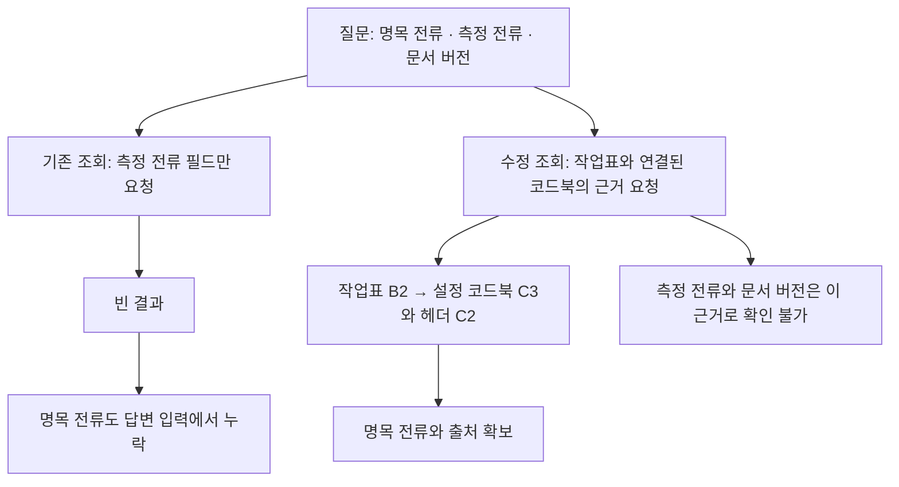

# Bounded manufacturing result review
Review claims and denominators only. Raw source, allbindings, full UI/runtime are omitted and remain independently unverified. Coordinator supplies execution summaries below. No paidcall/DBaction; no sourceedit. Report andrecord frozen forreview.

# Manufacturing evidence projection and identity review

Date: 2026-11-07. This is a bounded software/source diagnostic, not a new answer-quality benchmark.

## Inputs and execution

- Existing manufacturing source: seven nodes/four edges from the consumed development corpus, unchanged file provenance and CC BY 4.0 attribution.
- Historical replay: 36 slots; deterministic adapter emits 20 implemented-claim completions, 12 partial outputs and four unsupported outputs. Completion does not mean the entire question was answered.
- Corrected offline projection: 18 planned/emitted slots, 16 completed, two unsupported Q7.
- Corrected actual-backend run: 36 planned/emitted slots, 32 completed, four unsupported Q7. All eight supported questions have equal complete bindings across SQLite/Python, RDFLib, actual Neo4j/Cypher and actual Neptune/SPARQL.
- Posthoc source checks: 84 payload occurrences exactly match retained source objects; 28 legacy projections preserve values and cardinality. Q8 is intentionally excluded from legacy equality because its requested evidence changes.
- Both live namespaces cleaned: Neo4j remaining=0; Neptune remaining=false. Existing resources stopped, Neptune terminal state confirmed by AWS API error at 16:04:46 UTC, Neo4j stopped. The owned temporary stop timer was disabled only after this confirmation. No new AWS infrastructure.

## Artifacts

| Purpose | Repository path |
|---|---|
| Manually declared input obligations | `research/manufacturing-answer-trace-1/coverage-design-001/contracts.json` |
| Corrected runtime query contracts | `research/manufacturing-answer-trace-1/projection-v2/runtime-queries.json` |
| Offline evidence packages | `research/manufacturing-answer-trace-1/cards-001/` |
| Historical/offline input availability | `research/manufacturing-answer-trace-1/coverage-001/` |
| Actual corrected backend run and posthoc checks | `research/manufacturing-answer-trace-1/manufacturing-v2-20261107-001/` |
| Published-ticket identity diagnostic | `research/manufacturing-identity-1/run-001/` |

## Identity diagnostic

All three policies completed on the same 100 source records. Equipment-only: 20 groups, one multiple-location advisory finding. Location+Equipment: 21 groups, zero findings. Location+Equipment+Device: 32 groups, zero findings. Python/pySHACL finding tuples match in all three cases. These are not three independent datasets. The single name spans 35 records at two reported locations; physical identity and movement history remain unknown. Source inspection preceded policy construction.

## Checks and limits

Evidence-card tests: eight pass. Input-path tests: three pass. Identity prototype checks: four grouping/missing-value/duplicate-ID cases plus six acquisition/CSV failure-retention checks pass. Browser display checks cover all 36 question/backend selections and the three identity grouping controls; no script errors or horizontal overflow at 390px light and 1280px dark. These checks are software evidence only.

Independent native methods/implementation reviews are recorded in the ignored operations ledger. Earlier blocked versions remain preserved: evidence-card header/null handling, independent power-stop branches, and CSV failure retention. Review packets omitted some raw source and execution details; independent source verification is not claimed.

New paid model calls in this extension: zero. Existing paid budget and failures are preserved. No LLM accuracy, unnecessary withholding, human review-time reduction, SHACL-specific answer benefit, n10s inference performance, or backend throughput conclusion follows from these checks. Source absence and projection omission remain distinct.

# 제조 질문과 답변 근거 사이의 누락 점검

기존 제조 실험을 다시 살펴보니, 같은 값을 조회했다는 확인만으로는 질문에 필요한 근거를 모두 전달했다고 볼 수 없었다. 대표적인 예가 Q8이다. 질문은 명목 전류·실제 측정 전류·적용 문서 버전을 구분해 달라고 요구했지만 당시 쿼리는 실제 측정 전류 필드만 조회했다. 결과가 비어 있으니 원문에 있던 명목 전류도 답변 단계로 넘어가지 않았다.

이번 작업은 그 누락을 추적하고 조회 결과에 원문 셀과 출처를 붙이는 후속 점검이다. SHACL의 답변 개선 효과나 새로운 모델 정확도를 측정한 실험은 아니다. 기존 제조 자료를 중심에 두고 실제 버전 변경이 있는 SBOM 사례는 보조 근거로 연결한다.

## 자료와 이전 실험의 연속성

자료는 Tapia Suárez 등의 [Submerged Arc Welding Open Repository](https://doi.org/10.5281/zenodo.15083865)에서 추출한 작업표와 코드북이다. CC BY 4.0 출처 표시와 기존 파일 해시를 유지했다. 앞선 실험의 7개 노드·4개 관계를 그대로 사용했다. 이 부분집합은 243개 작업표 기록과 85개 사전 항목으로 구성된 기존 개발 자료에서 가져온 것으로, 새로운 평가용 자료가 아니다.

제조 자료에는 결함 코드와 설정 코드의 참조 관계가 있다. 그러나 이번 부분집합에 실제 검토 문서의 유효기간 이력은 없다. 따라서 Q7의 과거 가상 이력표를 실제 자료에 섞지 않았으며 해당 질문은 미지원으로 남겼다. 코드북의 명목 설정값을 실제 측정값이나 운전 권고로 바꾸지도 않았다.

앞선 네 백엔드의 저장된 결과 36개를 재사용했다. 여기에는 SQLite/Python, RDFLib, 실제 Neo4j/Cypher, 실제 Neptune/SPARQL이 포함된다. 수정한 조회는 먼저 SQLite/Python과 RDFLib의 18개 슬롯에서 실행했다. 이후 실제 Neo4j와 Neptune을 포함한 네 구현에서 36개 슬롯을 새로 실행했다. 32개는 완료됐고 Q7의 4개는 미지원으로 남았다. 지원하는 8개 질문의 전체 바인딩이 네 구현에서 같았다. 이 결과는 고정한 작은 부분집합과 같은 조회 의미에 한정된다.

## Q8의 누락 경로

Q8은 다음을 물었다.

> 제공된 작업표와 코드북으로 PP6 작업표 2행에 대해 확인할 수 있는 내용과 확인할 수 없는 내용을 나눠주세요. 명목 Idc, 실제 측정 전류, 적용 검토 문서 버전을 각각 판단하려면 어떤 근거가 필요한가요?

작업표의 B2는 설정 번호 1을 가리킨다. 연결된 설정 코드북의 C3에는 450이 있고, C2 헤더는 `Idc (A)`다. 이 관계를 통해 코드북상의 명목 전류를 제시할 수 있다. 실제 측정 전류와 적용 문서 버전은 이 근거만으로 확인할 수 없다.

빈 결과가 곧 원문 전체의 부재를 뜻하지는 않는다. 이번에는 보존된 원문과 조회 결과를 사후 대조해 누락 위치를 확인했다. 이 대조 결과를 실행 중 정답 보정에 사용하지 않았다.

## 질문별 입력 항목 점검

질문에서 필요한 입력 경로를 사람이 명시했다. 예를 들어 Q1은 값과 셀 위치, Q3은 두 설정 번호·두 명목 전류·차이 계산의 피연산자를 구분한다. 이 경로 점검은 값이 맞는지, 출처가 적용 가능한지, 자연어 답변이 적절한지를 판단하지 않는다.

| 질문 | 입력 항목 | 기존 조회에서 확보 | 수정 조회에서 확보 | 남은 한계 |
|---|---:|---:|---:|---|
| Q1 직접 값과 셀 | 2 | 1 | 2 | 최종 답변의 인용 정확도는 별도 |
| Q2 결함 코드와 근거 | 4 | 2 | 4 | 연결 의미의 적절성은 별도 |
| Q3 두 설정과 명목 전류 비교 | 5 | 3 | 5 | 피연산자 확보와 계산 정확도는 다름 |
| Q4 한정된 두 행의 조건 검색 | 2 | 2 | 2 | 경로 존재만으로 후보 누락을 검출하지 않음 |
| Q5 단위와 값의 역할 | 5 | 3 | 4 | 실제 측정값은 확인되지 않음 |
| Q6 출처 적용성 | 3 | 2 | 3 | 같은 이름을 가진 잘못된 출처도 경로 검사는 통과 가능 |
| Q7 적용 문서 버전 | 2 | 미지원 | 미지원 | 실제 이력 자료가 필요 |
| Q8 확인 가능·불가능 구분 | 4 | 0 | 2 | 측정 전류와 적용 버전은 확인되지 않음 |
| Q9 초안 검토 위치 | 4 | 2 | 3 | 실제 측정값이라는 주장은 확인되지 않음 |

표는 공통 SQLite/Python 결과를 비교한 것이다. 전체 재점검은 과거 36개와 수정 후 오프라인 18개, 총 54개 슬롯을 보존했다. 이 중 48개를 점검했고 Q7의 6개는 미지원이다. 항목에는 중복되는 입력도 있으므로 합계나 비율을 답변 완성도 점수로 사용하지 않는다. 자동 자연어 해석의 성과로도 볼 수 없다.

## 근거 카드와 정보량

수정 조회에는 원문 셀·헤더·파일·시트·해시를 포함했다. 두 오프라인 백엔드에서 완료된 16개 슬롯을 합산하면 직렬화된 바인딩은 기존 1,648바이트에서 102,702바이트로 늘었다. 근거가 풍부해졌지만 모델 입력 비용도 따져야 한다.

선택된 원문만 읽는 근거 카드 변환기를 별도로 만들었다. 같은 질문 안에서 동일한 카드는 한 번 저장하고 바인딩이 이를 참조한다. 모든 원본 헤더 행과 선언한 셀 필드는 유지하며 수식은 계산하지 않는다. 압축 후 패키지는 83,696바이트였다. 앞의 값은 바인딩만, 뒤의 값은 패키지 외곽 정보까지 포함한 JSON 크기다. 네트워크 전송량이나 모델 토큰 수는 아니다.

첫 검토에서는 빈 헤더가 유효한 헤더를 덮어쓰는 문제와 누락된 셀 필드를 명시적 null로 바꾸는 문제가 발견됐다. 수정 후 빈 문자열과 공백 헤더는 건너뛰고 필수 셀 필드가 없으면 변환 실패로 남긴다. 잘못된 입력을 정상 근거처럼 전달하지 않기 위한 처리다. 원래 실패 검토와 수정본을 모두 보존했다.

## SHACL과 백엔드 비교의 위치

이번 결과는 SHACL을 더 촘촘하게 만들면 모든 문제가 해결된다는 설명을 뒷받침하지 않는다. 필요한 근거 자체를 쿼리가 전달하지 않으면, 뒤의 검증기는 그 근거를 복원할 수 없다. 반대로 필드가 존재한다는 검사만으로는 같은 값의 다른 출처를 잘못 연결한 오류를 잡지 못한다.

비교해야 할 단계는 다음과 같다.

1. 질문을 어떤 입력 요구와 적용 규칙으로 해석했는가.
2. 각 백엔드가 같은 규칙 아래 같은 근거를 반환하는가.
3. 전달된 근거로 어떤 주장까지 확인할 수 있는가.
4. 최종 답변이나 검토 보고서가 사람이 확인할 위치를 정확하게 짚는가.

SHACL과 같은 정책의 Python 검사는 3단계의 선언된 제약과 4단계의 검토 지원에 둘 수 있다. 조회·해석·검토를 한 번에 바꾸고 개선을 SHACL에만 돌리면 효과를 분리할 수 없다. 이번 입력 보강은 별도 개입으로 기록한다.

## SBOM 보조 사례의 역할

제조 자료의 코드북은 선택한 다섯 작업 파일에서 내용이 같았고 실제 문서 버전 이력은 확보하지 못했다. 그래서 실제 변경에 대한 주장은 [SBOM 보조 실험](2026-11-06-schema-management-review.md)과 구분한다. 그 실험에서는 실제 릴리스 간 808개 조회 중 22개의 답이 바뀌었고 완전한 변경 관계 목록과 읽기 범위가 주어졌을 때 23개를 재검토 대상으로 표시했다. 그중 하나는 답이 바뀌지 않은 조회였다.

이 결과는 제조 현장의 실제 변경 이력이나 사람의 유지보수 시간을 측정한 것이 아니다. 제조 데모에는 원문 근거와 적용성 문제를, SBOM 데모에는 실제 버전 변경과 영향 범위를 맡기는 구성이 현재 자료에 맞는다.

## 추가 제조 자료의 식별 모호성

[Fujitsu의 ManufacturingRCA 문서 모음](https://huggingface.co/datasets/Fujitsu/ManufacturingRCA_Knowledge_Dataset/tree/4244add75777abb16ddebe1b061c99ce5338c771)에서도 작은 진단을 수행했다. 공개 CSV는 100개 기록·13개 열이며 CC BY 4.0으로 제공된다. 실제 산업 사고 기록인지 합성 자료인지는 확인하지 못했다. 기존 용접 자료를 대체하는 제조 정확도 벤치마크로 취급하지 않는다.

설비 이름 `Welding Robot System #1`은 두 위치에 등장한다. 이름만으로 묶으면 35개 기록이 하나의 그룹이 되며, 위치는 Processing A Line과 Processing B Line이다. 같은 설비가 이동했을 수도 있고 별개 설비가 같은 이름을 쓸 수도 있다. 위치가 다르다는 사실만으로 잘못된 병합이라고 판정할 수 없다.

따라서 선언한 검토 규칙은 “한 그룹에 보고된 위치가 여러 개이면 사람이 식별 범위를 확인한다”다. 각 기록에는 위치가 하나 이상 있어야 한다는 조건도 함께 검사했다. Python과 pySHACL이 같은 기록과 같은 정책을 받도록 했다.

| 그룹을 정하는 필드 | 그룹 수 | 여러 위치 검토 표시 | Python·SHACL 일치 |
|---|---:|---:|---|
| 설비 이름 | 20 | 1 | 일치 |
| 위치 + 설비 이름 | 21 | 0 | 일치 |
| 위치 + 설비 이름 + 장치 | 32 | 0 | 일치 |

세 조건 모두 100개 기록을 사용했고 실행 실패는 없었다. 위치를 그룹 키에 넣으면 여러 위치가 한 그룹에 들어가지 않는 것은 구성상 당연하다. 표시가 0개가 된 것을 식별 정확도 향상이라고 해석하지 않는다. 이 예시는 검토 보고서가 사람에게 확인할 위치를 가리킬 수 있음을 보여줄 뿐, 검토 시간을 줄였거나 답변이 개선됐다는 측정은 아니다.

이 자료로 다음을 구분해 물을 수 있다.

- 이 설비 이름이 등장하는 기록과 보고 위치는 무엇인가.
- 같은 이름이라는 이유만으로 하나의 물리적 설비라고 단정할 수 있는가.
- 위치가 다른 기록을 합치기 전에 어떤 식별자와 이동 이력이 필요한가.

마지막 두 질문의 답에는 “현재 자료로 결정할 수 없음”이 남는다. 규칙을 더 추가한다고 숨겨진 물리적 정체성이 생기지는 않는다. 설비 식별 기준은 도메인 담당자가 확인해야 하며 자동 수정이나 운전 조치는 수행하지 않았다.

## 검증 범위와 다음 단계

현재 입력 누락을 재현했고 수정 조회의 오프라인 일치와 선언한 셀·헤더·출처 필드의 보존을 확인했다. 근거 카드 테스트 8개와 입력 경로 테스트 3개는 통과했다. 독립 검토는 코드와 명시된 설계를 검토했으며 생략된 원문·실행 내역까지 독립 검증했다고 주장하지 않는다.

이번 단계의 새 LLM 호출은 0회다. 최종 답변의 정확도, 불필요한 보류, SHACL 보고서의 추가 효과는 새로 측정하지 않았다. 동일 근거와 동일 총 입력 예산을 고정한 뒤 별도 비교해야 한다. 수정 조회의 실제 Neo4j·Neptune 실행과 실험용 데이터 정리는 완료했다. 총 84개 출처 payload가 보존된 원문 객체와 같았고, Q8의 의도된 변경을 제외한 기존 조회 항목 28개도 유지됐다. 이는 같은 근거를 전달했는지 확인한 결과이며 엔진 속도나 추론 기능의 우열 비교는 아니다.

[질문·원문 셀·조회 결과를 함께 보는 데모](../experiments/seminar/manufacturing-trace.html)에서 기존 조회와 수정 조회를 전환할 수 있다. 데모는 저장된 실행 결과를 표시하며 브라우저에서 DB나 LLM을 호출하지 않는다.

<!-- HUMANIZE-SUMMARY -->
- 경로: light / 장르: report / 강도: 보수
- 탐지·수정: A-18의 명사 앞 수식을 짧은 절로 풀고 C-11의 연결어미 뒤 쉼표 2곳을 제거했다.
- 핵심 변경: “두 오프라인 백엔드의 완료된 16개 슬롯을 합산하면,” → “두 오프라인 백엔드에서 완료된 16개 슬롯을 합산하면”.
- 사실·수치·날짜·고유명사·인용·링크·제목·기술 용어와 주장의 강도를 보존했다.
- 자체검증: 6/6 통과. 변경률 확정은 공통 게이트에서 수행한다.
- 자체 등급: B. 원문이 이미 명료해 최소한으로 다듬었다.
<!-- /HUMANIZE-SUMMARY -->

## Supplied evidence summary
Coordinator posthoc check:36planned36emitted32completed4unsupportedQ7;8fullbindinggroups equal4backends;84payloadoccurrencesmatchsource;28oldprojectionchecks preserve;Q8 intentionalchange excluded;bothnamespacescleaned. Rawresultsomittedunverified. Browser36selections3identitycontrolszeroerrors/overflow. Lateststopreceipt explicitstoppedconfirmed16:04:46UTC,Neo4jstopped. Humanizegate0change0.04%. MkDocsstrict/Chirpy pass before newlyaddedrecord/specappend;finalbuildpending. Identitysame100rows20/21/32groups,1/0/0flags,PythonSHACLagree. No new modelcalls.
