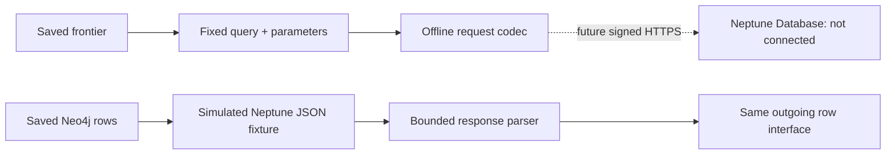

# Neptune Database wire preparation

Current problem: actual Neo4j outgoing rows feed shared Python traversal/packing, but Neptune Database HTTPS has a different request and response envelope. This cycle implements only a pure wire codec in scripts/graphrag_neptune_codec.py; it has no network transport, signing, credential lookup, loading or AWS provisioning. Neptune Analytics is outside scope.

Fixed parameterized outgoing query matches Neo4jSource.outgoing. Namespace and sorted unique frontier are form-encoded parameters, not query interpolation. Decode a bounded successful JSON results array into the same five scalar fields, reject HTTP/errors/malformed/duplicates/order/identity violations. Caps328 frontier entries,486 returned rows,4MiB are current-source codec limits, not engine capabilities. No LIMIT truncation and no source fallback. Source/traversal layer retains full source payload validation; codec cannot prove result completeness or namespace provenance.

Offline verification: tests/test_graphrag_neptune_codec.py negative/parameter tests, plus24 stored Neo4j queries rewrapped as fabricated Neptune-shaped JSON and parsed. Record explicitly simulated response fixture origin, input hashes,90 row occurrences if confirmed, and zero Neptune calls. This is protocol compatibility preparation only, not engine query execution, dialect certification, authentication, parity or performance evidence. Frozen current C and all source/gold remain untouched. Registered checks empty; bounded manual tests follow independent approval.

## Official sources checked 2026-11-02

- https://docs.aws.amazon.com/neptune/latest/userguide/access-graph-opencypher-queries.html : /openCypher endpoint, scalar results array, HTTPS requests.
- https://docs.aws.amazon.com/neptune/latest/userguide/opencypher-parameterized-queries.html : query and JSON parameters form fields.
- https://docs.aws.amazon.com/neptune/latest/userguide/iam-auth-connecting-python.html : IAM signing/service integration for later actual transport.

Future connection requires user-fixed account, region, duration and cost cap before resource creation; endpoint/VPC reachability, IAM read permissions, TLS verification, bounded signed transport with explicit failures, source loading and namespace cleanup also remain unimplemented/unverified. No automatic resource creation or pretense that a configured value proves readiness.

