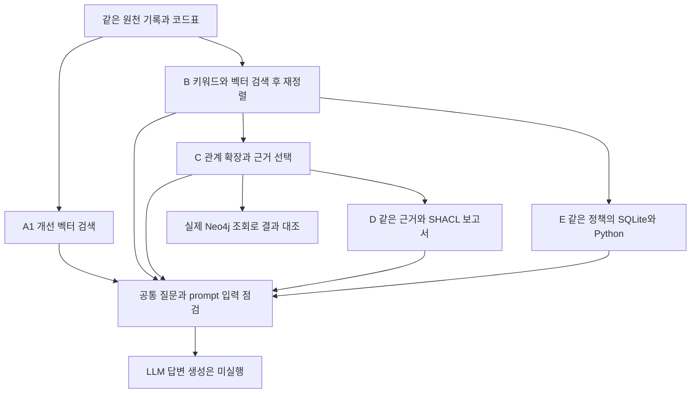

# 하이브리드 검색과 관계 조회 및 SHACL의 비교 결과

개선한 벡터 검색에 키워드 검색과 재정렬을 붙이고 같은 검색 결과에서 관계를 따라가는 방식을 비교했습니다. 필요한 근거를 모두 확보한 질문은 각각 5/18건, 6/18건, 7/18건이었습니다. 이는 개발 질문의 근거 확보 결과입니다. LLM 답변 생성과 정확도 평가는 아직 실행하지 않았습니다.

## 자료와 질문의 범위

PENELOPE 용접 검사 자료에서 추출한 기록 243개와 코드표 항목 85개를 사용했습니다. 노드 328개와 관계 486개이며, 실제 공장의 자재 투입부터 납품까지 이어지는 로트 이력은 아닙니다.

예를 들어 PP3 작업표 2행의 `welding_setting` 번호를 찾는 질문은 해당 행으로 답할 수 있습니다. 그 번호에 해당하는 명목 `Idc`를 묻는 질문에는 같은 파일의 코드표도 필요합니다. 명목 전류는 실제 측정값이나 공정 변경 처방과 구분합니다.

24개 질문 중 18개는 선택한 원천 묶음에 필요한 자료가 있어 근거 확보 평가에 사용했습니다. 나머지 6개는 원천 묶음의 자료 부족으로 따로 기록했습니다. 이 24개 질문은 이미 개발에 사용했으므로 새로운 독립 평가 자료로 세지 않습니다.

## 비교 흐름

A1과 B는 검색 방법을 비교합니다. C와 E는 같은 관계 선택 정책을 다른 구현으로 계산하며 Neo4j는 관계 조회 부분을 실제 DB에 연결해 대조한 별도 확인입니다. D는 C에 없던 원천 자료를 추가하지 않고 선택된 근거만 검사합니다.

## 근거 확보 결과

| 조건 | 설정 번호 | 명목 Idc | 결함 이름 | 합계 |
|---|---:|---:|---:|---:|
| A1 개선 벡터 검색 | 5/6 | 0/6 | 0/6 | 5/18 |
| B 하이브리드 검색 | 3/6 | 0/6 | 3/6 | 6/18 |
| C 관계 확장 | 3/6 | 0/6 | 4/6 | 7/18 |
| E 같은 정책의 SQLite와 Python | 3/6 | 0/6 | 4/6 | 7/18 |

B는 A1보다 새로 확보한 질문이 4개였지만 기존에 확보했던 질문 3개를 놓쳤습니다. C는 B에 비해 결함 이름 질문 1개를 추가로 확보했고 기존 성공 사례는 잃지 않았습니다. 명목 Idc 질문은 모든 조건에서 0/6건으로 남았습니다.

B는 원천 필드를 중심으로 표현한 814개 검색 단위에서 BM25와 dense 검색 후보를 합친 뒤 로컬 GTE 모델로 405개 질문·후보 쌍을 재정렬했습니다. C의 변화에는 관계 확장과 근거 선택 순서가 함께 포함됩니다. 이 결과만으로 그래프 DB가 SQL이나 Python보다 우수하다고 판단하지 않습니다.

## 실제 DB 조회와 선택 근거 검사

Neo4j 5.26.32 Community에 노드 328개와 관계 486개를 적재했습니다. 실제 조회를 연결한 24개 질문의 근거 묶음은 C와 모두 같았습니다. 관계 조회 이후의 원문 복원과 입력 크기 조정은 Python이 담당했습니다. 임시 컨테이너는 실행 후 삭제했으며 DB 성능 우위는 측정하지 않았습니다.

SHACL은 선택된 기록의 코드표 참조만 검사했습니다. 질문 해석, 모든 관계의 출처, 공정 검토 규정까지 검사한 것은 아닙니다. pySHACL과 같은 정책의 Python은 24개 묶음에서 일치했습니다. 참조 검사 62건은 일치 10건, 참조 대상이 선택되지 않아 근거 부족 52건, 충돌 0건이었습니다.

`conforms=true`인 묶음 9개에는 모두 검사 대상이 없었습니다. 이를 정상 판정으로 세지 않고 `unknown`으로 표시했습니다. 대상이 검색 결과에 없다는 사실을 원천 자료에도 없다는 뜻으로 해석하지 않습니다.

## 전체 입력 예산의 문제

근거만 4,096토큰에 맞추면 질문, prompt, 검사 보고서를 더할 공간이 부족합니다. 공통 질문과 지시문을 포함한 120개 입력을 E5 토크나이저로 세었습니다.

| 조건 | 4,096토큰 초과 |
|---|---:|
| A1 | 10/24 |
| B | 17/24 |
| C | 16/24 |
| D | 17/24 |
| E | 16/24 |

다섯 조건이 모두 한도에 들어간 질문은 6/24개였습니다. C와 D의 입력은 검사 보고서만 다르고 근거는 동일합니다. 이 수치는 JSON으로 저장한 메시지의 E5 기준 크기이며, 실제 답변 모델의 토큰 수나 서비스의 메시지 처리 비용을 검증한 결과는 아닙니다.

다음 답변 평가에서는 모델과 토크나이저, 전체 prompt, 출력 여유, 공통 입력 상한을 먼저 고정해야 합니다. 보고서 공간도 검색 전에 반영하고 C와 D의 근거는 같게 유지합니다. 한도에 맞는 6개만 골라 전체 실험의 결과로 보고하지 않습니다.

## Neptune 준비와 다음 평가

Neptune은 요청·응답 변환 코드까지 준비했습니다. 저장된 Neo4j 조회 24건을 Neptune 형태의 모의 응답으로 바꿔 관계 행 90개가 그대로 복원되는지 확인했습니다. 실제 Neptune 접속이나 쿼리 실행은 하지 않았습니다. AWS 자원 생성 전에는 계정, 리전, 사용 기간, 비용 상한을 정해야 합니다.

현재까지 검색 결과의 변화, 동일 정책의 구현 간 일치, 선택 근거의 제한된 검사를 확인했습니다. 관계가 필요한 질문에서 근거 확보가 개선된 사례는 있었지만 답변 오류나 불필요한 보류가 줄었는지는 아직 평가하지 않았습니다. 다음 평가에서는 전체 입력 예산을 고정한 뒤 이러한 결과를 함께 측정합니다.

## 실행 근거

수치와 원본 결과 파일의 해시는 [실행 근거 목록](../experiments/records/20261102-refined-hybrid-evidence.json)에 기록했습니다. 기존 결과는 그대로 보존했습니다. 이번 후속 작업에서 유료 API 호출과 답변 생성은 수행하지 않았습니다.
